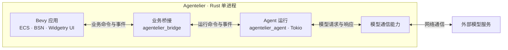
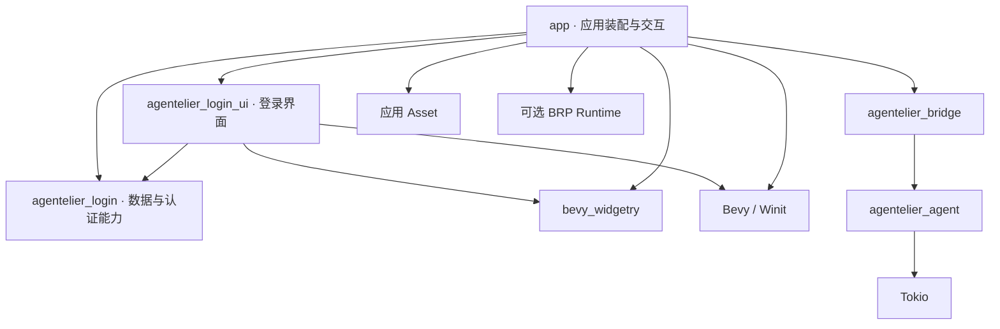
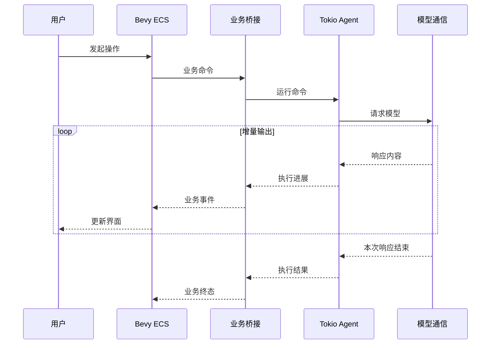
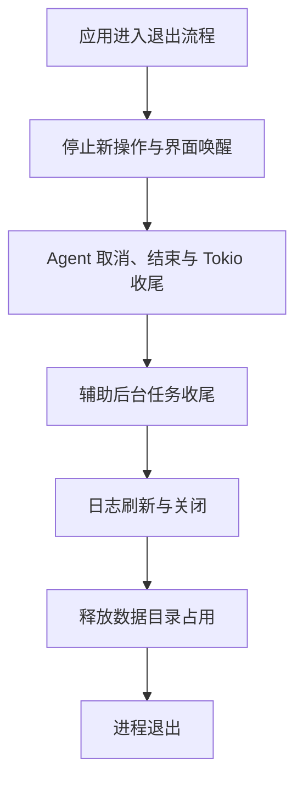

# Agentelier 总体架构

当前 Workspace 包含应用 `app/`、应用 Asset 库 `crates/assets/`、登录数据能力 `crates/login/`（`agentelier_login`）、登录界面 `crates/login_ui/`（`agentelier_login_ui`），以及空 Library Crate `crates/agent/`（`agentelier_agent`）和 `crates/bridge/`（`agentelier_bridge`）。`login` 已实现数据目录环境，`login_ui` 已实现目录启动界面；账号认证尚未实现。Agent 与 Bridge 仅有骨架，尚未接入应用或引入 Tokio。下文同时说明后续执行和桥接能力的设计边界。

Agentelier 是以 Bevy 构建交互界面的 Rust 桌面 Agent 应用。应用的交互与 Agent 的执行有不同的运行需求：前者由 Bevy ECS 与 Winit 驱动，后者需要持续处理异步模型响应、工具执行和任务生命周期。

两部分运行在**同一个进程**中，以**独立的业务桥接**交换命令和事件。Bevy 负责应用交互与呈现，Tokio 承载 Agent 执行；桥接隔离双方的内部模型，而不接管任何一方的业务状态。

图中的双向箭头表示**运行时信息交互**，不是 Rust Crate 的依赖方向。模型通信能力属于 Agent 运行侧，外部模型服务不属于 Agentelier 进程。

## 应用层与 Agent 运行层

### Bevy 应用：交互、状态与装配

Bevy 应用拥有窗口和 Winit 事件循环，使用 ECS 管理应用业务状态，使用 BSN 声明和组合 UI。`bevy_widgetry` 在 Bevy 原生运行模型中提供窗口、控件及其他 UI 能力，不建立第二套 UI 运行时。

应用层决定何时发起操作、如何响应用户输入，以及如何把 Agent 的业务事件反映到界面。它持有**面向交互与展示的状态**，例如当前操作、已收到的内容、等待用户处理的请求和界面反馈。Widgetry 控件自身的运行时状态继续由各控件按公开契约管理。

应用层还负责统一装配与管理应用基础设施，包括 Asset、日志、按需启用的 BRP 运行时，以及辅助后台任务。

当前入口先建立可执行文件旁的日志，加载 `config/config.ron`，再装配同一套 Bevy 运行时。`login_ui` 在启动窗口的内容宿主中复用 Widgetry 目录选择器，通过辅助后台任务调用 `login` 检查并占用目录，再调用 `app` 提供的保存操作提交新选择。完成后复用当前窗口进入主界面。数据环境保持到后台任务及日志收尾完成；当前仅确定 `auth.json` 路径，尚未实现账号恢复。具体关系见[数据目录与启动](mechanisms/application-data.md)。

`app` 保留通用配置、日志和应用装配；具体登录界面归 `login_ui`，数据环境与后续认证能力归 `login`。`login` 不依赖 Bevy，也不反向依赖应用；`login_ui` 依赖 `login`、Bevy 和 Widgetry。后续认证执行仍在 Agent/Tokio 侧协调，具体认证能力由 `login` 承载。

### Agent：执行与运行状态

`agentelier_agent` 负责 Agent 的实际执行：接收运行命令，协调模型通信与工具执行，维护相关任务和会话的运行状态，并产生执行进展和终态结果。

Agent 的异步工作由 **Tokio** 承载。Agent 自行管理执行任务的取消、结束和资源收尾，不把执行循环改造成 Bevy ECS System，也不直接访问或修改 ECS World。

Agent 运行状态与应用展示状态有不同的所有者：**执行是否真正完成，以 Agent 的结果为准；界面如何呈现，由 Bevy 应用决定。**

### 业务桥接：转换双方理解的信息

`agentelier_bridge` 是独立的 Rust Crate，连接应用与 Agent 的业务边界。它负责：

- 将应用发出的业务请求、控制操作转换为 Agent 可处理的运行命令。
- 将 Agent 的执行事件转换为应用可理解的业务事件，保留必要的结构化信息。
- 关联请求、执行进展和终态，使不同操作的结果能够正确归属。
- 负责跨运行边界的消息传递，并协调必要的通知、顺序与流量控制。

桥接提供与 Bevy 无关的 Rust 业务消息，不强制使用 Bevy 的 `Event`、`Message` 或 ECS 类型作为自身协议。应用侧再将这些消息接入 ECS。

桥接不负责 UI 渲染、不保存完整应用状态，也不管理 Agent 的执行循环。它表达执行事实，但不替 Agent 决定执行事实。

## 模块依赖与职责边界

运行时消息可以双向流动，源码依赖保持清楚的方向：

`app` 负责组合这些能力；下层 Crate 不反向依赖 `app`。桥接与 Agent 不依赖 Bevy，不需要知道 UI Entity、Component 或 World 的结构。Bevy 专属能力由应用层持有，在需要跨边界通知时，以与 Bevy 无关的能力接口交给桥接使用。

这里的 Crate 边界对应独立职责，不要求每种功能再拆出额外的 Crate。新增 Agent 能力应归入负责其执行语义的模块；新增界面能力则归入应用或适当的 UI 组件。

## 从用户操作到界面更新

Bevy 发起业务操作后，不在 ECS 更新过程中等待 Agent 执行完成。桥接转发命令，Agent 在 Tokio 中异步处理；执行期间产生的结果经过桥接返回，应用以非阻塞方式接收并更新 ECS 状态。

图中以模型响应说明信息流动；工具执行、需要用户处理的操作以及其他 Agent 行为也沿相同的桥接边界协作。具体事件种类随对应业务能力定义，不由整体架构预设完整清单。

### 状态与结果关联

Agent 持有执行状态；ECS 持有界面需要的状态投影。桥接传递必要的操作身份，使事件能归属到正确的请求、会话或操作，避免迟到结果覆盖无关界面。

例如，用户请求取消后，界面可以立即显示“正在取消”；只有 Agent 确认相关执行已经结束，界面才转为“已取消”或其他实际终态。取消命令本身不是取消完成的证明。

### 后台消息主动唤醒界面

桌面窗口空闲时，Winit 不一定持续驱动更新。Agent 产生业务事件后，除将数据放入通信通道外，还需要**通知应用侧唤醒事件循环**，以便 ECS 及时接收并处理。

唤醒能力由持有 Winit 的应用层提供。桥接只使用应用赋予的通知能力，不因此依赖 Winit 或 Bevy 的具体类型。唤醒信号用于触发应用处理，实际业务数据仍通过桥接通道传递。

## 辅助后台工作与应用基础设施

### Widgetry JobManager 的职责

`bevy_widgetry::job` 管理应用自身的辅助后台工作，例如文件 I/O 等独立于 Agent 执行生命周期的任务。其结果返回给发起任务的应用功能。

Agent 的模型请求、执行步骤、工具调用以及对应的取消与收尾，则继续由 Agent/Tokio 管理。**任务属于哪个执行体系，取决于其业务所有者，而不只是它是否异步。**

### Asset 管理

应用统一管理 Asset，由 `crates/assets/` 集中持有应用资源。

### BRP Runtime

BRP Runtime 由应用按需装配，用于操作和观察实际运行的 Bevy 应用，不进入 Agent 执行核心。

### 统一日志

跨模块操作使用必要的关联标识，方便在统一日志中追踪请求从界面到执行侧的过程。

## 生命周期由应用统一协调

应用拥有整体启动与退出流程；Agent 负责自身执行体的真实结束；辅助 Job 仍遵循自己的任务生命周期。

启动时，应用建立日志输出、读取配置，再装配现有 Bevy 运行时和目录启动界面。后台确认目录并取得占用，新选择保存成功后进入主界面。取消目录选择正常结束启动，等待辅助任务真实结束后完成日志收尾。Agent 的后续运行任务不占用 ECS 主线程。

退出时，应用在所需资源仍有效的阶段协调收尾：停止接纳新操作、停止向即将退出的界面发送唤醒，通知 Agent 停止并等待其任务和 Tokio Runtime 结束，随后完成独立辅助任务的收尾，最后刷新并关闭应用日志。

取消请求与任务实际结束是两个不同阶段。退出协调以执行体真实终止和必要资源释放为依据，并将收尾失败交由应用处理。应用应在 Bevy World 和相关资源失效前完成需要访问它们的收尾工作。

## 整体约束

- **单进程、纯 Rust。** Bevy 与 Agent 共享应用进程，不通过独立 Agent 服务进程连接。
- **执行环境分离。** Bevy ECS 管理交互与展示，Tokio 承载 Agent 执行；双方不直接操作对方的内部状态。
- **协议隔离。** 应用通过业务命令与事件和 Agent 协作，不直接消费 Agent 的内部执行事件作为 UI 协议。
- **职责归属稳定。** 桥接只协调通信，辅助 JobManager 不接管 Agent 生命周期，日志与应用基础设施由应用统一管理。
