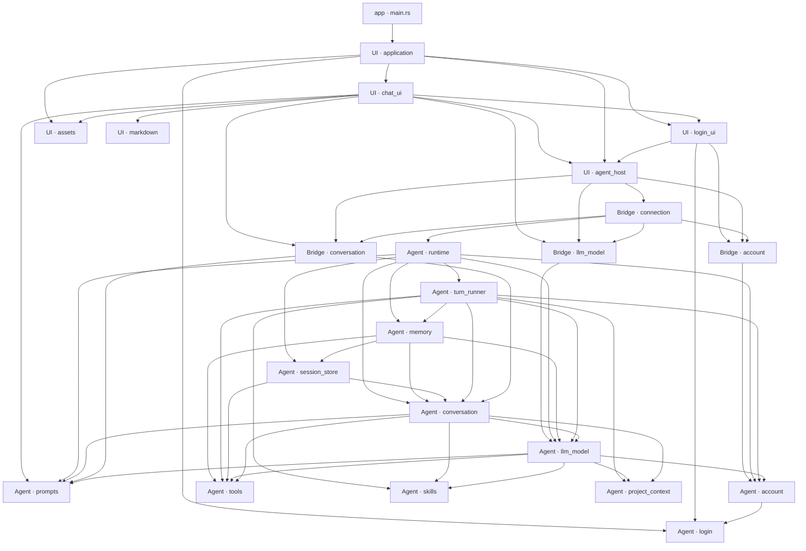
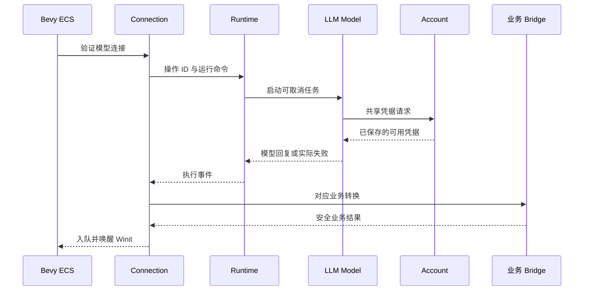
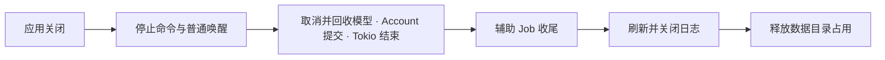

# Agentelier 总体架构

Agentelier 是面向 Windows x64 / DX12 的单进程 Rust 桌面 Agent 应用。Bevy ECS 与 Winit 管理交互和展示，独立线程的 Tokio current-thread Runtime 承载账号与模型执行。当前已实现数据目录启动与设置、Codex 浏览器登录和凭据恢复、模型连接验证、多轮流式聊天、工具执行及运行收尾。

## Workspace 与三个领域

`app/` 是唯一程序入口，只保留 `Cargo.toml` 与 `src/main.rs`，后者声明平台并调用 `agentelier_application::run()`。功能归入 `crates/ui/`、`crates/agent/`、`crates/bridge/`；这三个目录不是 Crate，领域内按实际职责划分独立库。

| 目录 | Package | 当前职责 |
| --- | --- | --- |
| `crates/ui/application/` | `agentelier_application` | 通用宿主、配置、日志、诊断、窗口装配与整体生命周期 |
| `crates/ui/assets/` | `bevy_app_assets` | 应用 Asset 的统一注册 |
| `crates/ui/markdown/` | `agentelier_markdown` | 原生 Markdown 解析、块更新、行内样式、原文复制与用户主动链接交互 |
| `crates/ui/chat_ui/` | `agentelier_chat_ui` | 模型准备、固定会话侧栏、按会话隔离的草稿与阅读状态、多轮流式聊天和相应交互投影 |
| `crates/ui/agent_host/` | `agentelier_agent_host` | 唯一 Connection、Winit 唤醒、命令提交、业务消息分发及执行收尾 |
| `crates/ui/login_ui/` | `agentelier_login_ui` | 数据目录、Codex 账号界面及 Bevy/Bridge 衔接 |
| `crates/agent/login/` | `agentelier_login` | 数据环境、Codex 浏览器 OAuth、凭据持久化与身份摘要 |
| `crates/agent/account/` | `agentelier_account` | Codex 来源状态、共享凭据请求和执行身份门控 |
| `crates/agent/llm_model/` | `agentelier_llm_model` | 模型目录与窗口能力、Responses 的 HTTP/SSE 与 WebSocket 传输、响应使用量和模型错误语义 |
| `crates/agent/conversation/` | `agentelier_conversation` | 固定设置的聊天会话、Turn 身份、工作窗口计量、压缩检查点及恢复、展示记录与结果收敛 |
| `crates/agent/session_store/` | `agentelier_session_store` | 稳定 UUID 会话日志、恢复读取、执行事件追加、独立名称与删除元数据、受控会话清理、不可变图片附件、单写入者、提交确认与存储收尾 |
| `crates/agent/memory/` | `agentelier_memory` | 数据目录级 SQLite、会话提取证据及状态、全局记忆候选选择、Markdown 发布与恢复、历史记忆检索、详情读取与显式修订工具，已发布材料的安全展示数据 |
| `crates/agent/prompts/` | `agentelier_prompts` | 提示词版本库、组合预设、指令快照与原子文件保存 |
| `crates/agent/project_context/` | `agentelier_project_context` | 会话适用的项目规则发现、有界 UTF-8 读取、来源快照与确定性表示 |
| `crates/agent/skills/` | `agentelier_skills` | 本地 Skills 来源发现、有界元数据解析、任务目录快照与来源诊断 |
| `crates/agent/mcp/` | `agentelier_mcp` | MCP 配置、stdio 与 Streamable HTTP 连接、工具和材料协议 |
| `crates/agent/tools/` | `agentelier_tools` | 固定工具目录、工作目录解析、PowerShell 进程会话与回收、UTF-8 文件补丁、不可变图片结果与有界展示、Windows 窗口管理与桌面捕获 |
| `crates/agent/turn_runner/` | `agentelier_turn_runner` | 独占活动任务记录，推进聊天请求、封闭边界自动压缩与检查点提交、正文增量和受控取消 |
| `crates/agent/runtime/` | `agentelier_agent_runtime` | Tokio 线程、跨业务队列、模型任务取消/回收及执行收尾 |
| `crates/bridge/account/` | `agentelier_account_bridge` | Codex 凭据安全摘要及账号事件转换 |
| `crates/bridge/llm_model/` | `agentelier_llm_model_bridge` | 模型结果、错误分类、取消和完成状态转换 |
| `crates/bridge/conversation/` | `agentelier_conversation_bridge` | 聊天命令、会话/轮次和安全展示投影转换 |
| `crates/bridge/connection/` | `agentelier_bridge_connection` | 命令/事件传递、操作关联、互斥、唤醒与连接生命周期 |

跨领域允许 `ui → agent`、`ui → bridge`、`bridge → agent`，禁止反向依赖。UI 可直接使用 Agent 的能力，例如数据环境；需要业务转换或跨运行边界协调时使用 Bridge。新增功能先判断所属领域，再按实际职责复用或新建库，不继续扩大聚合总库，也不预设占位库。

图中为内部 Crate 的直接依赖。UI 库另依赖 Bevy、Widgetry 及路径转换库；Login 直接依赖只使用标准库的 `bevy_widgetry_path_display`，复用 Shell 路径前缀简化。application 按配置安装 BRP Runtime。Agent 与 Bridge 不依赖 Bevy，不访问 Entity、Component 或 World，也不安装日志 Subscriber。

## UI 管理交互与通用宿主

`application` 建立可执行文件旁的日志，读取 `config/config.ron`，装配窗口、Asset、缩放与可选 BRP。BRP 的 Main World 和 Render World 端口独立配置。`agent_host` 是唯一 Connection 所有者和接收者，按业务将账号、模型与聊天事件分发到独立 ECS 消息通道，运行错误另行广播；`login_ui` 在宿主接收后消费自己的业务消息，通过 BSN 组合界面，持有面向交互的账号与目录状态；Widgetry 控件自身的状态遵循其公开契约。

启动界面复用 Widgetry 目录选择器，通过辅助 Job 调用 Login 检查并占用目录。配置由 application 的 ConfigStore 串行合并并完整替换提交；成功后复用同一窗口进入主界面，通过共享 AgentHost 发起账号恢复。数据环境保持到后台执行及日志收尾完成。

目录设置显示本次固定路径、打开当前目录、检查并保存下次启动位置。候选检查不持有第二份长期占用，保存成功才更新配置投影；更改下次位置不搬运文件、不切换当前数据环境或账号。关系见[数据目录与启动](mechanisms/application-data.md)。

UI 使用 `bevy_widgetry_path_display::display_path` 显示路径，application 在序列化配置时使用同库的 `simplify_path`，Login 在调用 Windows Shell 打开数据目录时使用该函数。数据环境对外仍返回原始规范路径，目录比较与文件操作不使用显示字符串。账号凭据位于本次取得占用的数据环境，目录检查只验证目录自身的读写能力。

## Agent 的账号、模型与执行所有者

Login 提供数据环境、Codex 浏览器 OAuth 与本地凭据存储。Account 恢复当前数据目录的授权、接纳登录结果并处理共享凭据请求。文件工作交给 spawn_blocking，Runtime 负责浏览器登录任务的调度、取消与回收。

Account 的可克隆 CredentialClient 管理接纳、会话失效令牌和在途请求合并。它通过 Runtime 赋予的命令提交能力进入同一个有界队列，不反向依赖 Runtime。Token、会话代次和旋转待保存结果只留在执行侧；启动仅恢复文件，无周期保活。按需更新保存成功才交付凭据，取消等待者不丢弃已经开始的旋转。

LLM Model 通过 Account 获取凭据，请求 Codex 的目录与 Responses，并管理一次有界认证恢复、流式响应完成判定及错误分类。会话固定 Codex 主体和工作区。缺少可核对身份的旧 SIWC 会话保留展示、附件及请求契约，作为只读历史恢复。工具实际执行前通过 CredentialClient 核对原任务授权。来源变化时 Runtime 等待旧任务、工具和队列记录收尾，随后让 Account 恢复凭据交付并向界面发布新状态。协议见[单次模型请求](modules/model-request.md)。

`generate_image` 通过同一任务授权访问 Codex Images。LLM Model 负责图像请求和返回验证，Tools 描述调用，Runtime 沿原工具派发与取消规则执行。Turn Runner 等待 Session Store 确认原图及可用的模型回看附件，再将它们与原调用关联到可恢复的工具结果。Chat UI 通过同一调用身份请求 Runtime 从已确认附件生成显示资源或另存原件。详见[图片生成](subscription-media/02-image-generation.md)。

Chat UI 通过 Widgetry 选择本地音频。Session Store 后台核对 WAV 或 MP3 实际内容，并以不可变字节和草稿记录提交。Conversation 将已确认的草稿附件与用户输入绑定，Bridge 仅传递展示元数据。详见[音频文件理解](subscription-media/03-audio-file-understanding.md)。

音频卡片发起独立的文稿任务。Runtime 沿用音频操作的后台执行与取消，LLM Model 使用绑定的 Codex OAuth 文件转写，Session Store 提交可恢复的版本，Chat UI 展示和复制已保存文稿。

用户选择文稿提问时，Conversation 冻结该文稿版本和原音频来源，LLM Model 在固定请求材料中提供带出处的转写文字。工作历史沿用普通用户问题与模型输出，聊天时间线和请求检查可追溯到所选文稿。

Runtime 接收账号命令并交给 Account，同时在同一 Tokio 中运行模型任务和独立 Turn Runner。Runtime 拥有线程、队列、取消令牌、JoinHandle 及真实回收信号；账号处理期间模型任务仍可并发等待网络。它不包含 OAuth、认证文件实现或模型网络协议。依赖为 Runtime → Account → Login、Runtime → LLM Model → Account，以及 Runtime → Tools，以及 Runtime → Turn Runner → Conversation / LLM Model / Account，无循环。

退出、登录更替或账号失效时，共享门控暂停新凭据交付，Runtime 停止旧模型任务并回收工具。退出在队列暂停和已接纳结果持久确认后尝试撤销远端授权并清除本地凭据。账号区随后显示新的来源状态。详见[认证运行与凭据管理](modules/authentication.md)。

## Bridge 按业务转换，共用连接协调

Account Bridge 将 AccountEventKind 转为自己的账号事件和安全摘要，投影浏览器等待、账号状态、退出结果和操作错误；LLM Model Bridge 将模型结果转换为自己的回复、错误及完成/取消类型。两者都不执行后台业务，不持有 Agent 的执行状态或 UI 的展示状态。

Connection 只包装和调用对应业务转换，返回带 operation_id 的 BridgeEvent；BridgeEventKind 区分 Account 与 Model。它分配操作身份、隔离迟到结果、协调在途操作、转发控制命令并持有连接收尾句柄，不实现字段投影或业务错误分类。UI 显式消费连接封装和相应业务类型。

命令队列容量为四，退出控制队列为一，结果队列为三十二。当前只接纳一个在途账号操作、模型操作或聊天操作；活动聊天的补充输入复用该任务，不占第二个任务槽，退出可停止当前操作；保存重试沿用同一操作 ID，全局 SessionStatus 使用保留 ID 0。满队列、通道关闭、通知失败和意外停止形成明确错误。

结果先入队再通过 UI 提供的通知能力唤醒 Winit，ECS 非阻塞消费事件并更新自己的投影。Bridge 不依赖 Winit 或 Bevy 类型，也不把通知信号当作业务数据。

执行是否真正完成以 Runtime/业务所有者的结果为准，如何展示由 Bevy 决定。连接验证在协议完成后一次性显示；聊天输出按输出项和内容段持续更新，并在合法完成后校准。UI 不把“正在取消”当作“已经结束”。

## 辅助任务与整体生命周期

Widgetry JobManager 管理目录 I/O 等应用辅助工作；账号更新、模型网络请求及其取消/回收由 Agent 侧管理。任务所属体系取决于业务所有者，不取决于是否异步。

`application::shutdown` 暂存 AppExit，通过 `agentelier_agent_host::AgentHost` 的 begin_shutdown/is_finished/finish 停止连接与普通业务唤醒、取消模型及后台业务等待。退出协调使用自己的 Winit 通知保持事件循环推进，在 World 和接收端仍有效时非阻塞确认线程结束并显式 join。

Account 完成在途更新和必要提交。Runtime 等待前台模型和长期记忆后台任务回收、Memory 关闭 SQLite 连接、Session Store 排空已接纳命令并回收存储线程，再释放 Tokio。随后宿主结束辅助 Job、刷新日志，最后释放目录占用。两类后台均结束后才重新发布 AppExit。主循环返回后保留兜底收尾。运行收尾错误影响进程退出结果，辅助任务仍执行收尾。

所有库使用宿主统一配置的 tracing。日志只包含安全的操作标识、阶段与诊断，不泄露 Token、授权地址或模型正文。开发与 BRP 验证须保护现有登录状态，未经授权不退出、重新授权、重置凭据或更换数据环境。

模型准备区由 chat_ui 构造并持有 UI 投影，通过共享宿主读取目录和验证显式模型。登录主页以 HomeContent 提供内容位置，application 使用 BSN 挂载 ChatUiHost，不把模型状态或网络逻辑放入通用装配。模型目录与验证复用现有模型任务生命周期，结果按业务类型在 LLM Model Bridge 转换；同一授权内的 Token 更新保留准备区，账号失效或身份变化后清除旧目录与选择。

## 内存聊天与流式投影

Conversation 固定 Session 的模型与推理设置，始终持有会话历史、前台状态和任务账本。Runtime 串行处理 Runner 对当前 Turn 的操作，并持有任务句柄、取消令牌与回收信号。Runner 获取冻结材料、驱动模型和工具，并等待实际保存回执。Runner 每任务通过同一 CredentialClient 捕获当前凭据身份，模型请求核对账号与认证生命周期。账号变化保留本地记录并持久暂停队列。当前支持一个内存 Session 的连续多轮交流，空闲时可确认新建或重置为全新身份与空历史。

Conversation 的内存 Agent Registry 管理 Session 内的 Root 身份及子 Agent 身份预留。Root 使用 Session UUID 映射其稳定标识与历史，Runtime 用每次打开时分配的实例标识核对执行事件。详见 [聊天会话与协议历史](modules/conversation.md#设置与生命周期)。

`spawn_agent` 由 Runtime 按当前调用来源接纳。Conversation 准备子配置、校验身份与路径，Runtime 通过现有 Session Store 确认身份记录和启动事实后，为子 Agent 启动独立的 Conversation 和 Turn Runner。在同一个 Tokio Runtime 内，各 Agent 的模型请求和工具工作可并发，子轮次记录按 Thread 保存在所属会话。详见 [创建子 Agent 时如何形成独立上下文](multi-agent-v2/02-spawn-context-and-config.md)。

Agent Control 在会话内统一接纳协作请求，并持有子 Runner、驻留实例和 Mailbox 通知。定向中断、Root 停止和退出分别协调对应范围的收尾，Session Store 保留可复原的身份、消息和子轮次。普通聊天展示 Root 对话，协作工具记录可在请求检查中查看。详见 [Multi-Agent v2](multi-agent-v2/README.md)。

LLM Model 解析 Responses 输出项、内容段、公开 phase 和文本增量；只有 response.completed 及可接受完整输出才成功。聊天无总生成时长限制，合法流式事件维持 120 秒空闲期限；连接验证仍保留原总超时。聊天启用固定 Direct function tools；LLM Model 只解析调用和映射结果，Runner 在完整响应和身份检查后执行。普通拒绝正文正常展示。任务 join 后才释放操作占用，失败/取消保留已经显示的部分回复。

网络任务经容量为 32 的有界 Tokio 通道传递文本变化。Runner 将增量交给运行时的会话所有者，Runtime 从最新状态生成累计展示快照。Bridge 合并可替换快照，并通过可靠队列送达任务回执和终态。任务账本另按会话 UUID 和修订投影，独立于当前前台操作。AgentHost 每次更新最多消费 32 项，仍有消息时继续唤醒。

chat_ui 仅管理展示投影与草稿，通过 BSN 和 Widgetry 多行 TextField、ScrollArea 构造消息列表。接纳前保留草稿；Accepted 后只清空尚未被继续编辑的原内容。消息更新复用既有行实体，切换设置页不改变后台任务，返回时按投影恢复。会话与历史边界见[内存会话与协议历史](modules/conversation.md)，正文投影见[Markdown 展示](modules/markdown.md)。

协议历史和安全展示摘要的具体关系见[聊天会话与协议历史](modules/conversation.md)。

Markdown 的原文、解析块和原生布局由独立 UI crate 管理，不依赖 Agent/Bridge，也不改变协议正文。Chat UI 保存会话投影并把每条助手原文交给 MarkdownView；底部跟随属于聊天阅读行为。具体边界见[原生 Markdown](modules/markdown.md)。

## 提示词库与固定指令

项目文件发现独立于固定提示词库：Runner 在每个逻辑模型请求准备时调用 Project Context，在可等待回收的阻塞工作中采集；Conversation 保管最近结果，Bridge 将来源及状态转成只读投影，Chat UI 在现有会话核对入口展示。项目正文首次发布为独立的 user 协议项，经持久确认后进入冻结请求；基础保持 developer。完整来源和逐请求安全投影随会话存档保存。读取失败阻止本任务请求，可修复后重试；详见[项目上下文](modules/project-context.md)。

会话核对可按 Turn 和实际请求序号选择保存材料，显示固定基础、项目发布与来源、包装正文和协议顺序，并区分准备、进入发送阶段及收到 HTTP 响应的事实。最近采集状态独立展示；切页与切会话仅维护各自的选择和控件状态，不重新读取源文件，不公开推理／压缩密文或认证信息。

Prompts 是无 Bevy、网络和线程依赖的业务库，管理来源与派生版本、基础覆盖及有序补充配置、预设解析和完整快照。应用内置来源数据由 Assets 提供，Chat UI 在启动数据目录就绪后，通过 Widgetry JobManager 加载该目录的 `prompts.json`；保存和 UTF-8 导入同样使用辅助 Job，并等待真实终态后更新 UI。来源版本与旧版本不被编辑覆盖，文件原子替换不接触账号凭据。

Chat UI 管理提示词库、组合预览和会话核对界面，并在创建 Session 时提交解析后的完整 InstructionSnapshot。Conversation 固定快照；重置复制当前设置，重试沿用原快照。LLM Model 在每次请求中将快照转换为有序 `developer` 消息，置于已提交协议历史和本轮输入之前，避免把指令重复写入历史。Bridge 传递快照与请求指令安全投影；UI 可核对文本、来源版本、哈希、角色及顺序，不公开凭据或加密推理内容。详见[提示词管理](modules/prompts.md)。

Runner 接收取消并结束网络等待，工具按实际结果收尾。Runtime 等待真实回收，Conversation 保留已确认的历史和最新展示。异常退出或提交不确定时阻止发送与重试，用户可重新加载存档。

任务输入、完整协议响应、工具开始与返回、结果追加、Steer、Queue 和终态经 Runtime 交给同一个 Session Store 工作者。完整响应、异步任务登记和上一请求的交付结算一并保存，确认后才公布任务或派发工具。已保存的结果再按原始调用 ID 分别追加到历史。Runtime 等待实际回执期间仍能接纳控制与普通凭据操作。在真实回收及 Finished 提交后才发布前台终态和自动出队。启动扫描并打开最近会话，UI 可打开其他本地存档。

Connection 创建本次运行共享的 OperationSequence；普通请求与恢复待办的重新绑定都从同一原子序列取得身份，避免新旧控制混用。过去的任务句柄、取消令牌和进程会话不恢复。Conversation 按原调用重建业务状态及独立队列，并从实际保存结果或中断事实生成唯一的历史补项。LLM Model 验证原始协议，Store 确认恢复依据、校验附件及保留原件后修复尾部。历史资源回收未确认记录随旧进程身份保留，并暂停该会话的执行与自动待办。恢复失败只影响目标会话，当前内容继续保留。

普通 Responses 聊天请求使用当前模型能力设置 `context_management`，在一次生成内接收原生压缩项和正常输出。完整响应与工具结果封闭后，Runner 通过单写入者保存压缩检查点，再由 Conversation 安装最新安全压缩边界之后的工作历史；完整时间线不随窗口裁剪。服务端完整请求用量与压缩后窗口占用分开记录，详见[模型请求](modules/model-request.md#服务端-inline-压缩)及[会话检查点](modules/conversation.md#自动压缩与持久检查点)。

## Direct 工具往返

会话创建时固定只读工具目录，请求声明与分发共用它。历史 SIWC 存档保留 developer `additional_tools` 记录供查看。Codex 的新建 `gpt-6-astra` 会话通过 WebSocket 的顶层 `tools` 声明原生异步。Runtime 随会话保存连接，Runner 在响应和工具登记持久确认后推进续接。Codex HTTP 会话使用同步契约。Tools 不依赖模型、账号、Bridge 或 Bevy。四项内置工具提供会话范围的 PowerShell 进程登记、标准输入、UTF-8 文件补丁和静态 PNG/JPEG 图片结果。编译进程序的提供者可通过 ToolRegistration 配对声明和执行器，恢复时由 Conversation 按工具来源和保存的声明重新绑定。Runner 每任务最多发送 32 次模型请求并接纳 64 次工具调用。完整响应持久确认后，Runtime 按会话许可准入各调用，最多 8 个普通执行；经登记的异步只读可并行，副作用调用按接纳顺序独占。超出单轮预算时整批写入未执行结果后触限。完整响应和逐项工具结果分别确认进入历史。原生会话在发送下一请求前等待同步调用结果，较早 Turn 的异步调用可继续执行。任务查询、有界等待及取消由 Runner 读取会话账本并响应实际保存事件，不占普通工具工作槽。Runtime 接纳会话侧控制，停止全部会暂停新派发并取消本次持有的执行。在途请求保持冻结，晚到结果先保存，并在完整响应接纳或请求结束失败后追加。正常 final 经持久确认并回收前台后释放唯一前台槽。会话保留后台执行与进程，空闲完成只保存并更新任务区。用户发言或明确处理结果才续接。Conversation 在接纳候选响应和用户材料时保护未交付的结果余量，模型层冻结本次请求的开放调用和 Inline 配置。安全压缩按已确认的协议前缀替换窗口，并保留尾部调用与结果关联。失败或停止保留已确认历史，已有响应提交的任务禁用原样重试。调用和正文按任务内请求序号区分，接收中的参数仅用于展示。

Steer 通过容量 8 的任务输入通道交给 Runner，由 Conversation 裁决接纳、应用和最终关门。Stop 仍走取消令牌。Connection 的容量 32 可靠结果队列承载接纳、应用和任务投影，正文快照可合并。Runtime 收尾期间持续排空事件至真实回收，UI 用草稿修订和输入身份关联回执。

长期记忆由现有后台工作者消费 Store 的来源快照。Conversation 按原 Turn 组装已结束前台、已保存工具结果和已终结进程的连续证据前缀，读取水位与来源修订分别跟踪。来源 cutoff 依据原输入身份。

会话任务和进程更新经 Connection 的可靠事件与唤醒到达任务区，匹配会话 UUID 与各自修订。任务区控制用稳定任务或进程实例进入 Runtime，回执与正文的 operation 分开关联。

## 会话队列与唯一活动任务

Conversation 保存 FIFO 待办和暂停状态。Connection 从统一操作序列预留待办任务身份。容量 16 的会话控制通道传递排队、移除与继续。Runtime 在回收旧任务并确认终态后按队列状态串行启动下一条，Stop 和 Steer 使用共享活动控制槽核对新身份。

队列控制回执和自动 Started 走可靠路径；Connection 区分待接纳操作、未来预留身份和当前活动操作。跨任务快照允许合并，旧任务的 Finished 前交付该任务最终 Updated，较新任务快照不被旧终态丢弃。UI 待办投影与聊天内容流分开，不重建输入框；排队输入启动前不进入模型上下文。失败、停止与触限使队列暂停，普通消息完成不自动恢复暂停。

## MCP 服务器配置

Runtime 在启动数据根下打开独立的 `mcp_servers.json`；配置 Crate 管理工作副本及原子保存。Chat UI 通过唯一 Connection 提交编辑并等待保存回执。stdio 记录程序和参数、启动目录及允许继承的环境变量名称；HTTP 记录端点与可选 Bearer 环境变量名称。账号凭据由 Account 独立持有。Agent MCP 客户端在同一 Tokio Runtime 连接启用的 stdio 与 Streamable HTTP 服务器，并通过 rmcp 协商版本及能力。每项连接的状态和能力经 Bridge 投影，独立于模型任务；禁用、替换或应用退出触发协议回收；stdio 同时回收 Windows Job。客户端对就绪服务器分页发现 Tools，Runtime 在创建会话时合并其经校验的非严格声明，存档保存服务器 UUID、传输配置摘要和原始工具名。执行器用同一来源和声明核对当前连接，经 rmcp 调用真实工具；具备异步资格，按未知副作用走独占许可。Runner 以模型 call_id 记录实际结果以及取消后的封闭历史。Resources 和 Prompts 通过同一 Connection 读取分页清单及实际预览。文本资源或单条纯文本 user 模板确认后复制到当前聊天草稿，再按原有用户输入路径提交。

## 本地工具的工作环境

chat_ui 在模型准备区保留内存目录候选并复用 Widgetry 目录选择器；Conversation 在创建时校验并固定本地工作目录，Bridge 传递 PathBuf 与安全展示。Tools 提供 WorkingDirectory 的校验和相对路径解析，已接入会话范围的持续 PowerShell 进程与标准输入；已接入 JSON 文件补丁及静态 PNG/JPEG 图片结果。目录选择与账号数据目录相互独立，不改变登录环境或进程全局 cwd。

Tools 的 process 模块拥有 PowerShell、Windows Job 与输出读取任务，output 模块负责 UTF-8 增量解码及有界开头/尾部缓冲。Runner 为每批保存固定来源，Runtime 以独立执行句柄可靠收集结果及清理状态。process-wrap 负责挂起后入 Job、恢复及进程树终止；win32job 在恢复前登记外层观察 Job，以 active_processes 确认整个进程组结束，再调用一次 wait。这样不以根 Shell 退出或 process-wrap 的缓存状态作为子进程回收证据。两层 Job 均只服务生命周期，不设置访问隔离；源码保持 unsafe 禁令。Tokio 增加 process feature，依赖由 Workspace 统一管理。

Runtime 持有会话许可、进程表和独立工具句柄。Tools 的 sessions 模块处理等待、输入、EOF、终止、ID 归属和统一收尾。任意 shell 在返回可继续的进程 ID 时将独占许可转给该进程，释放工作槽。进程组实际退出及回收后，退出事实提交确认才释放许可。共八个登记可保存存活进程或未消费的退出结果。write_stdin 走进程独有入口，终止信号可打断在途轮询，轮询取消保留进程。两个工具均采用 0–30000 毫秒等待窗口，没有命令全生命周期的 15 秒终止器。原生会话的 Runtime 按会话持有后台资源。Stop 按创建 Turn 回收，停止全部和会话收尾覆盖全部持有的资源。自动收尾记录通过 Conversation、Bridge 与 UI 安全投影，TaskPhase 增加进程回收阶段，原始工具输出不被改写。旧诊断登记、实现与专属执行包装已移除；旧名称返回 unknown_tool。

补丁由 Tools 的 patch 模块按解析、准备与文件提交拆分。全补丁完成精确匹配、路径冲突和资源预算校验后才写入；已有 UTF-8 BOM 与统一行尾保留。单文件通过同目录临时文件替换，跨文件不回滚，动作日志区分目标写入、源删除、目录创建及临时文件清理。blocking 模块始终等待工作线程，Stop 和 15 秒期限仅停止后续动作，当前提交取得真实结果后才返回。工具详情保存有界动作报告，卡片概括文件完成数量；凭据与完整文件内容不进入日志。

图片读取、解码、方向校正、等比缩放和编码由 Tools 的 image 模块在可等待的阻塞工作中完成。ToolPayload 区分 Text 与共享不可变 ImagePayload；ActiveTurn 的结果表保存真实载荷，ToolView、Bridge 和 UI 只保留文字摘要，封闭步骤不再从展示字符串重建协议。ProtocolHistory 按共享对象身份计算 16 MiB 会话图片预算，重置时随历史释放。LLM Model 将图片结果转换为 input_text/input_image 内容数组、正确 MIME 的 data URL 与 high 细节，并在发送前以有界序列化确认完整请求不超过 32 MiB。目录中可选 input_modalities 经 Bridge/UI 固定为会话的图片能力三态，未知允许真实请求验证，明确不支持则返回工具能力错误。

## Skills 目录

用户技能根为当前应用数据目录的 `skills/`。Runtime 从本次运行固定的数据根派生绝对路径，经聊天任务参数传入 Runner 与 Skills；普通发送、Retry、Queue 使用同一路径。请求中的技能目录明确提供该可写根，内置创建器据此定位跨项目技能，不读取或回退用户 HOME。项目技能仍由会话工作目录范围发现。

Runner 在每个实际启动的任务（含 Queue 与 Retry）开始时，通过可取消并等待回收的阻塞工作调用 Skills，取得固定工作目录适用的目录快照。Conversation 的 TurnView 保存目录与来源诊断，并随既有任务状态写入存档；固定 Prompt、项目规则和工具执行均不因此改变。目录筛选允许隐式调用的条目后，在每个模型请求中以独立 developer 材料提供一次，模型通过原工具按需读取正文与引用。目录不写入协议历史，实际角色、位置、文本和摘要随冻结请求事实保存；它参与上下文估算。任务启动前解析 `$name`，唯一有效的选中技能保存完整正文与摘要，并以独立 user 材料在每次请求中重用。Steer 不能更换任务技能，Queue 和 Retry 在各自启动时重新发现与选择。详见 [Skills 当前实现与目标机制](skills/README.md)。

Skills 自有资源随业务库嵌入，包括固定上游版本的完整 skill-creator 目录、许可和来源说明。任务启动的可回收文件工作将当前内容摘要对应的系统版本部署到 `%LOCALAPPDATA%/Agentelier/skills/.system/<hash>/`，逐文件核对并设置只读；不覆盖用户技能或改变认证数据环境。部署失败只产生该系统来源诊断，其余项目/用户目录仍可用。创建器本身仍由模型通过普通工具读取与执行，生成文件写入标准可写根，下一任务重新发现。
