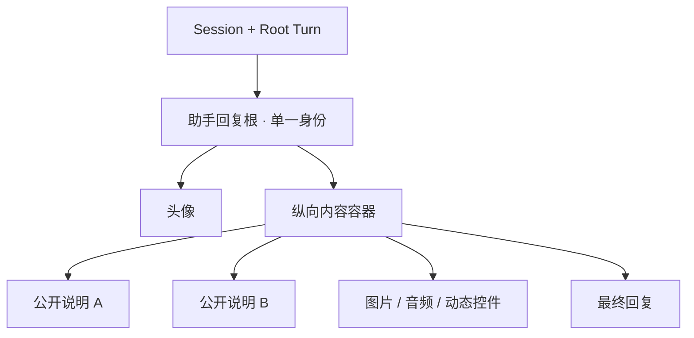
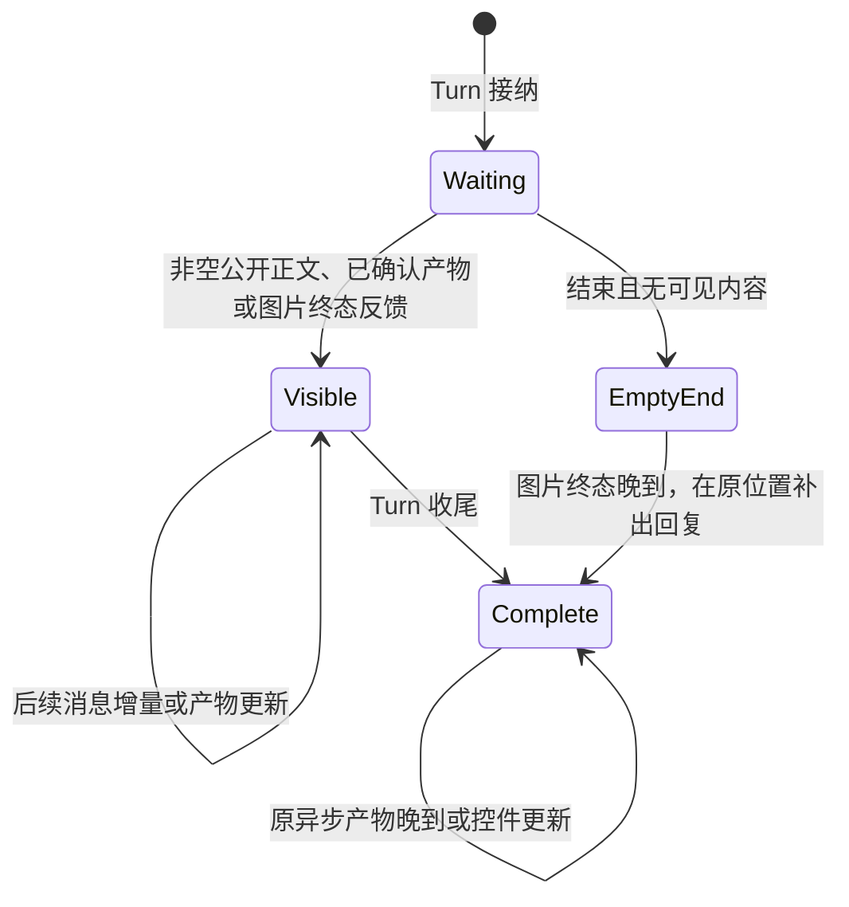

# 一次回复如何容纳多种内容

## 回复的身份从输出项提升到 Turn

现在 `chat_ui/src/conversation.rs` 的 `reconcile_list()` 按 `ChatRow` 对齐和更新消息。每一项助手文字以请求序号、输出序号和消息 ID 为键；`final_reply()` 排除其他显式阶段。对于第一个最终回复，当前代码还把它改用 `reply` 键，以便复用等待圆环所在的消息行。这已经建立了一个很好的起点：等待动画与第一个可见正文不必属于两个控件。

新的展示把这一关系扩展到整个 Turn。无论同一 Turn 经过多少轮模型请求、工具往返或公开说明，都只创建一个助手回复根控件。根身份由 Session 和 Root Turn 决定，内部文字项继续使用原有请求序号、输出序号和消息 ID。图片、音频与动态 Scene 各自拥有稳定的内容身份，不借用文字 ID，也不依赖 ECS Entity 的值来恢复。

`Commentary` 每条在容器内独占一个内容行，自然换行，不强制限制为物理上的单行字符。每项文字独立使用 Markdown 展示，保持内容边界。`Final Answer` 接在相应位置，使用同一头像和根容器。没有 Commentary / Final Answer 标签，不再为每个阶段创建额外的助手头像。不要用多张卡片或大量分隔线把同一轮回复重新切成多个视觉消息。

协议、请求历史与 UI 排版仍是不同层次。`ProtocolHistory` 继续保留原始 phase、正文、reasoning 与工具项，工具结果仍使用原 `call_id` 进入正确的请求历史。主聊天不展示 Reasoning、普通工具调用、参数、结果、调试截图或内部协作消息；既有后台任务通知、错误反馈、请求核对入口和记忆专用聊天不因这一改造被删除。

## 从等待到第一条公开内容

Turn 被接纳时，沿用现有头像和等待圆环。尚无可见内容时圆环存在；第一条非空 Commentary 或 Final Answer 到达后，原控件切换为正常内容，后续流式文本原位增长。这里不把每次工具往返都解释成一次新的等待，也不在 Commentary 之间重复显示助手头像和圆环。

需要区分输出项已经登记与实际存在文字。空 `output_item.added`、只有空白的增量、工具状态或 reasoning 不能消除等待。

第一份已确认的公开产物或图片生成终态反馈可以结束等待。图片生成成功后，预览资源尚在读取时显示图片占位。图片生成失败时显示真实原因，取消时显示取消反馈。没有公开内容的轮次结束时移除空等待行。若图片终态此时还未到达，收到成功、失败或取消结果时在来源 Turn 的原位置补出助手回复。生成中且无其他公开内容时沿用原等待行为；已经可见的回复在原位置更新。

`Complete` 表示助手轮次已经结束，并不表示其中每一个独立产物都已经结束生命周期。异步工具可以跨 Turn 完成，用户也能在结束后操作控件。

## 排列和增量更新

已有 `ActiveTurn::update` 使用 `(request_index, output_index, item_id)` 关联流式消息并按原顺序排序。公开正文继续由该顺序决定，而不是把 Bridge 事件接收时间当作新的协议顺序。同一内容项在快照和完整响应间的替换仍使用原身份。最终渲染不能重复拼接同一个增量。

产物占据对应来源调用的内容位置，通过 Session、Turn、request、output index、`call_id` 及同一调用内的产物身份区分。异步结果按原位置补出或更新内容，已有的生成中反馈使用同一内容位置。只有具备用户可见产物语义的调用才占据这样的位置，普通工具结果仍保持原展示边界。

无 phase 的消息沿用 `final_reply()` 的判断，轮次完成、来自最后一次响应且同次响应无工具调用时可作为正文显示。未知显式阶段不自动当作 Commentary。已明确标记 `commentary`、`final_answer` 的公开消息允许在流式阶段呈现；未被协议历史接纳的失败、取消片段沿用既有可阅读展示记录的语义，不把展示内容重新加入模型上下文。

用户的普通输入仍按 `input_id` 去重。Retry 使用自己的 Turn ID，因此有自己的助手回复，不覆盖旧尝试。Queue 产生新的 Turn，跨 Turn 结果续接也沿已有身份处理。Steer 保留原有用户补充行、状态和实际应用顺序，不混进助手头像下伪装成助手内容。对于跨越一次 Steer 的长回复，采用单一助手根不拆分的布局：根一旦挂载就保持其位置，后到的 Steer 仍为独立用户行；根内部按公开项和产物的来源次序组织。这是视觉分组的取舍，不改写协议历史的真实时序。

## UI 所有权

`chat_ui` 负责将 `SessionView`、`TurnView` 与已确认产物投影成有序内容；Bridge 只做必要的业务转换和操作关联。`MarkdownView` 负责文字及公式，媒体控件管理自己的显示与播放状态，动态 Scene 由原生控件和脚本机制承载。它们均作为回复根的 BSN 内容子树存在。

在 UI 重建时，回复根与内容项分别按稳定身份协调。仅更新发生变化的文字或产物，不因下一段正文增长重建先前图片、音频、控件或整张消息列表。继续保持现有 `reading` 的底部跟随规则、输入焦点、未发送草稿、文本选择与横向滚动行为。

主聊天使用这一回复分组。当前 `TranscriptPresentation::Memory` 具有检查性质，会显示各消息 phase、请求和保留情况，继续维持原展示策略。现有诊断不会因主聊天的隐藏规则而丢失信息。

## 验证所要观察的关系

在真实应用中令 Root 在同一 Turn 发送多条 Commentary、调用工具并输出最终正文；检查首条公开内容到达前后的圆环、头像数量、实际内容顺序和流式更新。只返回最终文本、无 phase 的响应、Stop、Retry、Steer、Queue、异步结果晚到、切换及重开 Session 均应保持原业务关联。GUI 使用 BRP 检查中间帧、实体身份、滚动和焦点，不能只检查最终截图。普通工具与 reasoning 仍不出现在主消息区。
