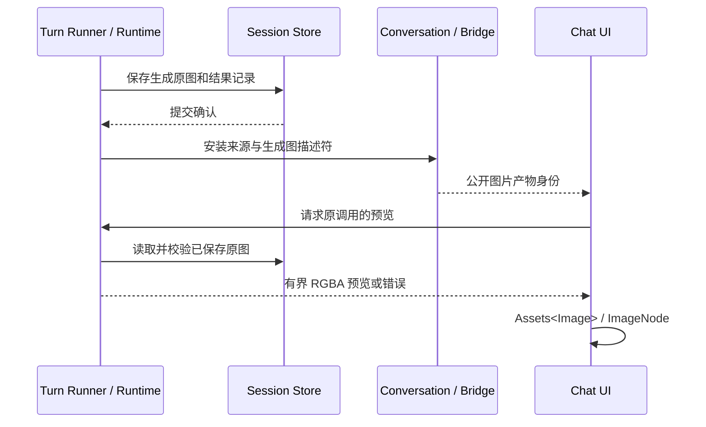
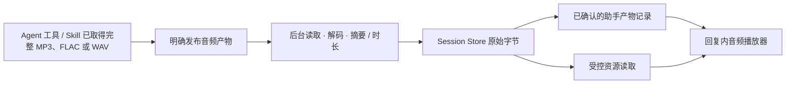

# 图片与声音成为可直接使用的会话产物

图片和音频有共同的用户体验：Agent 产生结果后，用户在聊天中直接看到或听到它。它们需要保存真实文件，但实际播放和渲染属于 Bevy UI，不应该由模型请求持续驱动。

## 图片：已有的原图存储，新的聊天呈现

`generate_image` 使用 Codex Images 生成 PNG 或 JPEG，由 Session Store 保存不可变原件。`ToolReturned` 关联 `GeneratedImage` 和原 `call_id`。Conversation 在保存回执后确认结果，重开时按对应记录恢复该确认。主聊天从生成图描述符请求预览，Runtime 从受控附件读取最长边不超过 512 像素的 RGBA 显示资源。原图与模型回看的派生图分别保存。

生成图片直接作为助手回复内的内容块，保留用户可见的图片状态。生成成功显示预览，生成失败显示真实原因，取消显示取消反馈；预览读取失败在对应图片项显示。若来源 Turn 在终态到达前结束且没有可见回复，收到终态时在原位置补出回复。普通 `view_image`、桌面截图等内部材料仍用于模型视觉反馈。预览以原生成图的有效描述符与已保存结果为依据。

UI 使用 `Handle<Image>` 与 `ImageNode`。沿用已有最长边 512 的预览生产路径，保持实际宽高比，并按可用聊天宽度和合理预览高度缩放。显示大小与原始图片大小无关，导出的仍是服务返回的原始编码字节。加载期间保持稳定占位，错误时可读地显示预览不可用；不能把已生成但预览失败误报为生成失败。

原图仍沿用单图 32 MiB、边长 4096、会话原图累计 256 MiB，以及模型派生图各自的既有预算。资源读取按 Session 和原调用身份核对，UI 仅应用当前图片块发出的预览请求的回执，切换会话时随回复子树释放显示资源。用户可以从已确认的图片块打开 Widgetry 另存为窗口，按原图格式选择路径。Runtime 读取并校验原件，再将原始编码字节写入新文件。已有目标返回失败，保存、取消和失败反馈跟随发起操作的图片块。

原 [图片生成设计](../subscription-media/02-image-generation.md) 与原 [图片 UI 方案](../../../plans/subscription-media/07-generated-image-ui.md) 中的原图、生成状态、预览、导出与恢复规则继续有效，唯一重要改变是用户可见图片进入回复容器，而不是恢复普通工具时间线。

## 音频：将取得的文件交付给聊天区

现有音频附件的起点是用户在本地选择文件。`session_store::audio::import` 使用 Symphonia 0.6.1 探测并实际解码 MP3/PCM WAV，保存文件名、MIME、SHA-256、编码长度与时长。Session Store 将音频保存为 `audio-<sha256>.mp3` 或 `.wav`，当前 `AudioDraft` 表示待发送的用户附件，`Accepted` 将其绑定到输入。`audio_attachment::card` 显示信息和转写入口，但没有音频播放。

用户要求生成一段提示音时，Agent 可以使用现有工具或 Skill 制作 MP3、FLAC 或 WAV 文件，再将完成的文件发布为当前回复的音频产物。现有 Codex 转写接口继续承担音频理解。本设计的音频范围是已经取得的文件的交付与播放。

仅有 shell 输出中的路径或 Markdown 链接无法建立可靠的聊天产物身份。因此本设计补足一个明确的发布行为：由 Root Agent 通过现有工具调用体系交付目标音频，Runtime 从冻结工作目录解析该文件、读取并校验其实际内容，复用 Session Store 音频快照能力。在发布成功后，模型得到真实的产物身份和元数据，UI 自动挂载对应播放器，无需用户打开文件夹。具体工具名和 schema 由实施阶段依照冻结工具目录规则确定，既有 Session 不被无声添加新的工具能力。

复用 `AudioAttachment` 的格式、摘要、长度、时长及去重语义，扩展助手产物的实际格式识别与解码，支持 MP3、FLAC、WAV。助手产物拥有自己的 Session、Root Turn、来源请求/调用和内容身份，用户主动选择的输入附件继续沿原有发送与转写入口处理。两者共享单文件 20 MiB、会话累计 128 MiB 的预算及按摘要复用的字节存储，展示身份各自独立。

只有原文件与产物记录持久确认后才发布成功。生成过程中未关闭、不完整、损坏或超限的文件返回实际错误；文件生成成功但发布失败是两个不同的事实，不能删除 Agent 原先在项目目录中生成的文件。重新打开 Session 时只读已保存的快照，源路径被移动、删除或覆盖不影响旧播放器。既有用户音频附件继续承担转写语义；紧凑播放器可以直接复用到用户历史附件，转写入口和文稿选择保持原有行为。

## 紧凑型原生播放器

播放器从左到右显示播放／暂停按钮、整段时域波形、音频总时长。用户点击同一个按钮播放或暂停。主动暂停保留播放位置，继续时从该位置播放，结束后可从头播放。波形仅展示音频幅度与进度，已播放区域使用主题强调色。

### 实际播放和时间轴

Workspace 当前锁定 Bevy 0.20.1，尚未开启 `bevy_audio`。实施时沿 Application 的插件装配职责启用 Bevy 原生音频及 MP3、FLAC、WAV 对应的解码 Feature。`AudioPlayer` 与 `AudioSinkPlayback` 提供非空间化播放、暂停、恢复、停止和实际位置。首次加载以实际 Asset 和 Sink 状态驱动控件，波形进度使用 Sink 的实际位置。

播放器使用 BSN、AgentelierButton / Widgetry 公开交互和主题。整个应用同一时刻只播放一段聊天音频。用户播放另一段时，先停止前一段并把它的播放游标归零，随后再启动新的播放；重新播放前一段时从头开始。对当前音频主动按暂停仍可保留进度。切换 Session 或删除所属内容时停止并回收播放资源。历史恢复时音频处于待播放状态，文件、时长和波形依据均可恢复。

### 波形是真实音频的显示投影

现有 Symphonia 解码已经遍历文件获取帧数。扩展这一能力，从校验过的同一文件提取覆盖完整时域的幅度包络；按显示分辨率聚合采样区间，采用实际极值/峰值或等效的真实波形摘要。立体声的预览归并应保留各声道幅度而不是相消为静音。静音、脉冲、强弱变化都应在波形中真实反映。样本解码和包络计算不阻塞 Bevy 主线程，绘制只消费有界摘要。摘要是可重建缓存，不替代编码原件，也不需要作为模型上下文。

Widgetry 上游已有 Waveform 和波形缩减/回放状态接口，面向多通道信号、时轴和测量，`WaveformUnit` 以电压表示。聊天只需要简洁的幅度预览，可复用合适的公开缩减和绘制接口，也可在 `agentelier_controls` 实现小型波形控件。解码和实际发声沿各自的音频路径处理。

## 资源与历史的关系

图片的预览像素、音频的编码字节或实际播放所需资源以单独的操作回执传递，不写入 `Reflect` 的聊天状态，不以 Base64 暴露到诊断或日志。Conversation/Session Store 保存权威身份与元数据；UI/Assets 管理显示句柄和播放实例。回执携带请求身份和当前资源代次，内容已被删除或切换后不再安装旧资源。

重开 Session 时可查看和播放已保存的媒体。读取失败或设备不可用只影响该媒体块。会话删除依原有受控目录、删除标记及资源收尾流程处理，项目文件和导出副本属于会话目录之外的资源。

实际验收确认真实生成图片、预览和原图导出。对 MP3、FLAC、WAV 分别确认实际声音、时长和真实波形，并检查同一按钮的播放、暂停和继续、换播停止并归零、历史恢复、切换清理和失败反馈。BRP 验证 GUI 输入和实际控件状态，声音由实际音频输出验证。
