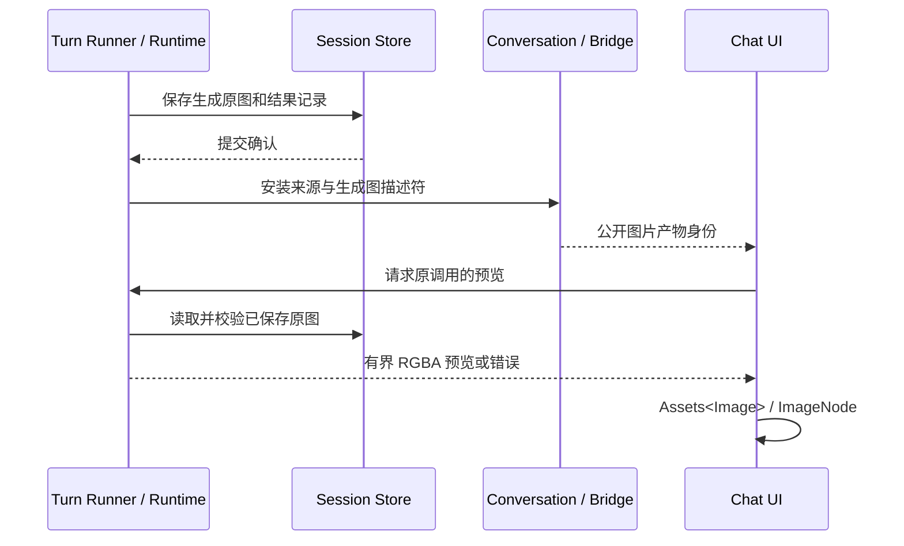
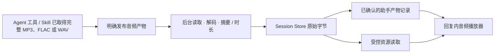

# 图片与声音成为可直接使用的会话产物

图片和音频有共同的用户体验：Agent 产生结果后，用户在聊天中直接看到或听到它。它们需要保存真实文件，但实际播放和渲染属于 Bevy UI，不应该由模型请求持续驱动。

## 图片：已有的原图存储，新的聊天呈现

`generate_image` 使用 Codex Images 生成 PNG 或 JPEG，由 Session Store 保存不可变原件。`ToolReturned` 关联 `GeneratedImage` 和原 `call_id`。Conversation 在保存回执后确认结果，重开时按对应记录恢复该确认。主聊天从生成图描述符请求预览，Runtime 从受控附件读取最长边不超过 512 像素的 RGBA 显示资源。原图与模型回看的派生图分别保存。

生成图片直接作为助手回复内的内容块，保留用户可见的图片状态。生成成功显示预览，生成失败显示真实原因，取消显示取消反馈；预览读取失败在对应图片项显示。若来源 Turn 在终态到达前结束且没有可见回复，收到终态时在原位置补出回复。普通 `view_image`、桌面截图等内部材料仍用于模型视觉反馈。预览以原生成图的有效描述符与已保存结果为依据。

UI 使用 `Handle<Image>` 与 `ImageNode`。沿用已有最长边 512 的预览生产路径，保持实际宽高比，并按可用聊天宽度和合理预览高度缩放。显示大小与原始图片大小无关，导出的仍是服务返回的原始编码字节。加载期间保持稳定占位，错误时可读地显示预览不可用；不能把已生成但预览失败误报为生成失败。

原图沿用单图 32 MiB 和最长边 4096 像素的边界。模型派生图遵循单图编码和请求图片投影约束。资源读取按 Session 和原调用身份核对，UI 仅应用当前图片块发出的预览请求的回执，切换会话时随回复子树释放显示资源。用户可以从已确认的图片块打开 Widgetry 另存为窗口，按原图格式选择路径。Runtime 读取并校验原件，再将原始编码字节写入新文件。已有目标返回失败，保存、取消和失败反馈跟随发起操作的图片块。

原 [图片生成设计](../subscription-media/02-image-generation.md) 与原 [图片 UI 方案](../../../plans/subscription-media/07-generated-image-ui.md) 中的原图、生成状态、预览、导出与恢复规则继续有效，唯一重要改变是用户可见图片进入回复容器，而不是恢复普通工具时间线。

## 音频：将取得的文件交付给聊天区

用户输入附件支持 MP3 或 PCM WAV。`session_store::audio::import` 使用 Symphonia 探测并解码，保存文件名、MIME、SHA-256、编码长度与时长。`AudioDraft` 表示待发送的用户附件，`Accepted` 将其绑定到输入，聊天中的已保存附件可直接播放或转写。

用户要求生成一段提示音时，Agent 可以使用现有工具或 Skill 制作 MP3、FLAC 或 WAV 文件，再将完成的文件发布为当前回复的音频产物。现有 Codex 转写接口继续承担音频理解。本设计的音频范围是已经取得的文件的交付与播放。

Root Agent 通过 `publish_audio` 发布目标音频。该工具接收一个文件路径，按冻结工作目录解析相对路径，并接受完整的 Windows 绝对路径。Runner 经 Runtime 请求 Session Store 读取和校验音频，确认原件和工具结果均已提交后，模型得到产物身份和元数据，来源回复显示可播放的音频项。工具声明随新会话目录一起冻结。

复用 `AudioAttachment` 的格式、摘要、长度、时长及去重语义，扩展助手产物的实际格式识别与解码，支持 MP3、FLAC、WAV。助手产物拥有自己的 Session、Root Turn、来源请求/调用和内容身份，用户主动选择的输入附件继续沿原有发送与转写入口处理。两者共享单文件 20 MiB 的边界及按摘要复用的字节存储，展示身份各自独立。

只有原文件与产物记录持久确认后才发布成功。未关闭、不完整、损坏或超限的文件返回实际错误，发布错误保留 Agent 在项目目录生成的文件。重新打开 Session 时从已保存的快照读取原件。用户历史附件共享播放器，并提供转写和文稿选择入口。

## 紧凑型原生播放器

播放器显示播放／暂停按钮、带进度的时域波形和总时长。用户点击同一个按钮播放或暂停。主动暂停保留播放位置，继续时从该位置播放，结束后可从头播放。

### 实际播放和时间轴

Application 通过 Bevy 默认插件装配原生音频，Workspace 启用 MP3、FLAC 和 WAV 解码。用户点击播放后，Runtime 根据当前 Session 和音频 ID 从 Session Store 读取原件，校验摘要和字节长度。UI 预检解码并创建 `AudioPlayer`，等待 `AudioSink` 就绪后发声。播放位置、暂停与结束从实际 Sink 读取，失败原因显示在音频项内。

播放器使用 BSN、AgentelierButton / Widgetry 公开交互和主题。整个应用同一时刻只播放一段聊天音频。播放另一段时，先停止前一段并把游标归零，再启动新的播放。切换 Session、删除所属内容或退出时停止并回收播放资源。重开 Session 时音频处于待播放状态。

### 时域波形

音频项进入可见区域时，Chat UI 通过同一原件读取接口发起波形请求。Bevy 后台任务复用 Session Store 的 Symphonia 解码，从完整时间轴提取最多 512 组有符号极值。每组汇总所有声道的样本，反相声道仍显示各自达到的幅度。

后台任务用较粗的时间区间再聚合极值，生成适合不同宽度的 Bevy 图像掩模。UI 按内容摘要缓存掩模，宽度和 UI Scale 变化只在已有分辨率之间选择。已播放区域按实际 Sink 位置用主题强调色覆盖。计算中和失败时分别显示占位和不可用状态，播放按钮保持独立。

波形是从已保存原件派生的临时显示资源，重开 Session 时可缓存复用或重算。模型上下文和 Session Store 仍以原始产物描述符和编码文件为准。

## 资源与历史的关系

图片的预览像素、音频的编码字节或实际播放所需资源以单独的操作回执传递，不写入 `Reflect` 的聊天状态，不以 Base64 暴露到诊断或日志。Conversation/Session Store 保存权威身份与元数据；UI/Assets 管理显示句柄和播放实例。回执携带请求身份和当前资源代次，内容已被删除或切换后不再安装旧资源。

重开 Session 时可查看和播放已保存的媒体。读取失败或设备不可用只影响该媒体块。会话删除依原有受控目录、删除标记及资源收尾流程处理，项目文件和导出副本属于会话目录之外的资源。

实际验收确认真实生成图片、预览和原图导出。对 MP3、FLAC、WAV 分别确认实际声音、时长和真实波形，并检查同一按钮的播放、暂停和继续、换播停止并归零、历史恢复、切换清理和失败反馈。BRP 验证 GUI 输入和实际控件状态，声音由实际音频输出验证。
