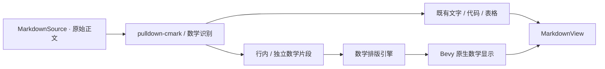

# 数学记号如何进入原生 Markdown

Markdown 解析器负责判断一段内容是不是数学公式，数学排版器负责如何显示它。把这两项分开，可以在现有 `MarkdownView` 中自然支持普通公式和专业数学记号，同时保持 Bevy 原生排版与会话原文不变。

## 从现有文本块引入数学块

`agentelier_markdown` 使用 `pulldown-cmark 0.13.6`，通过 `ENABLE_MATH` 将 `DisplayMath` 事件投影成独立块，将 `InlineMath` 作为行内内容。方括号定界符 `\[…\]` 和圆括号定界符 `\(…\)` 在 Markdown 文本范围内成对识别，通过等长定界符交给同一个解析器。转换前后字节区间不变，只有形成预期数学事件的定界符替换会保留。代码、HTML、链接及图片的范围保留原有解析语义。

公式保留供排版的 TeX 和按字节区间提取的原文。单美元公式关闭定界符后紧跟数字时保留为文本，避免把紧邻的价格标记当作数学定界符。

MarkdownSource 和已存原文依旧是复制、历史阅读和流式重算的依据。数学显示是从原文派生的 UI 资源，不把栅格图写回模型消息，也不将任意 LaTeX 指令视为 Rhai 程序。代码围栏、行内代码、转义文本中出现的公式语法不应被自动渲染。

独立公式使用排版宽度和高度创建原生图像，超出可用宽度时可横向滚动。行内公式与 TextSpan 共用 Bevy 0.20.1 文本布局，在段落、标题、列表和表格单元格中参与换行。排版成功后 `InlineBox` 用公式宽度和基线以上空间取代源文跨度。独立图像节点以 Bevy 返回的公式框底边为基线，按 TeX 度量向上和向下延伸。含公式的段落按最大下降深度保留行间空间。超出整行可用宽度的单个公式等比缩到行宽。

流式输出遇到未闭合公式时先保留可读原文，闭合后原位替换；已闭合且内容、样式未变化的数学项沿既有增量协调复用。未知命令、字体缺失和排版失败均保留原始数学表达式并局部提示，不让整条消息变空。公式源文本仍可复制。

## 排版引擎的选型依据

独立公式使用 LaTeX-Rust 3.0.3、引擎内嵌的 STIX Two Math 2.13（SIL OFL 1.1）和 resvg。后台任务从原始 TeX 得到盒模型，再输出包含可见墨迹范围和基线的自包含 SVG。resvg 按实际目标缩放栅格化并交付 Bevy 图像，逻辑宽度和高度取公式度量。换宽时只调整滚动区域，实际缩放或主题前景色变化时更新图像。引擎依赖和字体许可见 [LaTeX-Rust](https://docs.rs/crate/latex-rust/3.0.3)。

MathJax 可以作为覆盖范围及复杂数学布局的参照，支持 SVG 输出和较多 TeX 扩展；KaTeX 可作为常见网页公式渲染参照。两者依赖 JavaScript/网页技术环境的使用方式不同于当前项目。此处不建设 WebView、不直接嵌入它们的网页界面；若首选 Rust 引擎不能满足重要语法，先核查可扩展接口或其他本地原生排版方案，按项目上游问题规则处理，不复制、修改或 Fork 上游源码。需要更换技术方向时明确未满足项及影响。

每个 Markdown 公式块持有当前显示资源和在途任务。同一个块的内容和呈现参数保持一致时复用该资源。后台任务数量、公式输入长度和图像分辨率有固定上限，超出可排版范围时显示原文。

## 专业数学不等于更多普通字符

数学公式、字体与宏、环境、结构图形是不同层次。加减乘除显示正确并不意味着专业数学可用。将专业覆盖作为排版引擎的明确目标，而不是为每个数学学科另外编写一个渲染器。

| 领域 | 需要检查的记号和排版结构 |
| --- | --- |
| 数理逻辑、集合论 | `\forall`、`\exists`、`\models`、`\subseteq`、`\mathbb{N}`、蕴含和推导符号 |
| 线性代数 | 向量、粗体符号、矩阵、行列式、转置、分块和省略号 |
| 数学分析 | 多层上下标、极限、积分、偏导、梯度、多行对齐推导 |
| 概率论与统计 | 条件概率、期望、方差、分布、随机变量、指示函数 |
| 抽象代数 | 群、环、域、同态箭头、商结构与花体/黑板粗体字体 |
| 拓扑及几何 | 开集、闭包、内积、映射、流形和微分形式 |
| 数理物理 | 张量、多重指标、算符、Dirac bra-ket 及物理常用宏 |
| 证明与范畴论 | 多行推导、证明树、交换图、带标签的箭头与节点 |

LaTeX-Rust 处理 `\operatorname{Hom}(V,W)` 的算符间距、`pmatrix` 与 `vmatrix` 的布局以及 `\langle\psi|\hat{H}|\psi\rangle` 的符号和字体。行内与独立公式共用启用 Unicode 符号的解析配置。`math::notation` 在交给引擎之前扩展受支持命令的 TeX Token，原始 Markdown 和复制仍使用用户看到的输入。

宏表提供 `\abs`、`\norm`、`\set`、`\bra`、`\ket`、`\braket`、`\ketbra`、`\dv`、`\pdv` 和 `\mathbbm`。单位表达支持 `\qty{数值}{单位}`、`\SI`、`\unit`、`\si` 以及常见 SI 单位、`\per`、`\squared` 和 `\cubed`。参数使用花括号分组，允许在受限深度内嵌套。文本参数内部保留原有文本字面量。

未知命令、未登记环境和缺字均回退到原始定界符及 TeX。独立公式显示错误说明，行内公式在对应源文后提示排版失败，周围正常正文和其他公式继续呈现。

MathJax 的 `amscd`、`bussproofs` 等扩展说明有些需求属于多对象结构排版。复杂交换图和证明树可由数学示意 Scene 原生表达，普通 LaTeX 源文仍保持可阅读；化学结构等非数学领域若以后需要，同样可选用专门的可视化组件。本次不承诺整个 LaTeX 文档生态或化学排版支持。

专业覆盖使用一组实际聊天公式检验，不用理论功能表替代真实渲染。普通美元金额、代码中的公式字符、流式未闭合公式、未知宏、混合文本基线、表格公式、UI Scale 和长公式滚动都需要观察。图形与函数计算不由这个排版引擎负责，后续动态可视化复用同一个公式显示能力即可。
