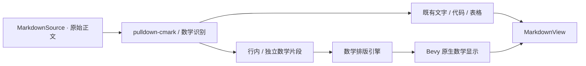

# 数学记号如何进入原生 Markdown

Markdown 解析器负责判断一段内容是不是数学公式，数学排版器负责如何显示它。把这两项分开，可以在现有 `MarkdownView` 中自然支持普通公式和专业数学记号，同时保持 Bevy 原生排版与会话原文不变。

## 从现有文本块引入数学块

当前 `agentelier_markdown` 使用 `pulldown-cmark 0.13.6`，只开启删除线、表格和任务列表扩展。`parse.rs` 将文档组织成 `Block` 与 `Run`，行内渲染采用原生文本样式。数学既没有独立块类型，也没有行内数学内容类型。

`pulldown-cmark` 本身提供 `ENABLE_MATH` 和 `InlineMath` / `DisplayMath` 事件。继续使用原有解析体系，以 `$...$` 和 `$$...$$` 分别表示行内和独立公式。常见模型输出中的 `\(...\)`、`\[...\]` 也应作为兼容候选验证；若原解析器不原生识别，在保留原始区间、转义规则和代码块语义的前提下适配，不能简单替换全文的反斜杠或美元符号。

MarkdownSource 和已存原文依旧是复制、历史阅读和流式重算的依据。数学显示是从原文派生的 UI 资源，不把栅格图写回模型消息，也不将任意 LaTeX 指令视为 Rhai 程序。代码围栏、行内代码、转义文本中出现的公式语法不应被自动渲染。

独立公式先建立可复用数学排版能力，支持公式高度、宽度、字号、主题及长公式可读性；超出可用宽度的公式可以横向阅读，不能被裁掉而无入口。行内公式需要基线、数学框的 ascent/descent、文字换行、混合中英文、列表、表格和强调样式的协调。只把整段公式栅格图放到一行旁边不足以实现真正的行内排版。Bevy 当前使用 TextSpan 的普通文本路径需要为嵌入数学对象提供相应布局能力，具体选择依据实际 Bevy 0.20.1 API 验证。

流式输出遇到未闭合公式时先保留可读原文，闭合后原位替换；已闭合且内容、样式未变化的数学项沿既有增量协调复用。未知命令、字体缺失和排版失败均保留原始数学表达式并局部提示，不让整条消息变空。公式源文本仍可复制。

## 排版引擎的选型依据

数学引擎、版本和渲染路径由实施者在第 08 项按实际验证结果选定。LaTeX-Rust 是纯 Rust 候选，其公开项目说明包含数学解析、盒模型排版、STIX Two Math 字体及 SVG/PNG 输出。选型需要在项目工具链上核对编译、依赖、字体许可、数学布局及渲染产物，同时检查后续行内公式所需的度量和专业记号覆盖。

MathJax 可以作为覆盖范围及复杂数学布局的参照，支持 SVG 输出和较多 TeX 扩展；KaTeX 可作为常见网页公式渲染参照。两者依赖 JavaScript/网页技术环境的使用方式不同于当前项目。此处不建设 WebView、不直接嵌入它们的网页界面；若首选 Rust 引擎不能满足重要语法，先核查可扩展接口或其他本地原生排版方案，按项目上游问题规则处理，不复制、修改或 Fork 上游源码。需要更换技术方向时明确未满足项及影响。

显示资源可由经过验证的矢量路径或按实际 DPI 生成的图像承载；若使用栅格化，保留原始数学文本和布局度量，字体、主题或 UI Scale 变化时更新显示资源。选择机制以原生显示、公式可读性和与 `MarkdownView` 的真实排版结合为准，不预先决定额外图形依赖。

## 专业数学不等于更多普通字符

数学公式、字体与宏、环境、结构图形是不同层次。加减乘除显示正确并不意味着专业数学可用。将专业覆盖作为排版引擎的明确目标，而不是为每个数学学科另外编写一个渲染器。

| 领域 | 需要检查的记号和排版结构 |
| --- | --- |
| 数理逻辑、集合论 | `\forall`、`\exists`、`\models`、`\subseteq`、`\mathbb{N}`、蕴含和推导符号 |
| 线性代数 | 向量、粗体符号、矩阵、行列式、转置、分块和省略号 |
| 数学分析 | 多层上下标、极限、积分、偏导、梯度、多行对齐推导 |
| 概率论与统计 | 条件概率、期望、方差、分布、随机变量、指示函数 |
| 抽象代数 | 群、环、域、同态箭头、商结构与花体/黑板粗体字体 |
| 拓扑及几何 | 开集、闭包、内积、映射、流形和微分形式 |
| 数理物理 | 张量、多重指标、算符、Dirac bra-ket 及物理常用宏 |
| 证明与范畴论 | 多行推导、证明树、交换图、带标签的箭头与节点 |

例如 `\operatorname{Hom}(V,W)` 需要正确的算符和间距，`\begin{pmatrix}a&b\\c&d\end{pmatrix}` 需要矩阵排版，`\langle\psi|\hat{H}|\psi\rangle` 需要准确的符号、间距和字体。专业符号还涉及 `ams`、`mathtools`、`braket`、`physics`、`unicode`、`units` 等宏和环境。实现应具有明确的可扩展记号配置，利用引擎所支持的宏和字形映射补齐实际需要的符号，而不是把所有未识别命令变成空字符串。

MathJax 的 `amscd`、`bussproofs` 等扩展说明有些需求属于多对象结构排版。复杂交换图和证明树可由数学示意 Scene 原生表达，普通 LaTeX 源文仍保持可阅读；化学结构等非数学领域若以后需要，同样可选用专门的可视化组件。本次不承诺整个 LaTeX 文档生态或化学排版支持。

专业覆盖使用一组实际聊天公式检验，不用理论功能表替代真实渲染。普通美元金额、代码中的公式字符、流式未闭合公式、未知宏、混合文本基线、表格公式、UI Scale 和长公式滚动都需要观察。图形与函数计算不由这个排版引擎负责，后续动态可视化复用同一个公式显示能力即可。
