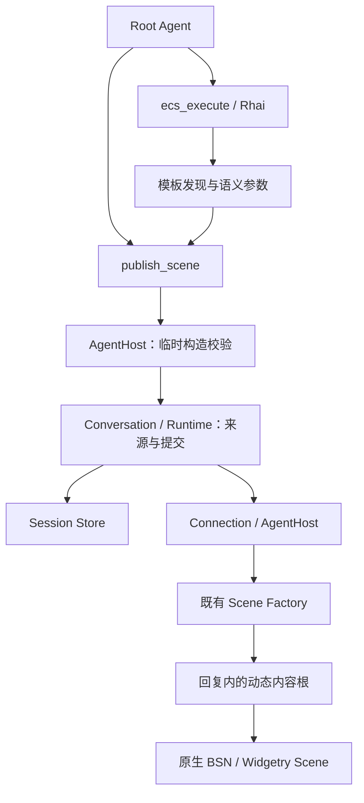
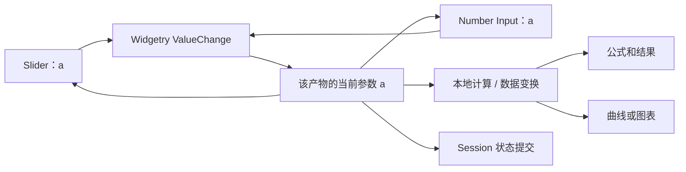

# 动态 Scene 如何创建、组合及更新

## 先把动态控件变成回复中的内容

Agentelier 当前的 `ecs_execute` 在 Agent 侧执行 Rhai，通过 `EcsAccess` 请求/响应由 `AgentHost` 在 Bevy 主线程操作 World。`scene_templates()`、`scene_spawn()` 和 `scene_despawn()` 可以发现并实例化 Rust 预先注册的 BSN Scene。当前 Application 注册了 `agentelier.button`，它按语义参数构造原生按钮，并由 Scene Factory 管理自己创建的实体。

这套机制继续用于生成式界面（Intelligent UI）。新能力首先不是给模型开放一种新的 UI 编程语言，而是让 Scene 作为用户可见产物进入具体回复，有明确的来源和独立生命周期。`scene_spawn` 所返回的实体只在当前 World 有效，聊天内容则必须在重开 Session 后仍然存在。

用户会话的 Root Agent 通过 `publish_scene` 传递模板标识和 JSON Props。`scene_templates()` 继续提供发现，普通 `scene_spawn()` 继续构造当前 World 的实例。发布请求复用 EcsAccess 和同一个 Scene Factory，在临时父节点实际构造并立即清理。验证通过后，Turn Runner 把稳定产物 ID、模板标识和语义参数与来源工具结果一起提交到 `ToolReturned`。模板 `agentelier.button` 的定义包含标签和样式。

确认提交后，Conversation 从来源调用投影产物，Chat UI 在回复的同一输出位置调用 Factory。切换会话销毁挂载的实体，重开时由原模板和已保存的语义参数创建新实体。恢复构造失败时在原位置显示局部错误。工具结果向模型提供产物 ID 和模板名，持久定义由会话存档保管。

这一组织方式参考 Generative UI 中由模型选择已有组件并传递结构化语义数据的做法。可用模板、参数描述和实际支持的更新行为由原注册体系提供给模型。模型选择 Scene、提供结构化语义数据或编写 Rhai 行为脚本，Rust 按控件实际契约创建和更新。模板定义不是模型任意发来的 HTML，不建设通用 UI Tree DSL，不用 `ecs_spawn` 手写 Widgetry 受管理控件内部实体。正常 Runtime ECS 读写能力和已开放的操作边界不变。

## 从独立控件到组合界面

Application 已注册 `agentelier.slider` 和 `agentelier.number_input`。两者接受可见标签、`integer` 或 `float` 类型、闭区间、正步进和初值。Number Input 的整数使用有符号 64 位，浮点使用双精度。Slider 使用 Widgetry 的单精度范围，整数值和跨度限于 2²⁴，且初值必须从某个端点按步进到达。

两个控件的 Props 只在构造时初始化 Widgetry 状态。用户的拖动、编辑和步进经由 Widgetry 公开接口更新实际状态，控件从 `ValueChange` 投影带源实体、强类型值和交互结束标记的统一数值事件。布局通过 BSN Scene/SceneList 组合。

离散输入模板 `agentelier.choice` 以 ComboBox、Radio Group 或 Segmented Control 呈现同一组选项，`agentelier.boolean` 以 CheckBox 或 Toggle Button 呈现布尔值。选项的字符串身份独立于标签、顺序和 Widgetry 的临时索引。实例从实际选择或勾选状态投影为统一离散事件。ComboBox 的列表数据源由该实例拥有，随回复控件挂载及回收。

这里的组合不要求预先为所有可能的应用实现一个完整的 Rust Scene。先具备可描述的布局位置及标准组件，进一步通过自定义脚本控件承载新行为。两者使用同一聊天内容归属与状态保存关系。

## 交互需要状态和绑定

滑块和数字输入只有在数值能影响图形时才是有用的。每个动态产物拥有一组有类型的命名参数及自己的当前状态。参数定义说明数值、布尔、枚举或文本的意义，以及必要的默认值、范围和步进。控件和图形共享同一参数语义，而不是让每个控件维护一份相互复制的数据。

例如二次函数探索器的 `a`、`b`、`c` 可以由滑块控制，数字输入与滑块同步，公式展示当前函数，图形重算对应曲线。选择器、开关和按钮可改变数据过滤、显示选项或恢复初始参数。用户操作在本地生效，不需要每次请求 LLM。标准数学和图表模板可由 Bevy System 维护响应关系，自定义行为由 Rhai 处理；两者都在正确的产物身份下更新。

参数绑定与计算的语义可参考 Vega-Lite 的命名参数、选择与输入绑定。这里采用其状态关系，不引入 Vega-Lite 的 JavaScript 或网页组件。原生控件读取和呈现参数变化时应避免循环触发同一次更新。只有依赖已改变的参数或数据的内容需要重算；流式正文增长不能重建整组场景。

## 场景更新与失败

`update_scene` 接收同一 Session 中的稳定产物 ID、预期修订及完整的新定义。首次发布为修订 1。Turn Runner 在 Factory 构造验证后核对修订，Session Store 将更新与来源工具结果一起提交。Conversation 在收到写入回执后更新原发布投影，恢复时按日志重放连续修订。过期修订返回当前修订，失败更新保留已经确认的定义。

Chat UI 保留原产物位置和容器。相同 `agentelier.button` 模板通过其更新接口改写标签和样式，原按钮实体与焦点保持一致。结构替换先在隐藏子树准备并构造新实例，再公开新子树及回收旧实例。实际更新失败时在原位置显示说明并保留此前实例。

数值模板在更新时允许省略 `value`。AgentHost 在同一 Session、同一产物的已挂载同类型控件中读取当前值，和新范围及步进一并校验，将生效值写入已确认的定义。当前值不满足新定义、更换控件或数值类型、或者实例未挂载时，Agent 必须提供有效的 `value`。普通用户交互值暂随当前挂载实例保留。

离散模板切换呈现方式时使用同一套值校验。选项重排或修改显示标签后，当前选项的身份仍可保留。移除当前选项需要同时提供新的合法值。布尔值在复选框和切换按钮间可沿用。

用户和 Agent 按顺序操作同一个场景。Agent 修改场景时，用户可以等更新完成，再继续使用控件。也可以通过现有聊天交互让 Agent 停止，等任务停止后接手操作。

对已有场景的更新使用明确的定义修订与状态关联。变更成功后保存新定义或状态，恢复时采用最后一次已确认版本。普通用户交互失败不抹掉之前可用状态；模型主动修复时同样更新原产物而不是留下多个失败控件。保存失败与渲染失败是独立结果，未获得持久回执不能宣称已经保存。

现有 `EcsError`、单次主线程请求 Panic 隔离、Rhai 解析及执行错误、Scene Factory 构造失败处理继续有效。新产物创建失败时清理其本次拥有的半成品，不影响其他消息或控件；更新阶段优先准备和校验新内容，失败时保留最后一次有效的定义和界面。现有通用 ECS 脚本不是事务，不能声称已回滚之前成功的其他 World 操作。对未能完全恢复的场景，以实际状态报告并允许显式修复。

当 Agent 正在执行任务时，创建或更新错误沿原工具回执返回，Agent 可以修正参数或脚本重试。任务已经结束后，用户操作引发的错误在控件内可见，保留最近有效状态，用户可以再次操作或要求助手修复。错误本身不会擅自发起模型请求。恢复失败保留原位置的错误占位，其他可阅读聊天内容继续工作。

这些是正常构造、状态一致性与生命周期规则，不是额外的权限系统。继续使用现有 Agent/UI 分离、进程内通信、取消和执行预算，不建立另一个安全沙箱，不给每种图形或控件附加新的审批机制。
