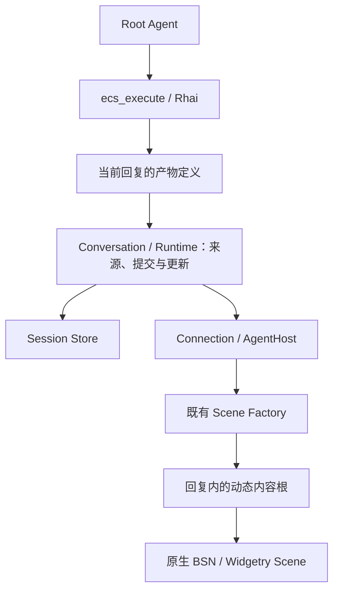
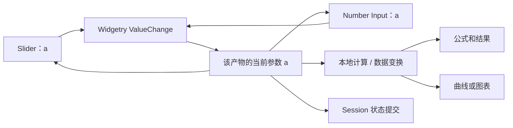

# 动态 Scene 如何创建、组合及更新

## 先把动态控件变成回复中的内容

Agentelier 当前的 `ecs_execute` 在 Agent 侧执行 Rhai，通过 `EcsAccess` 请求/响应由 `AgentHost` 在 Bevy 主线程操作 World。`scene_templates()`、`scene_spawn()` 和 `scene_despawn()` 可以发现并实例化 Rust 预先注册的 BSN Scene。当前 Application 注册了 `agentelier.button`，它按语义参数构造原生按钮，并由 Scene Factory 管理自己创建的实体。

这套机制继续用于生成式界面（Intelligent UI）。新能力首先不是给模型开放一种新的 UI 编程语言，而是让 Scene 作为用户可见产物进入具体回复，有明确的来源和独立生命周期。`scene_spawn` 所返回的实体只在当前 World 有效，聊天内容则必须在重开 Session 后仍然存在。

图表示目标业务流。普通 `ecs_execute` 仍可以按现有方式操作其他 UI 实体；只有明确登记为用户可见产物的 Scene 才进入回复及持久化流程。模型不通过搜索任意 `ChatMessage` Entity 推测自己应该挂在哪一轮回复里。为这类产物建立稳定的当前调用来源上下文和语义化创建入口；现有 Scene Factory 可继续承担 BSN 实例化，持久化产物身份与临时 `EcsEntity` 分开。

这一组织方式参考 Generative UI 中由模型选择已有组件并传递结构化语义数据的做法。可用模板、参数描述和实际支持的更新行为由原注册体系提供给模型。模型选择 Scene、提供结构化语义数据或编写 Rhai 行为脚本，Rust 按控件实际契约创建和更新。模板定义不是模型任意发来的 HTML，不建设通用 UI Tree DSL，不用 `ecs_spawn` 手写 Widgetry 受管理控件内部实体。正常 Runtime ECS 读写能力和已开放的操作边界不变。

## 从独立控件到组合界面

优先复用 Widgetry 现有控件：Button、Slider、Number Input、CheckBox、Radio Group、ComboBox、Toggle Button、Segmented Control、Text Field，以及适合数据展示的表格。按用途启用所需 Feature 并以公开 API 注册 Scene；现有 `chat_ui` 已接入其中一部分，`slider`、`number_input`、`canvas` 等尚需接入。不能只添加模板名称而不提供实际行为。

标准控件的 Props 描述构造时的语义数据，例如滑块的数值类型、范围、步进、初始值；运行期值由持久 Component 和业务状态管理，使用 Widgetry 的真实事件及公开修改方法，不保留同义的 Props 副本。布局通过 BSN Scene/SceneList 组合。模板可以表达具体组合场景，例如函数探索器的公式区、绘图区、参数区和结果区；它的内部仍然是原生控件。

这里的组合不要求预先为所有可能的应用实现一个完整的 Rust Scene。先具备可描述的布局位置及标准组件，进一步通过自定义脚本控件承载新行为。两者使用同一聊天内容归属与状态保存关系。

## 交互需要状态和绑定

滑块和数字输入只有在数值能影响图形时才是有用的。每个动态产物拥有一组有类型的命名参数及自己的当前状态。参数定义说明数值、布尔、枚举或文本的意义，以及必要的默认值、范围和步进。控件和图形共享同一参数语义，而不是让每个控件维护一份相互复制的数据。

例如二次函数探索器的 `a`、`b`、`c` 可以由滑块控制，数字输入与滑块同步，公式展示当前函数，图形重算对应曲线。选择器、开关和按钮可改变数据过滤、显示选项或恢复初始参数。用户操作在本地生效，不需要每次请求 LLM。标准数学和图表模板可由 Bevy System 维护响应关系，自定义行为由 Rhai 处理；两者都在正确的产物身份下更新。

参数绑定与计算的语义可参考 Vega-Lite 的命名参数、选择与输入绑定。这里采用其状态关系，不引入 Vega-Lite 的 JavaScript 或网页组件。原生控件读取和呈现参数变化时应避免循环触发同一次更新。只有依赖已改变的参数或数据的内容需要重算；流式正文增长不能重建整组场景。

## 场景更新与失败

Agent 可以基于稳定产物身份更新已有场景的数据、参数定义或结构；正常更新保留原聊天位置和仍然有效的交互状态。只有该场景需要替换时才重新构造其受影响的部分，不通过连续销毁、创建来模拟每一次数值更新。

如果新定义保留了某个参数，但其当前值已不满足新的类型、范围或选项，Agent 必须在同一次更新中为该参数指定符合新定义的当前值。校验通过后才提交新定义及参数值，缺少新值或新值无效时通过原有结构化错误回执反馈。

用户和 Agent 按顺序操作同一个场景。Agent 修改场景时，用户可以等更新完成，再继续使用控件。也可以通过现有聊天交互让 Agent 停止，等任务停止后接手操作。

对已有场景的更新使用明确的定义修订与状态关联。变更成功后保存新定义或状态，恢复时采用最后一次已确认版本。普通用户交互失败不抹掉之前可用状态；模型主动修复时同样更新原产物而不是留下多个失败控件。保存失败与渲染失败是独立结果，未获得持久回执不能宣称已经保存。

现有 `EcsError`、单次主线程请求 Panic 隔离、Rhai 解析及执行错误、Scene Factory 构造失败处理继续有效。新产物创建失败时清理其本次拥有的半成品，不影响其他消息或控件；更新阶段优先准备和校验新内容，失败时保留最后一次有效的定义和界面。现有通用 ECS 脚本不是事务，不能声称已回滚之前成功的其他 World 操作。对未能完全恢复的场景，以实际状态报告并允许显式修复。

当 Agent 正在执行任务时，创建或更新错误沿原工具回执返回，Agent 可以修正参数或脚本重试。任务已经结束后，用户操作引发的错误在控件内可见，保留最近有效状态，用户可以再次操作或要求助手修复。错误本身不会擅自发起模型请求。恢复失败保留原位置的错误占位，其他可阅读聊天内容继续工作。

这些是正常构造、状态一致性与生命周期规则，不是额外的权限系统。继续使用现有 Agent/UI 分离、进程内通信、取消和执行预算，不建立另一个安全沙箱，不给每种图形或控件附加新的审批机制。
