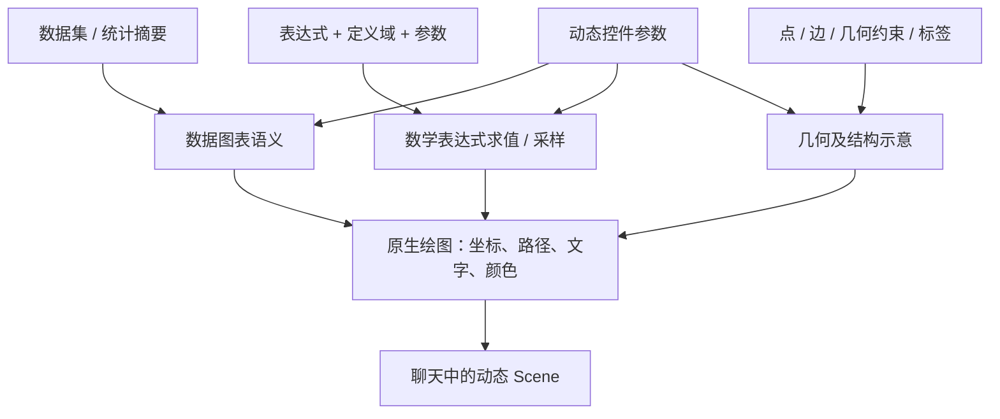
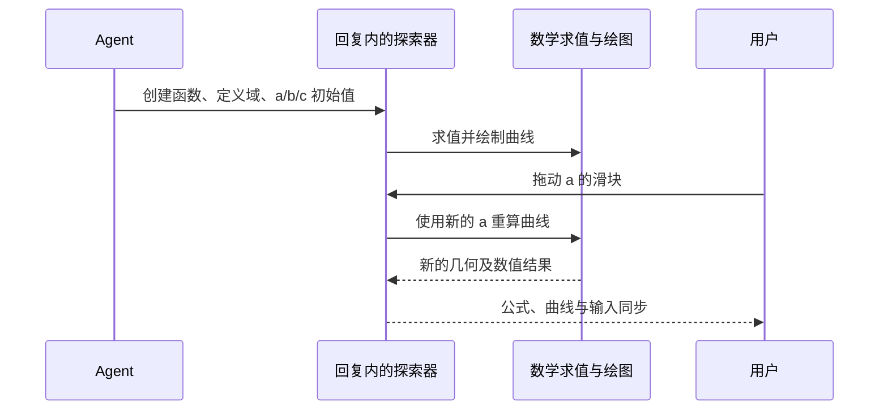

# 从数据绘图到数学交互

动态图表、数学示意图和交互式控件不必设计成三个互不相干的系统。它们可以共享回复归属、Scene 创建和参数绑定，也可以共享底层绘图能力；真正需要分开的，是输入数据的意义和计算方法。

对外提供的模板应使用各自的语义描述。数据折线是观测值的连线，函数图是定义域内的数学关系，证明树是逻辑结构，不能让它们全部退化为模型传来一堆不明含义的屏幕像素。

## 原生绘图基元

Bevy 负责实际渲染。Widgetry Canvas 已具备矩形、椭圆、路径、文字、连接线、箭头、分组、图层及部分流程图预设。它适合参考或复用矢量显示与几何图形的部分公开能力，不承担数学函数求值、坐标轴刻度或统计计算。其上游编辑画布包含编辑、图层和历史等能力，本设计只使用回复内展示与交互所需要的部分，不创建独立白板工作区。

绘图层需要逻辑坐标与可见区域之间的转换、布局、裁剪、文字标签、颜色和主题、图例、网格和轴刻度。不同图形可以选择各自的坐标系、比例和数据变换；真正的显示参数由 Scene 或控件状态管理，不把每个点都暴露为跨线程的同步 ECS 请求。计算可以在后台完成后传递图形描述，再由 Bevy 主线程更新图形。Rhai 自定义控件也可使用这组点、线、矩形、圆、路径和文字能力。具体绘制 API 由公开 Bevy/Widgetry 能力决定，不建立第二套 UI 组合语言。

原生图表 Scene 拥有自己的 Widgetry Canvas 文档和视口，轴和网格使用画布路径，刻度使用原生矢量文字，图例与轴名称按 Bevy UI 布局。视口根据实际逻辑尺寸等比适配，回复正文继续独立布局。切换会话回收视口和文档，重开从保存的图表定义重新构造。

## 数据图表

输入是结构化数据集、系列和字段语义，而不是待解析的自由文本。图表需要说明数据类型、系列名称、单位、坐标范围、类别顺序或时间顺序；缺失值和非有限数值应以有意义的方式处理，不能自动补造观测。普通文字数据表继续由 Markdown 支持。动态数据表提供行选择和与其他视图的联动，可使用 Widgetry 的正式控件。

`agentelier.line_chart` 接受一个或多个命名序列。X 轴使用数值或带时区的 RFC 3339 时间，时间刻度以 UTC 展示。Y 轴使用数值，缺失或不可表示的 Y 在 JSON 中提供 `null`。点按 X 稳定排序，缺失值断开连接，单独的观测保留为点。当轴给出范围时，只画出落在范围内的路径部分；省略范围时按实际观测值确定范围。图表与其数据沿原回复产物的定义修订保存。

`agentelier.scatter_chart` 使用两个数值轴、命名系列和可配置的点半径。每组 X/Y 是独立观测，任一坐标缺失便跳过该点。点中心使用与轴相同的数值变换，重叠样本保留原位置。组合场景的 `series_filter` 将选择参数值映射到同名系列，可声明一个不同于系列名的值用于显示全部。筛选只变更相应绘图层的可见性，轴范围保持按完整数据和显式范围确定，重开恢复保存的筛选值。独立散点图的数据修订在轴、标题和图例相同的情况下更新发生变化的路径。

`agentelier.area_chart` 使用折线图相同的连续轴和观测顺序，要求给出 Y 轴单位下的 `baseline`。各系列分别填充观测到基线之间的区域，缺失值结束当前段，穿过基线时在真实交点换侧。自动范围纳入基线，显式范围裁剪填充。界面显示基线数值，且在它落入可见范围时用虚线标示。轴与图例布局保持一致的修订在原视口内更新发生变化的填充和基线，恢复沿用已保存的完整定义。

`agentelier.bar_chart` 使用显式有序类别和数值 Y 轴。同一类别中，系列按定义顺序占固定槽位，量值从显式基线向对应方向延伸。基线上的真实观测显示彩色短线，`null` 槽位保持空白。组合场景可分别通过 `category_filter` 和 `series_filter` 绑定选择参数。筛选保留类别位置、系列槽位和 Y 轴范围，还原时从会话中读取筛选值。轴与图例布局相容的定义修订更新已有路径。

`agentelier.pie_chart` 按非负组成值的真实合计计算扇区角度，按定义顺序从正上方顺时针绘制。图例显示量值、单位和有定义的百分比，零值显示在图例中。合计为零或有缺失项时保留已知值并说明比例未定义，省去圆形。负值与无法表示的合计在发布时返回错误，已确认的会话定义按原模板恢复。

`agentelier.heatmap` 在原生矩阵网格中按定义顺序显示行列标签、数值和缺失标记。渐变图例和单元格使用同一色标，自动范围取有效值的最小值和最大值，给定范围时超出边界的值映射到最近的颜色端点。观测相同时使用单一颜色和对应数值说明。组合场景可通过 `category_filter` 筛选行，行列标签、单元位置和颜色范围保持稳定。横向滚动保持单元可读，并把纵向滚轮输入交给外层聊天区。矩阵定义及选中行读取已确认的会话记录。

`agentelier.histogram` 接受样本和一个或多个命名分箱，或边界与计数的固定摘要。柱宽使用实际数值区间。样本落入左闭右开区间，最后一个区间包含右端点，范围外和缺失样本分别计数。相对频率是箱内计数除以已纳入总数，概率密度再除以箱宽，使柱面积对应概率质量。没有纳入样本时，区间仍列出计数，频率和密度显示为未定义。组合场景可通过 `histogram_binning` 选择预定义样本分箱，轴范围保持跨配置一致，选项沿所属产物状态保存。

`agentelier.box_plot` 以有序分组呈现各自的四分位数和须线。样本按 Tukey hinges 计算四分位数，奇数个观测时上下两半均包含中位数。须线截止于距箱体不超过 1.5 IQR 的最外侧观测，其余有效样本显示为异常点。给定摘要提供自己的分位数方法和须线规则，缺少异常点信息时显示未知。零跨度箱体显示为线。组合场景可用 `series_filter` 绑定分组选择，同步筛选图形和统计明细，保留原分组位置与轴比例。

`agentelier.data_table` 将列定义和稳定行 ID 装入 Widgetry Table 模型。列区分文本、整数、实数与布尔值，数字单位显示在表头，缺失有专用标记。使用 Widgetry 视口的二维滚动和可见行投影。独立表持久化选中的行 ID，修订通过 ID 找到重排后的同一行。组合表的 `table_selection` 绑定共享行 ID，`table_field` 按同一参数和来源表格读取实际列值。

`agentelier.combined_chart` 在一个绘图区将折线、散点、面积及区间柱绘制在共享的 X/Y 轴上。X 支持数值或时间，Y 为数值。系列声明的轴引用和单位须与共享轴一致；未声明的单位沿用轴单位。每个系列用自身的实际标记与图例符号，区间柱的宽度由两个真实 X 边界决定。系列依定义顺序绘制，`series_filter` 切换绘图层，坐标与图例身份保持稳定。

多个独立数据视图可在组合场景内引用同一个选择参数。表格输出稳定行 ID，折线、散点等视图可在 `series_filter.map` 中声明从共享 ID 到本视图系列名称的映射。每个视图沿用自己的绘图区、单位、轴范围和系列定义。新选择只投影到绑定该参数的视图，重开后同一个保存的 ID 再次驱动各视图。

| 图表能力 | 需要呈现的语义 |
| --- | --- |
| 折线图 / 面积图 | 连续趋势、多序列、时间或数值轴、明确基线与缺口 |
| 柱状图 | 类别与量值的对应、分组和单位、基线 |
| 散点图 | 独立二维数值、点系列和分布，不能默认连成线 |
| 饼图 | 非负组成与合计、零值或无总量的反馈 |
| 热力图 | 行列矩阵、颜色映射、量纲及缺失单元 |
| 直方图 | 分箱边界、计数/频率/密度的明确含义 |
| 箱线图 | 四分位数、中位数、须线、异常点及统计定义 |
| 组合图和多视图 | 按各系列语义共享或区分轴、图例、单位与参数状态 |

第一批可用能力由若干独立模板逐项实现，共用坐标、绘图与状态关系；不是等待整个图表库完成后才允许用户看到一张折线图。已知定义的统计图可接受数据或明确的统计摘要，不能在没有原数据时伪造精确分箱或异常点。必要的图表筛选、系列显示、选择和缩放使用本地参数绑定，不要求模型重复生成所有数据。

## 函数图形

例如用户要求展示 `f(x) = a x² + b x + c`，可以让 Agent 给出函数、定义域和三个参数，然后使用 Scene 的本地计算响应滑块。

数学排版引擎负责显示 `f(x)` 的记号。独立的数学表达式引擎负责变量、常量、运算、常用函数、定义域及求值错误。这里使用专门的数学语法，是因为函数图形需要明确数学含义、定义域和数值行为，而不是把一段 TeX 或随意的 Rhai 当成可绘制函数；Rhai 自定义控件仍可以自由编写自己的计算行为。无需为求值再设一套权限限制。

函数图像的计算和绘制应区分定义域以外、除零、非有限值和真正的连续曲线。遇到 `1/x` 的奇点等情况不能跨越断点画出不存在的线。采用实际坐标范围和合理采样，在缩放或参数变化时重算必要曲线。

需要覆盖的图形范围是：

- 直角坐标：显式函数、方程/隐式关系、不等式区域、点和曲线。
- 极坐标：半径与角度的关系。
- 参数曲线：由同一参数确定的坐标路径。
- 数学空间图形：三维坐标中的函数曲面、空间向量和向量场。该场景只提供数学图形的有限视角操作，不建设通用 3D 场景编辑或独立工作台。

`agentelier.function_plot` 使用独立的 Rust 数值解析器。语法包含显式乘法、幂、括号、数值常量、变量和固定的初等函数集合。解析得到的表达式用于有限数值求值，也用于生成调用原生 Markdown 排版的公式。同一图可在各自的定义域内绘制多条函数并叠加独立散点。采样随视口分辨率与变量变化更新，对无效值和快速发散的小区间断开曲线。`math_parameter` 将组合里的数值交给已声明的变量，曲线和公式使用同一份局部状态。

`agentelier.implicit_plot` 在 X/Y 定义域内计算表达式的目标等值线。绘图从网格边查找收敛到目标值的根，利用单元中心解决四边相交的连接关系，再拼接共享交点生成闭合曲线与开放分支。含无效值或符号变化无法收敛的单元会留下断点。它和显式函数图共用数学参数、原生公式及视口更新机制。

`agentelier.inequality_plot` 在显示范围和区域定义域的交集内采样比较关系，以闭合路径填充成立区域，也保留内部缺口。实线表示包含在区域内的比较边界，虚线表示排除的比较边界。定义域裁剪和未定义值造成的缺口只改变填充轮廓。一个区域包含多个比较时，需要显式选择 `all` 或 `any`，且在所有条件均有有限求值的位置应用组合关系。表达式、定义域和可绑定的数学参数随 Scene 恢复，原生视口重算采样结果。

`agentelier.polar_plot` 在给定角域中以声明的度或弧度求值 `theta`，再用等比例圆形网格和相应单位的角刻度投影。投影方向每周重复，表达式仍接收未折叠的角度，负半径移至相反方向。三角函数继续使用弧度。超出径向上限和无效求值会中断路径，公式显示实际角域，历史保存定义与绑定参数。

`agentelier.parametric_plot` 按同一个递增的 `t` 求值 X、Y 表达式，保留路径次序、交叉和断点。视口与声明的最低采样数共同决定初始采样，随后按曲率和有效性细分。只有原始首尾同位且整条路径在视口中连续时才闭合。可选游标从已声明的数学参数取 `t`，标示每条曲线上定义且可见的对应点，沿同一套绑定与存档机制恢复。

## 几何与专业结构

平面几何、向量图、图论、交换图、证明树通常更适合传入语义对象。一个三角形由顶点和边定义，角度标签引用相关顶点；向量有起点与方向；交换图和证明树由节点、关系、箭头、推导标签等组成。绘图层负责把这些对象变成真实图形，数学排版能力可以作为节点或标签的显示来源。

允许几何点、参数或标记通过用户输入改变，从而更新依赖的边、角、面积或其他关系。对于没有定义的几何约束，显示实际不可计算状态，不把拖动后不成立的约束仍标成成立。图论、交换图和证明树强调正确连接、方向、逻辑层级和标签，不要求内置证明器、自动定理证明或任意图布局系统。

## 组合例子：二次函数探索器

这个例子说明预设 Scene、专业公式、数学求值和参数绑定怎样共同工作。

改变 `a` 不应创建另一条回复或启动模型请求。多个控件引用同一状态，恢复初始值后所有依赖内容一起更新。重开 Session 可以继续使用保存的参数。

同一机制也可用于物理、工程、概率统计和算法演示，不要求为每个学科建立独立 UI 框架。高频场景优先提供预设原生模板，事先无法预料的布局、算法或交互交给下一层 Rhai 自定义控件。
