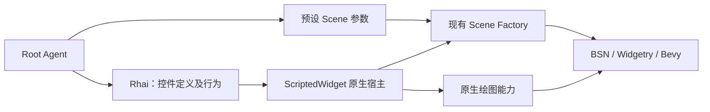
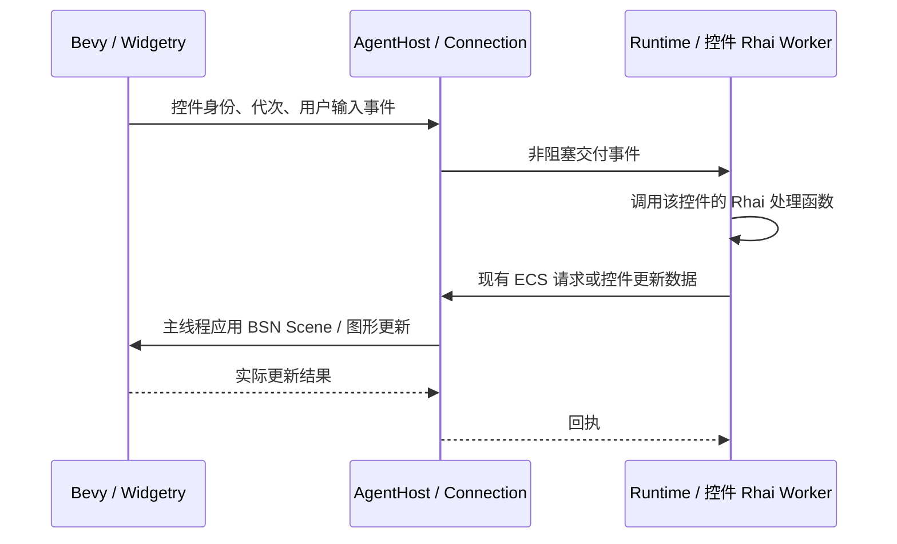

# Rhai 如何定义运行时自定义控件

## 创建新行为，而不只是换一组 Props

当前 Scene Factory 只能实例化 Rust 侧已经登记的 Scene。模型可以选择一个按钮，或组合多个现有控件，但按钮的行为及组合界面的计算仍然来自编译时实现。

这里增加另一种能力：使用一个 Rust 实现的原生脚本控件宿主承载由 Agent 定义的界面和行为。下文以 `ScriptedWidget` 表示这类宿主，不要求最终 Rust 类型一定采用该名称。Agent 可以从未存在过的需求出发，自行定义控件状态、布局、绘图方式、事件响应、计算和随时间变化的行为。

预设 Scene 和自定义控件不是二选一。普通图表、Slider、表格等通用需求选择稳定的 Rust 模板；自定义控件可以调用它们，也可以通过绘图基元表现新图形，并用 Rhai 自己定义计算和事件处理。例如一个抛体运动模拟器不需要开发者先写 `ProjectileSimulator` Rust 类型，Agent 可定义初速度、发射角、重力、运动进度，以及轨迹、当前位置和计算结果之间的关系。

运行时自定义不等于运行时编译 Rust 类型、任意原生插件或新 ECS System。宿主预先实现必要的原生布局、事件转发及绘图能力，Rhai 在已提供的执行与通信机制上描述新行为。布局继续通过原生 Scene Function、SceneComponent、SceneList 组合，可由脚本利用已登记的容器/控件、语义位置与实际布局参数。脚本不用再发明一套替代 BSN 的 UI Tree 语言，也不直接改 Widgetry 私有状态。

Bevy Dynamic ECS 和 `bevy_mod_scripting` 可作为理解运行时动态行为的参考；现有 `ScriptSession` / `EcsAccess` 已有明确职责，本次不引入另一套 Lua/Rhai 框架或动态原生类型注册系统。

## 为什么已有 ScriptSession 还不够

`agentelier_tools::ScriptSession` 持有一个会话的 Rhai Engine、Scope 和函数 AST。`ecs_execute` 在 `spawn_blocking` 中执行有界脚本，经同步 Native API 发送 ECS 请求，由主线程处理后返回结构化结果。变量与函数可以在该会话多次调用间保留。当前 ScriptSession 的脚本控制和取消属于一次工具执行，代码没有一个由 UI 事件持续触发的控件运行时。

如果把用户每次拖动滑块都变成模型工具调用，一轮回复结束后控件便失去行为。需要延续的是现有 Rhai 引擎和通信方式，而不是普通工具调用的生命周期。每个自定义控件拥有独立于前台 Turn 的行为实例：自己的程序定义、可序列化状态、运行代次、事件处理以及恢复、销毁契约。Runtime 管理相应脚本工作者的实际执行与回收，Bevy 管理自己的 Scene 和交互事件。脚本引擎、Native API、取消及有界执行机制复用当前实现，不另设执行权限层。

此处的双向通信延续已有 Agent/UI 边界。Bevy 主线程不能同步等待 Rhai 回调完成，因为回调又可能等待 Bevy 处理 ECS 请求；Runtime 的 Tokio current-thread 也不直接运行长时间脚本。Rhai 工作交由适当的工作线程，使用原有 Winit 唤醒和非阻塞主循环。一个实例的状态事件有序推进，来自已销毁或替换代次的事件不应用到新实例。不同控件无需共享一个可变 Scope，也不因另一个控件的长任务而混淆状态。

运行中继续使用现有 `ecs_execute` 的通用世界发现、查询、修改、已登记事件及模板能力。新增的是用户事件到控件程序的实际交付、实例生命周期及状态持久化，不是减少既有 Agent 可用操作。已有 30 秒脚本期限、操作数、函数和变量等限制，以及 ECS 请求队列/主线程工作量边界仍按原机制处理；正常绘图和事件更新应合并必要的数据，避免大量逐点同步请求和无意义刷新。具体事件合并方式服从真实输入与动画语义。

## 控件的程序、事件和绘制

`agentelier.scripted_widget` 的独立 Rhai 源定义 `init(ctx)`。`ctx.parameters` 和 `ctx.resources` 是持久定义中的 JSON 映射，返回值包含 `parts` 和可序列化的 `state`。`parts` 使用已登记的原生组合子项格式，包含稳定 ID、区域及 Scene 定义。发布时工作者运行初始化，主线程实际构造子 Scene 并将结果交给发布工具。展示或重开时另起工作者调用 `restore(ctx)`，其中 `ctx.state` 带入已检查的初始状态，源没有恢复函数时使用 `init(ctx)`。构造成功后，原生子实体继续由回复产物管理。

可选 `on_event(ctx, event)` 在控件本地接收原生激活、键盘、数字、选择、文本和拖动。`event.part` 是直接所属原生子项的稳定 ID，同一实例的回调依次读取最后一次成功应用的 `ctx.state`。回调可返回 `()` 来忽略输入，也可返回新的 `parts` 和 `state`。成功更新原生内容后才采用新状态，错误在原控件反馈，后续用户事件仍可处理。拖动中的相邻移动合并位移，点击、选择和最终提交保留各自顺序。卸载时取消在途实例请求并丢弃其队列。

脚本可把 `agentelier.script_canvas` 放进原生子项。它以声明的 X/Y 逻辑范围解释有稳定 ID 的点、线、路径、圆、椭圆、矩形和文字，在 Bevy 主线程一次应用一批 Canvas 数据。回调的图元结构兼容时保持画布和对应图元实体，输入数学坐标与颜色变化按原位置重绘。无效数据通过同一原生构造校验反馈，保留上一版有效画布和状态。

程序需要表达这些行为，而非指定一套新的固定语言：

- 初始化：接受定义、参数和初始或已恢复状态，创建自己的原生 Scene 与图形。
- 用户事件：处理点击、按键、数值变化、选择和拖动，必要时更新状态、文字和图形。
- 自定义计算：在 Rhai 中执行控件专有逻辑，使用已有 Native API 完成需要的本地能力。
- 绘图：生成点、线、路径、矩形、圆形、文字等图形描述，更新已有图形或创建属于该场景的内容。
- 时间变化：在需要动画或模拟时响应定时/时间步事件；真实经过时间与展示状态相联系，暂停后停止更新。
- 暂停、恢复、销毁：切换 Session、应用退出、场景重建或移除时，按所属实例处理回调及资源收尾。

上述名称是行为契约，并非已确定的函数签名。事件的载荷、回调签名、脚本源组织和原生宿主调用方式在实施中根据现有 Rhai 接口核实。`Rhai` 当前启用 `no_module`；多文件 Skill 可以提供代码材料，但不假定运行时已经支持 Rhai `import`。如需多个脚本文件，应将所需定义明确装入同一可恢复程序，或在以后有明确必要性时单独改变依赖 Feature。

以抛体模拟为例：Agent 设定初始数据、控制条和画布；用户改变角度时脚本计算新的抛物线，按运动进度绘制质点；用户拖动进度或暂停/继续时也由本地事件改变结果。普通滑块仍由 Widgetry 管理输入，轨迹仍由 Bevy 绘制，而“角度怎样影响轨迹”是运行时生成的 Rhai 行为。这才是没有预设整件控件时也能实现的新能力。

## 控件运行出错时

自定义定义必须能够被编译、初始化并实际构造。脚本语法、Native API、数学计算或 Scene 构造失败通过结构化错误返回；Active Turn 内由 Agent 获取实际结果后决定修复。初始化的一次创建只清理本次拥有的场景资源，不回滚其他已完成的 ECS 操作。

运行中的回调错误保留最近一次有效状态与已展示内容，显示错误并允许用户重试或要求助手修复。动画错误停止相关实例的继续驱动，其他内容照常工作。更新到新程序时先准备新定义，只有成功构造/安装并获得相应回执后才替换已确认版本；若已经产生外部副作用，仍按实际事实报告，不声称事务回滚。应用现有单次 ECS 请求 Panic 隔离继续使用，不另设全局吞掉 Panic 的逻辑。

控件在 Agent 回复结束后仍能响应用户，错误在控件内反馈。切换、删除、退出使相关实例按归属停止，排空或取消在途回调，真实资源回收后释放 UI 和 Runtime 状态。重开时调用选定脚本的恢复入口，继续使用现有 Rhai Native API 和 ECS 操作边界。脚本来源及状态恢复见[动态内容的持久化与 Skill 复用](07-persistence-and-skills.md#历史如何选择脚本和恢复状态)。
