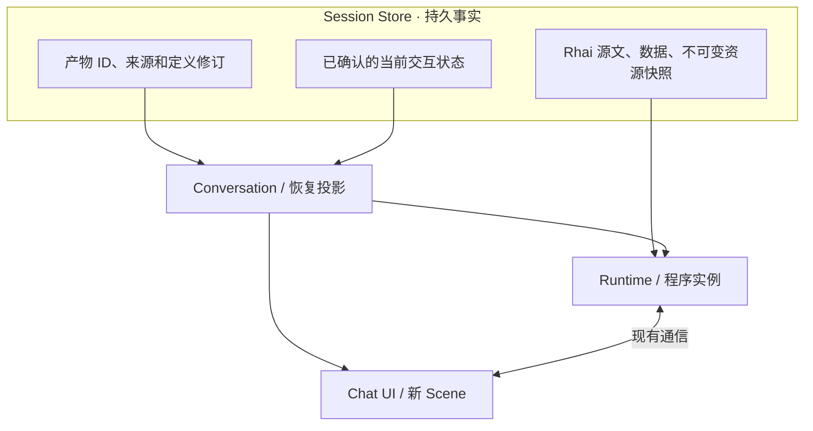
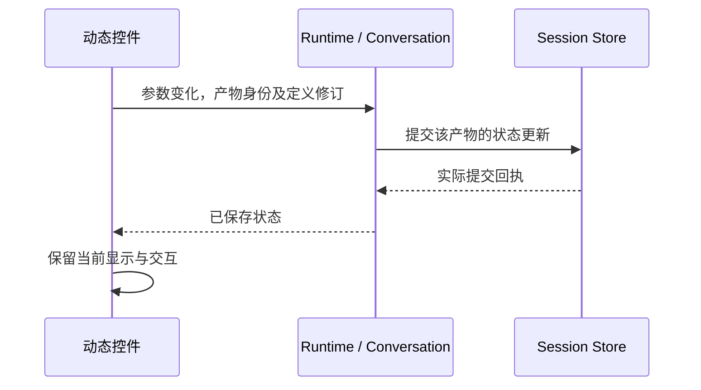
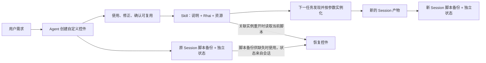

# 动态内容的持久化与 Skill 复用

## 历史记录保存定义，而不是运行中的实体

一张图片可以从原始编码文件恢复。一个动态控件要恢复的不只是外观，还包括它是什么、当前参数是什么、有哪些行为，以及哪些文件是当时实际使用的资源。

现有 Session Store 已经使用稳定 UUID、JSONL 单写入者、顺序记录和不可变附件。Conversation 恢复业务事实，Runtime 持有执行资源，Bridge/Chat UI 使用展示投影。动态内容沿用这一模式。



每份动态产物具有稳定的所属 Session、Root Turn、来源请求/调用和内容 ID，定义修订可以独立变化。它包含模板标识或脚本控件类别、构造参数、所需数据及资源、初始状态与当前交互状态。当前状态与定义修订明确关联。Rhai 自定义控件额外保存完整脚本源文和重建所需的接口信息。有 Skill 关联的控件同时保存 Skill 来源和脚本入口，供下次重开定位当前脚本。

| 持久事实 | 运行期资源 |
| --- | --- |
| 稳定内容 ID、来源及内容顺序 | Bevy Entity / generation |
| 模板类型和完整构造语义 | Rust Scene 实例及临时子树 |
| Rhai 源文、数据与资源快照 | Engine、Scope、AST、闭包和执行句柄 |
| 初始值、已确认用户状态、必要的模拟进度 | GPU Mesh/Image Handle、临时布局、输入捕获 |
| 结果或更新的真实失败状态 | 通道、取消令牌、计时器与任务句柄 |

定义和状态记录由 Conversation 建模，经 Runtime 提交至现有 Session Store 单写入者。大型脚本、数据及媒体资源按需使用所属会话的受控附件快照。具体 RecordEvent 名称、编码格式、存储大小上限和资源描述符在实施时按现有类型、附件机制及实际需要确定。JSONL 记录与会话备份资源采用稳定引用，Skill 关联沿已有 Skill 来源解析。

## 用户操作与定义更新如何保存

以一个函数探索器为例：初始 `a = 1`，用户将它调到 `a = 1.7`。界面状态先反映真实操作，变化提交后才成为可恢复状态。下次重开显示 `a = 1.7`，而不是重新使用默认值。与用户操作无关的 Markdown 增量不覆盖这个状态。



组合控件的参数变化即时生效，随后经 AgentHost 和 Bridge 合并短时间内的修改。Runtime 校验 Session、产物和定义修订，将语义参数写入独立的 `scene_state` 记录。Session Store 在单写入者队列中按实际追加顺序复核定义修订。Chat UI 收到保存失败时在原控件显示未保存提示，保留当前本地值。切换会话时提交待写值，正常退出在启动后台收尾前等待已接纳的状态保存完成。重新打开使用所属修订最后一次确认的状态。状态提交独立于 ProtocolHistory、用户消息和模型请求。

三维数学视口在拖动结束时保存方位角和仰角。独立三维 Scene 直接保存这两个数值，组合中的三维 Scene 则按稳定子 Scene ID 写入 `part_values`，与组合参数一起提交。早期会话记录缺少 `part_values` 时，仍按原有参数与初始视角重建。

几何示意同样在拖动结束时保存按点 ID 索引的自由坐标、圆上角度或线段比例。独立示意保存在产物自己的状态中，组合子 Scene 使用 `part_values`。恢复按当前定义重新应用约束和测量关系。

图论与交换图在同一状态机制下保存按节点 ID 索引的布局位置，重新计算连接和数学标签的锚点。

持久化指向可以恢复的用户参数与有意义的模拟状态，而非记录每一帧 GPU 状态。回放自动启动、悬停、焦点等瞬时 UI 状态不作为动态控件持久化合同。切换 Session 时停止对应控件的活跃行为并释放展示实体，保存的状态仍在。隐藏至托盘和窗口可见性变化沿现有应用生命周期；动画与定时回调按所属控件暂停或继续的状态收敛，不把可见性等同于删除 Session。

## 历史如何选择脚本和恢复状态

无附加来源的脚本控件保存 Rhai 源文、参数、资源快照和初始化得到的可序列化状态。重建用独立工作者运行定义的恢复入口，或重用初始化入口，再按返回的原生组合实例化。初次发布所校验的子 Scene 描述同源文保存在定义中。

有效回调更新后的脚本状态以 JSON 映射记录在所属产物的 `scene_state` 中，和定义修订共同校验。绘图资源、在途回调和主持时钟随旧实例释放。连续播放采用 Scene 状态写入者的合并期限，恢复只读取最后确认的映射，进度由脚本重新绘制，主持时钟仍暂停。

历史恢复读取已确认的产物描述、资源摘要和状态。预设模板按保存的定义创建新的原生 Scene。Rhai 自定义控件在每次重开时解析已关联的本地 Skill，找到对应脚本入口时使用其当前内容。未关联 Skill，或找不到关联 Skill 或脚本入口时，使用会话里最后保存的脚本。

Runtime 编译选定脚本并调用其保存的初始化或恢复约定，创建新实体、绑定事件，并交付该实例保存的状态。恢复入口使用现有 Rhai Native API 与 ECS 权限，可以按其脚本行为执行。历史上的整个 `ecs_execute` 调用仍是已发生的协议记录。新版脚本若需要转换旧状态，沿已有初始化或恢复约定处理；恢复失败时保留会话里已确认的定义与状态并在原位置报告实际错误。当前脚本存在但编译或运行失败时，错误反馈指向实际使用的脚本。恢复过程使用本地 Skill 和会话材料。

预设模板、脚本 API 或资源无法恢复时，在原内容位置反馈错误，聊天正文仍可阅读。动态控件状态是否保存成功由 Session Store 的实际提交回执确认。存档提交失败时，已确认状态仍是下次恢复的依据。

删除归属内容时清理其运行实例与关联资源。当前产品提供整 Session 删除而非任意单条消息删除，因此实施必须覆盖现有删除、重置、切换和退出，不另造单条消息删除功能。若将来存在单条删除入口，采用同一拥有关系。整 Session 清理延续现有受控目录规则，不删除用户外部项目文件或独立 Skill。导出的媒体也不属于 Session 私有文件。

## 从一个成功的自定义控件到一个 Skill

Skill 是可复用的工作流与代码材料，Session 中的控件是当次实例。Agent 可以在完成一个有用的控件后，按现有 `skill-creator` 的工作流将它整理成标准 Skill。

例如，一个抛体运动模拟器可以组织为：

```text
projectile-simulator/
  SKILL.md
  scripts/widget.rhai
  references/physics.md
  assets/                  (有实际资源时)
```

`SKILL.md` 描述何时使用、依赖的原生控件能力、创建方式与参数，例如重力、速度范围、角度范围和是否显示速度向量。`scripts/` 保存实际的 Rhai 初始化、计算、事件及绘制程序，必要参考资料和资源按标准目录组织。多文件程序必须符合当前 Rhai `no_module` 配置下实际可加载的方式，不假设任意目录导入已经实现。

当前 Skills 机制在每个任务开始重新发现名称和描述，模型按需读取正文和资源；显式 `$name` 和原有隐式匹配继续有效。用户可要求保存、修改或复用控件 Skill，Agent 沿已有原生 skill-creator 创建、校验和下一任务发现流程处理。Skill 不因为被发现就自动执行，不创建同名工具、独立的控件包管理系统或额外权限。被选用的 Skill 通过已有工具与 Rhai 机制实际创建产物。



使用 Skill 创建控件时，记录实际来源及脚本相对入口。用户将现有控件封装成 Skill 时，可以明确将原实例关联到新 Skill。关联按来源和入口解析，保留同名 Skill 的来源区分。Skill 更新会影响之后新建的控件，也会在关联的旧控件下次打开时生效。若移动或删除后原关联找不到脚本，会话内的备份仍可恢复。每个实例保有自己的参数和已确认状态，Skill 的默认参数通过其自身定义维护。

## 与现有设计的同步

本机制实现后，在 [总体架构](../architecture.md)、[会话与协议历史](../modules/conversation.md)、[会话存储](../modules/session-store.md)、[ECS Access](../mechanisms/agent-ecs-access.md)、[Skills](../skills/README.md) 和 [UI 设计](../ui/README.md) 中同步实际新增职责、事件及生命周期。Markdown 和媒体的相关说明同样随对应交付更新。不把一份目标方案直接覆盖现有代码事实，也不维护重复的功能清单。
