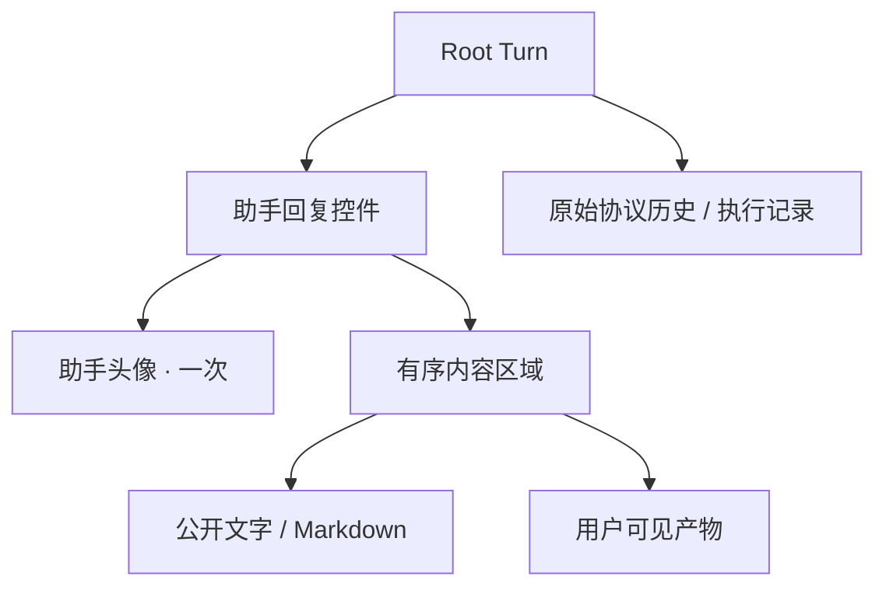
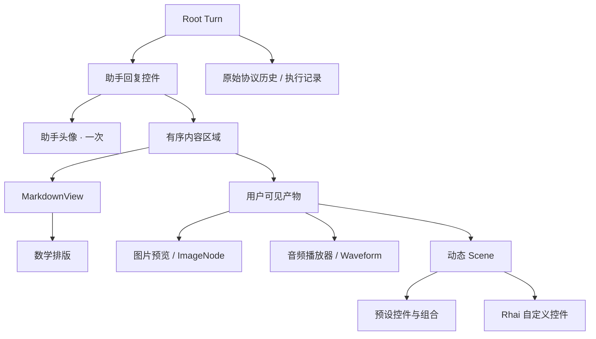
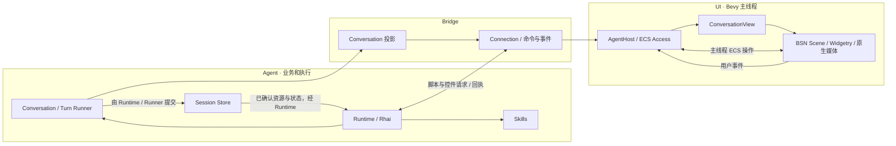

# 助手回复与动态内容

用户在聊天中要求生成一张图片、一段 MP3，或者解释一个需要图形演示的数学问题，应该能够直接在回复中看到和使用相应的产物。文字仍然是回复的主体，但不再是唯一的内容类型。这里改造的是主聊天区的回复呈现及其与 Agent 产物的关系，不把 Agentelier 扩展成另一套独立工作台。

本组是目标设计。现有架构、代码事实及原有实现方案是起点；具体实施按 [执行方案](../../../plans/assistant-content/00-overview.md) 推进。实现对应增量时再同步现有模块文档中的当前行为，避免将未实现的能力写成已经存在的功能。

## 从一条回复开始

现在 `Conversation` 已经区分公开的助手消息、工具调用、工具结果及不透明 reasoning。`conversation_bridge::MessageView` 保留消息 ID、请求序号、输出序号、`phase` 和正文；`chat_ui` 又将它们投影为 `ChatMessage`。只是 `ConversationView` 的 `final_reply()` 只选择最终回复，图片描述符也没有随 `ChatTool` 进入主聊天区的实际渲染。

因此，第一件事不是改变模型协议，而是改变界面理解“一次回复”的方式。一次 Root Turn 对应一个助手回复控件，头像只出现一次；其中依次放入公开说明、正文及用户可见产物。工具的执行事实仍然由 Agent 保存和管理。

这里的内容区域是排版和生命周期边界，不是新的模型消息格式。公开正文保持原有 `phase` 和原文；图片及其他产物保持自己的来源身份。用户不需要从界面辨认 `commentary`、`final_answer` 或 Function Call。

## 内容从哪里来

一部分内容来自模型已经输出的 Markdown，例如正文、代码、数学式。另一部分内容来自实际工具产物或 Agent 主动创建的动态控件。两条路径的输入不同，但在同一个回复控件内呈现。

数学排版依旧属于 Markdown 的原生显示路径。函数图像、数据图表和交互式数学演示属于动态 Scene：排版器解释数学记号，图形与计算模块解释数据和数学表达式。音频与图片使用各自的真实附件，而非从 Markdown 路径或工具摘要推测文件。

## 在现有三个领域中闭合

当产物拥有可操作的状态时，UI 不只需要把它画出来，还需要把用户操作交给相应所有者，并在 Session 重新打开后还原同一份内容。

图中的箭头表示业务数据流，不是新增 Rust 依赖关系。继续遵守 `ui → agent / bridge`、`bridge → agent`；Agent 和 Bridge 不依赖 Bevy。实际 World、Scene、音频播放句柄及图形资源留在 UI。Conversation 持有业务身份和已确认定义，Session Store 是持久化单写入者。脚本执行与用户交互经现有通信路径协调，不建立新权限体系，不把通用 UI DSL 或第二套执行引擎引入项目。

## 阅读路线

1. [一次回复如何容纳多种内容](01-reply-presentation.md)
2. [图片与声音成为可直接使用的会话产物](02-media-artifacts.md)
3. [数学记号如何进入原生 Markdown](03-math-typesetting.md)
4. [动态 Scene 如何创建、组合及更新](04-dynamic-scenes.md)
5. [从数据绘图到数学交互](05-visualization.md)
6. [Rhai 如何定义运行时自定义控件](06-scripted-widgets.md)
7. [动态内容的持久化与 Skill 复用](07-persistence-and-skills.md)

[源码与技术参考](sources.md) 区分已存在的代码事实和实现阶段需要验证的候选技术。执行方案的编号只表达交付顺序，不替代这里的理解关系。

## 本次范围

本次包含主聊天区的 Commentary、生成图片预览及导出、音频原生播放和真实时域波形、数学公式与专业记号、数据图表和数学示意、预设动态控件、Rhai 自定义控件、错误收敛、历史恢复以及自定义控件作为 Skill 复用。

会话恢复覆盖采用本设计记录格式创建和保存的 Session。

AI 白板工作区、Live Notebook、外部 Bevy Inspector、音频编辑或转写时间轴、独立 3D 场景工作台、外部应用辅助面板、可执行工作流编辑器和 MCP Apps/WebView 不属于本次设计。数学坐标中的三维曲面或向量示意仅属于数学绘图，不扩展为通用三维场景编辑器。音频也不引入麦克风、实时语音、录音、混音或新音频生成服务。
