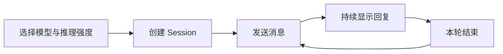

# 聊天环境提供什么

第一阶段解决一个具体问题：用户能够选择模型与推理强度，连续提问，看见回复逐步出现，并随时以全新上下文开始另一段对话。这里先实现稳定的聊天行为，不加入输出风格干预。

## 从一条消息开始

用户进入聊天页，选择模型和可用的推理强度，创建 Session，然后输入消息。界面立即显示已接纳的用户消息和正在生成的回复。随着服务返回文本，同一轮回复逐步增长；结束后，用户可以继续追问。

一次用户输入到本轮完成、失败或取消称为一个 Turn。一个 Session 可以包含多个 Turn。流式输出始终启用，不提供非流式模式、命令行执行模式或 JSONL 用户界面。

## 连续聊天需要保存什么

Session 在内存中保留设置、对话记录和用于后续请求的上下文。聊天页可以滚动查看前文，输入区允许换行和粘贴长文本，回复可以按 Markdown 阅读，也可以查看和复制原文。

用户在一轮结束后可以继续发送。正在生成时可以编辑下一条草稿，但不能把它排入另一个并行 Turn。本阶段同一时刻只有一个活动 Session 和一个在途聊天 Turn。

停止按钮中断当前生成。失败或取消后，已经显示的文字保留在界面上并标出状态；它们不会被当作完整答案悄悄加入后续模型上下文。用户可以重新发送同一输入，或提出一个新的问题。

## 在每段会话中保持设置一致

一个 Session 固定模型标识和推理设置。第一轮开始后，这组设置不能原地修改。需要使用另一模型或推理强度时，在准备区设置后创建新 Session。

这里保留两个入口：新建会话使用准备区的设置，重置当前会话沿用当前设置。两者都获得新的会话身份并清空历史。只有当前 Turn 已结束、执行任务已回收时才允许执行。界面在清空前说明当前记录不会保存。

例如，用户在第一段会话里讨论了一项设计，又创建空白 Session 讨论另一项内容。新会话不会携带上一段对话的消息，即使使用同一个模型也是如此。

## 第一阶段的完整能力

| 能力 | 用户能观察到的结果 |
| --- | --- |
| 内存 Session | 可以新建、重置并连续聊天，旧会话内容不混入新会话 |
| 模型选择 | 显示所选模型，并用其真实标识发起请求 |
| 推理强度 | 只展示当前模型支持的选项；未提供能力信息时使用服务默认 |
| 固定流式输出 | 生成期间持续更新，长文档不会一直等到结束才出现 |
| 状态与取消 | 生成、取消中、完成、取消和失败有明确区别 |
| Markdown | 标题、段落、强调、列表、引用、代码、链接和表格可阅读 |
| 原文与复制 | 保留模型原始 Markdown，能够复制回答和代码内容 |

## 完成时应能走通的场景

使用同一 Session 连续进行十几轮交流，包含概念解释、追问、整理文档和根据前文修订。聊天页保留历史，模型能使用有效前文，文档按 Markdown 展示。中途停止一轮后可以继续；重置后询问旧会话中的内容，新请求不携带那段历史。

还可以新建空白会话，并确认下一轮请求使用新的空历史；切换模型或推理强度时创建新会话，不改变已开始会话的设置。

本阶段不保存或恢复聊天历史，不增加多会话列表、分支回放、上下文压缩、长期记忆、工具调用、自动评分、自动重写或提示词加载与编辑。已整理的提示词及输出改善研究资料保留给第二阶段，第一阶段客户端不加载这些资料。
