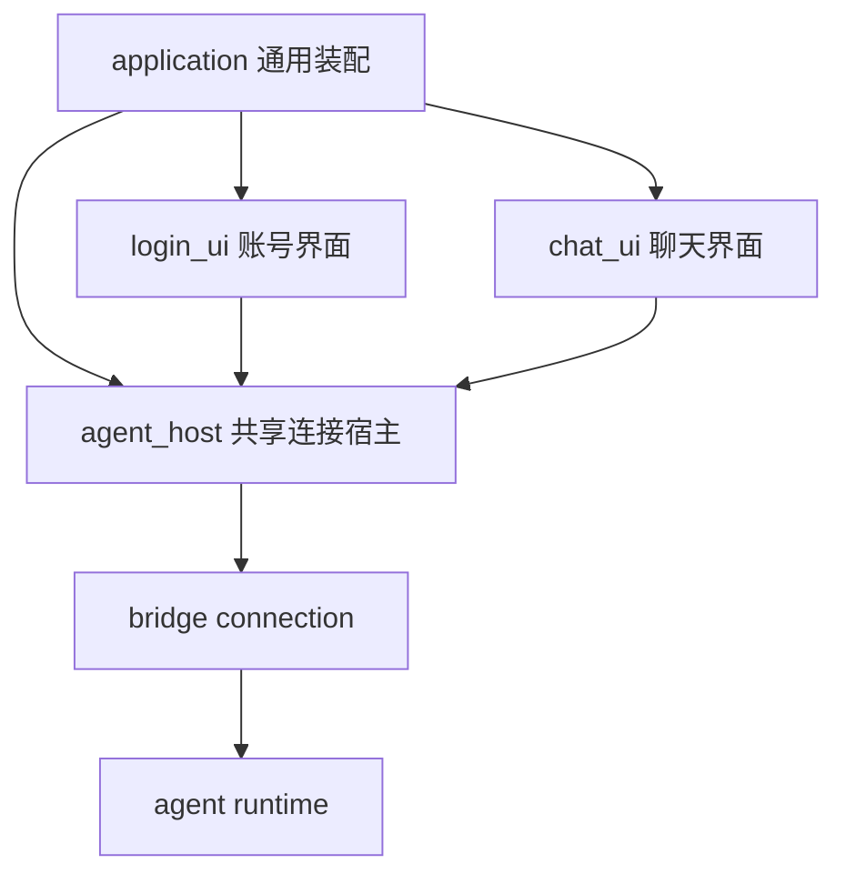
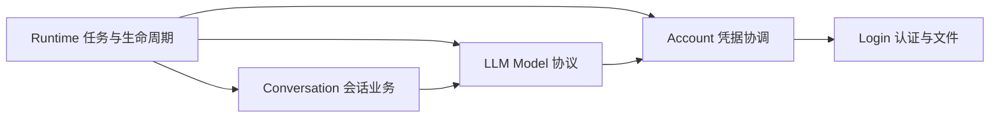

# 会话、执行与界面的职责

当前结构已经把协议、账号、执行环境、桥接和 UI 分开。新功能继续沿这条边界扩展。最先需要调整的是公共连接的位置：现在登录 UI 持有 Connection 并读取全部后台事件，聊天 UI 接入后不能再创建第二个后台，也不能与登录页争抢同一个接收队列。

## 先让两个页面共用一个后台

新增 `crates/ui/agent_host/`，承接公共 Connection 的启动、命令转交、事件读取、Winit 唤醒接入及关闭协调。它只处理共同的运行连接，不保存账号表单、浏览器授权数据、聊天输入或 Session 历史。

登录页仍负责账号展示、授权地址和浏览器辅助任务。聊天页负责自己的输入与展示。公共接收系统只读取一次 Connection，再向两个页面分发带业务类型的事件。页面各自更新自己的投影。

图中的连线表示依赖或提交操作的方向，不表示后台直接操作 UI。后台事件沿连接返回，由宿主转换成 ECS 中可分发的通知；业务字段的转换仍属于对应的 Bridge。

## Session 归 Agent，任务归 Runtime

新增 `crates/agent/conversation/`，管理 ChatSession、会话设置、Turn、展示记录和协议历史。它负责决定什么内容属于下一轮上下文，什么时候可以创建新 Turn，以及成功、失败和取消怎样改变会话。

`agent/runtime` 继续拥有唯一 Tokio 线程、命令循环、取消信号和任务句柄。它保管并调用 Conversation 业务对象，启动 LLM Model 请求，在收到模型事件时让 Conversation 推进状态。请求 Future 独立运行，不能在处理用户命令时阻塞等待整个模型回复，否则同一执行环境中的凭据请求将无法得到处理。

`agent/llm_model` 继续负责模型目录、认证 HTTP、Responses 与 SSE。它返回文本增量、输出项和终态，既不读 UI 状态，也不把网络缓冲区当成长期聊天历史。

Conversation 对 LLM Model 的依赖用于请求和响应的业务数据类型。它不反向依赖 Runtime，也不接管认证文件。账号会话续期与聊天 Session 的创建、重置保持独立。

## 新增 crate 的边界

| 位置 | 职责 | 不承担的工作 |
| --- | --- | --- |
| `crates/ui/agent_host/` | 共享 Connection、ECS 事件分发、运行收尾接入 | 账号与聊天的具体状态规则 |
| `crates/ui/chat_ui/` | 会话准备区、输入区、消息列表、状态与操作 | HTTP、协议历史权威、账号凭据 |
| `crates/ui/markdown/` | Markdown 解析适配、BSN 展示、原文映射 | 模型请求、Session、自动润色 |
| `crates/agent/conversation/` | Session、Turn、模型与推理设置快照、历史提交 | UI、线程、网络协议、持久化聊天 |
| `crates/bridge/conversation/` | 会话命令与事件的 UI 安全投影 | 执行业务、保存会话权威状态 |

Package 名分别使用 `agentelier_agent_host`、`agentelier_chat_ui`、`agentelier_markdown`、`agentelier_conversation`、`agentelier_conversation_bridge`。只有对应功能实际落地时才加入 Workspace，不提前创建空 crate。第一阶段不建立提示词文件加载或配置模块。

现有 `bridge/llm_model` 保留模型目录和连接验证的投影。聊天生成进入 `bridge/conversation`，不同时从两条路径发布同一个回答。`bridge/connection` 只关联操作、分发转换并协调连接，不把所有业务错误映射塞到自身。

## 数据各自只有一个权威来源

模型返回的原始协议数据由 LLM Model 解释，完成后的会话上下文由 Conversation 保管。UI 保留可重建的展示投影和未发送草稿，不用界面 Text 反推下一轮请求。

准备区的模型与推理选择属于下次新建会话的设置。Session 创建时复制已选设置，之后准备区的修改不影响活动会话。UI 状态提示和错误信息都不进入模型历史。

`ui/assets` 继续管理字体、图标等应用 Asset。Markdown 展示保持独立的 UI 职责，不把文档渲染或 UI 装饰内容送入 Agent 的模型上下文。

## 保留现有启动与退出链

数据目录准备、现有登录恢复、按需凭据续期继续使用当前所有者。把共享连接从登录 UI 移出时，同时迁移 application 对 begin_shutdown、is_finished 和 finish 的调用位置；浏览器辅助 Job 仍由登录 UI 清理。

正常关闭先停止新命令，取消并回收模型任务，等待已经开始的凭据刷新和提交收敛，再结束 Runtime 和辅助任务并刷新日志。普通关闭不退出账号。用户主动退出账号时沿用现有优先控制路径，会话不能把旧账号的迟到结果写入新会话。

## 工程落位

实现仍位于 `crates/ui/`、`crates/agent/`、`crates/bridge/`。允许 UI 依赖 Agent 或 Bridge，Bridge 依赖 Agent；Agent 和 Bridge 不依赖 Bevy。`app/` 保持薄入口，`application` 只做通用装配。

UI 结构通过 `bsn!`、Scene 与 SceneList 组合，持续状态放在 Component/Resource 中，Props 只初始化一次。复用 Widgetry 的公开状态 API，不修改其内部实体来绕过契约。

外部依赖版本统一由根 Workspace 管理。内部模块按语义组织，使用 `foo.rs` 与 `foo/`，不引入 `mod.rs`、上游源码复制或修改版依赖。新增 crate 遵守 Windows x64 编译约束、现有错误传播和 Lint。实际实施维护临时根目录进度文件，按增量同步架构与相关模块设计。

工程验证使用编译、格式、Clippy、真实应用运行和 BRP。项目不编写测试代码、Benchmark 或 Example。界面验证保持已有登录状态，不为制造验证条件退出、重新授权、重置凭据或切换数据目录。
