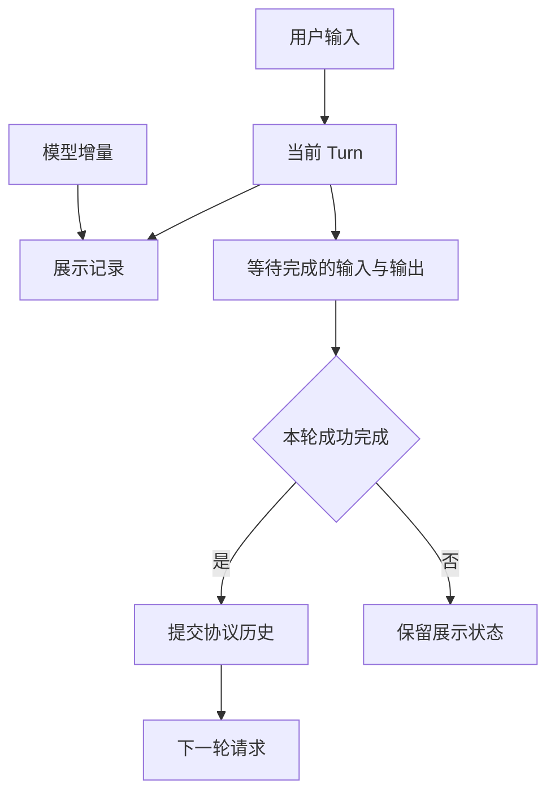
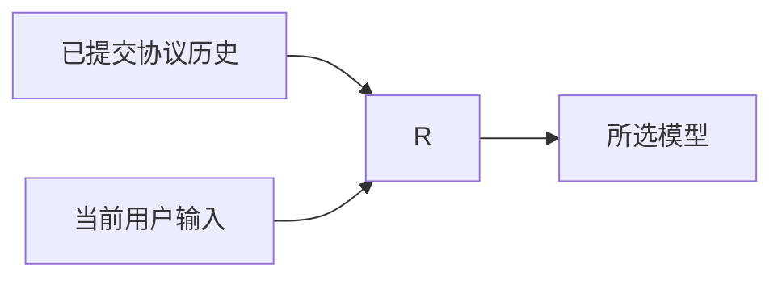

# 一段对话怎样成为下一轮上下文

Session 不是聊天窗口的另一个名字。窗口负责展示，Session 负责保证同一段对话使用同一套设置，并把已经完成的内容交给下一次模型请求。

## 创建时固定设置

创建 ChatSession 时，Conversation 接收一份设置快照：模型 slug、显示名称、推理选项，以及账号身份关联。只复制已经确定的值，不保留随准备区选择变化的引用。

模型选择来自当前账号的目录。界面用显示名称帮助识别，请求使用 slug。推理强度只使用该模型明确提供的能力；目录没有相应信息时显示“服务默认”，请求省略 effort，不把其他模型的选项照搬过来。选择显式档位后，服务拒绝该值就显示实际错误，不静默换档位或换模型。

目录中的默认推理值若存在，创建时解析为明确选择；只有未知时才保留“服务默认”。这两种状态在会话设置摘要中保持可辨认。

新建使用准备区设置，重置沿用当前快照。两者都清除历史、分配新的 Session 身份。正在生成时不执行这两个操作，用户先停止当前 Turn，等真实终态和任务回收后再清空。

## 展示记录和协议历史各做什么

界面需要保留取消、失败和未完成的痕迹，否则用户看不到刚刚发生了什么。下一次请求却不能把这些痕迹当作模型已经完成的答案。因此 Session 分别保存展示记录与已提交协议历史。

展示记录包含用户输入、助手消息项、已显示正文、状态及必要的错误信息。协议历史只包含已经完成并提交的 Turn，按原有消息角色和输出项顺序保存。

一个 Turn 的用户输入与完整模型输出一起提交。收到成功终态后提交一次；失败、超时、断流和取消都不提交这对内容。因而第二轮失败时，第三轮从第一轮的有效历史继续，第二轮仍留在 UI 中并标记“未进入后续上下文”。

例如用户要求“把刚才的设计扩展成文档”，生成一半后停止。下一次说“继续”不会自动承接那半篇文章。需要接着编辑时，用户把要继续的内容明确放进新输入；第一阶段不暗中把残缺回复补进上下文。

## 保存模型真正需要的历史

文本显示是协议输出的一种投影，不是原始输出本身。Responses 的输出可以包含多个 message 项和非展示项。后续请求保留可回传的协议内容、顺序、消息标识及适用的 phase，不通过拼接聊天气泡重新构造全部输出。

当所选模型与接口支持无状态推理续接时，按官方协议保留需要回传的加密 reasoning 内容。当前官方文档说明 store=false 时会默认返回此内容，旧 include 参数仍被兼容；实现以实际响应契约为准。它作为不透明协议数据保存，不翻译、不渲染成正文，也不提取或伪造隐藏推理。具体字段由 LLM Model 负责，Conversation 只保管已经规范化的可回传记录。

`commentary` 与 `final_answer` 等阶段信息保留原义。一次 Turn 可能先有公开进度文字，再有最终回答，UI 可以分段展示；它们不能被合并成一条没有阶段信息的假消息。

本阶段不向服务提供工具定义。若返回需要工具执行的输出项，LLM Model 给出明确的“不支持该输出类型”结果，不执行它，也不把工具调用当普通回答提交。普通拒绝说明如果由模型以合法完成消息返回，则作为正常完整回复展示和保留。

## 请求如何组成

本阶段沿用 `store=false`，由客户端在每轮请求中提供需要的历史。概念上由两部分组成：已提交协议历史与当前用户输入。模型与推理强度属于请求配置。

请求只使用当前会话的模型与推理设置，不增加应用自定义的风格提示词。应用错误、状态行和界面展示文字不混入模型历史。

请求不依赖服务替客户端恢复旧会话，也不以 response ID 代替本地完整历史管理。协议实现仍可利用服务支持的传输机制，但不改变这里的会话权威。

## 一轮结束后才能开始下一轮

提交操作带 Session、Turn 与现有 operation 关联身份。业务接纳后，用户消息才成为本轮正式展示记录，输入框才清空。接纳失败保留草稿，不生成一条看似已发送的消息。

生成期间禁止再次提交、排队和并行执行。用户可以编辑下一条草稿。执行侧给出终态并完成任务回收后，Session 才重新允许提交。已结束操作的迟到增量不能修改新 Turn。

“重试”是重新用同一用户文本发起新尝试，使用原设置与原已提交历史。UI 将尝试关联到同一条输入，保留失败状态，不在请求里重复添加用户消息。再次失败仍不提交协议历史。

## 历史长度与账号变化

第一阶段不压缩、摘要或静默裁剪历史。上下文超限时显示明确错误，保留当前记录，让用户新建 Session。若服务返回 token 用量，可显示它；不把未经核实的字符换算值当成精确容量。

账号凭据自然续期不清空聊天。账号身份发生变化后不能沿用旧 Session 发起请求；需要重新创建会话。模型目录刷新只更新准备区，不能修改已有 Session 的快照。模型不可用时保留原选择并显示错误，由用户决定新会话的设置。

## 实际验证

在真实应用中进行多轮追问和文档修订，检查显示记录与协议历史的角色、顺序及设置一致。通过执行侧安全状态与必要诊断检查实际历史组成，不在 UI 或日志中暴露 Token 或加密推理数据。

另外检查第二轮取消或失败后第三轮的上下文、新建与重置后的空历史、重试不重复插入输入，以及准备区模型与推理选择的变化不影响活动 Session。验证通过 BRP 的真实输入与状态查询完成，不编写独立测试程序。
