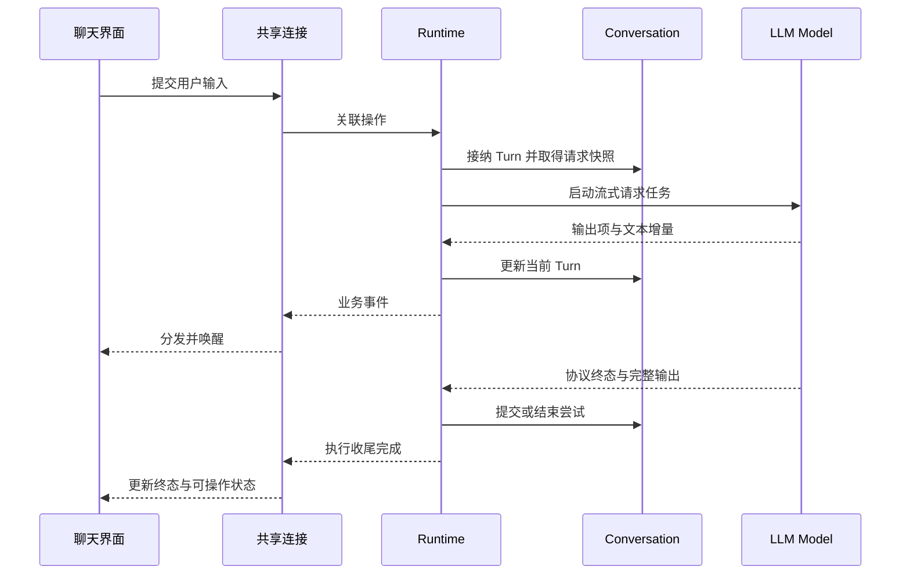
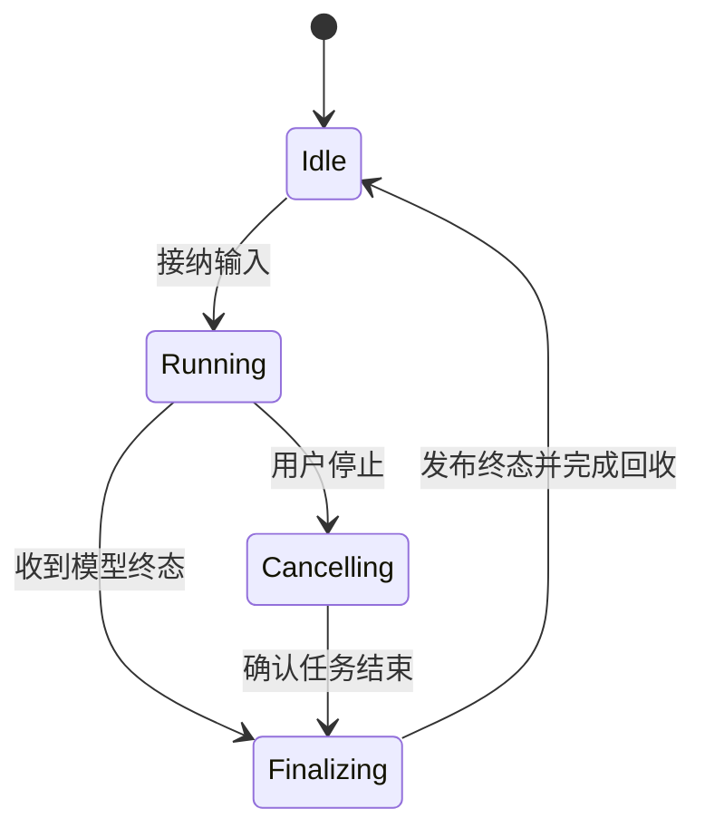

# 回复怎样逐步出现并可靠结束

现有模型验证已经通过 SSE 接收响应，但主要在完成时显示正文。聊天需要把同一条响应中的文本变化持续送到界面，同时保留明确的结束条件。

## 从服务事件到消息正文

LLM Model 解释 SSE 事件，标识属于哪个输出项、哪个内容段，并产生业务事件。Runtime 将这些事件交给 Conversation 更新当前 Turn，再经过 Conversation Bridge 和共享连接到达 UI。

UI 更新已有消息项，不为每个片段创建一条聊天消息。模型公开进度文字与最终回答保留自己的输出项身份；未展示的协议项不丢失其历史用途。

字符片段不等于 token，也不等于完整句子。中文、组合字符、Markdown 标记可能跨网络块到达，网络解码与 SSE 解析必须先获得有效事件，再更新文本。

## 增量快，但完成必须确定

收到文本只说明有内容可显示。只有合法 `response.completed` 及可接受的完整输出才能形成成功结果。`response.failed`、`response.incomplete`、显式错误以及未收到终态的断流分别表达，不用“已有部分文字”代替成功。

最终完整输出是这一响应的权威结果。结束时按输出项校准已展示正文，而不是把完整答案再次追加到增量后面。成功提交协议历史一次，然后等待执行任务回收，解除操作占用。

完整响应没有可展示文本时，UI 显示状态说明，但不伪造一条模型正文。若模型返回可展示的拒绝内容，则显示该内容。

## 事件密集时保持界面可用

现有有界通道适合终态事件，流式文本会增加事件频率。这里保留有界传递，但允许把同一消息项连续相邻的文本片段按顺序合并。不能跳过中间片段，也不能跨输出项、跨 Turn 合并。

UI 在一次更新中批量消费事件，并按本帧收集的变化刷新正文。完成事件进入队列前，先提交它之前的所有增量。先入队后唤醒，保留现有唤醒约定。

取消、账号退出与应用关闭继续走可优先处理的控制路径，不能被文本事件占满队列而饿死。任务在等待发送增量时也能响应取消，关闭接收端时结束等待并回报真实错误，不无限等待队列空间。

## 停止不是立刻销毁所有状态

Turn 的结果另行记录为 Completed、Cancelled 或 Failed，避免把当前是否可操作与上一轮结果塞进一个模糊的“忙碌”布尔值。

点击停止后显示“正在停止”，已经显示的正文保留。取消请求与正常完成竞争时，由执行所有者按已确认的终态确定唯一结果；同一个 Turn 不能先报取消成功再追加完成答案。取消确认以后不再接受它的文字。

模型等待取消不打断 Account 已经开始的凭据旋转和必要保存。关闭应用时仍等待刷新收敛并回收线程；不为聊天功能另建认证所有者。

## 长回答的等待策略

连接建立沿用现有超时规则。读流改为有明确阈值的空闲等待：采用 300 秒空闲超时，并以具名配置表达；收到合法 SSE 活动后更新读流活跃时间。不能因为总生成时长超过旧连接验证的 120 秒，就终止仍持续返回内容的长文档。

已有单事件与总流大小上限继续作为协议资源边界，超出时产生明确失败。用户通过停止按钮终止不再需要的长生成。界面不能把超时、超限或中断显示成文档已经写完。

认证恢复沿用一次有界 401 恢复与同账号校验。输出开始后不自动重放请求；429、服务失败和网络失败不自动反复生成，避免把多个候选答案混成一轮。

## 验证这一条链

使用真实长回答观察首段出现、后续增长、最终校准和按钮恢复。检查没有答案重复、消息项串接或大量微小气泡。Markdown 还未闭合时，应用仍能滚动与停止。

停止操作需要同时检查 UI 的“正在停止”、执行侧回收和最后保留的部分正文。正常关闭的验证保留账号登录，不为了验证退出分支擅自退出账号。断流与错误只有在实际遇到或可合法触发时才记录为已覆盖，编译通过不代替这些运行结果。
