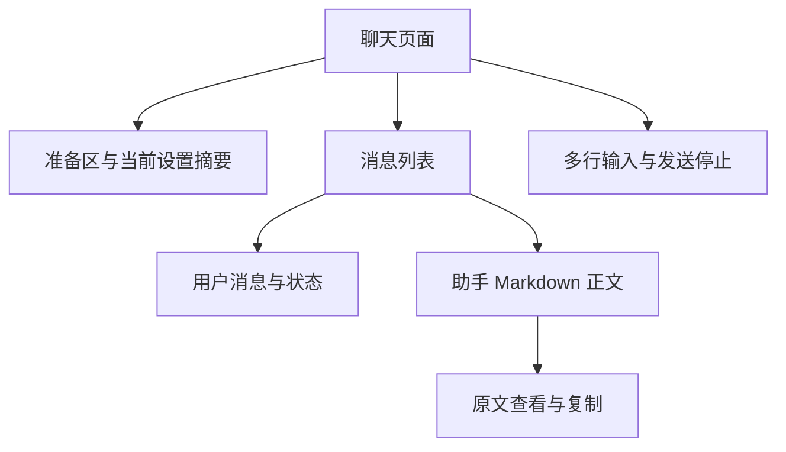

# 聊天界面与 Markdown 展示

用户需要在一张页面里完成准备、交谈和阅读。布局先服务于这三个动作，不把模型协议与后台诊断堆进聊天区。

## 页面怎样组织

准备区提供模型与推理强度选择。创建 Session 后，顶部保留当前设置摘要和新建、重置入口。中间是可滚动的消息列表，底部是多行输入区、发送和停止按钮。

账号与数据目录仍在原有设置入口中。切换到设置页不取消正在生成的回复，返回聊天页时从展示投影恢复当前内容。页面销毁与重建不拥有后台任务的生死。

## 用现有控件承担交互

输入区使用 Widgetry TextField 的多行与自动高度能力，超出最大展示行数后在编辑区内滚动。模型和推理选项使用 ComboBox 或等价的现有选择控件，操作按钮和消息滚动区域复用 Button 与 ScrollArea。

自定义外观优先组合 Headless 控件和 BSN Scene。Editor 内容、光标、选区使用公开 API 管理，不直接改内部 EditableText，也不保留第二份同步的控件 Props。

采用 Enter 发送、Shift+Enter 换行；中文 IME 正在预编辑或提交候选时，Enter 由输入法处理，不发送消息。发送按钮提供同等操作。输入为空白时不可发送，含正文的换行与空白保持原样。提交被业务接纳后才清空草稿；接纳失败保留内容。

生成时用户可以继续编辑草稿，但发送按钮不可用，停止按钮可用。发出取消请求后按钮显示取消中，直到执行侧实际结束。

## 滚动跟随由阅读位置决定

用户停在底部时，新内容保持底部可见。用户向上翻看历史后，流式更新不能把页面强行拉回底部。显示“回到底部”入口，让用户主动恢复跟随。更新一条回复不重建所有旧消息和输入框，不丢失焦点、选区或滚动位置。

第一阶段使用普通滚动消息列表，不提前引入依赖动态行高的虚拟化体系。长文本性能通过真实应用观察；只有证据表明当前路径不满足已定场景时，才针对受影响部分调整。

## Markdown 选型

**确定采用 `pulldown-cmark` 解析、原生 Bevy + Widgetry 展示。** 解析器负责把 Markdown 转换为结构事件；`ui/markdown` 在 BSN 与 Widgetry 的界面体系中呈现段落、列表、代码和表格。现成解析库不负责 Bevy 布局，因此 UI 适配、滚动和流式更新仍属于本阶段的开发范围。

新增依赖在 Workspace 根目录统一管理，使用官方发布版本，不 fork 或复制上游源码。

## 第一阶段显示哪些语法

基础内容包括段落、标题、粗体、斜体、删除线、行内代码、引用、分隔线、有序与无序列表、围栏代码块、链接。扩展内容包括表格和只读任务列表。代码块保留缩进、换行与语言标签，先实现可靠显示与复制；语法高亮不是本阶段完成门槛。

表格按列组织，保留表头与对齐信息。窄窗口中可以横向滚动，不能把列挤成不可读的单字竖排。中文段落正常换行，长代码与长 URL 不撑破页面。

Mermaid、数学公式和其他未实现扩展按原始内容或代码块显示，不伪装成已渲染图形。原始 HTML 当普通文本处理，不执行。图片语法显示替代文字与目标信息，不自动联网取图。链接只在用户主动操作时打开允许的 HTTP/HTTPS 地址，其它目标保持可复制文本。

## 流式 Markdown 如何更新

原始 Markdown 字符串始终保留。一次 UI 更新收到多个增量时，先合并文本，再解析当前正在变化的消息；已经完成且未变化的消息不反复解析。

初版采用当前消息整体重新解析，不依赖“最后一个段落之前永远不会变化”的假设，因为后续引用定义和未闭合结构可能改变前文解释。渲染适配层按稳定块复用现有实体，控制只更新受影响部分。是否做更细的增量解析由真实性能结果决定。

围栏未闭合时仍按当前可理解结构显示代码内容，表格头未完整时允许先显示文本。最终收到完整输出后重新解析一次，保证最终结构与最终原文一致。这里的容错属于显示，不修改模型原文，也不把修补后的 Markdown 写回历史。

## 原文与复制

每条助手消息提供“查看原文”和“复制正文”。原文区域使用可选择、可复制的只读文本控件。复制正文得到原始 Markdown，不把状态标签、生成时间或折叠按钮文字混进去。代码复制只取对应代码块的内容。

当前正在生成的消息复制当前可见原文快照，不冻结模型生成。跨多个渲染块的富文本拖选暂不作为完成门槛，原文查看保证内容始终可选取。

## 验证阅读与输入

在真实窗口中通过 BRP 验证按钮、焦点、键盘输入、真实滚动和复制入口，并观察流式更新的中间状态。中文 IME、原生剪贴板跨应用行为按工具实际能力补充本机验证，不用直接修改 ECS 冒充输入法测试。

实际内容覆盖长中文段落、嵌套列表、窄表格、长代码行、未闭合围栏、Markdown 引用链接、HTML 与模板分隔符。检查布局、终态校准、回到底部、切页恢复和主题变化。所有结构使用 BSN，遵守现有 Windows x64、公开 Widgetry API 和无测试程序约束。
