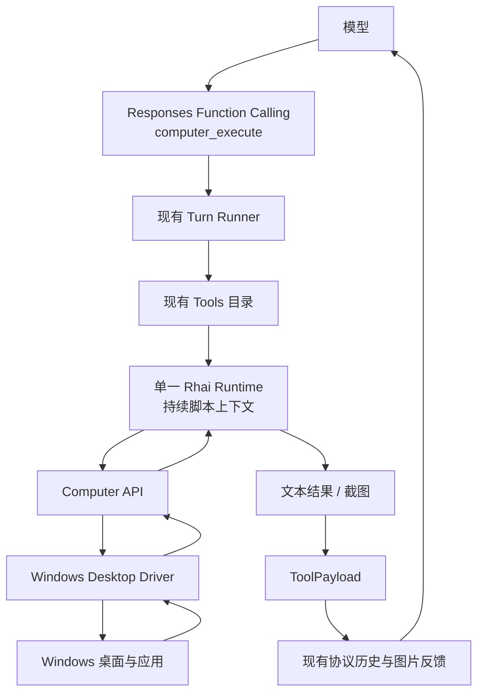
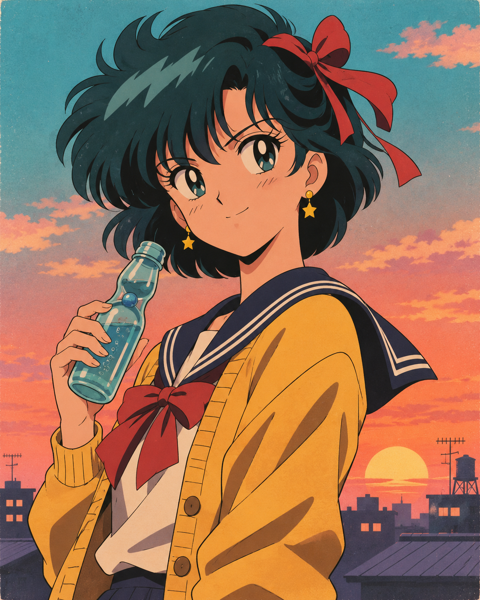
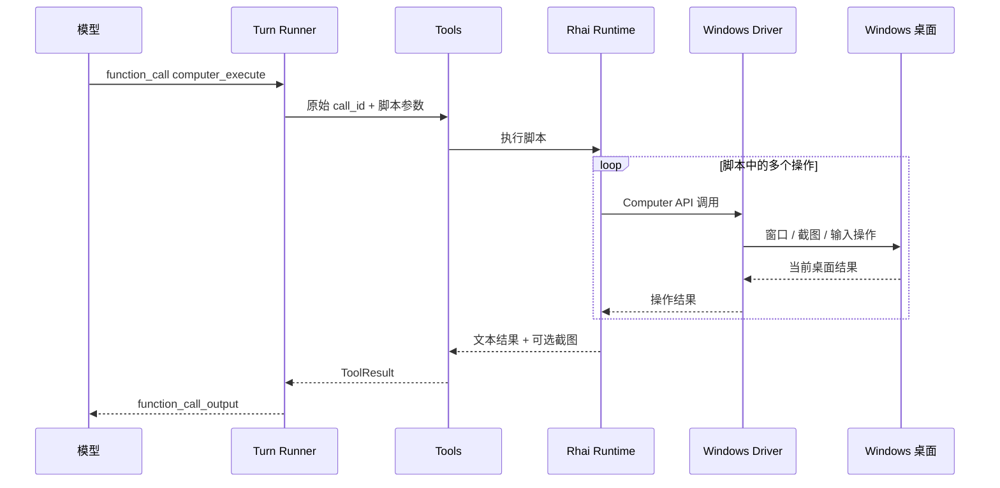
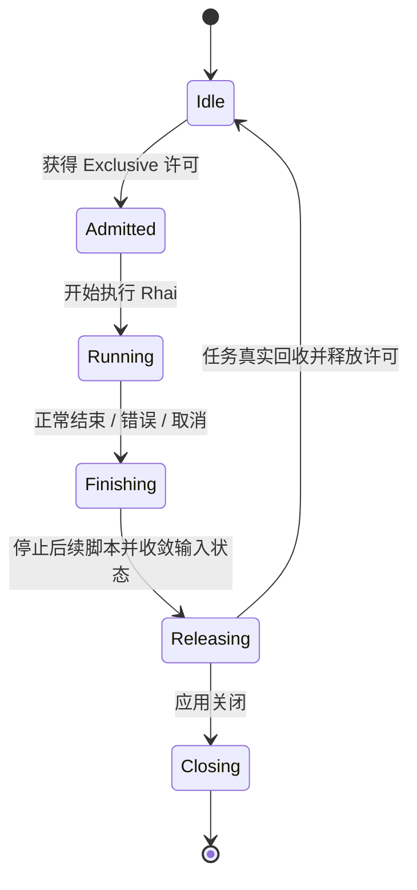

# Computer Use 设计

实施状态：Windows Driver、持续 Rhai 会话、Rhai Computer API 和桌面独占生命周期已实现。后续能力见[实施方案总览](../../../plans/computer-use/00-overview.md)。

Computer Use 让 Agentelier 中的模型直接操作当前 Windows 桌面上的应用。模型通过普通 Responses Function Calling 提交 Rhai 脚本；Agentelier 在本地解释脚本，由 Rust 提供的 Computer API 调用 Windows 桌面能力，再把执行结果和截图作为工具结果反馈给模型。

本设计只面向 Windows x64 本地桌面。浏览器自动化继续使用 MCP，不属于 Computer Use。Rhai 是本次唯一的脚本运行环境；它只服务于 Computer Use，不扩展为通用 Code Mode 或 Application Runtime。

## 整体执行方式

当前 Agentelier 使用的 ChatGPT/Codex OAuth + Codex Responses WebSocket 路径已经通过实测确认不接受原生 `computer` 工具类型，服务端返回 `Unsupported tool type: computer`。因此模型与 Agentelier 之间使用现有 Function Calling 协议，模型调用一个专用工具并提交 Rhai 脚本。脚本可以在一次调用内组合观察、等待、鼠标和键盘操作，避免每个底层动作都单独产生一次模型往返。

Computer Use 沿用现有模型—工具—结果反馈循环，不建立独立 Agent 循环，也不修改 Responses 的模型通信协议。

## Rhai Runtime 组织多步操作

每个 `ScriptSession` 持有独立的 Rhai Engine、变量作用域和函数 AST。后续调用合并已保存的函数定义与新脚本，执行成功后只保存函数部分，旧脚本的顶层语句不会重放。语法错误在修改作用域前返回，执行错误保留此前已执行语句的变量修改，失败脚本的新增函数不会发布。脚本可输出返回值或使用 `print`，工具结果文字受字节上限约束。

执行在现有 Tokio 的阻塞工作线程中完成。调用串行访问自己的脚本会话，并等待工作线程实际退出才取得结果。Rhai 进度回调用于协作式取消并检查执行期限，Engine 同时限制调用深度、操作数和数据规模。脚本模块导入已禁用。

Rhai 是嵌入 Agentelier 进程的脚本引擎，不启动 Python 或 Node.js 子进程。Runtime 保持持续存在的执行上下文，使模型能够在同一 Computer Use 会话的多次工具调用之间保留变量和函数，并在一次脚本内使用条件、循环和函数组合桌面操作。

典型脚本可以先读取窗口列表和截图，激活目标窗口，执行一组操作，等待界面响应，再请求截图并结束本次调用。模型读取工具结果后，决定是否继续提交下一段脚本。Rhai 上下文与 Windows 桌面状态是两种不同状态：脚本上下文由 Rhai Runtime 保存，窗口、焦点和画面始终以真实桌面为准。

Runtime 不应让同步脚本执行阻塞 Tokio current-thread Runtime。脚本计算、等待和桌面调用需要处于可管理的执行上下文；现有 `agent/runtime` 仍负责任务取消和真实回收。具体执行承载方式由对应实施方案确定。

## Windows Desktop Driver

Windows Driver 使用 Rust 和 Windows 原生桌面 API 操作完整桌面。它不依赖 Bevy BRP，也不局限于某个 Bevy 应用。Driver 按职责提供窗口观察、屏幕捕获、鼠标输入和键盘输入。

### 窗口发现与激活

Driver 能枚举当前桌面的顶层窗口，并读取后续识别和定位所需的基本信息，包括窗口句柄、标题、位置和尺寸。模型可以根据窗口列表选择目标窗口，并请求激活该窗口。窗口句柄只是当前桌面状态的引用；窗口关闭或重建后，旧句柄不能继续当作有效目标。

Rust 侧通过 WinSafe 调用 Win32 枚举和 DWM 查询。窗口列表过滤隐藏、被 DWM 隐藏、无标题、桌面外壳和普通工具窗口，保留最小化标记。边界是可见窗口框的物理屏幕像素，右边界和下边界为开区间。窗口标识包含 HWND 及原进程和线程身份，每次操作都从当前顶层窗口重新解析。激活要求窗口已可见且未最小化，调用后实际核对前台窗口，区分目标失效、最小化和系统拒绝激活。

窗口管理不负责理解窗口内部控件。本次不实现 UI Automation，不读取控件树、Automation ID 或 Control Pattern。

### 桌面截图与坐标

Driver 支持完整虚拟桌面截图和指定窗口截图。完整截图覆盖当前多显示器桌面布局；指定窗口截图以目标窗口实际边界为依据。截图的像素尺寸、MIME 和编码字节需要作为图片载荷的元数据保留。

坐标统一区分虚拟桌面屏幕坐标和窗口局部坐标。多显示器桌面的虚拟原点可能不是 `(0, 0)`，也可能包含负坐标，因此不能假设所有显示器从主屏幕左上角开始。窗口坐标到屏幕坐标的转换必须使用当前窗口边界和实际截图尺寸，避免窗口移动、缩放或显示器布局变化后仍使用旧换算关系。

Rust 侧使用 Win32 枚举显示器，按所有显示器的并集确定桌面范围。窗口截图覆盖可见框与显示器相交的部分，保留捕获范围和完整窗口边界，遮挡以捕获时桌面上实际显示的画面为准。最小化或完全位于显示器外的窗口会返回错误。

屏幕像素通过现有 PowerShell 7 环境调用 Windows System.Drawing 捕获。固定脚本在无窗口进程中运行，只接收数值范围并从标准输出返回图片字节。输出限制为 2048 像素长边和 4 MiB，优先使用 PNG，超出编码预算时改用 JPEG。Rust 使用现有 ImagePayload 校验输出，并按缩放后的像素中心映射到屏幕坐标。窗口或显示器布局变化后，旧截图的换算会要求重新捕获。

### 鼠标与键盘输入

连续鼠标轨迹使用至少两个同一空间的坐标点，首点时间为零，其余点按距前一点的间隔排程。整条轨迹只按下和释放一次按钮，驱动在每个点解析当前窗口或显示器位置。若输入取消、目标失效或坐标不可达，驱动停止后续移动并释放按钮。

基础鼠标操作通过 Windows 物理光标 API 移动指针，并通过 SendInput 注入按钮和滚轮事件。垂直正值向上，水平正值向右，每格为 Windows 的 120 单位滚轮增量。调用按下前检查该按钮是否已被其他输入持有，点击和拖动在取消或失败时也尝试释放本次操作的按钮。

键盘使用稳定键名表示字母、数字、方向键、功能键和修饰键。组合键按传入顺序按下，按相反顺序释放本次已注入的键。文字输入通过 SendInput 逐个 Unicode 字符发送 UTF-16 事件，保留代理对，并由目标控件决定如何处理；该操作不读取或修改剪贴板。

鼠标能力包括移动、左键/右键/中键按下与释放、单击、双击、垂直和水平滚动、拖动，以及绘画需要的连续多点轨迹。普通拖动描述起点和终点；连续轨迹包含按时间顺序排列的多个点，并在整段轨迹期间保持指定按钮按下。

键盘能力包括单键、组合键、按下与释放，以及文字输入。组合键需要管理按下和释放顺序。中文文字输入应根据 Windows 实际输入行为验证，不能假设模拟 Unicode 键击在所有输入法状态下都等价于粘贴文本。

输入状态由 Driver 跟踪。脚本正常结束、取消或任务退出时，Driver 只释放自己在本次执行中按下且尚未释放的按键和鼠标按钮，避免残留状态影响后续操作，也不盲目释放用户原本持有的输入状态。

## Computer API 连接 Rhai 与 Driver

Rhai 原生函数通过当前执行上下文访问 Driver。窗口引用使用 `windows()` 返回的 `id` 字符串，随每次操作核对窗口身份。

| 操作 | Rhai 接口 |
| --- | --- |
| 窗口观察与激活 | `windows()`、`window(id)`、`activate(id)` |
| 截图与坐标 | `capture_desktop()`、`capture_window(id)`、`screen_at(x, y)`、`window_at(x, y)` |
| 指针和按钮 | `mouse_position()`、`mouse_move(x, y)`、`mouse_move(id, x, y)`、`mouse_down(button)`、`mouse_up(button)`、`click(button)`、`double_click(button)` |
| 滚动与拖动 | `scroll(axis, detents)`、`drag(button, [x1,y1], [x2,y2])`、`trajectory(button, [[x,y,dt], …])`。拖动和轨迹可在首参数传窗口 `id`，使用窗口局部坐标。 |
| 键盘和等待 | `key_down(name)`、`key_up(name)`、`press(name)`、`shortcut([name, …])`、`type_text(text)`、`wait(ms)` |

`screen_at` 和 `window_at` 将最近一次截图的像素转换为物理屏幕坐标和窗口局部坐标，可以在后续调用中使用。脚本执行器交付本次最后一张截图，其他返回值和 `print` 作为文字。Driver 错误可用 `try/catch` 捕获并读取 `code` 与 `message`，未处理的错误由外层接收。每次调用实际退出前释放脚本持有的输入。

Computer API 将 Driver 能力注册到 Rhai，作为模型脚本唯一的桌面操作入口。模型不直接接触 Win32 原始对象、COM 对象或窗口句柄生命周期。

API 覆盖窗口枚举与激活、桌面和窗口截图、鼠标操作、键盘操作、连续轨迹、等待和必要的操作状态查询。函数名称、参数结构、返回类型和错误表现由实现时确定；本设计确定的是能力边界和可观察行为。

截图不能被转换成普通字符串或大型 JSON/Base64 文本。脚本执行结果需要区分文本摘要和图片附件，使外层工具执行器能够构造现有 `ToolPayload::Image`。当前 `ImagePayload` 接受 PNG/JPEG，编码结果上限为 4 MiB，最长边上限为 2048 像素；桌面截图需要按现有图片载荷约束完成编码或尺寸归一化，再交给模型历史。

一次 Function Calling 结果当前使用一个 `ToolPayload::Image` 图片载荷，因此一次工具调用向模型反馈一张截图。需要模型根据新画面重新决策时，应结束当前脚本并返回截图，让模型在下一轮调用中继续，而不是在脚本内部把模型尚未观察过的多张截图当作反馈。

## 接入 Agentelier 现有工具系统

Computer Use 是 `agent/tools` 固定目录中的内置 Function Tool。模型提交 Rhai 脚本，Tools 将脚本交给 Rhai Runtime 执行，结果按原始 `call_id` 返回现有 Turn Runner。

| 现有模块或机制 | Computer Use 中的职责 |
| --- | --- |
| `agent/llm_model` | 继续声明和解析普通 Function Calling；沿用图片输入协议 |
| `agent/turn_runner` | 推进模型请求、工具执行和结果反馈 |
| `agent/tools` | 登记 `computer_execute`、持有 Rhai Runtime 与 Computer API、调用 Driver、封装结果 |
| `agent/runtime` | 管理工具执行任务、取消、JoinHandle 和真实回收 |
| `agent/conversation` | 沿用调用身份、协议历史和工具结果保存规则 |
| `ToolAdmission` | 使用现有 `Exclusive` 访问模式控制桌面操作 |
| `ToolPayload` | 使用现有文本与图片结果表达 |

当前 `ToolRegistration::new/with_origin` 默认采用 `Exclusive`，且默认允许图片结果。Computer Use 必须保持独占访问，不改成 `SharedRead`。独占许可需要覆盖完整脚本执行及输入收尾，不能在脚本仍可能操作桌面时提前释放。

## 执行生命周期

所有脚本会话共享进程内桌面许可。等待会话或桌面许可期间可以取消。准入后，桌面许可和脚本状态一同移交给实际工作线程。工作线程完成脚本、清理输入并退出后才归还许可。桌面输入等待和轨迹也检查同一执行期限。同步捕获正在进行时，上层等待它返回，再完成清理和回收。

清理结果未确认或工作线程异常退出时，桌面入口会拒绝本次应用运行中的进一步操作。

Rhai Runtime 的上下文在同一 Computer Use 会话的多次调用之间持续存在；Windows Driver 每次操作真实桌面，并不缓存过期的窗口状态来代替重新观察。

工具调用开始时取得桌面独占许可，然后执行脚本。脚本结束后，Driver 完成输入状态收尾，工具结果被封装并返回。用户 Stop、任务取消或应用关闭时，取消信号需要传递到脚本执行和 Driver；只有脚本停止、输入状态收敛、执行任务真实退出并完成回收后，才释放桌面独占许可并报告终态。

## 最终端到端验收：Krita 绘画复刻

验收模型固定为 `gpt-6.2-sol`，推理档位为 `high`；绘画软件使用 Krita。参考图为本目录 `images/krita-reference-retro-cel-girl.png`，尺寸为 1122 × 1402 像素。画布使用相同尺寸和比例。

模型必须通过 Agentelier Computer Use 实际操作 Krita 完成高保真复刻。不得把参考图导入画布作为成品，不得调用图像生成工具、外部绘图程序、插件或脚本直接生成最终图像。允许 Rhai 辅助坐标计算、曲线生成和批量鼠标操作，但绘画内容与绘制决策必须由模型根据参考图观察后作出。

### 复刻内容

**整体构图**

- 纵向画面，保持参考图约 4:5 的宽高比例。
- 少女半身像位于画面中央并占据主要空间。
- 人物略微倾斜，采用三分之四侧身姿势，面部朝向观众。
- 头部位于画面上半部分，身体延伸至画面下边缘。
- 背景包含天空、云层、夕阳和城市屋顶，保持与人物的相对位置。

**头发与面部**

- 深青色、近黑色的蓬松短发，具有分层发束、明显刘海和青绿色高光。
- 头部右上方有大型红色蝴蝶结发带，并有向右侧及下方延伸的飘带。
- 面部为柔和椭圆形，下巴略尖，采用三分之四视角。
- 两只大眼睛具有深色瞳孔、青绿色细节和明显高光，位置、大小及透视关系自然。
- 保留小型鼻子、自然微笑、眉毛和双颊短线状腮红。
- 两侧耳朵附近有金黄色星形耳坠，并具有圆形耳钉连接结构。

**服装**

- 米白色水手服内搭，深藏蓝色水手领带有两道浅色平行装饰线。
- 胸前有大型红色蝴蝶结。
- 外穿暖黄色或芥末黄色宽松开衫。
- 开衫具有纵向罗纹衣襟、圆形棕色纽扣、罗纹袖口和明显的褶皱阴影。

**手部与汽水瓶**

- 画面左侧的手臂从黄色袖口延伸，手掌自然握住汽水瓶。
- 拇指和其他可见手指分布在瓶身两侧，方向、长度、弯曲关系和遮挡自然。
- 汽水瓶为浅青蓝色透明玻璃，具有收窄瓶颈、内部蓝色弹珠、液体、气泡、反光和高光。
- 瓶身整体倾斜角度、位置和大小接近参考图。
- 手指不得明显缺失、融合或扭曲，瓶子不得悬浮在手旁。

**背景**

- 上方天空以青绿色和蓝绿色为主，靠近地平线过渡到粉橙色与桃红色。
- 左右两侧保留粉色、橙色和浅紫色云层。
- 夕阳位于画面右下方，呈浅黄色圆形并接近地平线。
- 底部城市使用深蓝紫色和灰紫色剪影，包含不同高度建筑、暖色窗户、屋顶天线和右侧高架水塔。
- 前景屋顶具有斜向线条和瓦片细节。

**绘画风格**

- 复古 1980—1990 年代赛璐璐动画风格。
- 使用清晰连续的深色轮廓线、平涂色块和两至三层色阶阴影。
- 保留适量胶片颗粒、纸面纹理和细微噪点。
- 不使用写实照片质感、现代厚涂或 3D 渲染风格。

### 质量评估

最终作品与参考图并排比较，按以下维度评分：

| 维度 | 分值 |
| --- | ---: |
| 整体构图与空间比例 | 20 |
| 人物面部、发型与人物结构 | 25 |
| 服装、发饰、手部与汽水瓶 | 20 |
| 背景与环境布局 | 15 |
| 色彩关系与赛璐璐风格 | 10 |
| 线稿质量与细节完整性 | 10 |
| **总分** | **100** |

通过要求：

- 总分至少 85 分，目标 90 分以上。
- 每个维度不得低于该维度满分的 70%。
- 面部、手部、汽水瓶和整体构图为关键项目，不能用背景高分抵消这些区域的严重缺陷。
- 五官明显错位、手部畸形、主体缺失、构图严重偏离或大量区域未完成，均判定失败。
- 初稿完成后必须获取完整画布截图，识别至少三个明显差异，针对性修改，再次截图检查修正效果。
- 不得只修改局部装饰来代替整体修正。
- 最终保存 Krita `.kra` 工程文件，并导出 PNG 成品。

## 本次明确不包含

- 浏览器自动化继续使用 MCP，不纳入 Computer Use。
- 不接入 OpenAI 原生 `computer` 工具，不使用 Python 或 Node.js REPL。
- 不引入第三方 Computer Use 库。
- 不实现 Windows UI Automation；控件树、Automation ID、Control Pattern 和语义元素定位留待后续自行实现。
- 不单独建立权限与安全模块。
- 不增加 Computer Use 专用活动展示 UI，沿用现有工具结果展示。
- 不设计 Application Runtime、通用脚本插件体系或其他未来扩展结构。
- Rhai Runtime 本次只服务于 Computer Use。

## 一次工具调用中的执行与反馈

一次 `computer_execute` 调用包含一段 Rhai 脚本。脚本在本地执行，可以连续调用多个 Computer API；脚本执行结束后，工具返回文本结果，必要时附带一张截图。模型收到结果后再决定下一步，因此一次脚本中的连续操作不会在每个鼠标动作后触发模型请求。

一次调用内可以包含观察、点击、输入、等待和再次观察，但模型只能在工具结果返回后读取新截图并作出新的模型决策。若脚本需要模型根据新画面判断下一步，应在该处结束脚本并返回截图，而不是让脚本自行假设模型已经看到了画面。

## 桌面与脚本状态的生命周期

Rhai 上下文跨同一 Computer Use 会话的多次调用持续存在；Windows 桌面则始终是外部真实状态。脚本变量中保存的窗口信息、坐标和应用状态可能过期，使用前需要通过当前窗口信息或截图重新确认。

桌面独占许可覆盖整个脚本执行和输入收尾过程。脚本完成或取消并不意味着可以立即释放许可；Driver 需要先释放本次执行持有的鼠标按钮和键盘按键，Runtime 等待实际执行任务退出后，才报告终态。

## 图片反馈与现有载荷约束

现有 `ToolPayload::Image` 包含文字摘要和一个 `ImagePayload`，现有协议历史能够将其转换为 `input_text` 与 `input_image`。Computer Use 沿用这条路径，不增加新的图片协议。

当前图片载荷只接受 PNG/JPEG，编码字节上限为 4 MiB，最长边上限为 2048 像素。桌面截图可能来自高分辨率屏幕或多显示器虚拟桌面，因此 Driver 需要在输出前按现有图片载荷限制进行编码或缩放，并同步保留截图像素与屏幕坐标的比例关系。

一次工具结果当前携带一张图片。模型需要观察新的画面时，工具调用返回一张截图；模型根据该截图作出新决策，再提交下一次脚本调用。脚本内部连续捕获的中间画面不会自动成为模型已观察的输入。

## 已确定的工程边界

- Computer Use 归入 `agent/tools`，通过现有 `agent/turn_runner` 和 `agent/runtime` 执行。
- 模型接口使用普通 Function Calling；当前 OAuth + Codex Responses WebSocket 路径拒绝原生 `computer` 工具类型。
- Rhai 是本次唯一脚本运行环境，不引入 Python 或 Node.js。
- Windows Driver 使用 Rust 和 Windows 原生桌面能力。
- 浏览器自动化继续使用 MCP。
- 本次不实现 UI Automation，不引入第三方 Computer Use 库。
- 桌面控制使用现有 `ToolAdmission::Exclusive`，不建立新的桌面调度体系。
- 不单独设计权限与安全模块，不增加 Computer Use 活动展示 UI。
- 不设计 Application Runtime、通用脚本插件体系或未来扩展层。
