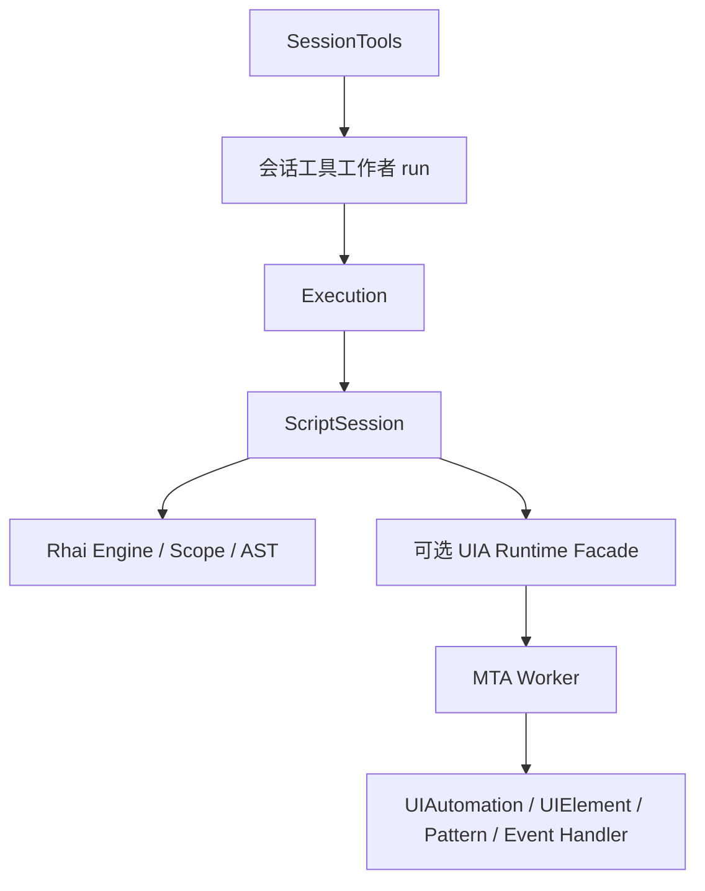

# UIA Runtime：让 COM 对象拥有稳定的线程与会话

UIA 的 Rust wrapper 最终持有 Windows COM 接口。Agentelier 的 Rhai `ScriptSession` 会跨多次工具调用保留状态，但每次脚本执行都通过 `spawn_blocking` 承载，线程身份不固定。UIA 对象不能跟着 Rhai 变量在不同执行线程之间流转，因此需要一个独立、稳定的 MTA Worker。

## 为什么 Worker 必须独立于 Rhai 执行线程

当前 `ScriptSession::run` 先取得会话状态锁，再将状态移入 `spawn_blocking` 执行 Rhai。工具执行结束后，下一次调用可能由另一个阻塞线程执行。若在 Rhai native function 内直接调用 `UIAutomation::new()` 并把返回的 `UIElement` 保存起来，下一次脚本可能在不同线程使用它。

这不只是 Rust 类型能否通过 `Send` 检查的问题。COM 对象有 apartment 语义，客户端调用必须遵守对象创建和使用所在的 COM apartment。

## Worker 与 ScriptSession 的所有权

`runtime/tool_jobs.rs` 的会话工具工作者在 `Execution` 中创建并持有一个 `ScriptSession::default()`。`Execution` 在会话工具工作者的生命周期内存在，连续的 `computer_execute` 调用复用同一个 ScriptSession。

UIA Runtime 应作为 ScriptSession 的内部状态延迟初始化：

Worker 不按每次 `computer_execute` 创建，也不作为全局进程静态服务。这样元素引用和事件订阅能跨同一会话的多次工具调用保留，又不会跨会话共享。

## COM 初始化与 UIAutomation 创建

Rhai 的 `uia_status()` 通过 Runtime 在 Worker 上查询 Control View 条件。首次探测启动 Worker，成功返回 `true`，启动或 Provider 错误沿现有脚本错误路径返回。

`uiautomation` 0.25.3 的 `UIAutomation::new()` 会调用 `CoInitializeEx(None, COINIT_MULTITHREADED)`；`UIAutomation::new_direct()` 直接 `CoCreateInstance`，前提是调用方已经初始化 COM。当前上游 wrapper 没有在 Drop 中配对 `CoUninitialize`。

Worker 启动流程：

1. 在专属线程调用 `CoInitializeEx`，并请求 `COINIT_MULTITHREADED`。
2. `S_OK` 和 `S_FALSE` 都是成功初始化结果；每次成功调用都需要在该线程配对一次 `CoUninitialize`。
3. 若线程已处于不兼容的 apartment（例如 `RPC_E_CHANGED_MODE`），Worker 启动失败，不尝试在同一线程切换 apartment。
4. 使用 `UIAutomation::new_direct()` 创建 UIA 客户端，避免库再次隐式初始化 COM。
5. 后续 UIA COM 对象全部在该 Worker 创建、使用和释放。
6. Worker 关闭时先移除事件处理器、释放元素和 Pattern 引用，再释放 UIAutomation 客户端，最后调用 `CoUninitialize`。

不要在 Rhai native function 中直接持有 COM wrapper。Rhai 与 Worker 之间只传递窗口 Token、逻辑元素引用、普通参数和普通结果 DTO。

## 请求通道与 COM 调用

UIA Facade 提供可发送的请求句柄。每个请求包含请求类型、会话身份、目标窗口/元素引用、参数、截止时间和取消状态。Worker 串行处理 COM 请求，返回普通结果。

请求队列需要有界，防止模型在一个脚本中产生大量 UIA 请求而无限积压。队列满时返回明确的 `uia_queue_full`，不静默丢弃普通请求。

取消在 COM 调用边界协作执行：

- 尚未开始的请求可直接取消。
- Worker 开始调用前检查取消与截止时间。
- COM 调用返回后再次检查取消，决定是否继续后续操作。
- 不假设任意正在执行的 Provider COM 调用都能被强制中断。
- 若 COM 调用尚未返回，外层工具仍处于执行中，不能提前释放桌面许可或报告资源已回收。

## Rhai 脚本与桌面独占许可

`ToolRegistration::execute` 对 `computer_execute` 持有现有 `ToolPermit`，并在 `script::execute_tool` 返回后才释放。`ScriptSession::run` 内的 Rhai 脚本同步执行，`wait(ms)` 也在该工具调用期间占用独占许可。

UIA 操作与 UIA 条件等待沿用同一行为：

- UIA 查询、Pattern 操作和等待均发生在当前 `computer_execute` 内。
- 等待期间 `ToolAdmission::Exclusive` 仍由该调用持有。
- UIA 事件订阅可以在脚本返回后继续作为被动监听存在；被动监听本身不持有 `ToolPermit`，也不执行鼠标、键盘或其他桌面副作用。
- 事件到达后，下一次 `computer_execute` 可读取事件队列并重新查询元素。
- 不创建 UIA 专属锁，不改变现有工具并发契约。

## 事件回调与 Worker 解耦

`uiautomation` 的 Event Handler wrapper 会把事件发送方包装成 `UIElement`，并把属性值包装成 `Variant` 后调用用户回调。回调可能处于 UIA 的事件交付路径中，不应在回调里遍历树、执行 Pattern 或等待 Worker。

回调只提取事件参数中已经提供的普通数据，并通过有界、非阻塞队列发送通知：

- 焦点事件：发送焦点变化信号；后续由 Worker 查询当前焦点元素。
- 属性变化：发送订阅 ID、属性 ID，以及可转换为普通值的 `new_value`；无法安全转换时只标记属性失效。
- 结构变化：复制结构变化类型和事件参数中提供的 RuntimeId（若有）。
- 通用 Automation Event：发送订阅 ID 和 Event ID。
- 不把事件回调中的 `UIElement` 或 COM `Variant` 跨线程传递。

事件队列满时合并重复属性通知；结构变化无法合并到明确子树时，将对应窗口快照标记为需要完整刷新。事件丢失不能导致旧缓存继续被当成当前状态。

## ScriptSession 的关闭顺序

会话工具工作者收到 Cleanup 后，现有执行器先停止接纳新调用、取消在途调用并等待 `JoinSet` 中的工具真实结束。随后调用 `ScriptSession` 的显式关闭入口：

1. 停止 UIA Runtime 接受新请求。
2. 取消尚未完成的 UIA 等待。
3. 在 MTA Worker 中移除全部订阅处理器。
4. 清空元素引用表和快照缓存。
5. 释放 COM wrapper。
6. `CoUninitialize` 并 join Worker 线程。

不能依赖 Rust Drop 在任意线程释放 UIA COM 对象，也不能在仍有脚本调用时关闭 Worker。
