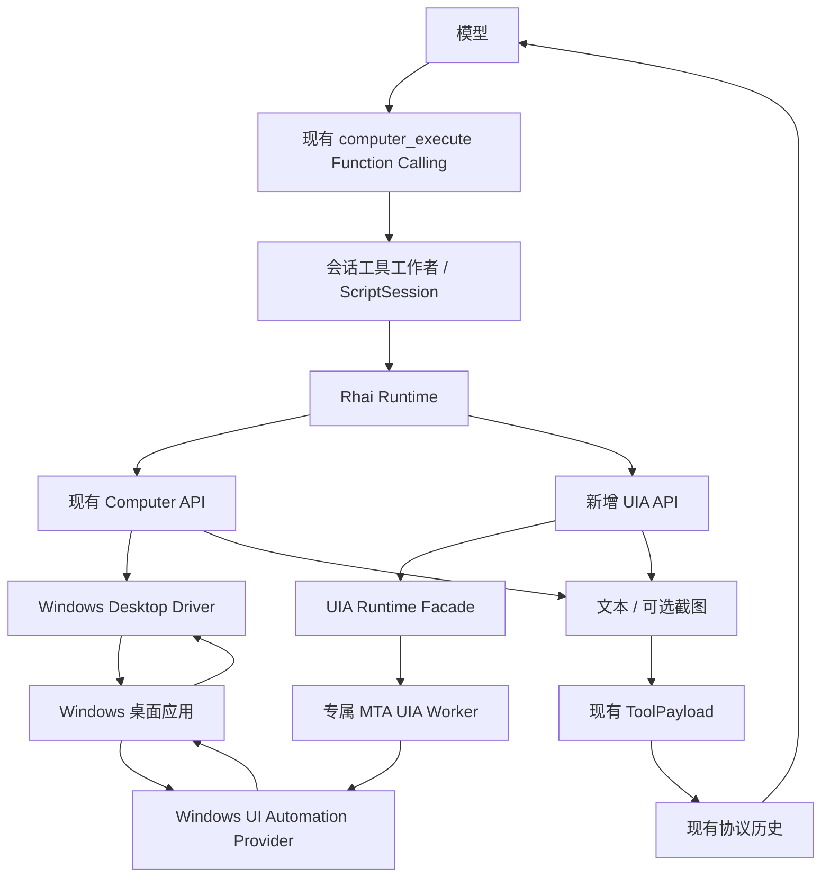
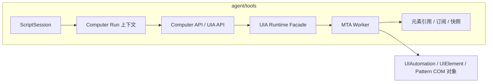

# UI Automation：在现有 Computer Use 上增加控件语义操作

现有 [Computer Use](computer-use.md) 通过 `computer_execute` 操作 Windows 桌面。模型提交 Rhai 脚本，脚本调用 Computer API，Windows Desktop Driver 负责窗口、截图、鼠标和键盘，结果沿 Function Calling 路径返回模型。

本设计在同一个工具入口下引入 Windows UI Automation（UIA）。当目标应用暴露元素树、元素属性和 Control Pattern 时，模型可根据控件语义定位和操作。画布、自绘区域和缺少可用 UIA 信息的界面继续使用截图和坐标输入。

UIA 不会替代 Computer Use，也不建立第二套 Agent 工具循环。它是现有 Computer API 的另一组能力，仍由同一个 `computer_execute` 入口执行。

## 现有结构提供了什么

当前实现中，`agent/tools` 已拥有 Windows Desktop Driver、Rhai Computer API 和 `ScriptSession`。`ScriptSession` 保存 Rhai Engine、变量作用域和函数 AST；后续调用会继续使用同一会话状态。脚本执行通过 `spawn_blocking` 承载，因此不同次脚本执行不保证落在同一个操作系统线程。

`runtime/tool_jobs.rs` 中的会话工具执行者创建一个 `ScriptSession::default()`，并把它放在长期存活的 `Execution` 中。它在同一会话的多次工具调用之间复用，直到该会话的工具工作者收尾。这是 UIA 长期状态最合适的归属点。

当前 `computer_execute` 注册为 `ToolAccess::Exclusive`。`ToolRegistration::execute` 在整个脚本执行结束后才释放 `ToolPermit`；脚本内的 `wait(ms)` 也处于该许可覆盖范围。UIA 操作必须复用同一条执行路径和许可，不能另建一把只保护 UIA 的锁。

## UIA 与 Computer Use 的职责边界

| 能力 | Computer Use | UI Automation |
|---|---|---|
| 顶层窗口枚举、激活 | 现有 Driver | 复用现有 `WindowId` |
| 桌面/窗口截图 | 现有 Driver | 不重复实现 |
| 鼠标、键盘、轨迹 | 现有 Driver | 不重复实现 |
| 控件树 | 不负责 | Raw / Control / Content |
| 元素属性 | 不负责 | UIA Properties |
| 元素查找 | 依赖截图和坐标 | UIA Conditions / TreeWalker |
| 控件语义操作 | 坐标输入 | Control Pattern |
| 焦点、属性、结构变化 | 不负责 | UIA Events |
| 自绘画布、无 Provider 区域 | 适用 | 可能没有可用元素 |

两种通道不自动互相伪装。UIA Pattern 不支持、元素不可访问或 Provider 调用失败时，结果必须准确反映失败原因。模型可以据此选择 Computer Use 的截图和输入操作；不能在 UIA API 内部悄悄改成坐标点击，再把结果报告为 Pattern 成功。

## 新增能力放在哪里

UIA 属于 Windows 桌面操作能力，放在 `crates/agent/tools` 的现有 `desktop` 职责下，不放入 Bevy UI crate，也不新增一个承担整个桌面领域的聚合 Crate。可以在 `desktop` 内建立 `uia` 子模块，内部再按 Runtime、元素、树、Pattern 和事件职责组织。

UIA Runtime 由 `ScriptSession` 持有一个可延迟启动的客户端句柄。真正的 COM 对象只存在于独立 MTA Worker 线程中。Rhai 只持有普通字符串形式的逻辑元素引用和可序列化结果，不持有 `UIElement`、TreeWalker 或 Pattern COM wrapper。

### UIA Runtime 的会话范围

每个 `ScriptSession` 对应一个会话工具执行上下文。UIA Worker 与它一一关联：

- 第一次调用 UIA API 时才启动 Worker，未使用 UIA 的会话不创建额外线程。
- Worker 在该 `ScriptSession` 的多次 `computer_execute` 调用之间保持存活。
- 元素引用、事件订阅和 UIA 快照均属于该会话，不跨会话共享。
- 会话工具工作者停止接收新任务、取消并回收在途工具后，显式关闭 UIA Runtime；Worker 移除事件订阅、释放 COM 对象并退出。
- 不使用进程级静态元素表，也不把 UIA 状态放进 Rhai 的持久变量作用域。

## 采用 uiautomation

采用 `uiautomation` 0.25.3。其 `UIAutomation`、`UIElement`、`UITreeWalker`、`UIMatcher`、`UICacheRequest`、Pattern 和 Event API 覆盖了本次需要的大部分 Windows UIA 客户端能力。

Agentelier 根 Workspace 当前使用 `windows = "0.62"`；`uiautomation` 0.25.3 的 Workspace 依赖为 `windows` / `windows-core` 0.62.2，版本线可以统一解析。实际接入时应确认 Cargo.lock 中只解析到预期的 Windows crate 版本。

建议仅启用本次需要的 Feature：

| Feature | 用途 | 本次是否需要 |
|---|---|---|
| `control` | 控件封装；同时启用 `pattern` | 是 |
| `event` | UIA 事件注册与处理 | 是 |
| `input` | 库自身键鼠模拟 | 否，已有 Computer Use |
| `screenshot` | 库自身截图 | 否，已有 Desktop Driver |
| `process` | 库提供的进程辅助筛选 | 否，可用 UIA ProcessId 属性 |
| `clipboard` | 剪贴板 | 否 |
| `dialog` | 消息框辅助 | 否 |
| `log` | crate 内部日志 | 非必要 |

`control` Feature 依赖 `pattern`，`event` 默认关闭。使用 `default-features = false` 并显式启用 `control`、`event`，避免引入重复的键鼠、截图和剪贴板实现。

## COM 与执行线程

`uiautomation::UIAutomation::new()` 会在当前线程调用 `CoInitializeEx(..., COINIT_MULTITHREADED)`；`new_direct()` 则不初始化 COM，要求调用方已经完成初始化。当前上游源码中，`UIAutomation` wrapper 没有负责配对 `CoUninitialize` 的 Drop 实现。

因此 UIA Worker 在线程启动时显式初始化 MTA，随后使用 `UIAutomation::new_direct()` 创建客户端；线程退出前在同一线程释放 UIA 对象并配对 `CoUninitialize`。不要在每次 Rhai 调用的 `spawn_blocking` 线程里直接创建 UIA 对象。

## 模型可用的能力范围

本次完整纳入：

- 窗口与桌面 UIA 根元素。
- Raw、Control、Content 三种树视图。
- 有界树遍历、局部展开和继续读取。
- 常用与扩展属性读取、Pattern 可用性。
- 多条件查找。
- 跨调用逻辑元素引用和失效恢复。
- 全部相关 Control Pattern。
- UIA 事件订阅、条件等待。
- UIA Cache Request、控件树快照和增量更新。
- 结构化结果和 Rhai API。

## 设计导航

- [Runtime 与 COM 生命周期](ui-automation-runtime.md)说明会话如何持有 MTA Worker，以及请求、事件回调和关闭如何协作。
- [元素模型](ui-automation-elements.md)说明根元素、树视图、有界遍历、查找与逻辑引用。
- [Control Pattern](ui-automation-patterns.md)说明上游覆盖、适配范围与操作契约。
- [事件、条件等待与缓存](ui-automation-events-cache.md)说明事件通知如何驱动条件检查、快照失效与增量刷新。
- [Rhai API 与结果契约](ui-automation-rhai-api.md)说明脚本接口、结构化结果和错误语义。

实施顺序与验收安排见 [UI Automation 实施方案总览](../../../plans/ui-automation/00-overview.md)。

## 参考项目的取舍

**Agentelier** 的桌面能力、脚本状态和工具入口归属 `agent/tools`。Windows 交互和模型协议沿用现有边界。相关源码见 [ScriptSession](../../../crates/agent/tools/src/script.rs)、[Computer API](../../../crates/agent/tools/src/script/computer.rs)、[Desktop Driver](../../../crates/agent/tools/src/desktop.rs)、[ToolAdmission](../../../crates/agent/tools/src/admission.rs) 和 [会话工具工作者](../../../crates/agent/runtime/src/runtime/tool_jobs.rs)。

**bevy_brp** 是 Bevy App 的 BRP/MCP 检查与交互通道。其 [README](https://github.com/slc90/bevy_brp/blob/main/README.md) 和 [MCP 协议说明](https://github.com/slc90/bevy_brp/blob/main/docs/mcp.md) 将 App 暴露的方法目录与 MCP 原生工具目录分开，并强调工具调用被接受不等于应用 UI 已产生预期行为。它适合验证 Agentelier 自身 Bevy GUI 的运行状态，不是面向任意 Windows 应用的 UIA Provider 客户端。Notepad 和 File Explorer 的验收应使用 Windows UIA 和 Accessibility Insights，不通过 BRP 操作外部应用。

**bevy_widgetry** 是 Agentelier 使用的 Bevy UI 组件库。其 [AGENTS.md](https://github.com/slc90/bevy_widgetry/blob/main/AGENTS.md) 和 [crate 公共入口](https://github.com/slc90/bevy_widgetry/blob/main/crates/bevy_widgetry/src/lib.rs) 展示了 Widgetry 的 Bevy UI 组件与插件边界。UIA 是 `agent/tools` 的 Windows 桌面能力，不属于 Widgetry 控件或 Bevy UI 组合职责；本次不修改 Widgetry，也不为 UIA 新建 Widgetry 组件。

**OpenAI Codex** 仅作为工具接入、执行上下文和资源生命周期的参考；调查范围限制在 `codex-rs/` 与 `docs/`。Agentelier 已有自己的 `computer_execute`、Rhai、ToolAdmission 和 Runtime 取消/回收路径，继续沿用即可，不移植 Codex 的沙箱、Guardian、权限审批或安全审查体系。

## 运行结果与现有工具协议

UIA 返回普通结构化文本数据，沿用 `computer_execute` 当前结果路径。截图仍由 Computer Use 的 Desktop Driver 生成，仍遵循现有 `ToolPayload` 图片约束。UIA 不引入第二种模型工具协议，也不改变 Responses Function Calling、Turn Runner 或 Conversation 的调用身份与历史格式。

## 设计边界

- 仅支持 Windows x64。
- 不增加浏览器自动化；浏览器继续使用 MCP。
- 不引入 Python、Node.js、通用 REPL 或第三方 Computer Use 框架。
- 不新增沙箱、权限审批、Guardian 或独立安全审查机制。
- 不新增 Unit Test、Integration Test、Regression Test、Benchmark 或 Example。
- UIA 与 Computer Use 共享现有桌面独占许可；UIA 等待也属于当前 `computer_execute` 调用的一部分。
