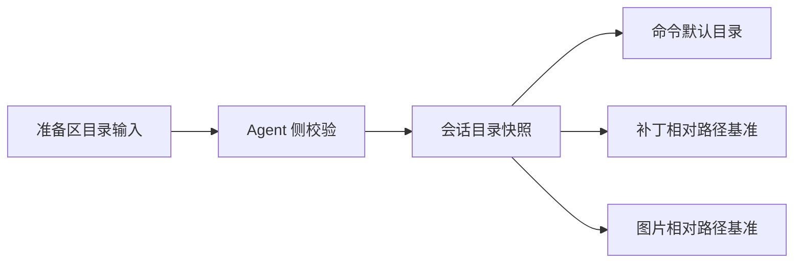

# 工具先要知道自己操作哪里

计算只需要输入数值；读取文件和运行编译器还需要一个确定的目录。当前会话设置保存模型、推理选项、账号身份和提示词快照，没有本地工作目录。本阶段把目录加入会话设置，而不是让每次执行临时猜测应用进程的当前位置。[当前会话结构](sources.md#current)

## 工作目录属于会话，不属于登录数据

准备区增加“本地工作目录”，支持输入绝对路径并复用已有 Widgetry 目录选择能力。初始值取应用启动时读取到的进程工作目录，显示完整解析结果；读取失败则保持未选择状态，要求明确指定。准备区修改只影响随后创建的新会话。

创建会话时校验目录存在、确实是目录且路径可解析，固定为会话快照。重置会话沿用该目录，重试、Steer 和 Queue 使用所属会话的同一快照。已有会话的工作目录不随准备区变化，也不随某条 Shell 命令执行了 `Set-Location` 而变化。

目录只保存在准备区和会话的内存状态中，不增加项目列表、最近项目数据库或新的持久化设置。本阶段也不自动发现项目根目录或加载 `AGENTS.md`；考题明确要求模型用现有工具主动读取这些文件。

账号数据目录仍由原有 Login / Application 路径管理。工具工作目录不能复用、更换或重新初始化账号数据环境。新建实验项目也不触发登录、授权或清理凭据。

## 每次调用可以选择自己的目录

`exec_command.workdir` 与 `apply_patch.workdir` 支持字符串或 `null`。`null` 使用会话目录；相对目录从会话目录解析；绝对目录直接使用。工具启动前返回明确的路径错误，不自动创建一个错误拼写的目录。

`view_image.path` 支持绝对路径，相对路径从会话目录解析。模型需要读取生成项目的截图时，应传入实际文件绝对路径。路径不是 Shell 片段，不对文件工具的路径字段执行变量展开或命令解释。

例如会话目录是 `C:\Users\<用户>\Downloads`，模型创建了 `counter-tool-exam` 后：编译命令把 `workdir` 设为这个新项目；补丁也把 `workdir` 设为同一路径；图片工具读取该项目中截图的完整路径。无需修改会话本身或隐式记忆“上次 cd 到哪里”。

实际 I/O 使用解析后的路径对象，UI 使用现有路径显示能力。Shell 的工作目录通过进程 API 单独传入，不拼进 `cd ...; <命令>`；不调用全进程的 `set_current_dir`。这样其他会话业务、辅助 Job 与账号文件处理不会被改变。

## 不使用沙箱时的权限含义

工具以运行应用的当前 Windows 用户权限执行。工作目录是路径基准，不是访问围栏；绝对路径、父目录访问以及网络能力由当前用户和操作系统环境决定。

本阶段不接入沙箱、目录授权列表、网络白名单、逐命令审批、提权重试或 UAC 流程。操作系统拒绝访问时返回真实错误，不自行换用户或提升权限。任务中的“仅修改实验项目”是执行要求，不包装成应用已经强制隔离的安全保证。

工具层不接收账号的 `CredentialClient`，不自动把模型服务 Token 放入环境变量或参数。Shell 仍具有当前用户本来就拥有的本地访问能力；无沙箱模式不能承诺阻止任意命令读取该用户可访问的文件。

## PowerShell 环境保持明确

Shell 固定使用 PowerShell 7 的 `pwsh`，不回退到 Windows PowerShell 5。解析到的可执行文件必须真实存在。使用独立进程参数传入命令，关闭 Logo 与用户 Profile，避免每次调用被个人启动脚本改变；不提供 Codex 中切换任意 Shell、login shell 或多环境选择的参数。

命令仍继承正常开发所需的用户环境，例如 PATH、Rust / Cargo 和系统代理配置。不安装第二套环境管理系统，也不复制 Codex 的 Shell 快照机制。

标准输入输出采用明确的 UTF-8 约定；读取跨块字符时保留尚未完整的字节。非 UTF-8 的外部程序输出若需要替换字符，结果应说明解码替换已经发生，而不是把乱码归因于模型。命令启动失败、工具业务失败和命令自身的非零退出应能区分。

模型通过工具描述获得默认工作目录及参数规则，通过工具结果获得本次实际解析后的目录。这里不增加实验专用 Developer 行为提示词，也不改变用户已选定的提示词组合。

## 放入现有模块的位置

会话目录设置及其快照属于 `agent/conversation`；目录解析、Shell 环境检查与工具执行上下文属于 `agent/tools`。Runner 把当前会话的执行上下文交给工具；Runtime 继续只负责任务生命周期。

`bridge/conversation` 传递目录设置与安全展示字段，`ui/chat_ui` 负责编辑和显示，`ui/agent_host` 继续使用唯一连接。Agent 与 Bridge 保持不依赖 Bevy。UI 结构使用 BSN，TextField 和目录控件通过 Widgetry 的公开状态接口操作。[架构与控件依据](sources.md#rules)

本阶段新增的进程、补丁和图片代码继续放在 `agent/tools` 内按职责分 module，不为四个工具各建一个 crate，也不引入 Router / Registry / Orchestrator 层级。对外依赖由 Workspace 统一管理。

## Downloads 是考题目标，不是全局默认目录

考题使用当前登录 Windows 用户的 Downloads 已知文件夹。其默认位置通常为 `%USERPROFILE%\Downloads`，但实际位置可能被重定向，因此被测模型应先解析并确认实际路径，再在其下创建一个新的项目子目录。[Windows 路径依据](sources.md#platform)

不得把 `\Downloads` 当作当前盘根目录，也不硬编码用户名。Downloads 根目录中的已有文件不成为实验工作区。生成路径已存在时选择新的子目录，不能清空或覆盖原有目录。

Cargo 安装、Git 模板缓存和依赖下载可能使用正常的用户缓存目录；“源代码修改只发生在实验项目中”与“系统绝无其他缓存写入”是两种不同要求。考题约束前者，并要求报告必要的安装与缓存活动。
