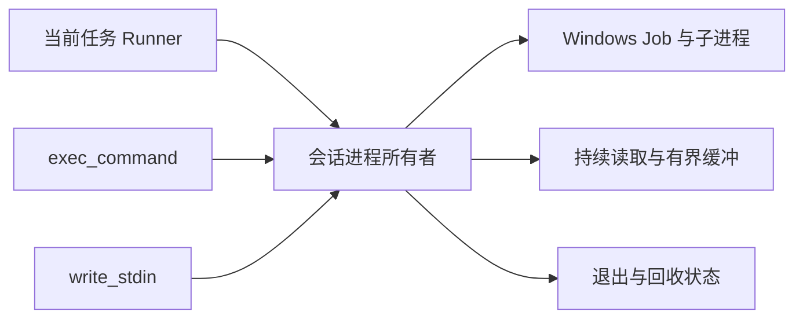
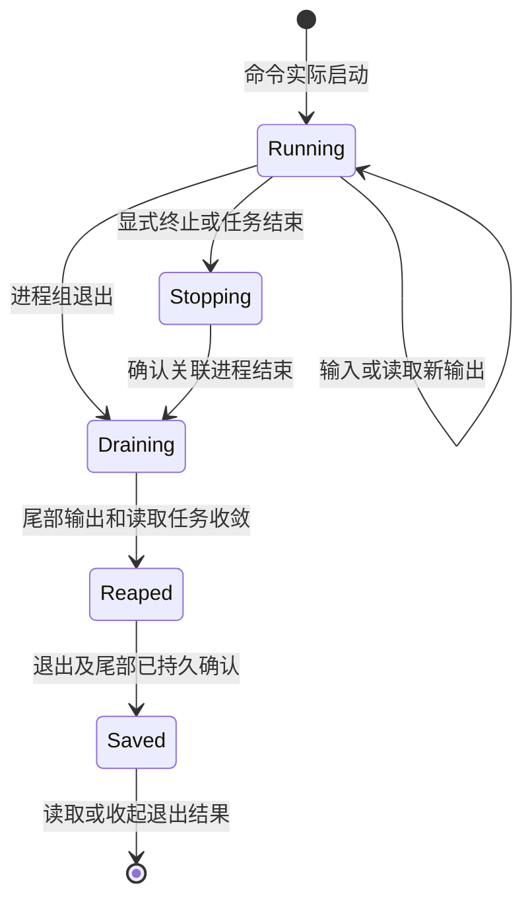

# 一次工具返回之后，进程还可能继续运行

`exec_command` 的返回表示本次观察结束，不必表示编译器或应用已经退出。Codex 用 `session_id` 把后续输入与同一个进程关联；本阶段保留这个思路，会话内用独立登记保留创建来源和退出结果。[Codex 命令与进程实现](sources.md#codex)

## 先区分三个身份

模型工具调用的 `call_id` 关联一份调用与一份结果。`session_id` 标识应用管理的进程会话，同一会话可以被多次 `write_stdin` 调用引用。操作系统 PID 只用于诊断和实际进程操作，不能直接充当可任意访问的工具会话 ID。

进程会话使用不可混淆的内部标识，并关联会话、用户任务和创建它的工具调用。其他会话的 ID、未知 ID 和已经消费或恢复后的历史 ID 都返回明确错误，不根据 PID 猜测归属，也不重新启动原命令。

图中是运行时协作，不是新增的 crate 层级。进程所有者实现在 `agent/tools`，由 Runtime 按会话持有，应用关闭和停止全部工作时执行异步收尾。所有后台读取任务都有句柄并参加回收，不交给 Widgetry JobManager，也不新建 Tokio Runtime。

## 启动命令并取得第一份结果

本阶段 `exec_command` 接受 `cmd`、`workdir`、`yield_time_ms`。参数保持严格 JSON：所有声明字段都在 `required` 中，`workdir` 与 `yield_time_ms` 使用 `null` 表示默认值，拒绝未知字段。默认等待窗口为 10000 毫秒，允许 0–30000 毫秒。

命令在等待窗口内结束时，直接返回输出与退出码。窗口结束但进程组仍在运行时，返回 `state: running`、`session_id`、本次可读输出和 `exit_code: null`。`yield_time_ms` 控制等待输出的时间，不是命令的生命期限。

结果至少表达解析后的工作目录、进程状态、新输出、退出码，以及是否发生输出截断或解码替换。工具调用成功并得到一个运行中的会话，不等于命令任务已经成功完成。非零退出必须显示实际退出码和输出，工具记录呈现失败；启动失败则没有可使用的会话 ID。

首版采用普通管道，不分配 PTY / ConPTY，不提供 `tty`、`shell`、`login`、审批或沙箱字段。标准输入可供脚本和控制台程序读取，但发送字符不等于向 Bevy 窗口发送键盘输入，向管道写入 Ctrl+C 字节也不等于可靠地终止进程。

## 继续输入、读取输出与明确终止

`write_stdin` 接受 `session_id`、`chars`、`yield_time_ms`、`close_stdin`、`terminate`。全部字段列为 required 并拒绝未知字段；`chars` 为空字符串表示只读取新输出，两个布尔字段没有对应意图时必须明确填写 `false`，等待时间为 `null` 时使用同一 10000 毫秒默认值，允许 0–30000 毫秒。

非空 `chars` 按给定内容写入，不自动补换行。`close_stdin: true` 在本次写入完成后关闭输入端，使等待 EOF 的程序能够结束。输入关闭后仍可读取输出，但再次写入返回输入已关闭的错误。

`terminate: true` 表示终止这个已登记的进程会话及其关联进程，不依赖控制字符解释。它不能与非空输入或关闭输入请求混用；应用等待实际终止和输出排空后再返回终态。任务的 Stop 则是更大的控制操作，会终止本任务管理的全部进程。

同一进程会话的写入、关闭和取出输出串行处理。一次输入只完成部分写入、或取消时无法确认对端处理情况，应报告已知的写入状态，不自动重放非空输入。进程可以跨请求和跨 Turn 继续运行。终止请求可中断在途轮询，取消一次读写只结束这次操作并保留进程。

## 输出不能因为没人轮询就堵住程序

stdout 和 stderr 从启动后就持续读取，分别保存流身份；只在模型调用 `write_stdin` 时才开始读取，会让大量输出的进程堵在管道上。

每个会话设置 1 MiB 的待取输出总上限。超出后丢弃部分内容并累计丢弃字节数，保留足以识别开头与近期错误的内容；不能无限增长，也不能把读取线程阻塞在已满的 UI 通道上。

每次调用返回尚未交付的新输出，成功交付后推进读取位置，不反复把整段历史发回模型。单次序列化文本结果继续限制在 64 KiB 内，先截断文本，再构造完整合法的 JSON，并报告截断与丢弃数量；不裁断 JSON 本身。stderr 和 stdout 之间不虚构严格全序。

进程退出时先读取可取得的尾部内容，再报告退出。根 Shell 已退出但 Job 中还有子进程时，整个命令会话仍未回收；不能仅凭父进程退出就报告所有工作结束。存活进程和未读取的退出结果共用八个登记。八个均占用时拒绝启动，读取或明确收起已保存的尾部可释放名额。

这些数值是本阶段选择的集中初始限制，不沿用 Codex 的默认数量或 token 预算，也不增加限额设置面板。

## 用生命周期管理代替沙箱

Windows Job 用来持有同一次启动产生的进程树，在显式终止、任务取消和异常释放时统一清理。它在这里不限制文件或网络权限。[Windows Job 与安全封装依据](sources.md#platform)

实现优先采用 `process-wrap` 的 Tokio / JobObject / KillOnDrop 安全接口，按需要启用 creation-flags；Tokio 增加 `process` feature。新版本由 Workspace 锁定，不直接复制 Codex 的 Windows 适配代码，也不在本项目加入 unsafe。普通 Shell 不弹出额外控制台，命令启动的目标 GUI 仍正常显示。

实现期间需要在实际 Windows 环境确认嵌套 Job、子进程启动、stdin 管道与关闭行为。若该依赖的公开能力不足，记录阻塞并选择符合相同约束的安全实现；不能退化成按进程名批量结束程序，或把关闭父进程当作进程树清理。

## 每条任务结束路径都要收尾

原生会话正常结束前台时，已持有的进程继续运行或保留已保存退出结果。Stop 只终止当前 Turn 创建的进程，轮询其他来源不会改变归属。明确终止、停止全部或应用关闭负责实际回收。平铺同步会话仍在结束前回收本 Turn 进程。

终止请求要能打断等待输出；停止时不发送新的模型请求。已完成的工具结果保留，当前执行返回真实取消或终止结果，尚未开始的调用沿用未执行结果。Runtime 必须在收尾与任务真实回收后才发布最终状态。

启动后取消、等待输入时取消、进程自然退出与 Stop 同时发生，都依据已经发生的事实收敛。已确认退出的进程不被迟来的取消改写为“从未执行”。清理失败或期限内未能确认全部回收时，显示真实失败并暂停后续执行，不能提前显示“已停止”。显式异步收尾是主要路径，KillOnDrop 只作异常释放兜底。

进程登记、退出和消费使用独立记录。真实退出、回收和退出事实提交后才释放独占许可。原 `exec_command` 返回的 `running` 结果保留，`write_stdin` 以自身调用身份交付尾部。重新打开只恢复进程摘要，历史 ID 无法控制，未确认的历史回收与本次持有的句柄区分。

## 15 秒期限应该保留在哪里

现有统一的 15 秒包装不能继续包住整个长进程。命令改为“有界等待 + 持续进程会话”；没有额外的全进程 15 秒终止器。进程的硬边界由明确终止、任务结束、资源上限和应用关闭承担。

当前每任务 32 次模型请求、64 次工具调用的预算继续保留，轮询也计入调用次数。长编译耗尽预算时如实报告触限并回收，不能为了完成考题偷偷增加无限循环或自动续跑。

每次阻塞的文件 I/O、图像处理或外部库等待都离开 current-thread Runtime 的热路径；与命令相关的任务通过可等待的句柄收敛。停止不是丢弃一个 Future 后立刻声称外部世界停止。
