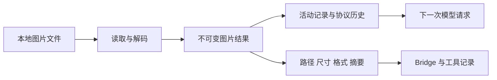

# 让模型读到图片，而不是一个图片路径

`view_image` 成功读取文件，只完成了一半工作。另一半是把图片内容放进模型的后续请求，并在会话继续时保留同一份图像。返回路径、宽高或一段 Base64 文本都不能替代结构化图片输入。

## 真实载荷与展示摘要

原字符串结果链路已改为类型化 ToolPayload；ProtocolItem::FunctionResult 持有真实载荷，ActiveTurn::seal 从执行结果表收集结果，ToolView.output 只保留摘要。[当前结果保存路径](sources.md#current)

本阶段把执行结果拆成两个相关但不同的部分：一份供历史与协议使用的真实载荷，以及一份有界、安全的展示摘要。普通文本工具仍可产生现有 JSON 文本；图片工具产生包含文字说明和图片的结构化结果。



图片字节留在 Agent 执行侧。Bridge、ECS 反射状态、日志与工具详情文本只接收摘要，不复制整段 data URL。本阶段不新增聊天附件上传器、图片编辑器或通用多模态资源服务。

## 读取一次，保存当时看见的内容

`view_image` 接受 `path`。本阶段先支持本地 PNG 和 JPEG 静态图片。相对路径从会话目录解析；错误路径、目录、损坏数据和不支持的格式返回明确业务错误。

先检查文件大小，再读取并按真实内容解码，不能只凭扩展名判断格式。图片处理放到可回收的阻塞工作中，不阻塞现有 current-thread Runtime。解码成功后形成不可变的像素或编码结果，并记录实际格式、原始尺寸、发送尺寸与内容摘要。

本阶段选择最长边最多 2048 像素的等比缩放，保留足以查看普通应用截图的内容。输入文件上限 10 MiB、解码像素上限 2500 万、单张规范化编码结果上限 4 MiB、会话累计图片结果上限 16 MiB。限制在分配、解码和加入历史前检查；压缩后仍超限则返回错误，不把截断的图片当成功。

同一结果中的图片在内存中共享不可变数据。之后原文件被覆盖、移动或删除，旧历史仍使用读取当时的图片，不重新打开路径；修改图片后需要新的 `view_image` 调用。会话重置或释放时随历史释放图片，不新增磁盘持久化或内容压缩机制。

上述大小和缩放值属于本阶段初始选择，不是 Codex 或服务端的统一默认值。

## 协议结果使用内容数组

Codex 的 `view_image` 把 `InputImage` 放入 `FunctionCallOutputBody::ContentItems`。Responses 文档也提供图片工具结果的内容数组形式。[Codex 图像实现](sources.md#codex) · [协议依据](sources.md#platform)

本阶段由 `llm_model` 统一生成对应的协议形状，例如：

```json
{
  "type": "function_call_output",
  "call_id": "本次调用标识",
  "output": [
    {"type": "input_text", "text": "已读取本地图像，发送尺寸为 1920 × 1080。"},
    {"type": "input_image", "image_url": "data:image/png;base64,...", "detail": "high"}
  ]
}
```

这里的 `output` 是数组，不是包含 JSON 数组字符的字符串。工具库只提供图片结果类型，不直接构造 Responses 请求；模型层负责 MIME、data URL 和协议项。

一次完整模型输出仍然与对应的全部工具结果组成封闭步骤，`call_id` 一一对应，同批多个图像与文本结果保持原有顺序。图片步骤成功封闭后，如果下一次请求失败，已取得的图片与工具结果仍保留。未完成模型响应、重复调用 ID 或协议错误仍按第 4 阶段的边界处理。

当前文本的 64 KiB 上限只约束文字参数和文字结果，不再误用来拒绝整个图片载荷。序列化前还应检查总请求预算，本阶段采用 32 MiB 的完整请求字节上限；包含 Base64 膨胀和已有文本历史。超限返回可观察错误，不静默删除旧图或伪造读取成功。

## 模型支持情况必须来自真实数据

模型目录保存服务实际返回的可选 input_modalities；会话以 Option<bool> 固定支持、不支持或未知。[模型目录依据](sources.md#current)

本阶段保存服务实际返回的可选模态信息；缺失时记为未知，不能默认“所有模型都支持图片”。明确不支持时，`view_image` 返回能力错误；未知时由真实图片往返确认，服务拒绝则保留原错误类别和请求标识，不自动换模型、账号、登录方式或工具协议。

最终考题使用当前账号和明确选定的模型。图片传输失败属于协议或模型能力问题；模型看到图后判断不够准确属于另一个观察维度。不能通过改写提示词，把图片尚未接通掩饰成“模型已经看过”。

## 截图和图片查看是两个独立动作

截图由 `exec_command` 调用本机能力生成。截图需要来自目标应用实际运行的窗口，文件保存在实验项目下的证据目录；`view_image` 读取这个文件。工具的成功结果应能与本地图片的内容摘要、尺寸及模型下一次请求中的图片项对应。

仅有一张静态截图，可以检查界面有没有显示、文字是否完整等视觉事实。增加、减少、重置是否有效，需要实际交互或其他对应证据；不从“按钮画出来了”推断点击已验证。

本阶段图片工具不承担截图、点击、OCR 或桌面自动化。模板实验获准直接截图，不等于给应用增加一个第五种工具。

## 当前实现

Tools 的 image 模块检测静态 PNG/JPEG，PNG 在解码器分配前检查 IHDR 像素数，并为解码器配置分配上限；编码使用有界 Writer，超过 4 MiB 即失败。发送前校正图像方向，PNG 规范化为 RGBA8 PNG，JPEG 规范化为质量 85 的 RGB JPEG。源 SHA256 与发送编码 SHA256 分别保留。原文件修改或删除后，旧协议结果仍使用 Arc 共享的原载荷。

模型协议层发送真实内容数组，生成完整请求时进行有界序列化。会话图片预算在纳入结果表前检查，按共享对象身份去重。超过会话预算的图片不保留编码，但保留已经读取及其元数据的错误事实。工具卡片展示格式、原始/发送尺寸、路径与摘要；所有图片字节均留在执行侧。
