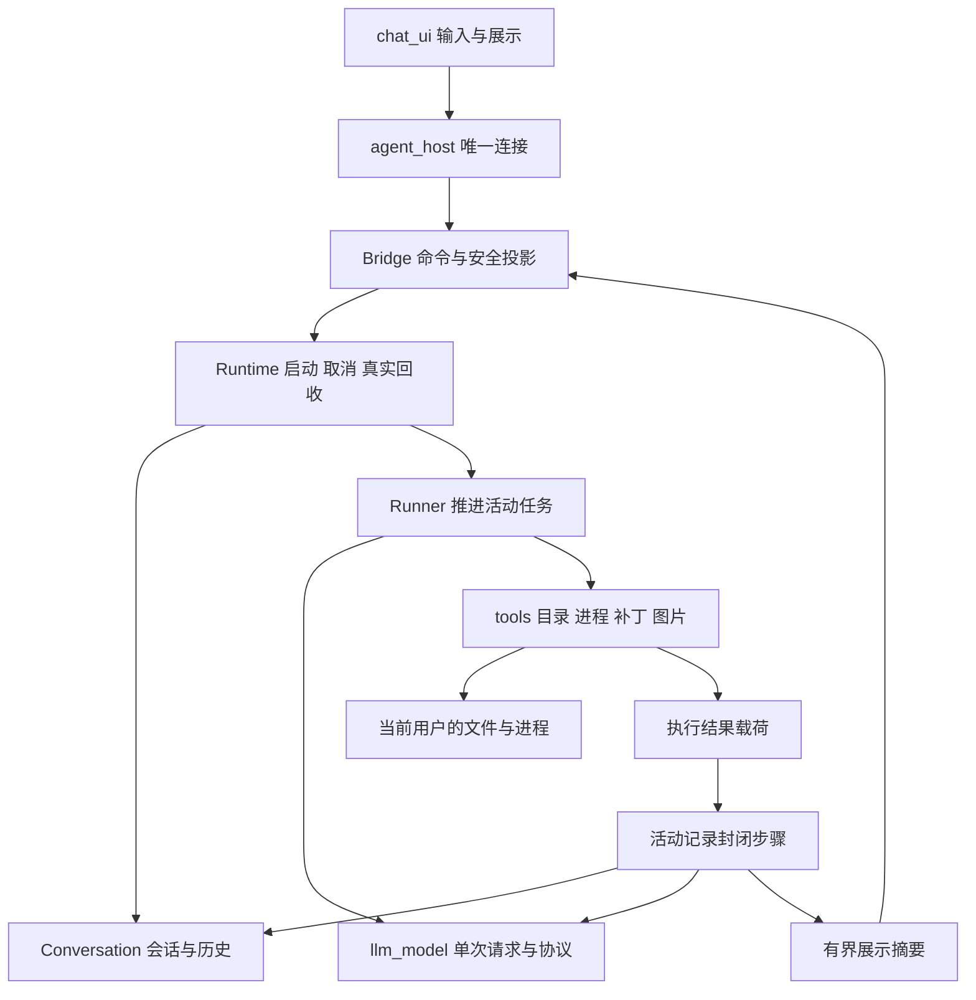

# 把执行资源、真实结果和界面重新接到一起

前面的目录、进程、补丁和图片机制最终都回到同一个任务：模型选择工具，应用执行，保存实际结果，再决定是否继续。新增能力要落在现有职责边界中，而不是把所有事情塞给 Runtime。

## 谁拥有哪一份状态

这张图描述运行协作，返回箭头不表示 Cargo 反向依赖。内部依赖仍保持 Runtime → Runner、Runner → Conversation / LLM Model / Tools，Conversation 和 LLM Model 只使用 Tools 的必要值类型。Tools 不依赖模型通信、Runtime、账号、Bridge 或 Bevy。

会话保存不可变的工作目录与工具目录快照；Runner 独占活动记录，并拥有当前任务的工具执行上下文；工具执行上下文拥有进程会话和相关读取任务。图片结果作为不可变数据交给活动记录和协议历史。UI 只消费投影，不成为结果、进程或文件修改的权威。

当前 `ActiveTurn::seal` 从 `ToolView.output` 收集结果。引入图片时，改成从执行侧保存的类型化结果封闭历史；`ToolView` 只保留摘要。这个改变是图片接入的一部分，不另建全局附件服务。[现有实现](sources.md#current)

## 执行协议保留什么

本阶段继续等待合法的完整模型响应才执行工具。参数流片段只供显示；未完成响应、重复 `call_id` 和身份关系损坏不进入实际执行。同批合法工具按最终响应顺序串行执行，普通业务错误作为结果交给模型。

未知工具、参数无效、目录不存在、输入已关闭、补丁匹配失败、图片损坏等属于可解释的业务结果。模型通信错误、历史封闭失败或执行所有权损坏属于任务失败，不能伪装成一个普通工具错误后继续。

结果错误类型需要容纳实际路径、退出码和操作系统错误的受控描述，不继续被当前仅接受静态字符串的错误结构限制。文本仍有字节预算；图片另有载荷预算；诊断内容剔除凭据和敏感大段输出。

Steer 仍在当前工具实际结束后的边界生效，跳过尚未开始的旧调用，然后发起下一次模型请求。Steer 本身不自动杀掉已经存在的进程会话；模型可用 `write_stdin` 的终止意图处理它们。Stop、触限和任务结束才触发统一收尾。

Queue 仍按 FIFO 推进；只有前一任务的模型工作、进程组和工具 I/O 都真实回收后，才启动下一项。失败、停止、触限或清理失败继续暂停队列，不以“工具返回了 session_id”视为旧任务已经完成。

## 如何显示进程仍在运行

工具调用状态与进程状态分开。`exec_command` 已成功返回一个运行中的会话时，这条调用可以是成功，结果摘要必须同时显示“进程仍在运行”、会话 ID 与后续交互入口说明。不能只显示绿色成功，让人误以为编译已完成。

`write_stdin` 展示本次新输出、输入或终止意图和进程终态。补丁展示实际修改路径和部分完成情况。图片展示路径、格式、原始与发送尺寸、摘要及读取状态，不显示 Base64。

任务停止期间显示“正在停止 / 正在回收”，只有 Runtime 取得真实结果才显示终态。清理失败必须保留错误和未确认状态，阻止自动启动后续 Queue。工具原有成功结果不会被迟来的停止覆盖。

任务末尾的自动进程清理作为独立执行事实记录，既不伪造 `function_call`，也不改写之前的工具输出。后续模型请求可附带由应用固定格式生成的执行环境通知，列出已结束的旧进程会话和清理异常；通知只表达应用自身事实，不把命令输出提升为 Developer 指令。

这是运行事实的传递，不增加一套实验 Developer 行为提示词，不做提示词组合或效果比较。正式考题仍只有用户题面。

## 开发约束落到实际工作中

应用源码保持 Windows x64、PowerShell 7 和当前锁定的 Bevy / Widgetry / BRP 组合。沿用 current-thread Tokio；文件 I/O、图片解码等阻塞工作由受管理的阻塞任务承担，不阻塞 UI 或调度线程。新依赖在 Workspace 中统一声明，Agent / Bridge 保持不依赖 Bevy。

`lib.rs` 只承担模块声明和出口，按进程、补丁、图像等真实职责划分内部 module，不使用 `mod.rs`，不为每个按钮、错误或工具建立一个 crate。保留 unsafe 与主动 panic 的禁令，不通过全局 lint suppression 绕过。[工程规则](sources.md#rules)

涉及 UI 的运行验证继续通过 BRP 操作 Agentelier 自身。特殊键采用仓库已记录的完整 KeyboardInput 路径；建立焦点后再输入，不能直接修改编辑器内部 ECS 状态冒充输入。完成后释放 Pointer 并确认 inactive。截图豁免只给 Downloads 中生成的实验项目，不修改应用自己的 GUI 验证规则。

开发、调试和最终考试都使用现有账号与数据目录，不退出登录、不重新授权、不换账号或清除凭据。普通应用关闭依然只是正常收尾，不触发账号退出。

## 验证分成两个不同视角

实现期间，每个增量通过静态检查和真实应用运行验证自己的行为。Agentelier 仓库不新增 Unit Test、Integration Test、Regression Test、Benchmark、Example、模拟模型服务或持久化测试脚本。可使用真实进程的受控调试输入验证难以由模型稳定产生的异常，但记录其注入性质，不称为服务真实输出。

最终考试由 Agentelier 自己接收题面，调用四个工具，从模板创建 Downloads 中的新项目，修改获准的规范、开发计数器、编译运行和截图。Codex CLI 可以部署、启动或观察被测应用，但不能替它生成项目、补写计数器、运行其命令或代交工具结果。若外部介入改变了试卷工作区，记录该段为辅助操作，不计入自主执行证据。

工具是否可靠，分别看真实输入、执行事实、结果关联、错误反馈与资源收尾。模型代码写错、依赖下载失败、目标模板要求当前没有的子 Agent，分别记录原因；原因尚不明确时标为待定位，不把所有失败都归为“模型能力”。一次正常调用不是取消和错误路径的替代证据。

每次验证保留当前工具记录、退出码、实际文件变化、截图、图片输入项摘要和相关进程回收事实。常规日志只保存身份、状态、耗时和错误类别，不保存完整命令输出、补丁正文、图片数据或凭据。[日志依据](sources.md#rules)

## 实验项目与开发仓库的规则不能混用

模板目前带有 TDD、自动化测试和独立 Reviewer Subagent 等规则；这些与 Agentelier 自身的规则不同。[模板规则依据](sources.md#template)

实验模型在生成项目里按该项目规则工作。用户授权的是取消必须使用 BRP 的限制，允许本地截图，并同步修正相关文档中的相同要求。没有授权它为了通过考题随意删除测试、审查或其他流程要求。

当前四工具不提供子 Agent、MCP 或 Skills。遇到必须依赖这些能力的环节，保留未完成状态并报告阻塞，不伪造完成；只有不依赖该环节的工作才能继续。独立 Reviewer 缺失可能使模板的正式交付流程未完成，但已经取得的四工具运行证据仍单独保存。

实验截图只记录真实窗口可观察事实。计数器按钮是否确实工作需要交互证据；没有完成交互时明确列为未验证，不把视觉通过写成完整 GUI 通过。

## 移除诊断工具时同步收口

四个真实工具各自基本验证通过后，再删除计算和等待工具的登记、执行分支、实现与专属 receipt 逻辑。仅当依赖确实不再被其他能力使用时才移除依赖项；进程 ID 等能力可能仍需要唯一标识支持。

重启后的新会话默认目录只包含四个工具。新二进制不为旧诊断名称提供隐藏兼容别名，调用旧名称按未知工具返回错误。原有 `plans/Agent 工具调用/` 是历史方案，不改写成“过去没有诊断工具”；相关模块设计和 `docs/design/tool_call.md` 中的当前边界则按实际交付更新。

实现完成时同步 `docs/design/architecture.md`、`docs/design/modules/conversation.md`、`docs/design/tool_call.md` 等受影响的设计文档。更新只描述已经完成的增量，不因整份计划存在就提前宣布所有能力可用。

详细实施顺序见[执行方案总览](../../../plans/本地开发工具/local-development-tools/00-overview.md)，完整题面见[独立考题](../../../plans/本地开发工具/local-development-tools-exam.md)。
