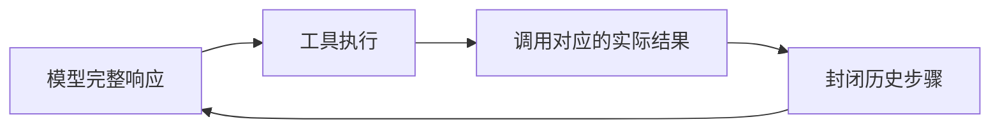

# 本地开发工具：从工具往返到实际操作项目

一次工具调用能够完成，并不等于应用已经能处理本地开发任务。计算和等待只产生结果；编译会留下进程，补丁会改变文件，图片还需要进入模型真正能读取的输入通道。

第 5 阶段围绕这三个差异展开。范围固定为 `exec_command`、`write_stdin`、`apply_patch`、`view_image`，已移除原有计算和等待诊断工具。使用当前用户的本机权限，不引入沙箱、审批系统、权限升级、MCP、Skills 或多 Agent。

这组文档说明本地工具的设计与实现边界。工作目录、进程会话、补丁、图片结果和诊断退役已接入；完整考题的验收事实单独记录，不从代码已接入推断考试已经通过。

## 先保留已经成立的工具循环

当前应用在新建会话时固定工具目录；Runner 等待完整模型响应，再执行串行工具批次，把结果封闭到历史中，继续请求模型。Runtime 负责取消和真实回收，UI 显示累计投影。[现有实现依据](sources.md#current)

第 5 阶段继续使用这条循环。改变的是工具执行所拥有的资源，以及结果携带的内容，而不是另建一套 Agent Runtime。

当前进程工具使用任务级持续会话；补丁与图片使用可等待的阻塞工作及 15 秒协作式期限。ToolResult.output 与协议结果保存类型化载荷，活动记录按真实结果封闭历史，展示摘要不参与协议构造。[执行与结果结构依据](sources.md#current)

## 四个工具各完成一件什么事

| 工具 | 本阶段交付的能力 |
| --- | --- |
| `exec_command` | 在明确的工作目录启动 PowerShell 7 命令，返回已完成结果或可继续操作的进程会话。 |
| `write_stdin` | 向该进程会话写入标准输入、读取新输出、关闭输入，或明确终止进程。 |
| `apply_patch` | 接收 JSON 中的补丁文本，创建、修改、移动或删除文本文件，并报告实际变化。 |
| `view_image` | 读取本地图像，形成不可变图片结果，把图片内容送入后续模型请求。 |

文件读取、内容搜索、文件枚举和 Git 操作通过命令工具完成，不另注册一组同义工具。截图也由命令生成；`view_image` 只负责读取已有图像。

Codex 提供命令执行与继续输入的配对方式、补丁格式以及图片结果的协议实现。本方案沿用这些职责划分，但保留当前应用的 Direct JSON function tools，不照搬 Codex 的完整执行服务器、沙箱、审批和动态工具体系。[Codex 参考入口](sources.md#codex)

## 从哪里读起

[工作环境与目录](01-working-environment.md)先说明工具到底操作哪里，以及“不使用沙箱”在本机执行中的含义。

[命令与进程会话](02-process-sessions.md)接着区分一次工具返回和一个进程结束，再解释输入、输出、取消与回收。

[补丁与实际文件变化](03-file-patches.md)把这套执行边界应用到文件修改，说明为什么停止和回滚是两回事。

[图像结果与模型输入](04-image-results.md)说明图片为什么不能被当成普通 JSON 字符串，以及它如何留在历史中。

最后由[模块协作与验证](05-integration-and-validation.md)把这些局部机制接回现有架构，并区分实现期间的验证和最终考题。引用的代码与外部文档集中在[参考依据](sources.md)。

## 这次具体作出的收敛

本阶段采用普通管道执行 PowerShell，提供标准输入交互，不提供 PTY、ConPTY 或完整终端模拟。使用任务级进程会话：同一用户任务内可以多次交互，任务结束后统一回收，不留下跨任务后台服务。这两项是为当前四工具验收作出的范围选择，不是 Codex 的全部能力。

工具输入继续使用严格 JSON。补丁放在字符串字段中；图片通过结构化工具结果输出。路径和进程生命周期有明确所有者，模型决定调用什么，应用负责把实际发生的结果保存下来。

开发执行由 Codex CLI 完成；最终固定考题必须通过 Agentelier 自身的模型请求和四个工具运行。考题中的新项目创建在当前 Windows 用户的 Downloads 文件夹下，不进入应用源码仓库，也不进入账号数据目录。完整题面和证据要求见[独立考题方案](../../../plans/本地开发工具/local-development-tools-exam.md)。
