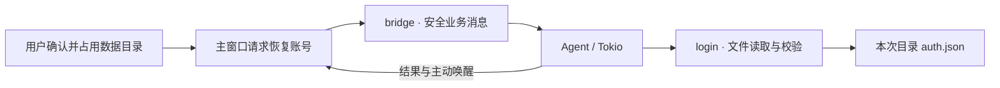

# 从数据目录恢复账号

当前已经实现[数据目录启动与设置](mechanisms/application-data.md)和[文件账号恢复](modules/authentication.md)。进入主窗口后，应用通过业务桥接请求 Agent/Tokio 读取本次目录的 `auth.json`，展示未登录、账号摘要或具体存储错误。恢复不主动打开浏览器、不创建或覆盖凭据文件。

`crates/login` 集中数据环境和具体文件凭据能力，不依赖 Bevy；`crates/login_ui` 集中目录界面及账号安全投影；`app` 保留配置、日志、Winit 通知及退出协调。Agent 串行执行认证操作，桥接只负责业务转换、操作身份和通信。账号真相留在运行侧，不将 Token 或原始记录放入 ECS。

## 当前行为

[数据目录与启动](mechanisms/application-data.md)说明首次选择、重启恢复、查看路径和更改位置。更改目录在下次启动生效，当前账号始终来自本次固定数据目录；文件由用户自行整理。

[账号恢复界面](modules/account-ui.md)说明读取中、未登录、已恢复会话、过期与错误的展示。存储失败可以重新读取，不把损坏文件当作不存在；没有会话时不制造登录成功。

[认证运行与凭据管理](modules/authentication.md)说明文件格式、结构校验、安全投影、主动唤醒及真实收尾。数据环境保持到后台及日志结束，账号恢复不接管辅助任务体系。

## 后续边界

浏览器授权、Token 续期、退出登录和模型请求尚未实现，按[登录实施导航](../../plans/登录/00-overview.md)继续。合法真实会话由浏览器登录增量产生后再验证重启恢复，不提前构造伪造登录。
