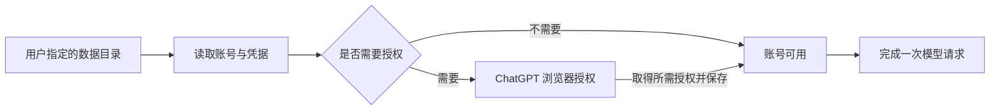

# 从数据目录进入 ChatGPT 登录

当前已落地[数据目录启动与设置](mechanisms/application-data.md)，尚未实现账号恢复、浏览器授权或模型请求。下文及关联认证文档描述后续设计，实施顺序见 [plans/登录](../../plans/登录/00-overview.md)。

功能按 `crates/login` 与 `crates/login_ui` 划分：前者集中数据与认证能力，后者集中 Bevy 界面，应用保留通用配置和装配。后续认证能力从原方案中的 Agent 内部模块调整为由 Agent 运行侧调用 `login`；尚未实施的增量需要沿此边界落地。

应用先确定本次使用哪一份本地数据，再恢复这份数据中的账号。目录里没有可用凭据时，用户通过系统浏览器登录 ChatGPT；已有凭据时，应用直接恢复账号并按需续期。账号准备好以后，可以完成一次基本模型请求。

数据目录是账号恢复的起点，只保存账号登记与当前凭据。应用配置及数据目录选择统一存放在可执行文件旁的 `config/config.ron`，运行日志存放在可执行文件旁的 `logs/`。应用没有默认数据目录，也不会读取其他应用的登录缓存。

## 先理解目录，再理解账号

[数据目录与启动](mechanisms/application-data.md) 说明首次选择、重启恢复、查看路径和更改位置。更改目录在下次启动生效，原目录中的文件由用户自行复制、整理和删除。

[浏览器登录与账号界面](modules/account-ui.md) 沿着未登录、等待浏览器授权、账号可用和退出登录展开，说明用户能看到什么、每个操作改变什么。

## 账号如何落到现有架构中

[认证运行与凭据管理](modules/authentication.md) 说明应用、业务桥接与 Agent 的协作，以及文件凭据、自动刷新和结束操作的关系。认证仍属于 Agent 运行侧，界面接收的是账号状态和操作结果。

[首次模型请求](modules/model-connection.md) 把登录后的可用性落实为一次真实请求：取得当前账号可用的模型，发送简短验证输入，接收完整结果并显示在界面上。

## 这组能力的边界

登录只采用 ChatGPT 浏览器授权，凭据只采用文件存储。每个数据目录维护一个账号登记及其当前登录会话。退出后保留账号登记，清除能够继续认证的 Token。

应用使用具体的文件凭据组件和具体的 ChatGPT 通信路径，不增加登录方式选择器、存储后端选择器或多供应商框架。
