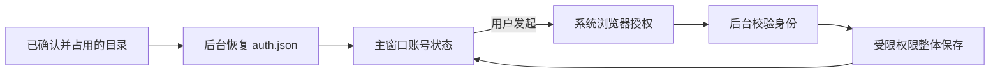

# 从数据目录进入 ChatGPT 登录

当前已经实现数据目录启动与设置、文件账号恢复和 ChatGPT 浏览器授权。应用先确定并占用本次目录，再恢复该目录中的账号；未登录时可从主窗口打开系统浏览器完成授权。

`crates/login` 集中数据环境、OAuth、身份校验和具体文件凭据能力，不依赖 Bevy；`crates/login_ui` 负责目录与账号界面；`app` 负责配置、日志、浏览器/剪贴板集成及退出。Agent/Tokio 串行执行认证，Bridge 传递操作身份和业务阶段，账号与 Token 真相留在运行侧。

[数据目录与启动](mechanisms/application-data.md)说明目录选择、重启恢复及下次启动位置。更改位置不切换当前账号，也不移动文件。

[浏览器登录与账号界面](modules/account-ui.md)说明准备、等待、取消、保存重试、账号及订阅范围状态。没有 API Key 或其他登录方式，密码与验证只由用户在授权页面输入。

[认证运行与凭据管理](modules/authentication.md)说明独立客户端登记、文件格式、JWT 校验、安全存储、唤醒与真实收尾。文件保存成功后才报告登录完成，失败保留已有会话。

可用凭据在请求时按有效期续期，旋转结果保存后才交付；明确失效的会话清空 Token、保留登记。主窗口可通过“检查会话”调用同一路径。退出登录及模型请求仍按[后续增量导航](../../plans/登录/00-overview.md)实施。
