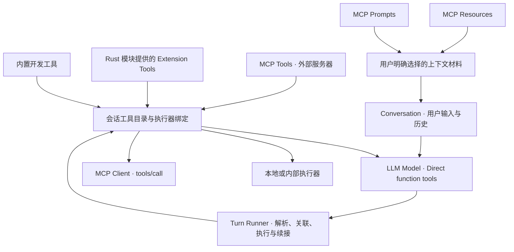
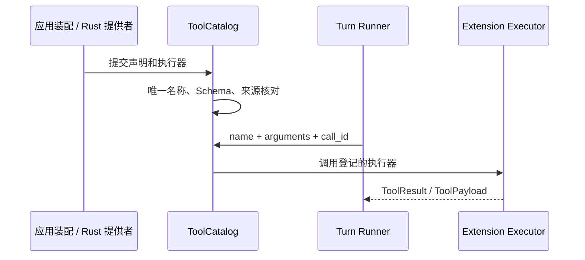
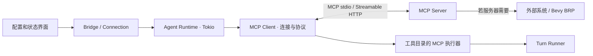
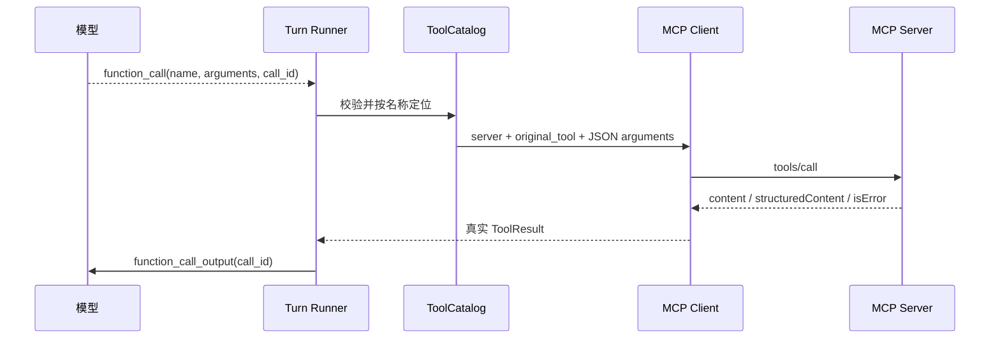

# 内部扩展工具与 MCP 客户端

Agentelier 已能在一次用户任务中连续执行 `exec_command`、`write_stdin`、`apply_patch` 和 `view_image`，并把 `function_call_output` 交回模型。这次扩展的目标不是再造 Agent Loop，而是让同一条执行链能够使用内部 Rust 模块提供的工具，以及外部 MCP Server 提供的 Tools、Resources 和 Prompts。

现有四个工具仍是应用内置能力。Extension Tools 是**编译进程序的内部工具提供方式**；MCP 是**与外部服务交换能力的标准协议**。二者解决不同来源的问题，最终都遵守 Agentelier 的运行、取消、历史和展示边界。Dynamic Tools、DLL 动态加载和插件市场不进入本设计。

图中工具目录是一项统一的执行约定，不意味着每种来源都要增加一套 Router。Resources 和 Prompts 没有进入工具目录：它们提供可读取的内容与模板，使用时机由宿主界面与用户决定。

## 从固定四工具目录扩展到多来源目录

### 当前机制的可复用部分

`agent/tools/catalog.rs` 的 `ToolRegistration` 将声明和异步执行器绑定。工具名可由提供者定义，`execution.rs` 通过同一目录查找执行器。`turn_runner` 在完整 `response.completed` 后才开始调用，并用 `call_id` 绑定结果。`llm_model` 从目录读取声明和严格模式生成 Responses 请求。

### 一份登记同时绑定声明与执行能力

`ToolCatalog` 的登记包含四类相互关联的信息：

| 信息 | 作用 |
| --- | --- |
| 模型声明 | 可调用名称、描述、输入 JSON Schema、Responses 严格模式选择 |
| 来源身份 | `builtin`、内部提供者及本地工具名，或 MCP 服务器身份及原始工具名 |
| 执行器 | 与声明配对的本地处理器，或使用已选择 MCP 连接的调用适配器 |
| 会话契约 | 创建会话时保存的稳定声明、来源身份与调用目标约定 |

调用仍按模型看到的唯一名称进行。目录构造阶段发现冲突就明确报错，不让后注册的工具覆盖已有工具；MCP 的名称由服务器身份与原始名称生成可逆或有显式映射的模型可用名，实际调用使用保存的原始 `server + tool`，不从压缩名称猜测目标。内部扩展同样不得抢占内置工具名称。显示名称可与执行名称分离。

来自 MCP 的工具 Schema **不能被无条件强制改写为严格 Schema**。`llm_model/generation.rs` 使用登记的严格模式，四个内置工具继续使用完整 required/封闭对象及 `strict=true`；MCP `inputSchema` 则允许可选字段和不同结构。借鉴 Codex `codex-rs/tools/src/mcp_tool.rs` 与 `responses_api.rs` 的做法，保留输入含义并为 MCP 使用适当的非严格声明；必要的最低限度格式适配仅修复模型接口的语法要求，不把 optional 擅自改为 required。服务端仍是自身 Schema 与业务校验的权威。无法向当前模型合法声明的工具应单独报告不可用，而不是制造一个与原工具不同的接口。

既有单次参数上限、模型请求上限、结果大小与图片预算继续生效。MCP 的 `outputSchema`、`structuredContent`、内容块及 `isError` 是结果协议，不等于模型输入 Schema；转换时不能只取一段展示文本丢掉错误状态或结构化内容。

## Extension Tools：内部模块提供执行器

这里借鉴 Codex `codex-rs/ext/extension-api/` 的工具贡献者与 `codex-rs/core/src/tools/handlers/extension_tools.rs` 的适配思想，但仅引入 Agentelier 需要的**工具提供者 → 执行器 → 现有目录**关系。无需复制官方完整 Extension API、生命周期贡献者或独立注册框架。

内部 Rust 模块提供工具声明及与之匹配的可执行处理器，应用装配时把提供者交给目录构造过程。执行器的内部工作可以是 Rust 函数、PowerShell/其他进程、HTTP 请求或组合业务操作；Extension Tools 并不要求有独立的 `Backend` 类型，也不要求运行在外部进程。

提供者在编译期被纳入程序，登记行为可在创建目录时发生。新增实现仍需要编译新的 Agentelier；这不是无需重新编译安装的第三方插件系统。执行器不得反向依赖 `turn_runner`、`conversation`、Bridge 或 Bevy，若未来确有涉及 UI 的内部工具，应由拥有该业务的模块提供明确接口，而不是允许 Agent 线程直接访问 ECS World。

首个增量应使用现有工具能力验证注册与调用契约，不为证明扩展机制而永久增加没有业务价值的第五个工具。四个内置工具与内部提供者共享执行模型，但不要求一次性重构其成熟的进程、补丁及图片内部实现。

## MCP 连接负责什么

MCP Server 运行在 Agentelier 外部。使用 `bevy_brp_mcp` 时，它是一个由客户端通过 stdio 启动的子进程，向连接方公开 MCP 能力；它再用 BRP HTTP 操作运行中的 Bevy App。MCP Client 不直接变成 BRP Client，也不需要让 `agent/tools` 依赖 Bevy。

MCP Client 建议成为 `crates/agent/` 中独立的业务边界：它拥有连接、协议版本、能力发现、请求关联、超时、取消与关闭；`agent/tools` 只持有调用适配器及声明，不接管服务器进程生命周期。这个边界有独立职责，可以形成 `agent/mcp`，但不应再细分一批空的 transport、router crate。

### 配置与连接的所有权

服务器配置至少表达稳定的服务器名称、启用状态、传输方式和启动/访问参数。stdio 配置需要可执行文件、参数、工作目录及明确允许传入的环境变量；Streamable HTTP 配置需要端点及当前支持的认证参数。服务器配置与 ChatGPT 账号凭据是两种业务数据，不复用 Account 的 Token 或 OAuth 生命周期，也不将秘密写入日志、会话存档或工具描述。

MCP 配置保存于本次数据目录的 `mcp_servers.json`，由 Runtime 持有的 `agent/mcp` 配置存储原子替换。每项自带稳定 UUID，显示名称需唯一。stdio 与 Streamable HTTP 各自校验字段，Bearer 认证只保存环境变量名称。Chat UI 提交改动并等待 Bridge 回执，`agent_host` 负责唤醒 Winit。已保存的启用状态与连接状态分别展示。配置更改影响下一次目录构造；已建立会话继续使用创建时的声明与执行绑定。

一个服务器失败不应被表示为整个 MCP 系统失败。运行侧记录其错误阶段（启动、握手/版本、发现、执行或关闭）与可用能力；用户可以修改配置再连接。stdio 子进程由 MCP Client 持有 Windows Job；程序以参数数组启动，默认只提供 SystemRoot，其他变量按显式许可继承。SDK 关闭协议，Client 等待并回收进程组。单轮任务 Stop 不终止共享服务器。服务器 stderr 和 SDK 原始消息不作为应用日志。

### 新旧 MCP 协议在连接处收敛

`bevy_brp_mcp` 使用 rmcp，已说明能够协商截至 `2025-11-25` 的旧版初始化流程，并为 `2026-07-28` 使用请求级 `_meta`。新版 MCP 核心不再要求 `initialize` / `initialized` 会话握手，能力和协议版本随请求表达，支持 `server/discover`。因此客户端不应把旧式握手写死为所有服务器共通的生命周期。

stdio 连接使用官方 rmcp 3.5.1 的 Auto 生命周期与有界 stdout 传输。它先尝试发现 2026-07-28，按 SDK 支持的条件回退到旧初始化。MCP 业务层依赖**连接可用、能力信息、请求完成**这些稳定语义。首批支持 stdio，并以官方的 Streamable HTTP 为另一种明确传输；不为未经需求确认的 SSE 旧传输或自定义 socket 设计兼容层。若版本或必需能力不能协商，应得到明确失败，不假装已连接。

## 服务器提供三种不同能力

### Tools：进入模型可调用目录

连接就绪后使用 `tools/list` 分页发现，监听旧版 tools list changed 通知刷新候选目录。清单、Schema 及描述受数量和字节约束。模型名由服务器 UUID 与原始工具名确定，原始身份和传输配置摘要进入存档。通过校验的工具才登记入统一 `ToolCatalog`。模型只看到名称、描述、模型兼容 Schema；当模型输出 `function_call` 时，Runner 仍按原顺序执行，执行器把 JSON 参数原样按相应协议对象转交给 `tools/call`。服务端返回的 `content`、`structuredContent`、`isError` 要经过有界映射成为既有 `ToolResult`，再交给下一次 Responses 请求。

模型调用仍只发生在完整响应边界；现有工具批次串行、Steer、Stop、64 次工具预算、封闭历史步骤、异常归还以及用户界面的工具时间线均复用。MCP 的应用层错误（包括 `isError=true`）作为可反馈工具结果；连接断开、协议错误或调用取消须区分，并在适当时机完成真实资源收尾。工具结果按有序内容数组保留文本、资源链接和结构化结果。当前单次工具载荷可携带一张图片，数组记录附件位置。其他图片、音频及无法解码的内容带有明确说明。静态 PNG/JPEG 与内置图片工具共用解码、规范化和会话预算。

### Resources：读取服务器提供的上下文

Chat UI 从已选服务器获取资源和 URI 模板，按 RFC 6570 展开显式参数。读取回执与服务器 UUID、传输配置摘要和请求 URI 关联。预览展示实际正文、URI、MIME、字节数和 SHA-256，确认后复制整段到聊天草稿。提交和恢复沿用原用户消息记录，读取或取消预览不会创建历史记录。

Resources 是由 URI 标识的数据，不是自动多出来的函数工具。客户端通过 `resources/list` 与可选的 `resources/templates/list` 得到资源或 URI 模板，再经 `resources/read` 获取内容。Resources 可以是文本或带 MIME 的二进制 `blob`。协议读取得到资源内容，是否加入模型上下文是宿主的决定。

建议采用**用户显式选择、读取、预览，再作为当前输入材料提交**的第一版交互，不扫描后自动注入全部资源。选择一个文本资源时，提交材料应带来源服务器、URI、读取时间与实际文本快照，进入用户输入/任务上下文，纳入会话存储和请求核对；不得替换固定 Developer `InstructionSnapshot`，也不能只保存 URI 后在恢复时重新读取一个可能变化的远端内容。未能安全转成受支持模型内容的二进制资源允许展示元数据和读取结果，但不得作为空正文冒充已附加成功。资源模板要求的值由用户明确提供并显示最终 URI，不根据字符串推测授权范围。

这部分适合借鉴 Codex `codex-rs/core/src/tools/handlers/mcp_resource/` 与 `codex-rs/codex-mcp/src/resource_client.rs` 的协议访问和资源身份处理；**不必照搬 Codex 将资源接口包装成模型工具的全部展示方式**。

### Prompts：服务器给出的可参数化消息模板

MCP Prompts 经 `prompts/list` 发现名称、描述和所需参数，用户选择后填写参数，由 `prompts/get` 取得实际消息。它不是把服务器文本自动写进当前会话的 Developer 基础指令，也不是 Agentelier 本地 `prompts.json` 的新版本来源。

建议第一版把返回内容放在可预览、可确认的**用户发起输入**路径：文本先进入草稿或确认界面，由用户提交后才进入新的任务及历史；不在后台自动执行。对于多个消息、`assistant` 角色、内嵌 Resource、资源链接、图片或音频内容，须保留原始类型与来源，只有已定义的映射才允许提交；首个可用闭环至少覆盖可参数化的纯文本 user Prompt，未支持的块明确显示，而不是错误转换为 Developer 或伪造一段已经发生的助手历史。

与本地 Prompt 库、项目规则及 Skills 的身份要严格分开：本地 Prompt 是创建会话时固定的 Developer 配置；项目规则来自项目目录；Skills 是按任务发现的工作流；MCP Prompt 是用户即时从外部服务器取回的模板。其读取失败不改变任何既有固定配置。

## 冻结目录、实时连接与可恢复历史

**固定的是模型可见的工具契约，不是服务器永远在线。** 新建会话时汇集内置工具、编译进程序的扩展工具和当前可成功发现的 MCP Tools，形成只读快照。会话目录包括来源与路由身份；模型声明与运行分发共用它。服务器之后通知列表变化或配置改变时，新会话可取得新目录，但旧会话不在一次任务中悄悄改变工具名、描述和 Schema。

`StoredTool` 保存名称、描述、参数、严格模式和来源身份。恢复时 Conversation 逐项核对保存的契约，并以原目录顺序重新绑定同一来源的执行器；已存在的同名工具不能替代失踪的原服务器。契约不匹配时沿用当前“保留历史、阻止执行”的语义；契约匹配而服务器暂时离线时，应显示真实连接错误并允许后续连接恢复，不能假称旧工具已被删除或自动替换。

Resources 和 Prompts 的列表可以随服务器状态重新获取，因为它们不是会话工具目录的一部分；但**已经提交的资源文本或 Prompt 展开结果必须按当时内容留在历史**，不能在恢复时再从服务器获取并替换原文。这与现有 Prompt 快照、Skills 任务材料和项目来源记录的原则一致。

在模型请求准备阶段，MCP 工具声明必须计入现有 32 MiB 请求预算与上下文估算；用户选择的 Resources/Prompts 文本也需要受限，不得绕开会话历史、自动压缩和持久确认。已有 `call_id`、模型请求序号与安全 ToolView 是日志、界面和存档关联的唯一依据，MCP 请求自身的协议 ID 不取代它们。

## 从运行结果看得见哪些能力

界面只需在现有模型准备/聊天区域提供服务器配置、连接状态、可用 Tool/Resource/Prompt 清单和必要的操作入口；沿用 BSN、Widgetry 与唯一 Agent Host，不建立第二套 UI 网络客户端。MCP Tool 调用继续使用当前 Tool Timeline；资源读取和提示词展开属于用户明确发起的材料操作，应与模型自动工具调用视觉区分。用户能够查看最终提交的来源、实际内容与错误类别。

正常使用的可观察流程是：配置并启用一个 MCP Server；新会话能看到它的工具；模型可以调用并读取真实结果；用户可以选取一条 Resource 加入下次输入，或选择一个 Prompt、填参并确认使用。服务器不可用时，其余已可用工具和现有聊天仍能正常工作；应用关闭后不留下自己启动的 MCP 子进程。

验证优先采用 `bevy_brp_mcp` 的 stdio 服务来证明 Tools 的真实调用，再由该服务独立补充 Resources/Prompts 验证内容。Streamable HTTP 使用支持该传输的实际 MCP Server 校验；不得把 BRP HTTP 端口误当作 MCP HTTP 端点。GUI 变化用现有 BRP 工具操作真实应用、截图及 ECS/日志状态核对，不因测试需要创建新的 Example 或自动化测试代码。

## 需要守住的执行与安全边界

- 新增功能继续运行于 Windows x64 的现有 Tokio Runtime；不增加第二个 Agent Loop。Agent、Bridge 不依赖 Bevy，Bridge 不持有执行权威；`application` 不接管 MCP 协议。
- MCP 服务器配置是用户显式启用的外部能力。服务器返回的 Schema、说明、资源正文和提示词都是外部输入，不是系统指令，也不能自动提升权限。客户端不能把 MCP HTTP 授权材料、账号 Token、完整参数或资源内容写入 `tracing`。
- stdio 子进程与 Streamable HTTP 请求有各自的连接、取消和关闭语义。Stop 不得丢失已经确认执行的结果；尚未完成的远端副作用是否已经发生不能凭取消推断为回滚。服务器自身声明的只读提示只可作为参考，不是强制隔离机制。
- 本次不实现 Dynamic Tools、热加载 Rust 组件、插件安装市场、MCP Server 开发框架，以及不在需求内的 Sampling、Elicitation、Roots、Tasks 等额外 MCP 客户端能力。无法处理的服务器请求须明确返回不支持，不让调用悬挂。
- Agentelier 不编写 Unit Test、Integration Test、Regression Test、Benchmark 或 Example。每个实施增量使用与其行为对应的静态检查、真实应用、BRP 和协议日志验证；不主动更改现有账号或触发 OAuth。

## 与既有设计的关系

`docs/design/tool_call.md` 定义模型调用与任务执行语义；`docs/design/modules/conversation.md` 定义冻结目录、历史与恢复；`docs/design/modules/prompts.md` 定义本地 Developer 指令快照；`docs/design/skills/README.md` 定义 Skills 材料发现。本设计只扩展工具来源和 MCP 外部材料来源，不重写这些已有业务规则。实际实施改变当前架构事实时，同步更新 `docs/design/architecture.md` 及受影响模块设计。

官方机制参考集中在 `codex-rs/ext/extension-api/`、`codex-rs/core/src/tools/handlers/extension_tools.rs`、`codex-rs/codex-mcp/`、`codex-rs/core/src/tools/handlers/mcp.rs`、`codex-rs/core/src/tools/handlers/mcp_resource/` 和 `codex-rs/tools/src/mcp_tool.rs`。协议范围以 MCP Tools、Resources、Prompts 的现行标准定义为准；Codex 的内部工程分层及其完整插件/权限体系不是 Agentelier 的移植目标。
