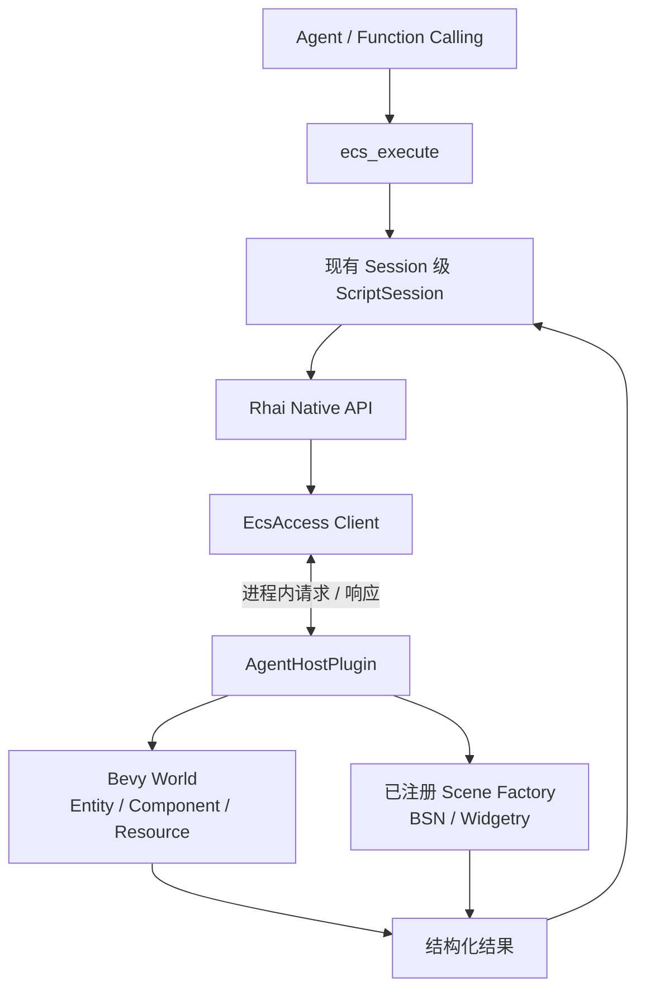
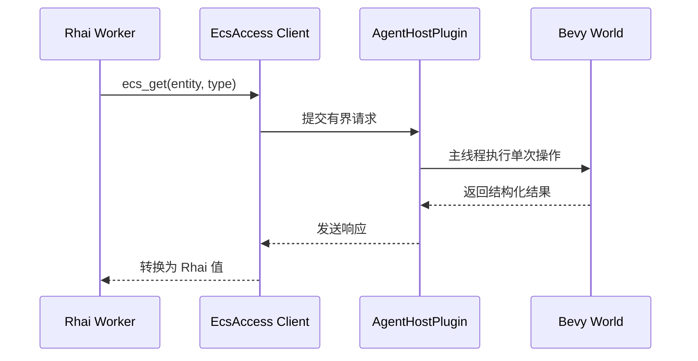

# Agent 自主 ECS 访问与动态 UI 构造

> Agent 通过 `ecs_execute` 发现和读写 ECS、派发已登记的 Event / Message，并实例化已登记的 BSN Scene。实施顺序见[执行方案](../../../plans/agent-ecs-access/00-overview.md)。

Agentelier 的 Agent 操作目标是当前进程中的 Bevy World，而不是外部桌面应用。Agent 生成 Rhai 脚本，Rust Native API 将脚本操作转换为对 Entity、Component、Resource、Event、Message 和已注册 UI Scene 的查询与修改。

这条路径不经过 Windows UI Automation、BRP、HTTP 或 MCP，也不注入鼠标和键盘输入。Agent 直接使用应用内部能力，用户的 OS 鼠标和键盘不需要让出控制权。

`bridge/connection` 负责把 Agent 侧 Client 与 UI Host 的请求接收端接起来；请求本身通过进程内通道传递。Agent 侧只认识不依赖 Bevy 的请求契约，真正访问 World 的操作由 Bevy 主线程完成。

## Agent 探索的是 ECS World，而不是一棵预先整理的 UI Tree

Bevy UI 的实际结构由 ECS 数据组成。一个界面区域可能包含多个 Entity，每个 Entity 挂载不同 Component；控件的行为、状态、布局和显示也可能分布在不同实体上。

`ChildOf` / `Children` 可以表达父子关系，但它只是 ECS 中的一种关系，不是所有 UI 语义的统一树。Agent 的主要探索方式是：

1. 根据 Component 类型和条件查询 Entity。
2. 检查目标 Entity 拥有哪些 Component。
3. 读取已支持反射的 Component 数据。
4. 根据 `ChildOf`、`Children` 等关系继续探索。
5. 结合 Resource 和应用注册的 Event / Message 理解状态如何变化。

因此，API 不提供一个预先整理好的 UI Tree，也不要求 Agent 通过 Accessibility 或 Windows UIA 认识控件。Agent 直接观察应用当前真实的 World。

## Rhai 继续承担脚本执行

现有 `ScriptSession` 已经为每个 Conversation 保存 Rhai Engine、Scope 和函数 AST。它支持多步脚本、变量、函数、条件和循环，并在同一 Session 的后续调用之间保留上下文。新增 ECS 能力继续复用这套 Session 级 Rhai 上下文，不建立第二个脚本引擎。

新建会话的固定工具目录包含内置 Function Tool `ecs_execute`。模型通过现有 Function Calling 提交 Rhai 脚本，工具调用由 ToolCatalog、ToolDispatcher 和 ToolAdmission 管理。一次调用执行一段有界脚本，返回文本结果；模型可以按现有 Function Calling 流程决定是否再次调用。恢复会话沿用其已保存的工具目录。

`ecs_execute` 与现有 `computer_execute` 共享 Session 级 Engine / Scope，但不共享桌面执行上下文：

- `ecs_execute` 使用 Agentelier 内部 ECS 能力，不获取桌面独占锁，不初始化 Windows Driver 或 UIA Runtime，也不执行桌面输入清理。
- `computer_execute` 继续负责 Windows 桌面窗口、截图、键鼠和 UI Automation。
- ECS Native API 只在提供 EcsAccess 执行上下文时工作；桌面 API 仍要求 Computer Use 的桌面上下文。

复用的是 Rhai 会话和脚本执行机制，不是 `computer::Run`。两个入口的资源、权限和收尾语义保持分离。

## Rhai 函数通过进程内请求访问 World

Rhai 执行线程不能直接持有 Bevy `World`。World 由 Bevy 主线程的 ECS Schedule 驱动；将 `World`、`EntityWorldMut`、Query 或其他 ECS 借用跨线程传递，会破坏 Bevy 的访问边界。

因此，Native API 对 Rhai 表现为同步函数，内部使用进程内请求 / 响应通道：

Agent 侧定义不依赖 Bevy 的 EcsAccess 请求契约。UI Host 持有请求接收端，并通过 Bevy System 在主线程执行请求。请求和响应使用受限、可序列化的数据值，不传递 Rhai `Dynamic`、Bevy `World` 或 ECS 借用。

请求队列、单次操作和返回数据都必须有界。查询 API 提供明确的结果数量限制和分页，避免一次脚本扫描并返回无限量数据。主线程每帧只处理有限工作量，不在主线程运行整段 Rhai 脚本。

当前通道容量为 32，AgentHost 在 `Update` 中每次至多处理 8 个请求。入队后通过应用现有的 Winit 通知唤醒主循环。`ecs_world_info()` 返回当前在 World 中生成的实体数、已登记的 ECS ID 数、Reflect 类型数和当前可用的操作。排队已满会立即报告错误；脚本等待响应时每隔至多 10 毫秒检查取消与原有脚本截止时间。

Rhai Worker 等待响应时不会阻塞 Agent Runtime 的 Tokio current-thread，也不会阻塞 Bevy 主线程。正常情况下，脚本每次调用一个 Native API，主线程处理该操作，随后脚本继续执行。

脚本不是 ECS 事务。多个 Native API 调用之间，Bevy 的正常 System 仍会运行，其他 Session 也可能改变 World。前面已经成功的操作不会因为后续语句失败而自动回滚；Agent 应在关键修改后重新查询实际状态，而不是长期依赖旧 Entity 或 Component 快照。

取消通过现有 Script Runtime 的 CancellationToken 传递：

- 尚未开始执行的排队请求，在主线程执行前检查取消状态；已取消的请求不再执行。
- 正在主线程执行的单次操作不会被任意中断；它完成后，脚本检查取消状态并停止后续语句。
- 响应通道关闭、宿主停止、请求超时或取消，都必须结束 Rhai 的等待。
- 应用关闭沿用 AgentHost 的现有关闭协调，在主循环仍可调度时完成请求收尾。

## Entity 引用与通用查询

Rhai 中用 `ecs:<bits>` 字符串持有 `EcsEntity` 引用，保留 Bevy Entity 的完整身份，包括 generation。每次操作都会重新验证实体是否仍然存在；销毁后复用的 index 不会被误认为原实体。Bevy 的资源实体通过 Resource API 访问。

### 类型信息与 ECS 读取

| API | 用途 |
| --- | --- |
| `ecs_world_info()` | 获取当前 World 的基础统计和可用类型概况 |
| `reflect_types([page])` | 分页列出已注册 Reflect 类型的完整路径 |
| `reflect_type(name)` | 查询指定类型的结构、字段和注册能力 |
| `ecs_query(filter)` | 按 Component 条件查询 Entity |
| `ecs_exists(entity)` | 检查 Entity 是否仍然有效 |
| `ecs_components(entity)` | 列出 Entity 当前拥有的 Component 类型 |
| `ecs_get(entity, type)` | 读取支持反射的 Component 数据 |
| `ecs_parent(entity)` | 获取父 Entity |
| `ecs_children(entity[, page])` | 分页获取子 Entity |
| `ecs_resources([page])` | 分页列出当前存在且可查询的 Resource 类型 |
| `ecs_resource_get(type)` | 读取支持反射的 Resource |

`ecs_query` 支持组件条件 `with`、`without` 及精确匹配 `Name` 的 `name` 条件。`with` 是 Rhai 保留字，调用时写作 `ecs_query(#{"with": ["Node"], name: "WorkspaceF"})`。分页结果通过 `items` 和 `cursor` 交付，默认 24 条，上限 128 条。继续查询时沿用原条件，将返回的 `cursor` 传回。单次查询最多扫描 4096 个实体索引，因此空页也可能带有可继续的游标。每页读取的是实时 World，实体可能在分页之间发生变化。

`ecs_components` 可以报告实体实际拥有的 Component 类型；字段读取则要求类型具有相应的反射能力。`reflect_types` 反映运行时 TypeRegistry 中真正可用的类型，不代表所有 Rust 类型都能被动态操作。

查询支持完整类型路径及可以唯一解析的短名。反射值通过有界的 Bevy Reflect 序列化转换为 Rhai 基本值、数组和映射。`Name` 返回名称字符串，`Entity` 返回完整引用。单次值读取最多遍历 1024 个反射值节点、输出 32 KiB，超限或无法转换时返回结构化错误。

### Entity、Component、Hierarchy 与 Resource 修改

| API | 用途 |
| --- | --- |
| `ecs_spawn(components)` | 创建 Entity，并添加指定的反射 Component |
| `ecs_insert(entity, type, value)` | 插入或替换 Component |
| `ecs_patch(entity, type, fields)` | 修改现有 Component 的指定字段 |
| `ecs_remove(entity, type)` | 移除 Component |
| `ecs_despawn(entity)` | 销毁 Entity |
| `ecs_reparent(entity, parent)` | 调整 Entity 的父子关系 |
| `ecs_unparent(entity)` | 解除父子关系 |
| `ecs_resource_insert(type, value)` | 插入或替换 Resource |
| `ecs_resource_set(type, value)` | 替换 Resource |
| `ecs_resource_patch(type, fields)` | 修改 Resource 的指定字段 |
| `ecs_resource_remove(type)` | 移除 Resource |

这些操作使用 Bevy 的 Component、Resource 和 Relationship 机制。修改 `ChildOf` / `Children` 时使用 Bevy 正常的关系维护 API，不分别写入两份关系状态。

`ecs_spawn` 接收类型名到初始值的映射，先完成类型解析与构造校验，再生成实体。`ecs_patch` 与 `ecs_resource_patch` 接收顶层字段映射，元组字段以字符串索引指定。校验全部字段后才写入，返回实际写入的字段名。Resource 的 `set`、`patch` 与 `remove` 要求资源当前存在。脚本输入具有大小和嵌套限制。

类型结构和传输值由 Bevy Reflect 分别提供。写入使用同一类型的 `ecs_get` 或 `ecs_resource_get` 所返回的形状。带自定义序列化的类型可以有不同的结构和传输形式，例如 `Vec3` 的三个结构字段通过三项数组传输。

Widgetry 托管类型和 Agentelier 业务 Resource 通过各自的公开接口修改。实体操作排除 Bevy Resource 的底层实体，避免绕过 Resource 权限和生命周期。

`ecs_spawn` 面向普通 ECS Entity。它可以组合已经注册反射能力的 Component；它不是 Widgetry 复合控件的构造方式。复合控件使用后面的 Scene API。

## Reflect 提供通用数据访问

不为每一种 Component 和 Resource 单独注册 Rhai 函数。通用 API 通过 Bevy Reflect 的类型信息和运行时适配器完成数据读取与修改。

Component 的字段操作需要对应的 `ReflectComponent` 注册，Resource 的字段操作需要对应的 `ReflectResource` 注册。应用已有的 `reflect_auto_register` 能力和显式 `register_type` 可以提供类型信息；像 `AgentelierButton` 这样的应用 Component 已通过 `AgentelierControlsPlugin` 注册。

Reflect 能提供类型结构和数据转换，但不等于任意 Rust 方法调用。没有对应反射适配器的类型可以被识别或查询存在性，但字段读取、插入和修改会返回明确的 `unsupported_type` 或 `reflect_not_registered` 错误。需要特殊行为的类型通过少量 Rust Native API 或专用适配器补充。

这保留了通用性：新增一个满足反射契约的 Component，通常不需要新增一个 Rhai 函数。Agent 通过类型名称和字段信息探索它，再调用同一组 ECS API。

## Event 与 Message 负责触发行为

ECS 数据修改和应用行为触发是两件事。某些控件和业务操作必须经过 Observer、Event 或 Message 的正常路径，而不是直接改写内部状态。

| API | 用途 |
| --- | --- |
| `ecs_trigger(type, payload)` | 触发已注册的 Bevy Event / Observer |
| `ecs_write_message(type, payload)` | 写入已注册的 Bevy Message |

动态派发只对明确注册了 Rust 适配器的 Event / Message 类型开放。`ecs_world_info().dispatch` 提供名称、说明及载荷字段。宿主登记 `Activate` 和 `WindowCloseRequested`，Application 登记已有的 `OpenSettings` 业务 Event。适配器负责验证参数并调用 Bevy 的正常派发入口。

`Activate` 接收 `#{entity: ref}` 并检查 Widgetry 的有效禁用状态，随后触发控件 Observer。`OpenSettings` 接收空映射。`WindowCloseRequested` 接收 `#{window: ref}`，由应用已有的窗口生命周期系统处理辅助窗口关闭。

`ecs_trigger` 返回时，Observer 事件已经通过其同步派发路径执行；`ecs_write_message` 返回时，Message 已写入 Bevy 的消息缓冲区，消费它的 System 仍按正常 Schedule 运行。Agent 可以在后续 ECS 查询中检查实际结果。

## 运行时控件创建使用已注册的 BSN Scene

普通 Entity 可以通过 `ecs_spawn` 创建，但 Widgetry 复合控件往往包含多个 Entity、行为 Component、内部绑定和受管理状态。只插入一个控件根 Component，不等价于构造完整控件。

Agentelier 的 UI 构造继续使用 BSN、Scene 和 SceneList。为运行时创建控件，UI 宿主提供一个有限的 Scene Factory Registry：

| API | 用途 |
| --- | --- |
| `scene_templates()` | 列出可实例化的 Scene 模板及其参数 |
| `scene_spawn(name, parent, props)` | 实例化指定模板并挂载到父 Entity |
| `scene_despawn(root)` | 清理由模板创建并归该实例拥有的 Scene 结构 |

每个模板都是 Rust 侧已经实现并注册的 Scene Function 或 SceneComponent 组合，内部仍使用 `bsn!`。Rhai 只选择模板、提供语义参数和父 Entity，不自行描述一套替代 BSN 的通用 UI 树语言。

Application 登记 `agentelier.button`、`agentelier.slider`、`agentelier.number_input`、`agentelier.choice` 和 `agentelier.boolean` 模板。按钮接受标签和样式，数值控件接受整数或浮点定义，离散控件接受稳定选择身份或布尔状态。`scene_spawn` 校验父实体为存活的 UI Node，调用 Widgetry 的 Scene 构造入口，并在成功后返回根 Entity 引用。需要在构造前取得 World 实体引用的模板可在同一 Factory 内构造子树，下拉框由此把选项数据源和控件交给同一个实例拥有。

Root Agent 的 `publish_scene` 通过进程内请求复用同一 Factory 验证语义定义。AgentHost 在临时父节点中构造，并在返回验证结果前释放该节点及其子树。持久定义提交成功后，Chat UI 使用同一个 Factory 在会话回复中挂载实例。详见[动态 Scene](../assistant-content/04-dynamic-scenes.md)。

模板注册可提供原位更新函数，`scene_templates()` 在模板描述中提供 `supports_in_place_update`。`update_scene` 继续先通过 Factory 验证新定义，Chat UI 在收到已提交修订后调用已挂载同模板的更新函数。`agentelier.button` 原位更新标签和公开运行时样式。

模板可在构造验证前读取同 Session、同产物的已挂载同模板实例。数值和离散模板据此填入省略的当前值，实际构造校验通过后返回补全的定义。Turn Runner 提交补全的定义，Chat UI 据此替换子树，存档恢复也使用同一份定义。

构造成功时在根实体记录该实例拥有的实体身份。清理时先解除后来挂入的外部子实体与该实例的关系，再销毁仍存活的实例实体。调用方提供的父实体和额外挂入的实体得以保留。

这一机制允许 Agent 在运行时增加已有控件的实例、决定它们的父实体和组合方式。新增一种 Rust 控件类型仍然需要应用实现并注册相应 Scene；Rhai 不会在运行时生成新的 Rust 类型或 Observer / System。

## 错误、Panic 与恢复

预期错误通过结构化 `EcsError` 返回给 Rhai。脚本可用 `try/catch` 捕获并读取 `error.code` 和 `error.message`。消息按错误类型提供目标实体、类型或字段信息，例如 Entity 失效、Component 不存在、未注册类型、字段缺失、载荷无效或请求超时。

Agentelier Application 已经通过 `App::set_error_handler(diagnostics::handler)` 安装 Bevy ECS 错误处理器。Agent 发起的单次 ECS 请求在主线程执行边界内隔离意外 Panic：当前请求向 Rhai 返回 `ecs_operation_panicked`，并以 `Severity::Error` 交给现有 Handler 记录。这样不会为了一个 Agent 操作而全局吞掉所有 Panic。逃出单次请求边界的 Panic 仍按 Bevy FallbackErrorHandler 和应用现有策略处理。

Panic 或普通错误都不会自动回滚此前已完成的 ECS 修改。Agent 收到失败后应重新查询受影响实体和 Resource，再决定是否继续。一次脚本失败不等于整个 Conversation 失败；模型可以读取错误并发起下一次普通 Function Call。

## 第一版验收范围

验收使用当前 Function Calling，不要求提示词管理、持续任务推进、长期任务状态或自动规划循环。Agent 接到一个明确的小任务后，生成一段 Rhai，执行若干 Native API，读取结果并结束即可。

验收拆成几个短小、可独立观察的场景，不把它们串成多页面长流程：

- **发现与读取：**Agent 自主查询当前 Workspace，找到一个真实 UI Entity，读取其 Component 和父子关系；不预先提供目标 Entity ID。
- **临时 ECS 修改：**Agent 创建一个临时 Entity，添加并修改已注册 Reflect Component，建立父子关系，读取确认后清理；对一个可安全恢复的 Reflect Resource 完成读取、修改和恢复。
- **行为派发：**Agent 通过已注册适配器触发一个 Event，并写入一个已注册 Message；检查对应 Observer 或 System 的实际结果。
- **动态控件：**Agent 找到真实界面容器，实例化已注册的 `AgentelierButton`，通过 ECS 查询确认其结构，再清理控件。

涉及 GUI 可观察变化的验收使用 BRP Screenshot 和 ECS State 检查真实界面。BRP 只用于开发验证，不进入 Agent 的 ECS 执行路径。

本阶段不把多页面长流程、持续任务推进或复杂自我规划作为验收条件。

## 实施边界

- `agent/tools` 不依赖 Bevy、UI 或 Bridge。ECS 请求契约由 Agent 侧定义，UI 宿主实现；依赖方向保持 `ui → agent / bridge`、`bridge → agent`。
- ECS 执行路径不使用 Windows UIA、BRP、HTTP、MCP 或 OS 鼠标 / 键盘输入。BRP 仅作为外部开发验证工具。
- 不为所有 Component 建立专用 Rhai 函数，也不维护按页面划分的硬编码操作清单；通用 API 面向运行时可查询和可反射的类型。
- 不把任意 Bevy World 引用跨线程交给 Rhai，也不建立脚本级事务或自动回滚。
- 不为 Widgetry 建立替代 BSN 的通用构造语言；动态控件通过已注册的 Scene Function 创建，并遵循 Widgetry 公开 API 对托管状态的契约。
