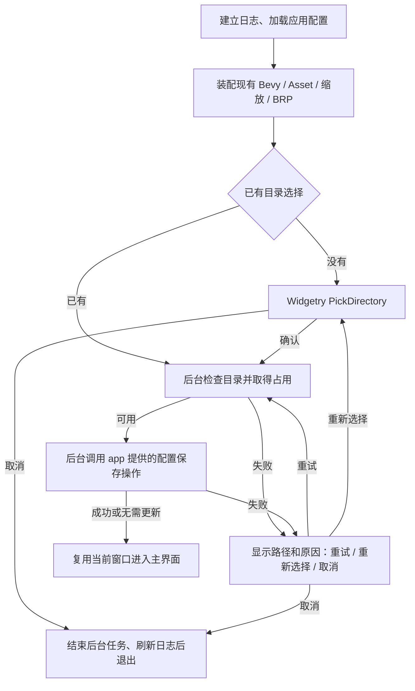

# 数据目录与启动

应用先以同一套 Bevy 运行时显示启动界面，确认数据目录后再进入主界面。当前交付目录选择、配置持久化、访问检查和单实例占用；账号恢复、认证以及设置页尚未实现，实施顺序见[登录增量导航](../../../plans/登录/00-overview.md)。

## 首次启动，明确选择目录

`app` 先建立可执行文件旁的 `logs/` 日志，再加载同一位置的 `config/config.ron`。配置缺失时创建初始配置，`data_directory` 为 `None`；旧配置缺少该字段时也视为尚未选择，保留缩放和 BRP 设置。

`login_ui` 在现有窗口装配的内容宿主中显示 Widgetry `PickDirectory` 选择器。窗口标题为“选择应用数据目录”。浏览位置只是导航，点击确认才交付目录；取消正常结束启动。应用不将主目录、安装目录或当前工作目录作为默认业务目录。选择器可以浏览这些位置，浏览本身不创建账号记录。

配置解析、校验或访问失败发生在 GUI 装配前：保留原文件，通过日志和原生应急提示报告配置路径与原因，然后失败退出，不用默认配置覆盖。日志尚未建立时继续使用原生提示及应急诊断出口。正常目录选择和失败恢复均由 Widgetry 界面完成。

## 功能与通用配置分别由谁管理

`crates/login` 提供不依赖 Bevy 的 `DataEnvironment`，集中根目录、`auth.json` 路径、访问检查与占用句柄。`crates/login_ui` 提供 BSN 启动界面、Widgetry 选择器、错误恢复及后台任务协调。`app` 保留程序入口、通用应用配置、日志、窗口和 BRP 装配，并向 `login_ui` 提供保存目录选择的操作。

目录检查和配置提交由 Widgetry JobManager 的后台线程执行，不在 ECS 主线程等待文件 I/O。JobManager 主动唤醒 Winit，界面非阻塞接收真实完成结果；检查或保存期间不会开放主业务界面或接受第二次目录提交。配置保存成功后，发布 `DataDirectoryReady`，应用更新内存配置和窗口标题、尺寸，复用当前窗口进入既有主界面。

## 路径可用才建立数据环境

根路径必须是已存在的绝对目录，支持中文和空格。检查目录读取、已有 `auth.json` 的读取和写入权限，并通过本次创建的临时文件检查新建、写入、替换和读回。不会为检查创建 `auth.json`，不会修改已有凭据或无关文件，只清理本次创建的探测文件。

目录不存在、无权访问、凭据路径不可读写或已被另一实例占用时，界面显示完整路径和原因，并提供“重试”“重新选择”“取消”。重试再次检查原路径；重新选择需要新的明确确认；取消结束启动。不自动重建缺失目录，避免将暂时断开的磁盘解释为新环境。

`.agentelier.lock` 上的操作系统独占文件锁限制同一目录同时只有一个实例。锁文件不保存 PID 或业务数据，文件存在不表示占用；活动句柄拒绝删除共享，防止锁文件在使用时被替换。文件保留在目录中，句柄关闭或进程结束后操作系统释放锁。

成功采用的数据环境通过共享的单次初始化槽交给应用入口持有，根路径本次运行保持固定。退出时先停止并等待所有辅助后台任务实际结束，再显式完成日志 `finish()`，最后释放应用持有的数据环境。收尾超时会记录并继续等待，超时不当作任务已结束。

## 配置与日志的位置固定

| 记录 | 位置 | 当前行为 |
| --- | --- | --- |
| 应用配置 | 可执行文件旁的 `config/config.ron` | 缩放、BRP 设置及 `data_directory` 绝对路径 |
| 运行日志 | 可执行文件旁的 `logs/` | 统一启动、目录选择、运行与收尾日志 |
| 账号凭据路径 | 所选目录的 `auth.json` | 仅确定路径，当前不创建、不解析或恢复账号 |
| 目录占用 | 所选目录的 `.agentelier.lock` | 仅用于句柄生命周期内的独占锁 |

新选择与已有设置合并序列化，在配置目录内创建唯一临时文件、完整写入并同步后替换 `config.ron`。初始配置使用不覆盖已有文件的提交方式。只有保存成功才记住新路径并进入主界面。

保存失败显示“无法保存数据目录选择”、数据目录、配置路径和原因，保留原配置并允许重试、重新选择或取消。数据目录可写不代表配置可保存。

下次启动重新检查已保存路径并取得占用，成功后直接进入主界面，不重复要求选择，也不重写未改变的配置。当前没有运行时目录切换。应用不读取其他客户端的凭据、不导入旧配置、不自动迁移、移动或合并文件。“设置 → 数据与存储”属于[后续增量](../../../plans/登录/02-directory-settings.md)。
