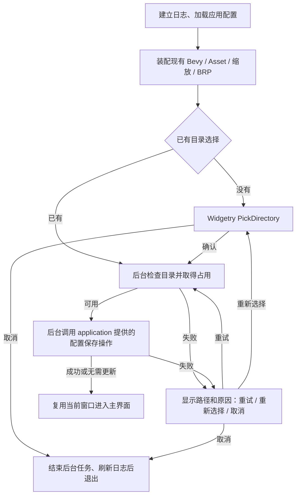

# 数据目录与启动

应用先以同一套 Bevy 运行时显示启动界面，确认数据目录后再进入主界面。本文说明目录选择、配置持久化、访问检查、单实例占用与目录设置；已接入的账号恢复和认证见[认证运行与凭据管理](../modules/authentication.md)。

## 首次启动，明确选择目录

`agentelier_application` 先建立可执行文件旁的 `logs/` 日志，再加载同一位置的 `config/config.ron`。配置缺失时创建初始配置，`data_directory` 为 `None`；旧配置缺少该字段时也视为尚未选择，保留缩放和 BRP 设置。

`login_ui` 在现有窗口装配的内容宿主中显示 Widgetry `PickDirectory` 选择器。窗口标题为“选择应用数据目录”。浏览位置只是导航，点击确认才交付目录；取消正常结束启动。应用不将主目录、安装目录或当前工作目录作为默认业务目录。选择器可以浏览这些位置，浏览本身不创建账号记录。

配置解析、校验或访问失败发生在 GUI 装配前：保留原文件，通过日志和原生应急提示报告配置路径与原因，然后失败退出，不用默认配置覆盖。日志尚未建立时继续使用原生提示及应急诊断出口。正常目录选择和失败恢复均由 Widgetry 界面完成。

## 功能与通用配置分别由谁管理

`crates/agent/login` 提供不依赖 Bevy 的 `DataEnvironment`，集中根目录、访问检查与占用句柄。`crates/ui/login_ui` 提供 BSN 启动界面、Widgetry 选择器、错误恢复及后台任务协调。`app` 只保留程序入口；`crates/ui/application` 提供通用应用配置、日志、窗口和 BRP 装配，并向 `login_ui` 提供保存目录选择的操作。

目录检查和配置提交由 Widgetry JobManager 的后台线程执行，不在 ECS 主线程等待文件 I/O。JobManager 主动唤醒 Winit，界面非阻塞接收真实完成结果；检查或保存期间不会开放主业务界面或接受第二次目录提交。配置保存成功后，发布 `DataDirectoryReady`，应用更新内存配置和窗口标题、尺寸，复用当前窗口进入既有主界面。

## 路径可用才建立数据环境

根路径必须是已存在的绝对目录，支持中文和空格。检查目录读取，并通过本次创建的临时文件检查新建、写入、替换和读回。检查跳过历史 SIWC `auth.json`，只清理本次创建的探测文件。

目录不存在、无权访问或已被另一实例占用时，界面显示完整路径和原因，并提供“重试”“重新选择”“取消”。重试再次检查原路径；重新选择需要新的明确确认；取消结束启动。不自动重建缺失目录，避免将暂时断开的磁盘解释为新环境。

`.agentelier.lock` 上的操作系统独占文件锁限制同一目录同时只有一个实例。锁文件不保存 PID 或业务数据，文件存在不表示占用；活动句柄拒绝删除共享，防止锁文件在使用时被替换。文件保留在目录中，句柄关闭或进程结束后操作系统释放锁。

成功采用的数据环境通过共享的单次初始化槽交给 application 的启动流程持有，根路径本次运行保持固定。退出时先停止并等待所有辅助后台任务实际结束，再显式完成日志 `finish()`，最后释放应用持有的数据环境。收尾超时会记录并继续等待，超时不当作任务已结束。

## 配置与日志的位置固定

| 记录 | 位置 | 当前行为 |
| --- | --- | --- |
| 应用配置 | 可执行文件旁的 `config/config.ron` | 缩放、BRP 设置、`data_directory` 绝对路径及可选的 `codex_auth_file` 绝对路径 |
| 运行日志 | 可执行文件旁的 `logs/` | 统一启动、目录选择、运行与收尾日志 |
| MCP 服务器配置 | 所选目录的 `mcp_servers.json` | Agent 侧独立校验及原子保存，保留服务器稳定身份 |
| Codex 凭据 | 账号区明确选择的外部文件 | Agent 按需只读，配置保存路径，Codex 客户端管理文件 |
| 用户技能 | 所选目录的 `skills/<skill-name>/SKILL.md` 及其关联资源 | 当前数据环境内跨项目复用；任务目录明确给出该根，下一任务重新发现，缺失目录按空来源处理 |
| 目录占用 | 所选目录的 `.agentelier.lock` | 仅用于句柄生命周期内的独占锁 |
| 会话存档 | 所选目录的 `sessions/<uuid>/session.jsonl`、`summary.json` 与 `attachments/` | Session Store 单写入者提交初始设置、执行记录、完整压缩检查点、摘要与图片附件；检查点不删除旧时间线或附件，不含账号所有权或凭据 |
| 长期记忆 | 所选目录的 `memory.sqlite` 和 `memory/` | Runtime 在取得目录占用后打开 Memory 存储，启动失败时记录不可用原因，启动时恢复有持久标记的记忆重置，正常关闭时等待数据库连接释放。详见[长期记忆](long-term-memory.md)。 |

新选择与已有设置合并序列化，在配置目录内创建唯一临时文件、完整写入并同步后替换 `config.ron`。`data_directory` 序列化时将扩展盘符路径写为普通 `C:\...`，将扩展 UNC 路径写为普通 `\\server\share\...`；内存中继续保留原始 PathBuf，加载仍接受已有的带前缀配置。初始配置使用不覆盖已有文件的提交方式。只有保存成功才记住新路径并进入主界面。

保存失败显示“无法保存数据目录选择”、数据目录、配置路径和原因，保留原配置并允许重试、重新选择或取消。数据目录可写不代表配置可保存。

下次启动重新检查已保存路径并取得占用，成功后直接进入主界面，不重复要求选择，也不重写未改变的配置。运行中的数据环境保持固定。账号区明确选择的外部 Codex 文件只保存路径引用，详见[认证运行](../modules/authentication.md)。应用不会搜索其他凭据文件，也不会迁移、移动或合并它们。

## 设置当前目录与下次启动位置

主界面通过“设置”进入“数据与存储”。“当前使用”来自本次 `DataEnvironment`，始终显示完整路径；正文按字符换行并放在纵向滚动区域中，不截断为省略号。“打开目录”始终打开当前位置，使用 Windows Shell 安全封装传递真实目录路径；目录失效或打开失败在本次操作区域显示错误。

当前路径、下次启动路径和自身错误上下文由 `application` 和 `login_ui` 直接调用 `bevy_widgetry_path_display::display_path` 生成统一的可读格式：扩展盘符路径不显示 `\\?\` 前缀，扩展 UNC 路径显示为普通 `\\server\share` 网络路径。配置写入和 Login 的资源管理器调用复用同库的 `simplify_path`，只简化扩展盘符和 UNC 前缀，其他命名空间保留原样。该转换保留原生路径编码；RON 序列化或当前 Shell 字符串接口无法表示为 Unicode 的路径时返回错误，不使用有损显示文字替代。目录比较、文件操作及数据环境对外路径继续使用规范化的完整路径。

“更改目录”在同一窗口显示 Widgetry `PickDirectory`，从当前目录开始浏览。候选路径复用目录访问检查，但不取得第二份长期占用，不创建 `auth.json` 或候选目录锁文件。只有检查和应用配置提交都成功后，才更新“下次启动使用”。检查失败、保存失败或取消都保留原来已经保存的选择。

当前目录和下次目录不同时，显示两条完整路径，以及“更改将在下次启动生效；文件由你自行复制和整理”。选择当前目录会重新保存当前路径，撤回待生效更改并隐藏该提示。程序不自动重启，不移动、复制、合并、清理或同步两个目录的文件。

设置状态属于 `login_ui` 的运行时 Resource。每次选择或打开操作都有递增的操作 ID，后台结果必须匹配在途操作；只允许一个在途操作。选择区域本身不提供重复发起入口，检查与提交期间禁用打开/更改按钮。

返回主界面会销毁未确认的选择器并取消该次选择。已经明确确认的后台 I/O 会继续收尾，设置状态持续接收结果；重新打开时仍禁用新操作，直到真实结束，随后显示实际保存结果或错误。应用退出沿现有 JobManager 收尾，不把请求取消视为任务已结束。

关闭后再次启动才读取新位置；原数据目录仍由用户自行整理。目录就绪后，应用启动 Agent/Tokio，恢复本地存储，并检查配置中选定的 Codex 文件，具体文件契约与后台生命周期见[认证运行与凭据管理](../modules/authentication.md)。
