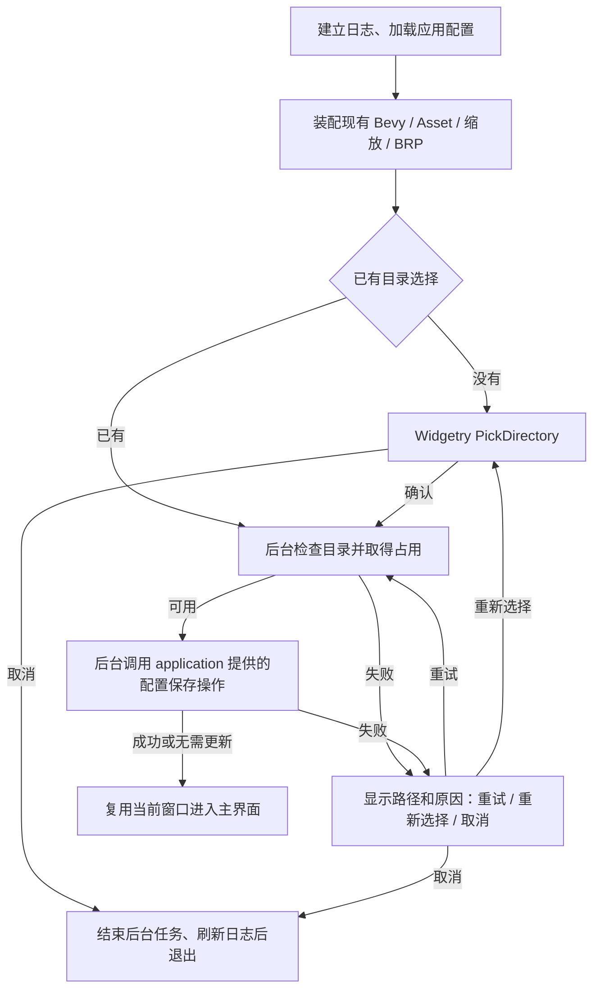

# 数据目录与启动

应用先以同一套 Bevy 运行时显示启动界面，确认数据目录后再进入主界面。本文说明目录选择、配置持久化、访问检查、单实例占用与目录设置；已接入的账号恢复和认证见[认证运行与凭据管理](../modules/authentication.md)。

## 首次启动，明确选择目录

`agentelier_application` 先建立可执行文件旁的 `logs/` 日志，再加载同一位置的 `config/config.ron`。配置缺失时创建初始配置，`data_directory` 为 `None`；旧配置缺少该字段时也视为尚未选择。新会话的 `default_model_slug` 和 `default_reasoning_effort` 分别默认为 `gpt-6.2-sol` 和 `high`，旧配置缺少对应字段时分别应用默认值。

`login_ui` 在现有窗口装配的内容宿主中显示 Widgetry `PickDirectory` 选择器。窗口标题为“选择应用数据目录”。浏览位置只是导航，点击确认才交付目录；取消正常结束启动。应用不将主目录、安装目录或当前工作目录作为默认业务目录。选择器可以浏览这些位置，浏览本身不创建账号记录。

配置解析、校验或访问失败发生在 GUI 装配前：保留原文件，通过日志和原生应急提示报告配置路径与原因，然后失败退出，不用默认配置覆盖。日志尚未建立时继续使用原生提示及应急诊断出口。正常目录选择和失败恢复均由 Widgetry 界面完成。

## 功能与通用配置分别由谁管理

`crates/agent/login` 提供不依赖 Bevy 的 `DataEnvironment`，集中根目录、访问检查与占用句柄。`crates/ui/login_ui` 提供 BSN 启动界面、Widgetry 选择器、错误恢复及后台任务协调。`app` 只保留程序入口；`crates/ui/application` 提供通用应用配置、日志、窗口和 BRP 装配，并向 `login_ui` 提供保存目录选择的操作。

目录检查和配置提交由 Widgetry JobManager 的后台线程执行，不在 ECS 主线程等待文件 I/O。JobManager 主动唤醒 Winit，界面非阻塞接收真实完成结果；检查或保存期间不会开放主业务界面或接受第二次目录提交。配置保存成功后，发布 `DataDirectoryReady`，应用更新内存配置和窗口标题、尺寸，复用当前窗口进入既有主界面。

## 路径可用才建立数据环境

根路径必须是已存在的绝对目录，支持中文和空格。检查目录读取，并通过本次创建的临时文件检查新建、写入、替换和读回。检查跳过历史 SIWC `auth.json`，只清理本次创建的探测文件。

目录不存在、无权访问或已被另一实例占用时，界面显示完整路径和原因，并提供“重试”“重新选择”“取消”。重试再次检查原路径；重新选择需要新的明确确认；取消结束启动。不自动重建缺失目录，避免将暂时断开的磁盘解释为新环境。

`.agentelier.lock` 上的操作系统独占文件锁限制同一目录同时只有一个实例。锁文件不保存 PID 或业务数据，文件存在不表示占用；活动句柄拒绝删除共享，防止锁文件在使用时被替换。文件保留在目录中，句柄关闭或进程结束后操作系统释放锁。

成功采用的数据环境通过共享的单次初始化槽交给 application 的启动流程持有，根路径本次运行保持固定。退出时先停止并等待所有辅助后台任务实际结束，再显式完成日志 `finish()`，最后释放应用持有的数据环境。收尾超时会记录并继续等待，超时不当作任务已结束。

## 配置与日志的位置固定

| 记录 | 位置 | 当前行为 |
| --- | --- | --- |
| 应用配置 | 可执行文件旁的 `config/config.ron` | 缩放、BRP 设置、`data_directory` 绝对路径、新会话默认模型和推理强度、用户头像引用与裁剪参数、工作区横向比例 |
| 运行日志 | 可执行文件旁的 `logs/` | 统一启动、目录选择、运行与收尾日志 |
| MCP 服务器配置 | 所选目录的 `mcp_servers.json` | Agent 侧独立校验及原子保存，保留服务器稳定身份 |
| Codex OAuth 凭据 | 所选目录的 `codex-oauth.json` | Login 原子保存并恢复本次数据环境的授权 |
| 用户技能 | 所选目录的 `skills/<skill-name>/SKILL.md` 及其关联资源 | 当前数据环境内跨项目复用；任务目录明确给出该根，下一任务重新发现，缺失目录按空来源处理 |
| 用户头像原图 | 所选目录的 `profile/avatar-<uuid>.png` 或 `profile/avatar-<uuid>.jpg` | 已验证的方形原图使用上传字节保存，裁剪参数由应用配置持有 |
| 目录占用 | 所选目录的 `.agentelier.lock` | 仅用于句柄生命周期内的独占锁 |
| 会话存档 | 所选目录的 `sessions/<uuid>/session.jsonl`、`summary.json` 与 `attachments/` | Session Store 单写入者提交初始设置、执行记录、完整压缩检查点、摘要与图片附件；检查点不删除旧时间线或附件，不含账号所有权或凭据 |
| 项目组织 | 所选目录的 `projects.json` 与 `sessions/<uuid>/project.json` | Session Store 串行保存项目定义和会话归属，所选项目目录只用于校验 |
| 长期记忆 | 所选目录的 `memory.sqlite` 和 `memory/` | Runtime 在取得目录占用后打开 Memory 存储，启动失败时记录不可用原因，启动时恢复有持久标记的记忆重置，正常关闭时等待数据库连接释放。详见[长期记忆](long-term-memory.md)。 |

`brp_enabled` 控制是否启用 BRP。`brp_port` 配置 Main World 端口，默认 `15702`。`brp_render_port` 配置 Render World 端口，默认 `15703`，旧配置缺少此字段时也使用该默认值。配置中的两个端口均须在 `1024..=65534` 内且互异。有效的环境变量 `BRP_EXTRAS_PORT` 和 `BRP_EXTRAS_RENDER_PORT` 可分别覆盖对应的监听端口。多实例启用 BRP 时，每个实例使用一对未被占用的端口，例如 `15702` / `15703` 和 `15712` / `15713`。

新选择与已有设置合并序列化，在配置目录内创建唯一临时文件、完整写入并同步后替换 `config.ron`。`data_directory` 序列化时将扩展盘符路径写为普通 `C:\...`，将扩展 UNC 路径写为普通 `\\server\share\...`；内存中继续保留原始 PathBuf，加载仍接受已有的带前缀配置。初始配置使用不覆盖已有文件的提交方式。只有保存成功才记住新路径并进入主界面。

保存失败显示“无法保存数据目录选择”、数据目录、配置路径和原因，保留原配置并允许重试、重新选择或取消。数据目录可写不代表配置可保存。

下次启动重新检查已保存路径并取得占用，成功后直接进入主界面，不重复要求选择，也不重写未改变的配置。运行中的数据环境保持固定。账号状态从该数据环境中的自有 OAuth 凭据恢复，详见[认证运行](../modules/authentication.md)。旧应用配置中的 Codex 文件路径只在解析时忽略，配置后续正常保存时省略该字段。

## 设置窗口与原子配置

B 区发出打开设置事件，由 Application 创建独立的 Widgetry Window。常规设置读取本次数据环境路径和下一次启动的配置路径。目录选择器以已保存路径为起点，确认后由 Widgetry Job 检查候选目录并提交配置。当前环境持续持有原数据目录的占用。取消选择、候选目录检查失败或保存失败时保留原配置。

当前路径和下次启动路径使用 `bevy_widgetry_path_display::display_path` 生成可读格式。序列化及比较时使用保留原生路径编码的 `simplify_path` 处理 Windows 扩展前缀，文件操作继续使用真实路径。应用在下次启动重新检查并占用已保存目录，当前进程持续从启动时确定的目录访问会话、记忆、MCP 和账号凭据。

UI Scale 和新会话默认值通过同一个 ConfigStore 提交。每次更新从锁内最新配置生成候选，校验后写入同目录临时文件，完成同步并替换目标文件后更新内存。UI Scale 保存成功后立即交付给 Widgetry 缩放资源。缩放保存失败时控件反映上次成功提交值。现有主窗口和辅助窗口在同一次缩放更新中使用同一个配置值。

新会话的默认模型及推理强度作为一对提交。当前模型目录决定可选模型及其支持的档位，保存时显示不兼容的选择。会话创建读取最新已提交默认值，存档及已有会话继续使用各自保存的模型设置。关闭设置窗口会丢弃未提交的会话默认值草稿，已开始的目录保存由应用继续接收真实结果。

用户头像文件由 Assets 检查格式与尺寸，并在当前数据目录的 `profile/` 写入原始字节。Application 等待新原图同步提交后更新 ConfigStore 中的引用、归一化偏移和缩放。配置提交失败时保留旧引用并清理本次新建的文件。更换或移除时，在新配置提交后回收旧文件；恢复读取失败时显示默认头像。

工作区配置持有 C 区与 E/F 横向宽度在扣除两条分隔条后的工作区净宽比例。D 使用剩余宽度。Chat UI 保留运行中的比例，按窗口净宽及三个区域的最小宽度换算出两层 Splitter 值。拖动结束或设置 Slider 确认时，由 Application 向 ConfigStore 提交当前比例。保存失败时设置窗口标记未保存布局，重启读取最后一次成功配置。临时缩窄窗口只影响实际宽度，配置缺失或数值无效时使用默认比例。E/F 在右栏内保持各占一半高度。
