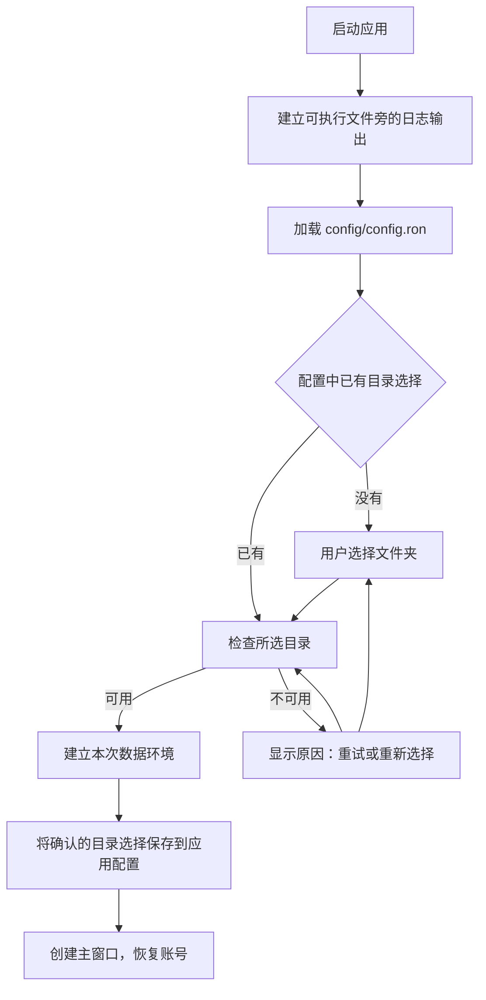

# 数据目录与启动

账号登记与当前凭据需要跨进程保存，由用户选择的应用数据目录承载。

## 第一次使用，从选择目录开始

应用没有默认数据目录。启动时先建立可执行文件旁的日志输出，再加载 `config/config.ron`；配置中若没有保存过目录选择，就打开 Windows 原生文件夹选择器，标题为“选择应用数据目录”。用户确认一个目录后，应用检查该目录的访问与写入条件，再进入主窗口。

选择器中的浏览位置只是文件夹导航位置。只有用户明确确认的路径才成为应用数据目录。取消选择会结束本次启动，不在其他位置创建一份应用数据。

选择已有目录时，应用读取其中属于自身的账号登记与当前凭据；选择空目录时，应用进入未登录状态，`auth.json` 在首次授权需要保存主机标识时建立，之后保存账号登记与当前凭据。

目录不存在、权限不足或正在被另一实例占用时，应用显示对应原因。用户可以恢复目录后重试，也可以重新选择；应用不会把“原目录暂时找不到”解释成“需要创建一个新的空目录”。

## 重启时，先找到上次的选择

应用从可执行文件旁的应用配置读取上次确认的数据目录，不另设启动定位文件：

| 记录     | 位置                               | 保存内容                                           |
| -------- | ---------------------------------- | -------------------------------------------------- |
| 应用配置 | 可执行文件旁的 `config/config.ron` | 界面缩放、BRP 设置及用户最后确认的数据目录绝对路径 |
| 运行日志 | 可执行文件旁的 `logs/`             | 主应用、后台任务和 Agent 的统一运行日志            |
| 应用数据 | 用户选择的目录中的 `auth.json`     | 账号登记与当前凭据，含登记所需主机标识             |

目录选择与其他应用设置合并保存在同一份配置中，Token 不进入配置。配置缺少目录选择时，启动流程回到文件夹选择。

包含目录选择的应用配置写入成功，才算记住了本次选择。更新目录选择时保留其余应用设置，采用完整写入后替换的提交方式。写入失败时显示“无法保存数据目录选择”及可操作的原因，允许重试或退出；原配置保持不变。

本次运行使用的根目录一经建立就保持不变。应用持有这个数据环境的生命周期；同一目录同时只交给一个运行实例写入，进程结束后释放占用。

## 配置和日志固定在可执行文件旁

应用从可执行文件旁的 `config/config.ron` 读取界面缩放、BRP 启用状态及端口等应用设置，以及用户确认的数据目录绝对路径。配置缺失时创建初始配置，目录选择初始为空；已有配置缺少目录字段时视为尚未选择，保留其余设置。已有配置解析或访问失败时保留原文件并报告错误，不用默认值覆盖原文件。

日志输出在目录选择之前建立，写入可执行文件旁的 `logs/`，因此可以记录配置读取和目录选择期间的错误。用户取消目录选择时正常结束启动并刷新关闭日志。日志尚未成功建立时，错误通过原生提示和应急诊断出口反馈。主应用、后台任务和 Agent 共用应用装配的日志体系。

各模块接收已经确定的路径，不自行搜索用户主目录、当前工作目录或其他程序的数据。应用拥有配置和日志路径，Agent 接收当前目录的凭据文件路径。

## 在设置里查看当前目录

“设置 → 数据与存储”显示本次运行正在使用的完整路径，并提供“打开目录”和“更改目录”。

“打开目录”在 Windows 文件资源管理器中打开当前目录，不改变应用状态。“更改目录”重新打开原生文件夹选择器。界面不提供“恢复默认位置”，也没有自动填入的默认数据根目录。

路径较长时允许换行或复制完整路径，不能只显示截断后无法辨认的位置。

## 更改位置，只影响下次启动

更改目录不搬运数据。用户选好新目录并通过检查后，应用更新 `config/config.ron` 中的数据目录字段，保留其余应用设置，同时在设置中明确显示两项信息：

| 项目         | 含义                     |
| ------------ | ------------------------ |
| 当前使用     | 本次进程继续读写的目录   |
| 下次启动使用 | 下一次启动准备加载的目录 |

界面显示“更改将在下次启动生效；文件由你自行复制和整理”。当前账号与凭据操作继续使用原数据目录，配置和日志仍位于可执行文件旁，应用不自动重启。

例如，本次运行使用 `D:\AgentelierData`，用户将下次启动位置改成 `E:\WorkData`。本次进程仍然读写 D 盘目录。关闭应用后，用户可以自行复制文件；下次启动才读取 E 盘目录。E 盘目录没有凭据时显示未登录，有可用凭据时恢复相应账号。

选择当前目录等于撤回尚未生效的目录更改。取消文件夹选择、目录检查失败或应用配置保存失败，都保留之前已经生效的选择。

切换操作只修改应用配置中的目录选择。它不会移动、合并、覆盖或删除原目录的数据，也不对新旧目录进行内容同步。
