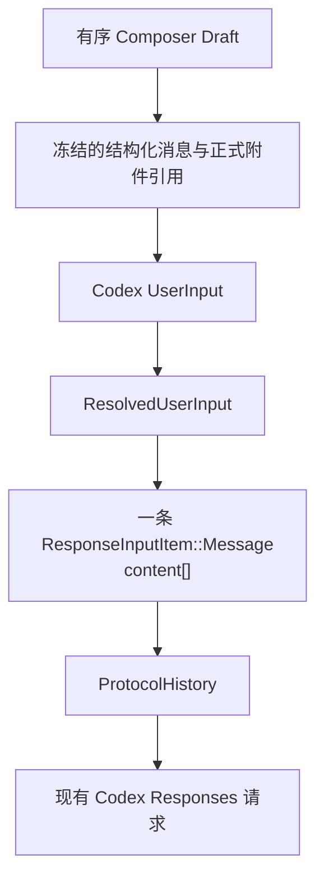

# Codex 兼容的多模态输入提交

Composer 需要同时保留两件看起来相反的事：用户看到的内容按插入顺序排列；模型请求则要遵循 Codex 已有的输入类型和组织规则。两者不需要强行一致。只要提交时保留文本占位符与附件编号的对应关系，编辑器就不必为了协议而改变用户看到的消息。



下面从一条混合消息开始，逐步看它怎样经过 Codex 输入类型、内容数组和可恢复历史。

## 同一条消息，存在两种顺序

假设用户在 Composer 中写下：

```text
请比较这张旧图 → 图片 A → 和这张新图 → 图片 B → 再听一下这段录音 → 音频 C → 并检查 @src/main.rs
```

Composer 需要按这个顺序显示文字、图片、音频和文件引用，因为这就是用户编辑时建立的语义关系。

整份草稿对应一条完整的用户消息。图片与可直传的音频按 Codex 的输入组织方式进入 `content[]`，真实载荷通过编号与文本里的 `[Image #n]`、`[Audio #n]` 对应。用户选择已有转写文稿时，文稿继续作为有来源的独立请求材料。

因此，编辑顺序属于 Composer；输入类型和类别排列属于 Submission Adapter。Adapter 转换消息，不重新解释用户意图。

## Codex 已经定义了不同的用户输入类型

Codex Core 的 `UserInput` 将普通文字、图片、音频、Skill 和结构化 Mention 区分开来：

| 类型 | Codex 中的职责 | Agentelier 中的来源 |
|---|---|---|
| `Text` | 普通文字与文本元素 | 文本段、`@` 路径、媒体占位符、可见 `$` 标记 |
| `Image` | 已有 URL 或 File ID 的图片引用 | 已准备好的图片引用 |
| `LocalImage` | 用户选择的本地图片路径 | Session Store 中的本地图片附件 |
| `Audio` | 已准备好的音频引用 | 直传可用时的音频内容 |
| `LocalAudio` | 用户选择的本地音频路径 | 本地音频附件 |
| `Skill` | Skill 名称和 `SKILL.md` 来源路径 | Composer 选中的 Skill 身份 |
| `Mention` | Codex 支持的 Plugin/App 等结构化 Mention | 对应的外部 Mention；不用于伪造 MCP 类型 |

`Text` 还可以带 `TextElement`。它以 UTF-8 文本中的 byte range 标识 UI 特殊元素，例如图片占位符。这样既保留完整文本，也能在历史恢复时还原哪些片段是特殊元素，而不必改写字面文本。

`ResolvedUserInput::into_message()` 将已解析输入转换为一条 `ResponseInputItem::Message`。文字形成 `input_text`，图片形成 `input_image`，音频形成 `input_audio`。上游 `LocalAudio` 生成前后文本标记，`Audio` 直接生成音频内容项。`Skill` 与 `Mention` 在请求准备阶段由各自的能力路径处理。

媒体二进制内容不能直接塞进 UI 文本或历史摘要。请求使用对应的图片/音频内容项，历史保存可恢复的结构化输入与附件引用。

## 提交顺序如何形成

Codex TUI 的 `input_submission.rs` 将本地图片、完整文本、Skill 和 Plugin/App Mention 组织为不同的输入类别。Codex Core 已经定义 `Audio` 与 `LocalAudio`，但当前普通 TUI 提交路径没有对应的音频附件交互。

Agentelier 沿用 Codex TUI 的图片、文本和 Skill/Mention 类别。第 07 步确认音频直传可用后，音频放在完整文本之后。

1. 远程图片。
2. 本地图片。
3. 一条完整文本，包含原始文字、`@` 文件路径，以及 `[Image #n]`、`[Audio #n]` 等占位符。
4. 可直传的音频附件，按附件顺序提交。
5. Skill 结构化引用。
6. Codex 原生 Plugin/App Mention（若实际使用）；Agentelier MCP 引用在本地工具上下文中解析。

图片载荷在完整文本之前。音频直传采用 Agentelier 的类别顺序，放在文本之后和 Skill/Mention 之前。

## 图片怎样与原来的文字位置对应

Codex TUI 会先收集图片，再提交完整文本。文本中保留图片编号占位符，因此图片载荷不必穿插在每段文字之间，模型仍能知道文字指向哪张图。

Agentelier 沿用这一组织方式。图片可以在 Composer 的任意位置插入，但提交时按图片类别先行。编号按本条消息中图片附件的稳定顺序分配，同一条消息内不重复使用。完整文本保留 `[Image #n]` 占位符和 `TextElement` 映射。

普通 `@` 文件引用仍留在文本原位置。若 `@` 选择的是图片文件，则它转换为 `LocalImage`，并在文本中放入对应图片占位符；图片不再作为普通路径交给模型读取。

## 音频直传与显式转写

第 07 步用 Agentelier 现有 Codex OAuth、目标模型和实际 Responses 传输发出最小的 `input_audio` 请求。现有独立转写接口的成功回执和 Codex 客户端的内容类型分别说明转写能力和请求形态。直传能力由目标模型在实际传输上的完整请求响应确认。

目标模型或传输确认无法直传时，音频仍可随普通消息绑定和播放。用户选择转写后，由现有 `/backend-api/transcribe` 路径读取已保存的正式附件。随后选择已保存的文稿版本，通过现有 `TranscriptReference` 加入请求材料。界面显示所用文稿及其来源。

### 直传可用时的格式与编号

Codex Core 的 `audio_mime_for_path()` 支持 WAV、MP3、M4A、WebM 和 OGG。Agentelier 从已保存的正式附件读取字节，准备内联 Data URL。标记使用保存的展示文件名，以消息内编号区分同一条消息中的多段音频。

Agentelier 在 Codex 原生格式之外增加 FLAC 支持：

| 原始格式 | 模型提交方式 |
|---|---|
| WAV | 原格式提交 |
| MP3 | 原格式提交 |
| M4A | 原格式提交 |
| WebM | 原格式提交 |
| OGG | 原格式提交 |
| FLAC | 保留原件，提交前无损解码并封装为 WAV |

FLAC 的 WAV 转换结果使用 `audio/wav`，并重新检查模型输入大小。原始 FLAC 附件仍保存在 Session Store，用于播放和历史恢复；转换后的 WAV 只作为本次模型输入载荷，不替换原件。

适配器按附件稳定顺序分配编号。每段直传音频最终都有编号开头标记、`input_audio` 和结束标记，并与文本中的 `[Audio #n]` 一一对应。若已准备好的音频通过上游 `Audio` 形态提交，适配器显式补齐标记。转码后的 FLAC 使用原附件的编号。

## Skill、MCP 和文件引用走不同的路径

### Skill 是结构化输入，不是 Function Tool

Skill 选择沿用 Codex 的 `UserInput::Skill` 语义，同时复用 Agentelier 已有的 `SelectedSkill`、来源路径、正文摘要和任务快照机制。显示用的 `$skill-name` 保留在完整文本中，结构化引用按绑定身份解析。原有 `$name` 识别用于手写文本，排除已绑定的 Skill 和 MCP 引用区间。

Skill 正文仍按现有 GenerationRequest 规则提供，不注册成新的 Function Tool。Codex 的输入提交也会将 Skill 选择与普通文本内容分开处理。

### MCP 是 Agentelier 的本地工具上下文

MCP Server/Tool 选择是 Agentelier 的本地扩展。Composer 保存 `ToolSource::Mcp` 的 server、target 和 tool 身份。提交及队列出队时，对照会话创建时冻结的 ToolCatalog 与实时连接状态，将有效引用作为请求上下文。

它不会创建 `input_mcp`，也不会伪造 Codex Plugin/App Mention，更不会在用户选择时直接调用 MCP。工具是否调用仍由模型的 Function Tool 选择决定，执行继续经过现有 ToolRouter、权限检查、MCP 连接和结果持久化。

### 普通 `@` 文件引用是文本路径

Codex CLI 的文件搜索选择普通文件时，会将路径插入当前文本光标位置；路径含空格时进行引号处理。普通源码或配置文件不会因为被选中就变成自动上传的 `input_file`。

Agentelier 保持相同行为。普通文件路径作为 `input_text` 的一部分发送，模型通过当前会话已有的文件读取工具访问它。只有图片文件走 `LocalImage` 媒体路径。这样普通文件引用和图片附件不会混成同一种输入。

## 结构化历史让重试使用原来的内容

当前 Agentelier 的 `ProtocolItem::User(String)` 只能重放纯文本，无法完整保存一条消息中的多张图片、多段音频、文本占位符和结构化引用。

新的用户历史项需要保留：

- 完整文本及 `TextElement` 位置。
- 图片附件 ID、摘要、MIME 与编号关系。
- 音频附件 ID、摘要、原始格式与编号关系。
- Skill 来源路径与显式选择身份。
- MCP Server/Tool 的稳定身份。
- 普通 `@` 文件路径文本。
- 本次附带的已有转写文稿版本，沿现有独立材料机制保存和恢复。

`ProtocolHistory` 构造下一次请求时，从结构化历史重建同一条 Codex 用户消息。Retry、认证恢复、继续执行和队列出队使用已经保存的附件引用，不重新读取用户最初选择的临时路径，也不从 UI 展示文本反向猜测附件身份。

请求准备时冻结最终内容数组和请求字节。认证恢复沿用同一份冻结内容；日志与诊断只保留必要的调用身份、MIME、大小和摘要，不记录完整 Base64、Token、认证头或完整用户音频内容。

用户媒体与既有工具图片一样，随工作窗口中的消息参与上下文估算和压缩。媒体脱离工作窗口后，历史展示仍可读取会话存档中的正式附件。图片在第 02 步明确估算与重放契约，直传音频在第 07 步结合实测落实计量。单文件、模型上下文和本次请求的传输约束分别判断。

## 模型目录和输入预算决定音频能否发送

Composer 使用现有模型目录的 `image_input`。添加和预览用户图片可以先完成，提交时要求明确支持图片。能力为未知或不支持时，保留草稿和附件并说明原因。工具结果中的图片仍按当前规则处理。

直传可用时，从 `input_modalities` 解析 `audio_input`，并通过 Model、Bridge 和会话设置提供给 Composer。只有目录明确声明 `audio` 且目标传输已实测可用时，才启用直传。

直传按 Codex 定义的 50 MiB 单文件上限校验。存储层的导入、附件描述校验、写入和读取都使用对应的用途约束。FLAC 原件和转换后的 WAV 分别校验，WAV 超限时保留原附件。转写路径沿用已支持的格式和 20 MiB 单文件上限。

## 身份、失败与请求重放

请求准备读取已接纳消息关联的正式附件。选文件时保存的草稿快照由 Session Store 在接纳阶段绑定至会话，首条消息的会话和附件归属见[富文本聊天输入组件](../modules/chat-composer.md#首次发送一并提交会话和首条消息)。遇到附件失效、格式不支持、FLAC 转换失败或超限时，返回对应附件的错误。接纳前失败保留原草稿，接纳后的失败可从历史重新处理。

已接纳消息的 Retry 使用原附件与原引用，不根据当前文件系统、Skill 目录或 MCP 目录重新解析。失效的 Skill/MCP 身份不能静默替换成同名目标。模型请求失败时不悄悄丢弃附件，也不把原始音频自动改成转写文本。

多模态请求继续使用 Agentelier 现有 Codex OAuth 身份、同域 Codex Responses 路由和当前请求准备流程；不增加公共 OpenAI API Key 配置，也不切换到公共 `/v1/responses` 路由。

本机制处理的是文件音频输入，不是麦克风流式输入。GPT-Live、GPT-Realtime、WebRTC、实时语音交接和语音人格配置均不属于此输入路径。

## 参考实现

- [Codex CLI input submission](https://github.com/openai/codex/blob/main/codex-rs/tui/src/chatwidget/input_submission.rs)
- [Codex UserInput types](https://github.com/openai/codex/blob/main/codex-rs/protocol/src/user_input.rs)
- [Codex local media preparation](https://github.com/openai/codex/blob/main/codex-rs/user-input/src/local_media.rs)
- [Codex resolved user input](https://github.com/openai/codex/blob/main/codex-rs/user-input/src/resolved_user_input.rs)
- [Codex audio input size and content helpers](https://github.com/openai/codex/blob/main/codex-rs/protocol/src/models.rs)
- [Codex model input modalities](https://github.com/openai/codex/blob/main/codex-rs/protocol/src/openai_models.rs)
- [OpenCode ChatGPT provider](https://github.com/anomalyco/opencode/blob/main/packages/core/src/plugin/provider/chatgpt.ts)：用于核对第三方 Token Sharing 与语音 API 的授权边界；本功能继续使用现有 Codex OAuth/Responses 路由。
- [Agentelier 会话与协议历史](../modules/conversation.md)
- [Agentelier 单次模型请求](../modules/model-request.md)
- [Agentelier 会话存档与单写入者](../modules/session-store.md)
