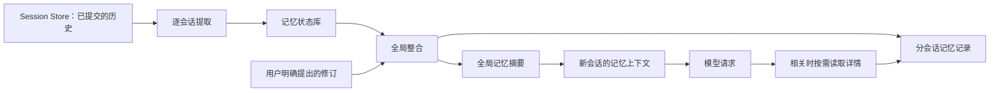
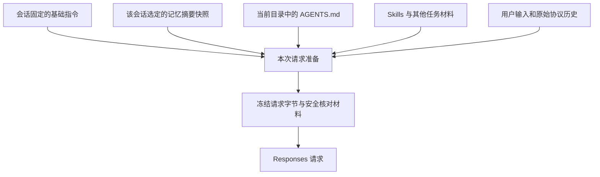
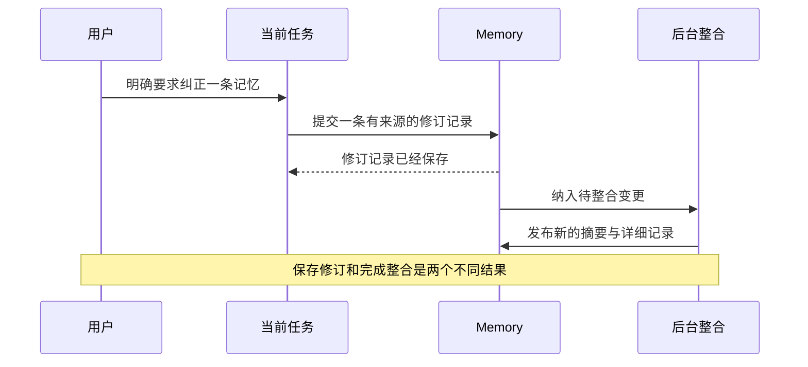
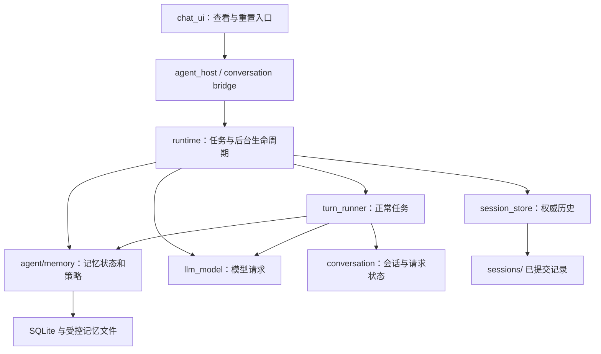

# 长期记忆：让历史任务在新会话中继续发挥作用

会话存档让过去发生过的事可以重读，上下文压缩让当前会话在窗口变长后继续执行；长期记忆要解决的是另一个问题：新会话如何利用过去多个任务中已经确认的事实、决策与经验，而不必重新遍历完整历史。

这里采用 Codex 官方 Memory 新一代流程作为**机制参考**，在应用内部统一称为**长期记忆（Memory）**。没有版本切换、启用开关或逐会话生成开关：已存在的长期记忆始终可用，所有正常会话默认成为后续记忆提取的候选来源。保留用户主动要求记住、纠正、忘记，以及查看和清空记忆的能力。记忆不替代当前会话、项目文件或项目规则。

阅读这套设计，先看历史怎样变成记忆，再看记忆怎样进入新任务，最后看用户怎样改变它，以及各部分如何接入现有运行链路。



图中的“提取”和“整合”是后台记忆工作；“新会话的记忆上下文”和“按需读取”属于前台任务。二者共享记忆材料，但不让记忆工作接管聊天执行循环。

## 会话历史与长期记忆保留不同的事实

`agentelier_session_store` 已经把会话身份、用户输入、完整协议结果、工具执行事件、压缩检查点和恢复所需的业务事件保存在应用数据目录的 `sessions/<uuid>/` 下。这份日志是任务**实际发生过什么**的权威来源。`conversation` 决定记录的业务含义，`turn_runner` 独占活动任务推进，模型层负责 Responses 协议与请求冻结。

长期记忆不再复制一套对话时间线。它从权威历史中选择对以后有价值的内容，形成较短的可检索记录：例如某项目已采纳的设计决策、被用户否定的做法、排错时真实出现的症状与有效处理方式、仍未完成的工作。历史摘要可以随新证据更新，但不能反向修改会话日志或已经发送的请求。

例如在一个项目中，用户先讨论了 A 方案，后来明确改成 B 方案。会话日志保留整个过程；长期记忆说明当前采纳 B、A 已被取代，并留下能回到该会话的线索。以后问相关项目时，模型先得到 B 这个结论，只有需要确认具体措辞或变更过程时才读取对应记录。

记忆也不同于项目 `AGENTS.md`。`AGENTS.md` 由项目上下文模块按当前目录重新采集，是本次请求应遵循的当前项目材料；记忆是来源于过去的历史背景，必要时应向实际文件核实，不能以旧记录覆盖新项目事实或当前用户要求。

## 记忆属于本次选定的数据环境

应用启动后，`DataEnvironment` 提供本次运行固定且已经独占的用户选择目录。记忆使用这个目录，不使用工作目录、代码仓库、`~/.codex`、当前系统账号的默认目录或其他 Agent 的资料。

建议保留与官方相同的“状态数据库 + 可阅读 Markdown”分层，但统一使用不带版本后缀的名称：

```text
<应用数据目录>/
├── sessions/<session-id>/...           # 已有权威会话存档
├── memory.sqlite                       # 记忆提取/整合的持久状态
└── memory/
    ├── memory_summary.md               # 供新会话使用的紧凑导航摘要
    ├── rollout_summaries/              # 按来源会话保存的详细摘要
    │   └── <source-id>.md
    └── extensions/ad_hoc/notes/        # 用户主动提出的增加/纠正/忘记记录
        └── <note-id>.md
```

这是一套**数据目录级**的记忆，不是每个项目或每个聊天会话各一套。记忆条目保留来源会话 ID、项目工作目录、时间与已知任务状态；检索时用这些范围信息判断是否适用。沿用现有会话可跨账号继续的本地数据语义，不额外建立按登录账号隔离的记忆库，因而切换账号不会自动清除同一数据目录中的历史记忆。

SQLite 保存来源会话已处理到哪个提交边界、提取结果、处理状态、失败重试与整合输入快照等机器状态；Markdown 则承担人和模型可以直接阅读的记忆内容。数据库不是第二份会话日志，`memory_summary.md` 也不是权威业务事件。

记忆文件采用受控相对路径，用户和模型引用历史资料时不应靠随意拼接目录外路径。实际持久化遵循原子替换与提交确认：新整合材料完成后才对外成为当前摘要；一份局部写坏的文件不能让旧的有效摘要同时丢失。

## 一段历史怎样成为候选记忆

### 只分析已经提交且暂时稳定的记录

正常会话不用额外选择“参与记忆生成”。后台工作在应用或根会话启动时检查已存在的本地会话存档，只选择满足闲置条件、仍可读取并且尚未处理到最新提交边界的会话；正在写入的会话不直接作为完整输入。以后会话增加了新的已提交记录，依照新边界重新提取。

Source 以 `SessionId` 和已提交记录位置标识，而不是仅以文件修改时间判断。读取从 Session Store 的受控读取能力取得快照；Memory 不私自修改 `session.jsonl`，也不让后台任务通过普通聊天 UI 重放历史工具。

后台只筛选记忆相关证据：用户明确要求、纠正、同意或否定，项目范围、实际工具结果、完成状态与未决问题。保留来源与时间顺序，区分用户决定、助手建议、实际验证和猜测。大型工具输出、重复流片段和无价值的日志不原样塞进模型输入；图片等不能直接解释的媒体可用来源占位表达。对源材料和提交长度设置上限，超出时按明确的筛选规则保留重要证据，而不是把截断后的材料伪装成全量历史。

### 第一阶段为每个来源生成独立摘要

提取请求通过现有的 `llm_model`/Account 路径执行，使用独立的记忆提示词和结构化输出约束，不改变用户会话的固定模型、指令、工作历史或登录状态。

产物主要包括：

- 可独立理解的 `rollout_summary`：按任务保留实际要求、关键决策、纠正、所做工作、结果、范围与待解决事项。
- 安全且稳定的来源标识及可选的简短文件名标识：便于重新访问同一会话的对应材料。
- 提取状态：已成功提取、确实无值得保留的内容，或真实失败并等待重试。

成功产物先写入 SQLite。提取可能并行执行，但同一来源提交边界只应被一个有效任务占有；失败使用有界重试，不因下次启动而无限重复相同失败。提取后对可能出现的密钥与凭据值做脱敏处理。没有有效内容是正常结果，不需要强行创造记忆。

普通聊天和文件读取不等待这项后台工作结束。未登录或当前模型服务不可用时，已有记忆仍可读取；待具备真实可用的模型请求条件时再继续生成，不主动发起 OAuth、切换账号或额外创建一套模型客户端。

## 多个来源怎样合成为同一份记忆

第二阶段从 SQLite 选择一组有价值的来源摘要，生成或更新 `memory/rollout_summaries/` 中的记录，再由独立的记忆整合工作更新 `memory_summary.md`。整合依据与已经成功发布的输入快照比较，只处理必要的新增、变化或删除，不每次都把整个历史重新总结一遍。

同一数据目录只允许一个全局整合任务持有写入权。多次启动、提取完成和手动修订同时到达时，后来的工作等待或在下次机会继续，不形成两个相互覆盖的整合结果。成功发布后再推进已处理快照；失败保留旧的已发布摘要及待处理变化。

全局摘要强调**导航和取舍**，而不是把所有任务平均压缩成一段人物介绍。它优先说明有根据的工作方式、最近项目的当前状态及精确的详细记录入口；规模保持在有界的短上下文范围内。详细记录包含会话 ID、适用项目、已知日期/来源与不确定性；文件名和索引能从摘要精确定位。

为了让记忆不因数量增长而无限膨胀，整合选择兼顾近期更新、实际被查阅次数和最近使用时间。删掉来源会话后，相关提取记录从候选集中移除，下一次整合清理只由该来源支持的记忆；同一结论仍有其他来源支持时保留有效部分。官方流程中使用的来源选择、用量反馈、差异整合思想保留，但不必引入旧版 `MEMORY.md`、`raw_memories.md`、自动生成 Skills 或版本双写体系。

## 新会话先得到导航，需要时再查详情

### 摘要是一份独立的请求材料

新会话开始使用记忆时，从当前已发布的 `memory_summary.md` 建立一份有界快照。它与会话创建时固定的基础指令、实时采集的项目 `AGENTS.md`、本次 Skills 材料和原始协议历史分开管理。请求准备时参考官方的记忆读取路径，以**独立的 developer 上下文片段**提供摘要和读取指引；片段明确将记忆正文标作需要审慎使用的历史证据，而非当前任务的事实或新指令。不直接把摘要拼进 `InstructionSnapshot`，也不作为假冒用户发言追加进 `ProtocolHistory`。



同一会话已经选定的摘要不会因为后台整合完成而在一次进行中的任务或认证重发中悄悄变化。新建会话读取新的已发布结果；恢复会话沿已经记录的记忆使用事实和当前工作窗口继续，避免重写旧的请求前缀。服务端 compaction 后，需要在新工作窗口重新提供当前会话的记忆背景，但不把它当成新的用户消息或一次新的历史决策。

`llm_model::prepare` 仍然是唯一网络请求构造入口，按当前限制有界序列化，冻结并记录实际载荷摘要。用于请求的记忆正文/来源版本、注入位置及摘要必须可以事后核对；历史请求不因磁盘摘要更新而被重新解释。记忆材料要计入上下文预算，与现有 Skills、项目材料及服务端 compaction 的窗口计量保持一致。

### 详细记录只在相关时读取

模型先看紧凑摘要中的项目与任务线索。如果本次任务需要具体改动依据、历史措辞或未决问题，再通过受控的记忆查询能力查阅一两份匹配的 `rollout_summaries/`，需要核对更早的事实时，再通过已有会话存档的合法查看路径核实权威记录；记忆查询工具不直接开放全量会话日志。检索只返回有界、来源明确的文本，不做默认全库拼接。

比如用户说“继续上次 Agentelier 的长期记忆设计”：摘要可直接告诉模型应查询哪个项目和上次设计记录。若用户问的是完全无关的 Rust 语法问题，则无需为了使用记忆而机械读取历史。

读取有实际命中的详细记录时，记忆存储可记录其用量反馈，供后续整合选择参考；不能把“检索命中”自动解释成“记忆内容已经在当前代码中得到验证”。需要确认会变化的项目事实时仍读取当前项目源码或文件。

## 用户怎样直接影响记忆

主动记忆修订与后台自动提取并行存在，但具有不同来源。用户在聊天中明确说“记住……”“之前记错了，改成……”“忘记……”时，Agent 可以将**这次明确意图**写成一条小型修订记录，放入 `memory/extensions/ad_hoc/notes/`；随后由整合工作应用到摘要和相关记录。修订记录保留增补、纠正或遗忘的目标及适用范围，不直接修改生成的 `memory_summary.md`。



普通聊天中的助手猜测不得冒充用户明确的记忆命令；自动提取可以总结已证实的历史事实，但不能把一次局部任务要求升级成普遍有效的用户偏好。用户后来明确撤回的内容不能仅因旧摘要重新参与整合就恢复。

**查看**不要求编辑器：在现有聊天界面提供一个轻量入口，展示本数据目录当前发布的记忆摘要、详细记录的来源线索和最近整理状态；有需要时可以展开只读内容。通过现有 `chat_ui`、Conversation Bridge/Host 的安全投影和 Widgetry BSN 实现，不在 UI 内直接扫描数据库，也不另建完整记忆管理后台。

**重置**是独立的明确用户操作，需确认后停止或排空在途记忆写入，清除本数据环境的生成记录与用户修订材料，但保留 `sessions/`、登录凭据和项目文件。重置完成后仍然自动使用/生成记忆；为避免旧历史立刻把被清空的结果重新生成，记录一次提取起点，后续新增的会话内容才重新进入候选。重置结果、等待中的后台工作与后续新生成应当有可区分的状态。

## 长期记忆怎样接入现有模块

长期记忆是一项独立的 Agent 业务职责，可以由 `crates/agent/memory/` 承担：它管理持久化、来源选择、提取与整合所需的材料、检索、修订与重置语义；不拥有 Bevy ECS、登录凭据、HTTP 协议或全局 Tokio 线程。



`runtime` 仍是后台生命周期所有者：在合适的启动时机安排独立记忆工作，使用 Session Store 取得已提交来源、经 Account 和 LLM Model 发送提取/整合请求，并按实际完成结果更新 Memory。它不在聊天循环里直接做长时间记忆整理。`turn_runner` 在普通任务中读取记忆快照及按需工具结果；`conversation` 承接当前请求的记忆材料与核对事实；`llm_model` 只序列化已经确定的记忆上下文，不直接打开记忆目录。

记忆的查询和用户修订能力接入现有工具目录/执行链路，实际调用、结果、取消与存档仍使用固定 `call_id` 的工具规则。已有工具目录属于会话快照：新增记忆工具不能通过篡改旧的已发送工具定义来伪造历史请求；新会话自动具备记忆能力，旧存档恢复后的后续请求需要显式按当前可用系统能力重新绑定，同时保留已保存的旧请求事实。无需为此创建 MCP Server 或独立执行引擎。

用户主动查看、重置的操作与普通聊天工具调用分别有真实回执。Bridge 只传递摘要、路径/来源的安全展示信息、状态和错误；不得把原始会话、敏感内容或数据库连接放入反射 ECS 状态。Memory 的后台整理与 Runtime 的正常关闭顺序衔接：不阻塞普通聊天，退出时停止接纳并回收已启动的工作，避免进程终止后仍有未拥有的写入者。

## 保持记忆可信而不是让它变成隐形规则

这套机制必须同时遵守几个直接影响使用效果的界限：

- **证据与作用域。** 区分用户原话、助手建议、工具观察与推断；保存项目路径、任务来源和状态，遇到新证据时更新或撤销旧结论。跨项目记录不因关键词相同就混用。
- **输入和权限。** 历史聊天、工具输出、记忆记录和修订正文均作为待解释的数据，不具有指挥当前执行的权限。当前用户要求、真实项目文件与安全边界优先于旧记忆。
- **秘密与原始协议。** 不向记忆库写入凭据、密钥、授权 URL 或无关敏感原文。提取不要求解密 reasoning，不复制整个 HTTP 响应或大型工具输出；普通日志只记录来源身份、摘要、数量和失败原因，不打印记忆正文。
- **失败与恢复。** 未形成有效摘要时正常聊天仍能运行；提取与整合错误分别保留可诊断状态和重试资格。读取失败不伪装成成功读取；写入失败不宣称已更新记忆。重置不能让迟到后台任务重新写入清空的旧状态。
- **运行范围。** 不增加“使用记忆/生成记忆”开关，不再做版本兼容、旧版文件迁移、语义向量数据库、自动生成 Skills、云端同步或额外的长期运行守护进程。记忆本身不替代 Session Store、项目指令或上下文压缩。

## 从应用里怎样确认它真的有效

下面的情境分别检验这套机制的不同部分；观察结果来自实际运行和受控状态检查，不另建测试/Benchmark/Example 工程。

1. 在同一数据目录创建会话并完成有明确决策的任务。会话日志先提交；经过符合条件的后台工作后，SQLite 存在对应来源提取状态，`rollout_summaries/` 和 `memory_summary.md` 能追溯到该会话。
2. 创建新的聊天会话，检查实际发送的请求材料包含有界记忆上下文；模型能够在相关提问中使用它。一个不相关的问题不应触发全量历史读取。
3. 纠正某项先前决定：先得到修订记录提交回执，后台整合完成后新会话使用新结论，旧说法不会被旧来源重新提升为当前决定。
4. 修改或删除原始会话后，相应提取和整合结果按来源更新；已有聊天存档不会被记忆整理改写。
5. 重开应用、发生 compaction、取消后台工作、遇到模型/磁盘错误时，检查摘要与会话请求核对材料仍符合持久化和阶段边界。
6. 通过现有 UI 查看记忆与确认重置，观察文件和 SQLite 记录清空、历史会话保留、后续新任务仍可产生记忆。涉及 UI 的场景用实际应用和 BRP 验证。

## 参考实现与本地设计依据

- Codex：[`codex-rs/memories/README.md`](https://github.com/openai/codex/blob/main/codex-rs/memories/README.md)、[`write/src/phase1.rs`](https://github.com/openai/codex/blob/main/codex-rs/memories/write/src/phase1.rs)、[`write/src/phase2.rs`](https://github.com/openai/codex/blob/main/codex-rs/memories/write/src/phase2.rs)、[`write/templates/memories/stage_one_system_v2.md`](https://github.com/openai/codex/blob/main/codex-rs/memories/write/templates/memories/stage_one_system_v2.md)、[`consolidation_v2.md`](https://github.com/openai/codex/blob/main/codex-rs/memories/write/templates/memories/consolidation_v2.md)、[`ext/memories/templates/memories/read_path_v2.md`](https://github.com/openai/codex/blob/main/codex-rs/ext/memories/templates/memories/read_path_v2.md)。参考其中的两阶段工作、来源忠实性、摘要导航和显式修订方式，不复制版本双写或旧版手册。
- 现有本地设计：[`architecture.md`](../architecture.md)、[`application-data.md`](application-data.md)、[`conversation.md`](../modules/conversation.md)、[`session-store.md`](../modules/session-store.md)、[`project-context.md`](../modules/project-context.md)、[`tool_call.md`](../tool_call.md)；实现时以相应源码中的实际接口、记录和请求准备边界为准。
- UI 与验证边界：[`bevy_widgetry`](https://github.com/slc90/bevy_widgetry)、[`bevy_brp`](https://github.com/slc90/bevy_brp)。它们提供 BSN/Widgetry 控件和 BRP GUI 操作参考，不参与后台记忆生成或存储设计。


[按独立交付目标拆分的执行方案](../../../plans/long-term-memory/00-overview.md)保存在 `plans/long-term-memory/`。
