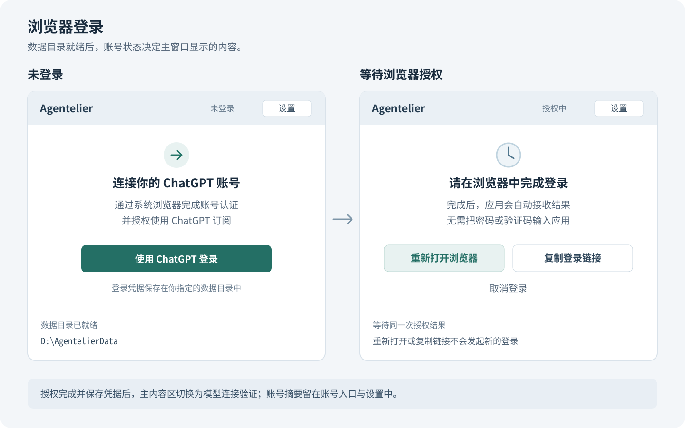
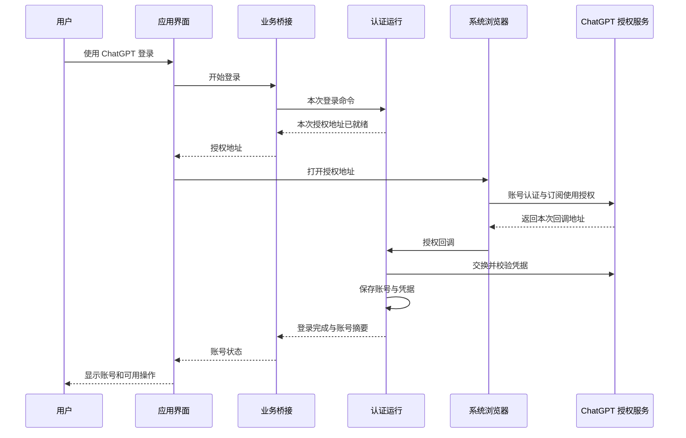

# 浏览器登录与账号界面

数据目录就绪以后，主窗口开始恢复账号。登录入口只提供 ChatGPT 浏览器授权：账号认证在系统浏览器中完成，应用接收授权结果，保存自己的文件凭据。

## 界面从当前账号状态开始

主窗口始终保留“设置”入口。未登录时，内容区显示登录卡片；登录完成后，卡片让位给模型连接验证区域，账号摘要留在账号入口和设置页。

恢复期间显示“正在读取账号”。没有凭据时显示“使用 ChatGPT 登录”，已有有效凭据时恢复账号，不主动打开浏览器。

登录卡片不包含账号密码输入框、API Key 输入框、设备码入口或登录方式选择器。应用和其他客户端分别管理各自的授权记录。

## 一次浏览器授权如何完成

点击登录后，后台准备这次授权，并建立仅用于本次登录的本地回调监听。监听就绪后，应用打开系统浏览器，界面转入“请在浏览器中完成登录”。

首次登录同时完成当前应用的账号登记。后续重新授权使用保存的登记信息。应用使用自己的客户端登记与主机标识，不借用其他客户端的身份。

“订阅使用授权”与“认出这个账号”分别表达。身份校验完成但订阅使用权限未开启时，界面显示“账号已登录，订阅授权未开启”，提供“开启订阅授权”按钮。这个按钮仍然进入 ChatGPT 浏览器授权，不引入另一种计费方式。

## 等待期间能做什么

等待卡片提供“重新打开浏览器”“复制登录链接”和“取消登录”。前两个操作复用当前登录尝试的地址，不创建另一份并行授权。浏览器自动打开失败时，显示错误，并保留手动打开同一个链接的方式。

同一时刻只保留一个登录尝试。重复点击登录不会重复创建回调监听。取消后先显示“正在取消”，等后台确认尝试已经结束，再回到未登录或原来的账号状态。

每次尝试有独立的操作标识。界面只接收当前尝试的结果，旧浏览器页面产生的迟到回调不会覆盖新状态。授权和取消竞争时，以后台已经确定的实际终态为准。

用户拒绝授权、等待超时或 Token 交换失败时，卡片显示具体失败阶段和“重试”，重新准备授权尝试。若已取得并校验凭据而本地保存失败，则保留本次待保存结果，显示“重试保存”；重试提交同一份记录，不重复兑换授权码。凭据写入成功后才发布可跨重启恢复的登录成功状态。

## 已登录时显示什么

账号区域显示能够从经过校验的身份信息中取得的账号名称或邮箱，以及“订阅授权已开启”“订阅授权未开启”或“需要重新登录”等当前状态。未返回的套餐名称不在本地猜测。

设置分为两个区域：

| 区域       | 内容与操作                                     |
| ---------- | ---------------------------------------------- |
| 账号       | 当前账号摘要、认证状态、重新授权入口、退出登录 |
| 数据与存储 | 当前目录、下次启动目录、打开目录、更改目录     |

账号内容只包含展示所需的信息。Access Token、Refresh Token 和原始 ID Token 留在认证运行侧，不作为界面组件或可反射资源公开。

## 退出登录只结束账号会话

“退出登录”停止当前账号的新请求，结束相关操作，尝试撤销可续期会话，然后清除内存和文件中的 Token。界面在整个操作期间显示“正在退出登录”。

本地 Token 清除完成后，界面回到未登录状态。应用仍保留数据目录选择、配置、日志以及账号的非凭据登记信息；主机标识与已经签发的客户端标识可在下次登录时复用。

如果远端撤销未能确认，但本地 Token 已经清除，界面显示“已退出本机登录；远端撤销未确认”。如果本地文件无法更新，则显示“退出未完成，无法清除本地凭据”，保留重试入口。两种情况分别反馈。

关闭应用与退出登录不同。关闭应用正常保存并收尾，不主动清除凭据；下一次启动仍可恢复账号。

## 失败反馈跟随实际原因

网络暂时不可用时，界面保留账号摘要，说明当前连接失败并允许重试。刷新凭据被服务端明确拒绝时，状态变为“需要重新登录”。订阅权限、服务可用性或额度问题显示在对应操作区域，不统一转换成“账号退出”。

账号状态、正在进行的操作和该操作的错误分别保存。一次模型请求失败可以与“账号已登录”同时存在；正在刷新凭据也不需要让整个界面跳回登录卡片。
