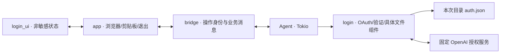

# 认证运行与凭据管理

当前已实现 SIWC 文件账号恢复、ChatGPT 浏览器授权及按需会话续期，以及 Codex OAuth 外部凭据的只读选择。具体认证与文件能力归 `agentelier_login`，Agent/Tokio 串行执行，Bridge 转换业务事件，`login_ui` 负责安全投影、Bridge 衔接以及浏览器和剪贴板交互；`application` 通过界面库提供的生命周期句柄协调退出。SIWC 续期不依赖周期保活，退出登录在同一所有者中撤销并清空 SIWC 会话。

## 记录与会话

`auth.json` 根记录包含稳定的 `ext_agent_host_id`、可空 `registration` 和可空 `session`，拒绝未知字段。首次授权前使用随机 UUID 创建 `urn:uuid:` 主机标识并完成保存；后续授权、重启和移动同一份数据都复用它。单纯恢复不生成主机标识。

| 记录 | 字段与语义 |
| --- | --- |
| 登记 | 固定 `issuer=https://auth.openai.com`，实际签发的 `client_id`，已验证的 `subject`，可空展示名与邮箱 |
| 会话 | ID Token、实际 `scopes`，以及服务实际授予的可空 Access/Refresh Token、Token 类型 |
| 时间 | Token 响应接收时的 `received_at`，可空 Access Token `expires_at` 和 `refresh_not_before`，统一为 Unix 秒 |

有会话必须有登记。Access Token、Bearer 类型和有效期必须共同存在；直接订阅使用范围需要 Access Token，offline_access 需要相应凭据。仅有已验证身份的合法授权不生成假的 Access Token 或有效期。最早刷新时间可能在网络响应到达前已经过去，不因此拒绝合法记录。

文件缺失、只有主机、登记但会话为空分别为 NoRecord、HostOnly、SignedOut。已有会话恢复摘要、是否过期及实际订阅范围，不把本地读取视为远端认证检查。解析错误只显示行列，结构错误使用固定字段名称，原始正文和 Token 不进入错误或 Debug。

## Codex OAuth 外部来源

Account 保存当前来源。用户可以显式选择本地绝对路径上的 Codex `auth.json`，或断开该来源并回到原 SIWC 状态。应用配置的 `codex_auth_file` 只保存路径，配置原子提交成功后才切换来源。启动恢复配置中的路径，运行期间定期只读检查选中的文件，摘要或状态变化时才更新投影。文件读取失败、格式不支持、令牌缺失、工作区或身份不一致和过期都有独立反馈。读取失败时保留所选来源。

Login 识别 Codex ChatGPT OAuth 文件的认证模式及令牌结构，核对两枚 JWT 的账号与工作区声明以及文件记录的工作区。Access Token 的本地有效期用于显示过期状态。声明核对是本地结构检查，尚无远程会话或签名验证。Token 仅在 Login 解析期间存在，不写入配置、SIWC 认证文件、事件或日志。外部文件的签发、刷新和撤销由原 Codex 客户端处理。

Codex 来源尚未接入模型路由。启用该来源时 CredentialClient 停止发放 SIWC 凭据并使旧执行身份失效，Runtime 收尾相关工具和队列工作。断开仅清除配置中的文件引用，原外部文件和 SIWC 会话继续保留。

## 浏览器尝试

应用只采用固定 OpenAI 公共客户端协议。首次请求使用 `dynamic_agent_client` 与 Agentelier 名称提示；回调必须返回实际客户端标识。该入口标识不会保存为正式登记。已登记账号复用原客户端及主机标识，且返回 subject 必须匹配。

每次尝试生成新的安全随机 state、nonce、PKCE verifier，用 SHA-256 / base64url 构造 S256 challenge。先绑定 127.0.0.1 的可用端口，再形成同一尝试固定的 `/auth/callback` 地址，授权与 Token 交换完全复用此 URI。URL 和表单均由编码库构造，不拼接原始参数。

回调只接受匹配 Host 的 GET，限制请求大小与连接等待时间，核对单一 state 后才处理授权错误、授权码和客户端标识。无关或 state 不匹配的请求被拒绝，不消耗当前尝试。正确回调的浏览器响应清除地址栏查询参数，禁止缓存和 Referrer，不提前宣称持久化成功。

Token 请求携带实际客户端、一次性授权码、PKCE verifier、回调和固定 resource。禁止重定向；网络错误和响应格式只返回固定阶段信息及 HTTP 状态，不转发响应正文。已取得的客户端标识在当前运行中保留，失败后的新授权不再次使用动态注册入口；未验证身份的标识不成为磁盘登记。

reqwest 显式启用 `system-proxy`，Token、发现文档与 JWKS 共用该客户端，自动读取 Windows 手动系统代理及绕过设置，代理环境变量遵循依赖自身的优先规则；不解析 PAC。客户端随新登录建立，回环监听不经过代理。应用的浏览器 Job 通过 Windows Shell 将当前授权地址交给系统默认浏览器，首次打开和重新打开复用同一路径；启动失败保留同一次尝试的手动入口。

从固定签发方获取发现文档及同源 HTTPS JWKS。校验 RS256 签名、issuer、audience、exp、iat、可选 nbf、本次 nonce 和适用的 azp，再以 sub 建立身份。Access Token 的内部字段不参与身份判断。服务端未授予订阅范围时仍保存验证后的身份，并在显式开启订阅授权时请求补充同意。

## 按需续期与会话代次

恢复账号不触发网络；运行侧需要凭据时，通过同一个认证所有者检查当前记录。到期前 60 秒进入续期窗口，同时受服务返回的 refresh_not_before 限制。最早刷新时间未到但 Access Token 有效时继续使用；凭据已经不可用则返回暂不可用及重试时间，不忙等或发送过期 Token。

Account 提供可克隆 CredentialClient，以请求类型及被拒绝的原凭据代次合并在途等待，所有文件和会话变更仍由同一 Tokio 循环串行处理。会话代次仅存在于进程内，文件记录实质变化或成功提交时更新；重新读取相同文件不改变代次或清除当前运行的错误防护。调用方丢弃 Future 不取消已经开始的 Token 旋转。

续期使用固定 Token 地址和实际客户端，省略 scope。新 ID Token 若存在，除正常 JWT 验证外，要求 subject 与原登记一致，并比较最初授权的 audience、可选 nonce 和 auth_time。首次续期从已保存的 ID Token 取得原始绑定，后续将其作为可选 identity_binding 随会话保存；缺少新 ID Token 时保留旧值。展示名和邮箱继续使用既有已验证登记。

续期状态区分 Ready、Failed 和 Pending。成功旋转或明确失效都先由运行侧持有待提交整记录；只有文件完整提交成功才交付新凭据。Pending 状态不允许重新读取覆盖、再次交换旧 Refresh Token 或由浏览器取消路径丢弃。失效清理即使尚未落盘，也立即投影为 ReauthenticationRequired，保留账号和客户端登记。

明确失效按协议错误代码判断；invalid_client 单独报告配置问题。连接失败和限流保留会话并限制重试间隔；可能已经消费旧 Token 的超时、5xx 或无法判定的响应在当前运行中阻止再次消费，要求显式重新授权。该保护不是跨进程事务日志，重新启动仍只能恢复磁盘上的最后记录；无法消除未确认服务结果后进程丢失所带来的不确定性。

认证恢复使用原请求持有的身份、代次和一次性预算；仅首次 401 且尚未输出时提供恢复。若同一身份已有有效的新代次，直接交付；账号变化拒绝重发。实际模型网络重试尚未接入。

## 私有文件提交

主机创建和 Token 保存共用同一个整记录提交路径。临时目录创建后，先设置仅当前用户及 SYSTEM 可访问且禁止继承的 DACL，再在其中创建并保护临时文件。使用 win-custody 的安全 API 查询并核对权限；写入秘密之前权限必须满足要求，不解除 unsafe 禁令。

完整序列化、写入、sync 后，将受保护文件移至同目录的唯一暂存路径，清理本次临时目录，再原子替换目标。第一次创建使用不覆盖已有文件的提交。已有目标只接受普通非重解析文件，提交前保护目标权限；不递归处理用户目录。最终替换保留来源文件的受保护 DACL。

会话先在运行侧暂存。保存失败保留同一份已验证结果并等待重试，不重复消费授权码；保存成功才替换缓存并发布持久化终态。取消待保存结果会丢弃新结果，保留旧会话。实际提交已经开始时等待完整结果，不在提交中途丢弃任务。

## 退出会话

退出请求先在共享凭据门控中停止新请求并取消旧请求的交付许可，再进入独立有界控制队列。门控与普通命令提交使用同一同步边界，避免退出请求接纳后又排入新的账号操作；当前登录通过取消令牌结束，旋转由认证所有者继续完成。控制队列在当前操作收敛后优先处理，旧的排队命令被结束，迟到的结果不会成为新登录状态。

AuthFile 的 SignOutState 区分 Inactive、Pending 和 Complete；Pending 只持有已清空会话的待提交记录及安全的远端结果，复用已有 pending 和原子提交入口。撤销上下文选取最新待提交记录或已提交记录，防止旋转期间读旧 Refresh Token。撤销前后不并发执行其他文件更新，代次核对拒绝不属于当前所有者的清理结果。

撤销读取固定 issuer 的发现文档，仅接受 auth.openai.com 上无凭据/fragment 的 HTTPS 地址；表单只包含 token、token_type_hint=refresh_token 和实际 client_id。网络或 5xx 做三次以内、每请求八秒的有限尝试，间隔 500/1000 毫秒；确认 HTTP 200 后不要求成功 JSON。失败保留“远端未确认”结果，继续将 session 置空，不引入秘密备份或后台补偿守护。

文件提交失败时，运行侧继续禁止所有业务，不把旧磁盘 Token 当作已清空；下一次退出重试只保存待清理记录。Complete 状态拒绝通过重新读取带 Token 的记录恢复会话，只有新的已验证浏览器授权保存成功后才重开凭据入口。主机标识和登记始终保留，UI 以未登录卡片呈现。

普通关闭取消浏览器与业务等待、等待在途旋转及必要提交，保留当前会话；已经明确接纳的退出则先完成撤销/本地清理，再结束运行。若本地提交持续失败，退出保持未完成并在关闭收尾返回存储错误，不能宣称文件 Token 已清除。

## 执行、通知和结束

命令队列容量为四、事件队列容量为八。Bridge 只接纳一个在途账号操作，保存失败与重试继续使用同一标识，终态才释放操作。state/nonce/Token 留在认证运行；授权地址只通过无 Debug 的私有交互消息交给应用后台句柄，不进入可反射 AccountState。

Runtime 在独立线程驱动 Tokio，Account 串行协调账号操作，Login 的具体文件工作使用 spawn_blocking，网络与回调为异步。取消通过当前操作专属 CancellationToken 直接通知在途任务；等待超时为命名常量五分钟。取消或关闭停止监听和网络等待；已开始的文件提交等待真实完成，以实际保存结果决定成功或取消。

结果先入队再通知 Winit，应用非阻塞消费所有待处理阶段。打开浏览器作为应用辅助 Job 管理，其结果有独立操作关联；迟到结果不覆盖其他登录。应用只安装原有日志和 BRP Runtime。

退出协调暂存 AppExit，停止认证命令及普通通知，取消当前授权并等待执行线程与 Tokio 真实结束，再在事件循环有效时收尾辅助任务。最后允许主循环退出、完成日志并释放数据环境。显式 finish 传播错误，Drop 仅提供防泄漏兜底。

SIWC 协议参照 [OpenAI 注册与登录](https://developers.openai.com/siwc/token-sharing-open-source/sign-in)。Codex OAuth 结构参照 [Codex auth.json](https://github.com/openai/codex/blob/main/codex-rs/login/src/auth/storage.rs) 及 [TokenData](https://github.com/openai/codex/blob/main/codex-rs/login/src/token_data.rs)。

## 模型消费者与认证收敛

单次模型验证在同一 Tokio 中使用独立任务，通过 CredentialClient 等待认证所有者交付已保存的凭据。目录与推理之间重新获取当前凭据并检查登记身份；输出开始前的 401 使用已有 AuthenticatedRequest 恢复预算，输出开始后不自动重放推理。

退出或关闭会取消并回收模型执行体。取消凭据等待者不会丢弃认证所有者已经开始的旋转；所有者仍负责网络结果及必要文件提交，然后才结束退出清理或 Tokio 生命周期。模型协议和 Bridge/UI 终态关系见[单次模型请求](model-request.md)。

## Crate 所有权

`agentelier_login` 保留协议、Token 和具体持久化实现；`agentelier_account::Account` 持有唯一 AuthFile 与待保存浏览器操作，执行账号恢复、授权、续期、保存和退出协调。共享凭据入口及会话门控位于 Account，向 Runtime 注入的命令提交能力发送 AccountCommand，不依赖 Runtime 或 Bridge。

`agentelier_agent_runtime` 拥有 Tokio、混合命令队列、独立退出队列、模型任务及线程收尾。Account 的交付失败返回 Runtime，由 Runtime 在完成必要提交后报告；退出时先回收模型，再进入 Account 的撤销和清理。Account Bridge 负责非敏感账号投影，Connection 负责操作关联和唤醒，UI 只持有展示状态。

公共 UI 连接由 `agentelier_agent_host` 持有，登录 UI 不再持有或读取 Connection。AgentHost 接收一次后台事件后，分别分发账号、模型业务消息和运行失败通知；login_ui 只管理账号展示、私有授权地址及浏览器辅助任务。整体退出通过共享宿主确认执行结束，再收尾辅助任务和应用资源。

本地聊天存档独立于认证会话。退出与主体变化仍先取消并回收旧执行体，随后暂停并保存待办；不会清空聊天 Session、时间线、指令或工作历史。后续任务通过当前 CredentialClient 取得新的执行身份，不按创建账号过滤本地记录。认证文件中的会话清理只指凭据，不指聊天存档。
