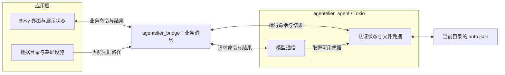
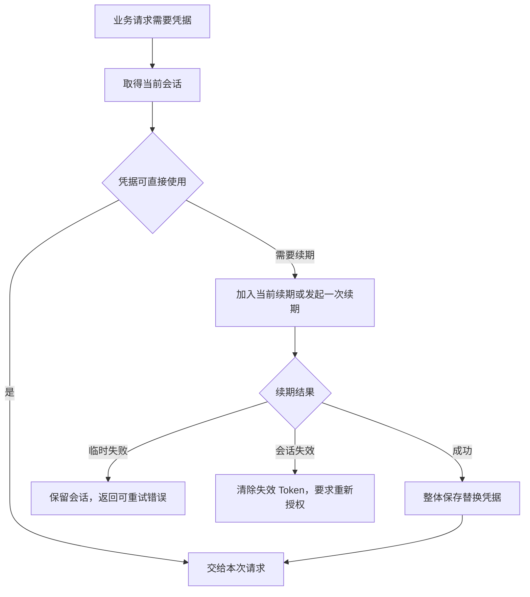
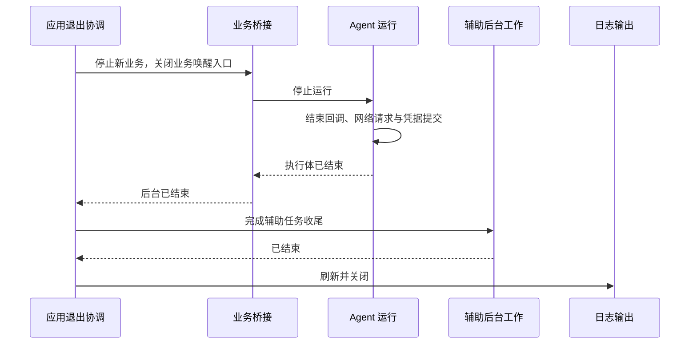

# 认证运行与凭据管理

长期登录依赖一份可恢复的本地授权记录。应用重新启动时读取这份记录，发送请求前取得当前可用的凭据，凭据续期后再把新记录写回同一文件。界面只观察这些操作形成的账号状态。

## 一份文件，区分登记与会话

当前数据目录中的 `auth.json` 保存三个层次的信息。

| 内容 | 生命周期 | 作用 |
| --- | --- | --- |
| 主机标识 | 随这一份应用数据环境保留 | 标识发起授权的应用实例 |
| 账号登记 | 登录后保留，退出登录时继续保留 | 将签发的客户端标识与校验后的账号身份关联 |
| 当前会话 | 登录建立、刷新替换、退出清除 | 保存 Token、授权范围及有效时间 |

主机标识在首次授权前生成并保存，采用随机 UUID 对应的 `urn:uuid:` 标识。同一份数据在同一台设备上移动目录后，继续使用原来的标识。应用重启和重新登录不重新生成它。

账号登记保存签发方、实际签发的客户端标识、已验证的账号身份以及用于展示的邮箱等信息。每个数据目录维护一份登记；同一登记下的重新授权继续校验同一身份。

当前会话保存 Access Token、Refresh Token、ID Token、实际授予的范围、接收时间及由响应得出的过期信息。退出登录时将当前会话置空，其余登记信息仍可用于下次浏览器登录。

文件不存在表示尚未建立账号记录；只有主机标识表示首次登记尚未完成；已有登记而当前会话为空表示当前未登录。解析失败、字段矛盾和读取失败分别形成存储错误，原文件保留，界面提供原因。

## 状态由谁持有

应用拥有用户选择的数据根目录，并把当前凭据路径交给后台。认证模块位于 `agentelier_agent` 内，负责文件读写、授权流程、凭据续期和账号会话状态。

图中表示运行时协作。源码依赖保持 `app → agentelier_bridge → agentelier_agent`；桥接和 Agent 都不依赖 Bevy。

桥接把开始登录、取消登录、恢复账号、退出登录和模型请求转换为后台命令，再把执行结果转换为界面业务事件。它传递必要的操作标识，不另建账号真相或第二份凭据缓存。

后台事件先进入通道，再通过应用提供的唤醒能力通知 Winit。业务数据仍在通道中，唤醒信号只促使界面处理消息。ECS 非阻塞地消费事件并更新展示状态。

界面持有账号摘要、当前操作和反馈信息。完整 Token、授权码和 PKCE verifier 只在认证运行内部流动。

## 浏览器授权形成新的会话

认证模块使用固定的 ChatGPT 授权路径。首次登记使用动态客户端注册入口，回调取得实际签发的客户端标识；返回登录使用保存的标识。两种情况共用同一条浏览器授权流程。

每次授权生成新的随机 `state`、OIDC `nonce` 和 PKCE verifier。回调监听绑定回环地址 `127.0.0.1`，使用 `/auth/callback` 路径，并在打开浏览器之前启动。单次尝试始终使用同一个完整回调 URI。

回调先核对 `state` 和本次尝试身份，再处理拒绝授权或授权码。认证模块用本次尝试的客户端标识与 PKCE verifier 交换 Token，检查 ID Token 签名、签发方、受众、有效期和 nonce，将经过校验的身份与客户端登记关联。

授权结果中的实际范围决定订阅是否可用。身份有效而缺少订阅使用范围时，会话仍可保存，账号状态表达为“已登录、订阅授权未开启”。用户明确点击开启授权后，才发起补充同意的浏览器流程。

完整校验和文件提交完成后，认证模块发布会话结果。用户界面使用这一结果结束等待。

## 文件提交与凭据更新是一个动作

凭据存储只有一个具体的文件实现。登录、刷新和退出通过同一处提交逻辑更新整份记录，不提供存储后端枚举、动态后端选择或兼容其他客户端文件格式的分支。

写入在同目录的临时文件中完成，确认完整写入和刷新后替换目标文件。敏感内容写入前就具备受限的 Windows 文件访问权限；替换后仍保持这些权限。读取者看到完整的旧记录或新记录。

同一数据目录由一个进程持有独占占用，认证运行内部再串行化会话更新。这样多个业务请求可以共享一次续期，而不是分别使用同一个旋转中的 Refresh Token。

## 需要凭据时，自动恢复和续期

启动恢复从文件建立账号状态。真正需要访问服务时，认证模块检查当前会话的有效时间；临近过期时，通过 Refresh Token 申请替换凭据，并遵守服务返回的最早可刷新时间。

自动续期以实际 Token 响应中的有效期为依据，不依赖固定登录天数，也不建立一个只为保活而持续轮询的后台服务。新 Access Token、替换 Refresh Token 和相关过期信息一起提交。

若网络交换已经成功而写盘失败，运行中保留待保存的新凭据，暂停依赖它的新请求并提示保存失败；恢复写入时提交同一份新记录，不再次拿旧 Refresh Token 发起续期。

业务请求收到认证拒绝时，可在当前会话身份未变化的条件下执行一次认证恢复，并使用更新后的凭据重试。重复拒绝、明确的权限问题和额度问题分别返回，不通过反复刷新掩盖原因。

模型请求的取消不直接丢弃已经开始的凭据续期。认证运行负责把正在进行的 Token 更新收敛到可判定的结果，避免刷新成功却无人保存替换凭据。

## 退出与关闭怎样结束后台工作

退出登录先停止该账号的新业务，结束当前登录和模型请求，并等待已经开始的凭据变更收敛。随后使用最新可用的会话材料尝试远端撤销，再将文件中的当前会话清空并更新内存状态。

普通关闭应用则保留当前会话，只结束执行体。两者使用同一套任务收尾能力，但最终对凭据文件采取不同操作。

应用的退出协调保留自己的进度驱动，停止普通业务唤醒以后，仍能接收后台结束结果。必要资源在收尾完成后再释放。

目录验证、打开资源管理器等应用侧工作可使用辅助后台任务；OAuth、Token 刷新和模型通信始终由 Agent/Tokio 管理。

日志记录操作阶段、操作标识和经过筛选的错误原因。Token、授权码、完整授权地址以及包含敏感字段的响应正文不进入日志、界面反射数据或诊断快照。
