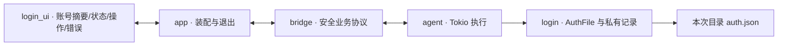

# 认证运行与凭据管理

当前已实现从本次数据目录恢复 `auth.json`。具体文件能力归 `agentelier_login`，Agent/Tokio 负责执行，Bridge 转换业务结果，应用协调启动与退出，`login_ui` 展示安全投影。浏览器登录、续期及退出登录尚未实现，后续方案见 [04](../../../plans/登录/04-browser-login.md)、[05](../../../plans/登录/05-renew-session.md) 和 [06](../../../plans/登录/06-sign-out.md)。

## 一份文件，区分主机、登记与会话

根记录包含 `ext_agent_host_id`、可空的 `registration`、可空的 `session`，不接受未知字段。主机标识必须为非 nil UUID 对应的 `urn:uuid:`。本次恢复不会生成或保存标识。

| 记录 | 字段及约束 |
| --- | --- |
| 登记 | `issuer` 固定为 `https://auth.openai.com`；非空 `client_id`、`subject`；可空 `display_name`、`email`，存在时不得为空白 |
| 会话 | 非空 `access_token`、`refresh_token`、`id_token`；`token_type` 为 Bearer（忽略大小写）；`scopes` 为非空且无重复/空白项的字符串数组 |
| 时间 | `received_at`、`expires_at`、可空 `refresh_not_before`，均为 Unix 秒；过期时间晚于接收时间，最早刷新时间不得早于接收时间 |

会话存在时必须有登记。读取已有会话只检查本地结构，信任先前授权阶段保存的身份，不重新执行 JWT 校验或向服务确认有效性；后续真实写入必须先完成身份校验。Token 的实际授权范围及时间完整保留在运行侧，界面只展示是否过期，不推断订阅或套餐。

文件不存在、只有主机、已有登记但无会话分别投影为 `NoRecord`、`HostOnly`、`SignedOut`，均显示未登录。会话存在时恢复账号 subject、展示名、邮箱，并比较当前时间与有效期。文件只读，不创建空账号或覆盖损坏记录；本次没有写入接口、密钥管理或其他存储后端。

解析、结构、读取、超出 1 MiB 及系统时钟错误分别返回。解析错误只保留行列，结构错误使用固定字段名称，不转发 serde 中可能包含敏感值的原文。失败时保留上次成功缓存，并向界面报告本次错误。

## 运行和投影分别持有状态

Agent 独立线程驱动 Tokio current-thread Runtime，串行接收恢复命令；每次通过 `spawn_blocking` 调用具体文件组件，等待真实结果后保留组件和缓存。它不访问 ECS、不安装日志订阅，也不由 Widgetry JobManager 管理。

命令队列和结果队列容量各为一。Bridge 只接纳一个在途操作，负责分配及核对操作标识；应用再次核对当前投影中的操作身份。Bridge 消息只包含它自己的摘要、状态和筛选后的错误，不暴露 Token、授权码或原始文件记录。

结果先入队，再调用宿主提供的通知能力。应用将通知转换为 Winit WakeUp，ECS 以非阻塞方式消费结果；账号面板在 PostUpdate 投影文字，保证 Update 收到结果后不依赖下一次用户输入更新文字。队列满、通道关闭、任务或线程异常、唤醒失败都不当作正常缺失结果。

## 退出以真实结束为准

退出帧暂存 `AppExit`，关闭新认证命令和普通业务唤醒。已接收的读操作继续到真实结束，不把停止请求视为完成。退出协调自行通知 Winit 推进帧，保持 World、桥接、接收端及事件循环有效；非阻塞检查认证线程已结束后再 join。线程先释放 Tokio 并等待阻塞文件工作结束，再报告退出结果。

随后在事件循环有效时开始并完成独立辅助任务收尾，再发布真正的 `AppExit`。主循环返回后兜底检查运行状态，刷新并关闭日志，最后释放数据目录占用。后台失败会影响进程退出结果，不阻止辅助任务收尾。显式 `finish()` 用于传播失败；Drop 只在宿主遗漏收尾时阻塞等待并记录无法返回的错误。

当前仅恢复，不修改凭据。合法真实会话的重启验证留到浏览器授权增量产生真实记录以后，不制造伪造登录记录。
