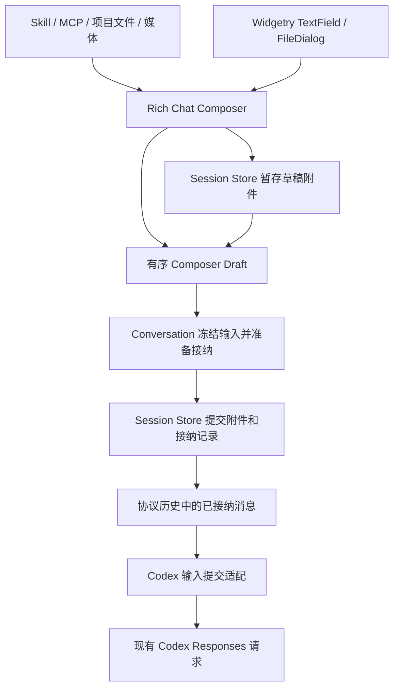
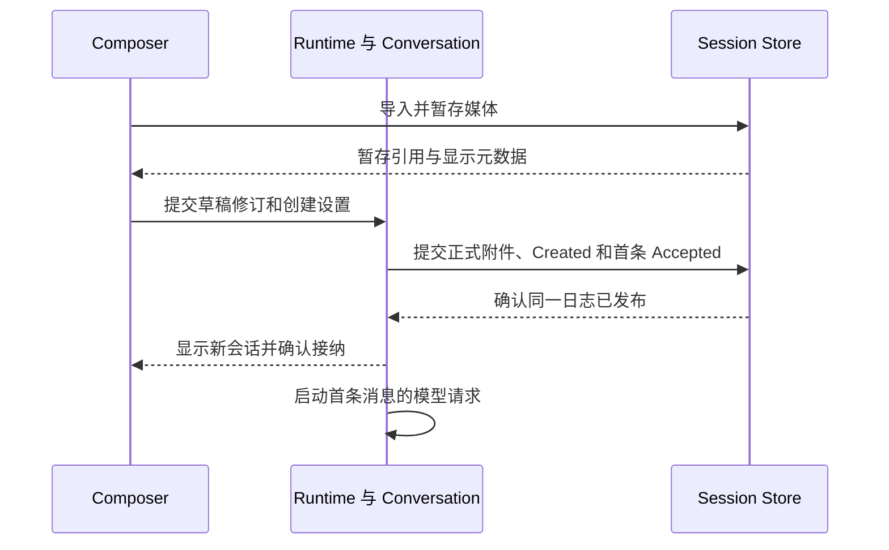

# 富文本聊天输入组件

一条聊天消息不再只是一个字符串。用户可能先写一句话，再插入图片，接着引用一个 Skill、补充文件路径，最后附上几段音频。编辑器需要让这些内容仍然像一条消息那样连续可编辑，也要让每个引用和附件在发送、排队及恢复时保持原来的身份。

Rich Chat Composer 是 `chat_ui` 内由 Agentelier 自己负责的复合控件。它把文字、能力引用和媒体组织成一份有序草稿，bevy_widgetry 提供基础文本编辑和文件选择能力。Conversation 决定消息如何接纳，Session Store 保存草稿附件和接纳记录，模型请求层负责 Codex 输入转换。



这套设计从草稿本身开始：先确定一条消息可以由什么组成，再说明这些内容如何进入编辑器，最后看它们怎样跨越会话边界进入模型请求。

当前聊天界面以有序草稿承载分段文本和既有音频附件。Conversation、Bridge 和 Session Store 使用同一份输入快照，首条接纳随会话发布。输入 `$` 时从本地能力投影补全 Skill 与 MCP。输入 `@` 时在工作目录与项目范围的交集中索引文件。图片可从 Windows 剪贴板、文件选择器或 `@` 候选导入，草稿和历史按插入顺序显示实际缩略预览。WAV 和 MP3 可在新会话和既有会话中暂存、播放并随消息保存，正式音频可显式转写后按版本引用。

## 一条消息由有序内容组成

当前聊天输入主要由 `ChatState.draft` 保存文本，而音频附件另存于 `ChatSession.audio_draft`。`ConversationRequest::Send` 再把文本、单个音频 ID 和转写引用分别传递。这样的表示可以处理简单文本或一个音频附件，却无法完整表达一条消息里多段文字、多个媒体和能力引用之间的关系。

Composer 将草稿表示为有序内容序列。每个元素都有自己的稳定身份；显示名称与真实目标分开保存。逻辑元素包括：

| 元素 | 用户看到的内容 | 保存的身份 |
|---|---|---|
| 文本段 | 普通消息文字 | 文本内容及文本元素位置 |
| Skill 引用 | `$skill-name` | Skill 名称与来源路径 |
| MCP Server 引用 | `$server-name` | MCP Server 身份 |
| MCP Tool 引用 | `$server.tool` | Server、target 与 tool 身份 |
| 文件引用 | `@src/main.rs` | 当前工作目录下的路径 |
| 图片附件 | 图片预览或占位元素 | 草稿暂存引用，接纳后为会话内附件 ID |
| 音频附件 | 现有音频附件控件 | 草稿暂存引用，接纳后为会话内附件 ID |

例如，用户输入“比较这两张图”，在中间插入图片 A 和图片 B，随后引用 `@src/main.rs`，最后附上音频 C。Composer 显示的顺序始终是：

```text
文字 → 图片 A → 文字 → 图片 B → 文件引用 → 音频 C → 文字
```

连续文字可以在视觉上合并，图片和音频可以按内容类型使用块状预览，但布局变化不能改变草稿中的逻辑顺序。模型请求最终如何排列这些元素，由 Codex 输入提交适配器决定；编辑器不为了迎合协议顺序而移动用户看到的内容。

用户已选的转写文稿仍通过提交快照保存 `TranscriptReference`。请求准备沿用现有的具名文稿材料，历史和队列保留用户选择的版本，让结构化消息与独立的文稿引用都能恢复。

## Widgetry 负责文本编辑，Composer 负责内容组合

Rich Composer 放在 Agentelier 的 `chat_ui`，不向 bevy_widgetry 增加聊天专用控件。

`WidgetryTextFieldHeadless` 与 `WidgetryTextFieldEditor` 提供普通文本编辑、焦点、光标、选择和输入法相关能力；`WidgetryFileDialog` 提供本地文件选择。Composer 负责在这些基础能力之上组织多个文本段、原子引用和媒体元素，并管理它们之间的焦点与布局。

文本段仍由 Widgetry TextField 编辑。引用和媒体是原子元素：光标跨越它们时由 Composer 处理，删除时整项移除，不留下半截路径、显示 token 或内部附件 ID。选择补全结果后，焦点回到插入点之后。

首版保留单个文本段内的选择、复制粘贴和编辑行为。Composer 负责跨元素移动光标、整项删除和移动后的输入法焦点。跨元素选区及其复制粘贴、整份草稿的撤销留给后续增量。

控件使用 Agentelier 现有 BSN Scene / SceneComponent 组合方式。Props 只承担 Scene 创建时的初始化；编辑内容、焦点、弹层状态和草稿修订等运行期状态由持久 Component 管理。对 Widgetry 只使用公开 API，不依赖其私有状态。

## `$` 把 Skill 和 MCP 能力放进同一个候选入口

输入 `$` 后，Composer 打开能力候选弹层。候选分为 Skills、MCP Servers 和 MCP Tools。继续输入时只在当前候选快照中筛选，不为每个按键重新访问 MCP 服务。

### Skill 引用保留来源身份

Skill 候选来自现有 `agentelier_skills` 发现结果，显示名称、描述和来源。选中后，草稿显示 `$skill-name`，同时保存 Skill 的稳定身份，至少包括来源路径。不能只靠显示名称在发送时重新查找，因为不同来源可能存在同名 Skill。

正文快照沿用现有 Skills 机制。手动输入的 `$name` 由原有语法解释，弹层插入的结构化引用按绑定的来源身份解析。请求准备按元素区分手写文本与引用的显示文字，同一个引用只解析一次。

显式 Skill 仍遵循现有选择规则。若输入中包含显式 Skill，活动 Turn 期间不把它作为普通 Steer 追加，而应经 Queue 或新任务边界处理。

### MCP 引用指向具体服务或工具

已有会话的 MCP 候选以会话创建时冻结的 `ToolCatalog` 为准，并用实时连接状态判断可用性。工具身份包含 `ToolSource::Mcp` 的 server、target 和 tool。新发现的工具进入新会话的目录。尚未创建会话的草稿可展示当前可用工具，首条消息接纳前按实际冻结的目录核对其身份。

选择 MCP Server 表示用户希望 Agent 考虑该服务器提供的能力；选择 MCP Tool 则指向一个具体工具。两者都不是立即执行命令。模型仍通过现有工具声明、工具调用循环、权限检查和结果交付机制决定是否调用。

MCP 引用通过 Agentelier 本地工具上下文传递。可见的 `$server` 或 `$server.tool` 保留在请求文本中，Runtime 对照会话冻结的工具目录核对绑定身份。发送和排队出队时遇到连接断开或原身份失效，返回对应引用的失败原因。

## `@` 选择当前会话工作目录中的文件

输入 `@` 后打开文件候选弹层。搜索范围限定为当前会话的工作目录和所属项目，不扫描整个磁盘。候选显示相对路径、文件名和类型，筛选在本地完成。

选择普通源码、配置或文档文件时，弹层将路径插入当前光标位置。路径中包含空格时，沿用 Codex CLI 的路径引用习惯进行引号处理。普通文件引用仍然是文本路径，不会把整个文件自动上传给模型；模型通过现有文件读取工具访问它，并继续遵守会话工作目录与文件系统权限。

图片文件是特殊情况。通过 `@` 选择图片时，不把它作为普通路径文本插入，而是交给图片附件输入流程，创建图片元素并保留对应占位关系。其他普通文件不会因为从 `@` 菜单选择就变成通用附件。

## 图片与音频是不同来源的媒体元素

### 用户图片有自己的附件身份

用户输入图片与工具生成图片是两种不同来源。当前 `ImageAttachmentAction` 主要服务于工具生成图片的预览和导出，不能直接充当用户图片上传路径。

用户图片在 Composer 中按插入位置显示预览。Session Store 提供草稿快照，在消息接纳时生成会话内的正式附件引用。请求按 Codex `LocalImage` / `Image` 的内容形式发送用户图片。

聊天文本段获得焦点时，Composer 在分发 `Ctrl+V` 前读取 Windows 剪贴板。位图经 Runtime 异步缩放和编码为 PNG。资源管理器复制的文件列表中，PNG 和 JPEG 沿用本地文件导入路径，保留文件名和列表顺序。两种来源都记录当前草稿和插入位置，使用统一的附件暂存与预览流程。普通文本由 TextField 粘贴。

Session Store 负责保存和受控读取媒体字节。Conversation 保存消息与附件之间的关系，Bridge 转交图片导入请求、结构化输入、附件引用和显示元数据。

### 音频展示复用已有控件

音频附件按插入位置出现在 Composer 中，复用主线的播放控件和波形。草稿卡片读暂存快照，历史卡片读正式附件，二者共用当前播放状态和控件。

播放前在后台预检解码器。播放或等待波形与音频读取时，界面每 200 毫秒最多接收一次专用唤醒，进度显示按同一间隔更新。暂停且无待处理的音频工作时结束定时唤醒。

一条消息可以包含多个音频附件。播放交互由已有控件负责：

- 保留现有播放、暂停和波形反馈。
- 暂停后继续当前播放位置。
- 播放结束后再次播放从头开始。
- 开始播放另一段音频时，之前的音频停止并重置到开头。

媒体控件的呈现顺序由草稿决定，不改变最终 Codex 请求的类别组织方式。

## 草稿如何进入会话并在恢复后保持一致

Composer 草稿按 Session 隔离。提交时冻结当前草稿快照，只有对应输入被 Conversation 确认接纳后，UI 才清除该快照。发送期间用户继续输入的内容属于新修订，不得被旧请求的迟到回执清空。

可提交草稿出现时，Composer 可以经共享宿主提示 Runtime 提前连接 WebSocket。提示只携带草稿模型或已有会话 ID。草稿内容和附件仍随正常提交进入 Conversation。

普通发送、CreateAndSend 和 Queue 使用同一份结构化输入契约。Queue 接纳时保存完整快照及附件引用。出队时按新 Turn 的 Skill 和模型设置校验，MCP 继续使用原会话冻结的工具目录。Retry 使用原 Turn 保存的内容和附件。

Steer 继续接收纯文本。活动 Turn 中含结构化引用或媒体的草稿使用 Queue，或在 Turn 结束后作为新消息提交。

### 首次发送一并提交会话和首条消息

添加媒体时，Session Store 为草稿保存不可变的暂存快照。草稿阶段使用暂存引用，新会话仍在首次发送时创建。Runtime 在发送时冻结草稿修订和会话设置，Conversation 按该设置准备首条接纳记录。



存储层先写入正式附件，再把 `Created` 和首条 `Accepted` 写进同一份临时日志，一次发布。回执明确后，UI 显示新会话并只清理对应草稿修订。记录已发布但回执不明确时，按本次提交的稳定身份核对日志，再继续或重试。

发布前失败清理半成品并保留草稿和暂存文件。重启时，会话扫描以已发布的日志为准，未发布的半成品由存储层回收。发布后模型失败时，历史与正式附件均可用于恢复和重试。

已有会话的发送和排队分别沿原入口接纳。两者同样先保存正式附件，再提交引用这些附件的记录。存储层根据草稿、在途提交、队列和历史的引用回收不再使用的附件。

## 模型能力决定媒体是否可以提交

用户可以先添加和预览图片。发送时要求会话的 `image_input` 为明确支持。能力未知或明确不支持时返回对应提示并保留草稿和附件。工具产生的图片继续采用现有的能力规则。

聊天请求携带用户选择的已保存文稿。Composer 在发送前标明原音频随消息保存在本地，会话附件提供独立的「转写音频」入口。用户可在限高滚动区查看结果，复制全文，或选用当前文稿提问。文稿显示在首次展开时填入文字。

## 设计边界

- 富文本编辑、`$` / `@` 补全和媒体布局属于 Agentelier，不向 bevy_widgetry 增加聊天专用控件。
- 音频附件展示与播放复用现有控件。
- 媒体输入支持图片文件、剪贴板图片与音频文件。
- 音频文件输入不是麦克风输入，不包含 GPT-Live、GPT-Realtime、WebRTC 或实时语音会话。
- Skill 与 MCP 的显式选择不绕过现有工具权限，也不直接执行工具。

## 相关设计

- [Codex 兼容的多模态输入提交](../mechanisms/codex-input-submission.md)
- [会话与协议历史](conversation.md)
- [单次模型请求](model-request.md)
- [会话存档与单写入者](session-store.md)
- [Skills](../skills/README.md)
- [工具调用](../tool_call.md)
- [音频文件理解](../subscription-media/03-audio-file-understanding.md)
- [媒体产物](../assistant-content/02-media-artifacts.md)

## 参考实现

- [bevy_widgetry TextField](https://github.com/slc90/bevy_widgetry/blob/main/docs/design/modules/text_field.md)
- [bevy_widgetry FileDialog](https://github.com/slc90/bevy_widgetry/blob/main/docs/design/modules/file_dialog.md)
- [Codex CLI input submission](https://github.com/openai/codex/blob/main/codex-rs/tui/src/chatwidget/input_submission.rs)
- [Codex CLI chat composer](https://github.com/openai/codex/blob/main/codex-rs/tui/src/bottom_pane/chat_composer.rs)
- [Codex CLI file search popup](https://github.com/openai/codex/blob/main/codex-rs/tui/src/bottom_pane/file_search_popup.rs)
- [Codex Core UserInput](https://github.com/openai/codex/blob/main/codex-rs/protocol/src/user_input.rs)
- [Codex local media preparation](https://github.com/openai/codex/blob/main/codex-rs/user-input/src/local_media.rs)
- [Codex resolved user input](https://github.com/openai/codex/blob/main/codex-rs/user-input/src/resolved_user_input.rs)
- [bevy_brp](https://github.com/slc90/bevy_brp)：用于实际应用的 GUI 运行时交互和状态核对，不承载 Composer 业务逻辑。
- [OpenCode Voice](https://github.com/anomalyco/opencode/blob/main/packages/core/src/voice.ts)：用于核对实时语音路径与文件输入的边界；本设计不采用其 Realtime 会话路径。
