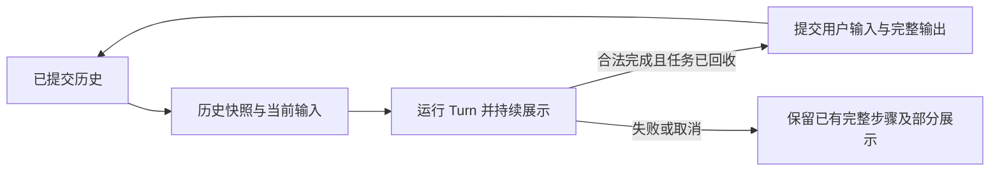

# 聊天会话与协议历史

`agentelier_conversation` 管理当前内存会话。内部 ChatSession 持有固定模型、推理设置与账号身份、展示快照，以及空闲时的 ProtocolHistory。运行时签出 ActiveTurn，Turn Runner 独占活动记录和协议历史，消费模型增量并处理受控取消。Runtime 保管业务对象和任务句柄，回收后归还记录，LLM Model 负责协议解析；UI 只持有可重建的展示投影与未发送草稿。

## 一轮记录怎样提交

新 Turn 只在上一轮终态与任务回收后接纳；生成期间可补充当前任务或显式排队后续输入，不并行执行。纯聊天的当前输入与完整输出在成功分支一起提交一次。工具调用在完整输出及全部结果封闭后提交；此后失败或取消仍保留已完成步骤。展示记录保留失败和部分回复，后续提问不隐式承接这些内容。

## 保存协议项而非气泡文本

ProtocolHistory 按原顺序保存类型化的用户输入、助手原始协议项和不透明 reasoning 项。助手输出保留 ID、角色、内容及 phase，不把公开 commentary 和 final_answer 合并成失去阶段信息的假消息。该历史不实现 Debug 或 Reflect，不作为业务日志内容。

请求以 store=false 重放客户端完整历史，客户端不裁剪输入；显式请求 reasoning.encrypted_content。完成响应缺少该字段时，只能从相同 ID 的 output_item.done 取完整不透明内容；没有可续接内容则明确失败。不会提取或伪造隐藏推理。协议依据：[无状态推理续接](https://developers.openai.com/api/docs/guides/reasoning#preserve-reasoning-without-stored-responses)、[流事件](https://developers.openai.com/api/reference/resources/responses/streaming-events)。

Bridge 与 UI 只取得消息正文和安全顺序摘要：User、Assistant 的公开 phase，以及 Reasoning 是否含加密内容。Turn 记录其请求项摘要，Session 记录已提交项摘要，以便观察上下文是否重复或串接；摘要不参与请求构造。

## 设置与生命周期

每轮请求从同一 Session 捕获设置及历史快照。准备区变化只影响下次创建，账号凭据正常续期保留当前会话；账号身份改变或退出后不复用旧上下文。上下文超限保留原记录并显示实际失败，不压缩、裁剪或自动重试。

SessionSettings 还持有已解析的完整 InstructionSnapshot，创建时核对版本内容哈希及基础槽位。每轮请求克隆该快照，TurnView 另保留其有序请求指令消息。指令不提交进 ProtocolHistory，LLM Model 在历史前单独注入；多轮不会累计重复指令。重置复制当前会话设置，重试也不重新解析准备区。类型及材料保存关系见[提示词管理](prompts.md)。

当前只有一个活动内存 Session，没有聊天持久化或分支回滚；工具任务最多 32 次请求及 64 次调用，同一响应可提出多项调用，按输出顺序串行执行。生成与展示的传递、关闭与回收关系见[总体架构](../architecture.md#内存聊天与流式投影)。

当前订阅接口拒绝显式 truncation 参数，因此不发送该字段。客户端始终提供完整的已提交历史；服务上下文超限路径尚未在真实运行中触发，不把未验证的服务端行为视为保证。

## 取消控制

Runtime 为每次生成保留独立取消令牌，并在接纳后绑定 Session、Turn 和 operation 身份。Connection 与共享 Host 直接提交控制，不等待普通命令或正文通道。UI 只记录停止中意图；执行所有者结束任务、收割 JoinHandle、排空最后增量后发布唯一终态。Runner 接收取消并结束网络、凭据等待和增量发送等待，工具执行返回实际取消结果后归还活动记录；Account 已开始的凭据旋转与持久化由其所有者独立完成。

## 输入与尝试身份

Turn 的 input_id 将同一输入的多次尝试归组，id 与 operation_id 每次独立分配。Retry 只接受当前最近 Failed/Cancelled 的身份；该时刻已提交历史仍等于原输入之前的历史，因此直接捕获它加一次原输入。旧尝试移入展示记录，历史只在新尝试成功后原子提交。Bridge 投影 is_retry，UI 据此保留草稿并按 input_id 去重用户行。

## 空白会话

Create 接受准备区快照；Reset 核对当前 Session 身份并从执行侧复制其设置。运行中的 Turn 拒绝替换；空闲时分配新 Session ID，展示与 ProtocolHistory 同时置空。UI 在提交替换前持有待确认设置，用户确认后才发请求；取消确认不改变原记录，输入草稿不随记录清空。

## 活动记录与异常回收

活动记录包含会话、轮次、操作和输入身份，以及固定设置、已有协议历史和展示内容。执行期间 Conversation 不持有可写历史副本；它只校验并接收安全累计快照。Runner 收到取消后结束模型等待，归还记录；Runtime 在 JoinHandle 真实回收后发布终态。异常退出或无法归还可信记录时，会话阻止发送和重试，重置或新建会话才恢复。

## 工具步骤的保留

会话固定工具目录；每个任务记录模型请求序号、工具输出项 ID、call_id、参数和结果，以及提交步数。完整响应先校验所有调用身份，再执行；工具成功、普通错误、超时、取消或未执行均通过匹配 call_id 的 function_call_output 封闭。原输入仅在首次提交点写入；未完成响应不进入协议历史。已有提交点的任务只能通过新消息继续，避免原样重试重复执行。具体协议遵循 [Responses function calling](https://developers.openai.com/api/docs/guides/function-calling)。

工具时间线由 chat_ui 内部 tool_timeline 模块构造，卡片持有展示数据及展开状态，详情通过 WidgetryReadOnlyTextField 的公开 API 更新。正文与工具按 Session/Turn/请求序号/输出项身份复用行实体，并按协议输出顺序排列；UI 不据此重建协议历史。卡片展开选择保存于持久 ChatState，切页回来恢复；创建新会话时清理旧选择。

## 活动输入的接纳与应用

Runner 在模型或工具等待期间消费有界 Steer 输入，并通过独立于累计快照的可靠回执确认接纳。活动记录分别保存 Accepted、Applied、NotApplied 及实际请求序号。每个步骤边界排空已到达的输入，有待应用补充时跳过旧批次余项并封闭其结果。下一次请求前将原始输入与补充用户消息保留到历史，输入身份与顺序不合并；没有完整响应但已经应用补充的任务也不能原样重试。

完成裁定由 Runner 关闭接纳通道，迟到但尚未接纳的消息可靠拒绝；已接纳而来不及应用的消息保留为未生效。Stop 不经过该通道。Runtime 在收尾等待任务时仍排空进度和可靠回执，避免取消回收被满通道阻塞。Connection 关联独立输入 ID，回执不释放活动任务占用。

## 会话待办与跨任务交接

Conversation 管理最多 8 条 FIFO 待办及暂停状态。排队时保存独立输入 ID、原始输入与 Connection 预留的未来操作 ID；开始时才签出新 ActiveTurn。Runner 只推进已开始任务，返回的旧展示快照不能覆盖会话所有者新接纳的队列。

Runtime 在旧 JoinHandle 回收和活动历史归还后，才申请下一条并启动。非正常终态暂停队列，普通对话不会清除既有暂停。自动启动的控制身份发布到共享活动槽，使 Stop 和 Steer 总能匹配实际任务；旧操作和迟到拒绝不会释放新占用。Connection 在 Started 回执后关联预留操作，每个终态前显式交付对应最终快照，较新任务进度保留到其开始回执之后再消费。

排队、移除和继续通过独立有界会话控制入口交给执行侧串行裁定；满队列拒绝，不替换旧输入。重置创建新会话并清空待办，关闭前停止接纳与自动出队，账号主体变化清除整个旧会话。

## 本地工作目录快照

SessionSettings 还保存 working_directory 的 PathBuf。Create 通过 Tools 的 WorkingDirectory 校验绝对路径、规范化并确认目录类型后保存；失败不替换旧会话。Reset 从旧会话复制目录再校验，Retry、Steer 与 Queue 使用活动会话设置。Bridge 显式传递候选与规范路径，UI 使用路径显示库展示，输入候选在独立 Resource 保留，切页不重新读取 cwd。路径解析值类型位于 agent/tools，解析以快照为基准，不修改全局进程目录。

本地命令的目录随会话固定工具描述发给模型。Runner 在完整响应后将 PathBuf 快照交给 Tools，串行调用不改变全局 cwd。工具若无法确认进程树收尾，剩余批次记录为未执行，已有结果仍封闭进历史；会话标记 execution_blocked，任务失败并暂停后续队列。用户停止、工具超时与命令的非零退出分别保留状态及真实输出。

## 任务级进程与收尾事实

Runner 创建独占 ExecutionContext 后推进任务；每次调用借用同一上下文，Steer 不重建它，Queue 的下一任务创建新的上下文。context.cleanup 覆盖正常完成、停止、模型失败、协议或交付错误及触限，先等待进程树与读取任务收敛，再关闭补充通道并发布终态。清理阶段投影为 ReapingProcesses；清理失败标记 execution_blocked 并暂停队列。

ProcessCleanup 保存 session_id、cleanup_confirmed 和独立有界结果（包含尾部输出及自动清理原因）。它位于 TurnView，与普通 ToolView 分开，不修改既有 running 结果，也不伪造 function_call。Bridge 显式转换为展示记录，UI 会话状态概括结果，请求核对页保留完整清理内容。工具描述声明 ID 在任务结束后失效；本增量不增加额外 Developer 行为提示词。全部结果依然由执行侧记录，不根据 UI 文本重建历史。

## 文件补丁与部分结果

`apply_patch` 的结果仍通过同一 call_id 封闭到历史，状态包括成功、失败、停止或截止；结果动作日志保存已完成、失败和未开始项，不把取消解释为撤销。Runner 等待 Tools 的阻塞工作句柄再收尾，临时文件清理失败阻止继续执行。UI 的工具卡片概括完成动作数和路径，展开详情保留源/目标及辅助变化。实现契约见[文件补丁](../local-development-tools/03-file-patches.md)。

## 图片载荷与展示分离

ActiveTurn.results 保存本批次的 ToolPayload，ToolView.output 只保存安全摘要。seal 按完成响应的调用顺序和 call_id 从真实结果表收集载荷，提交后清空本批表；协议历史共享不可变 ImagePayload，之后不再读取原始路径。普通文本仍使用字符串结果。加入图片前，已有历史、本批其他结果和候选结果按 Arc 身份去重，累计最多 16 MiB；超限保存带读取元数据的工具错误，不宣称图片从未读取，也不删除既有历史。

图片历史与同批文字结果共同封闭；下一次请求的网络、能力或 32 MiB 请求预算失败仍保留既有步骤。ToolPayload 不跨 Bridge，图片字节不进入 ECS 反射或日志。重置或释放 Session 释放历史图片，不增加磁盘持久化或全局附件存储。会话还固定来自模型目录的 image_input 三态，UI 准备区变化不追溯修改已有会话。

## 固定四工具目录

新会话的只读目录仅有 exec_command、write_stdin、apply_patch、view_image；旧计算/等待工具及专属 receipt 已退役，不提供别名。工具声明、执行查找和安全目录展示仍由同一 ToolCatalog 提供，不热替换已有会话。Steer 的 InputReceipt 是业务输入回执，与已移除的诊断 receipt 无关，继续保留。
