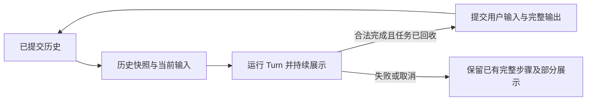

# 聊天会话与协议历史

`agentelier_conversation` 管理当前内存会话。内部 ChatSession 持有固定模型、推理设置与账号身份、展示快照，以及空闲时的 ProtocolHistory。运行时签出 ActiveTurn，Turn Runner 独占活动记录和协议历史，消费模型增量并处理受控取消。Runtime 保管业务对象和任务句柄，回收后归还记录，LLM Model 负责协议解析；UI 只持有可重建的展示投影与未发送草稿。

## 一轮记录怎样提交

新 Turn 只在上一轮终态与任务回收后接纳；生成期间不排队或并行发送。纯聊天的当前输入与完整输出在成功分支一起提交一次。工具调用在完整输出及全部结果封闭后提交；此后失败或取消仍保留已完成步骤。展示记录保留失败和部分回复，后续提问不隐式承接这些内容。

## 保存协议项而非气泡文本

ProtocolHistory 按原顺序保存类型化的用户输入、助手原始协议项和不透明 reasoning 项。助手输出保留 ID、角色、内容及 phase，不把公开 commentary 和 final_answer 合并成失去阶段信息的假消息。该历史不实现 Debug 或 Reflect，不作为业务日志内容。

请求以 store=false 重放客户端完整历史，客户端不裁剪输入；显式请求 reasoning.encrypted_content。完成响应缺少该字段时，只能从相同 ID 的 output_item.done 取完整不透明内容；没有可续接内容则明确失败。不会提取或伪造隐藏推理。协议依据：[无状态推理续接](https://developers.openai.com/api/docs/guides/reasoning#preserve-reasoning-without-stored-responses)、[流事件](https://developers.openai.com/api/reference/resources/responses/streaming-events)。

Bridge 与 UI 只取得消息正文和安全顺序摘要：User、Assistant 的公开 phase，以及 Reasoning 是否含加密内容。Turn 记录其请求项摘要，Session 记录已提交项摘要，以便观察上下文是否重复或串接；摘要不参与请求构造。

## 设置与生命周期

每轮请求从同一 Session 捕获设置及历史快照。准备区变化只影响下次创建，账号凭据正常续期保留当前会话；账号身份改变或退出后不复用旧上下文。上下文超限保留原记录并显示实际失败，不压缩、裁剪或自动重试。

SessionSettings 还持有已解析的完整 InstructionSnapshot，创建时核对版本内容哈希及基础槽位。每轮请求克隆该快照，TurnView 另保留其有序请求指令消息。指令不提交进 ProtocolHistory，LLM Model 在历史前单独注入；多轮不会累计重复指令。重置复制当前会话设置，重试也不重新解析准备区。类型及材料保存关系见[提示词管理](prompts.md)。

当前只有一个活动内存 Session，没有聊天持久化或分支回滚；工具往返暂限两次请求和一次工具。生成与展示的传递、关闭与回收关系见[总体架构](../architecture.md#内存聊天与流式投影)。

当前订阅接口拒绝显式 truncation 参数，因此不发送该字段。客户端始终提供完整的已提交历史；服务上下文超限路径尚未在真实运行中触发，不把未验证的服务端行为视为保证。

## 取消控制

Runtime 为每次生成保留独立取消令牌，并在接纳后绑定 Session、Turn 和 operation 身份。Connection 与共享 Host 直接提交控制，不等待普通命令或正文通道。UI 只记录停止中意图；执行所有者结束任务、收割 JoinHandle、排空最后增量后发布唯一终态。Runner 接收取消并结束网络、凭据等待和增量发送等待，工具执行返回实际取消结果后归还活动记录；Account 已开始的凭据旋转与持久化由其所有者独立完成。

## 输入与尝试身份

Turn 的 input_id 将同一输入的多次尝试归组，id 与 operation_id 每次独立分配。Retry 只接受当前最近 Failed/Cancelled 的身份；该时刻已提交历史仍等于原输入之前的历史，因此直接捕获它加一次原输入。旧尝试移入展示记录，历史只在新尝试成功后原子提交。Bridge 投影 is_retry，UI 据此保留草稿并按 input_id 去重用户行。

## 空白会话

Create 接受准备区快照；Reset 核对当前 Session 身份并从执行侧复制其设置。运行中的 Turn 拒绝替换；空闲时分配新 Session ID，展示与 ProtocolHistory 同时置空。UI 在提交替换前持有待确认设置，用户确认后才发请求；取消确认不改变原记录，输入草稿不随记录清空。

## 活动记录与异常回收

活动记录包含会话、轮次、操作和输入身份，以及固定设置、已有协议历史和展示内容。执行期间 Conversation 不持有可写历史副本；它只校验并接收安全累计快照。Runner 收到取消后结束模型等待，归还记录；Runtime 在 JoinHandle 真实回收后发布终态。异常退出或无法归还可信记录时，会话阻止发送和重试，重置或新建会话才恢复。

## 工具步骤的保留

会话固定工具目录；每个任务记录模型请求序号、工具输出项 ID、call_id、参数和结果，以及提交步数。完整响应先校验所有调用身份，再执行；工具成功、普通错误、超时、取消或未执行均通过匹配 call_id 的 function_call_output 封闭。原输入仅在首次提交点写入；未完成响应不进入协议历史。已有提交点的任务只能通过新消息继续，避免原样重试重复执行。具体协议遵循 [Responses function calling](https://developers.openai.com/api/docs/guides/function-calling)。
