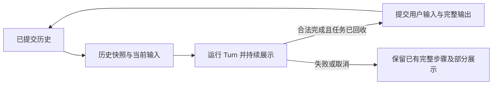

# 聊天会话与协议历史

`agentelier_conversation` 管理当前内存会话。ChatSession 始终持有固定设置、会话历史、活动状态、队列和工具任务登记。Runtime 在同一个会话所有者上串行应用 Runner 请求。ActiveTurn 是一次同步操作期间对状态的借用。Runner 驱动当前任务并持有冻结材料，UI 消费可重建的展示投影。

## 一轮记录怎样提交

新 Turn 只在上一轮终态与任务回收后接纳；生成期间可补充当前任务或显式排队后续输入，不并行执行。纯聊天的当前输入与完整输出在成功分支一起提交一次。工具调用在完整输出及全部结果封闭后提交；此后失败或取消仍保留已完成步骤。展示记录保留失败和部分回复，后续提问不隐式承接这些内容。

## 保存协议项而非气泡文本

ProtocolHistory 按原顺序保存类型化的用户输入、助手原始协议项和不透明 reasoning 项。助手输出保留 ID、角色、内容及 phase，不把公开 commentary 和 final_answer 合并成失去阶段信息的假消息。该历史不实现 Debug 或 Reflect，不作为业务日志内容。

请求以 store=false 重放当前工作窗口的完整 typed 历史；显式请求 reasoning.encrypted_content。完成响应缺少该字段时，只能从相同 ID 的 output_item.done 取完整不透明内容；没有可续接内容则明确失败。不会提取或伪造隐藏推理。协议依据：[无状态推理续接](https://developers.openai.com/api/docs/guides/reasoning#preserve-reasoning-without-stored-responses)、[流事件](https://developers.openai.com/api/reference/resources/responses/streaming-events)。

Bridge 与 UI 只取得消息正文和安全顺序摘要：User、Assistant 的公开 phase，以及 Reasoning 是否含加密内容。Turn 记录其请求项摘要，Session 记录已提交项摘要，以便观察上下文是否重复或串接；摘要不参与请求构造。

生成图片的工具行在 `ToolReturned` 提交后取得安全的原图描述符。恢复同样从该工具记录重建展示投影，不从摘要或用户导出路径解析附件。预览和另存为按当前会话与原调用身份查询，不提交新的对话步骤。

文稿问答将已完成的文稿版本和音频来源绑定到输入。用户问题进入普通协议历史，文稿通过冻结请求的独立 developer 材料提供。恢复以同会话音频和转写记录核对版本与摘要，重试和压缩继续保留原绑定。文稿材料占用现有固定材料预算，全文由权威转写记录保管。

## 设置与生命周期

Conversation 持有按 Session 隔离的内存 Agent Registry。新建与重置在初始存档获得确认后登记 Root，打开时由已有 Session UUID 重建同一个 Root Agent ID 和 Thread ID。重复登记同一 Root 幂等，其他身份冲突会拒绝打开。每次打开分配新的 Runtime Instance ID，Runner 的前台进度和终态必须匹配当前实例。

Registry 预留子 Agent 标识、相对路径与显示昵称。只有提交后的身份可查询，失败的准备可以释放预留。删除会话释放预留并保留本次进程内已提交 ID 的占用记录。子 Agent 身份的存档和恢复使用现有 Session Store，当前增量仅支持内存登记。

Agent Tree 使用所属 Session、不可变父级关系、规范路径和深度标识节点。目标解析先核对调用者，再按完整 Agent ID 或路径查找可操作目标。一个节点的业务状态与 Runtime 驻留独立更新，切换会话只卸载原实例，原业务状态仍保留在 Registry。

Conversation 可为已确认的调用步骤准备子 Agent 配置和独立历史。配置记录来源、项目发布、Skills 与权限边界。完整历史 Fork 使用冻结请求的闭合前缀，Fresh Context 从当前项目材料重新开始。运行时在创建子 Agent 时使用该准备结果。详见 [创建子 Agent 时如何形成独立上下文](../multi-agent-v2/02-spawn-context-and-config.md)。

每轮请求从同一 Session 捕获设置及历史快照。准备区变化只影响下次创建。新会话的 SessionSettings 固定 Codex 主体与工作区。任务在首次请求前取得匹配的 ExecutionIdentity，普通请求、自动压缩和工具反馈共用该身份。账号变化保留历史。缺少可核对绑定的旧会话以只读方式恢复，原始工具结果继续归属原调用。普通请求携带服务端 Inline 压缩阈值，完整响应与工具结果封闭后持久保存检查点；失败保留已提交记录，不使用文本摘要重试。

SessionSettings 还持有已解析的完整 InstructionSnapshot，创建时核对版本内容哈希及基础槽位。每轮请求克隆该快照，TurnView 另保留其有序请求指令消息。指令不提交进 ProtocolHistory，LLM Model 在历史前单独注入；多轮不会累计重复指令。重置复制当前会话设置，重试也不重新解析准备区。类型及材料保存关系见[提示词管理](prompts.md)。

当前只有一个活动内存 Session；初始设置、执行过程和图片附件可以从本地存档恢复，不提供分支回滚。工具任务最多 32 次请求及 64 次调用，同一响应可提出多项调用，经会话许可独立执行并保存实际终态。同一 Turn 的下一请求等待同步调用的结果确认入史；开放的异步调用可以继续执行。生成与展示的传递、关闭与回收关系见[总体架构](../architecture.md#内存聊天与流式投影)。

当前订阅接口拒绝显式 truncation 参数，因此不发送该字段。客户端提供当前窗口的完整已提交历史；服务上下文超限路径尚未在真实运行中触发，不把未验证的服务端行为视为保证。

## 取消控制

Runtime 为每次生成保留独立取消令牌，并在接纳后绑定 Session、Turn 和 operation 身份。Connection 与共享 Host 直接提交控制。Runner 接收取消并结束网络与凭据等待，按创建 Turn 停止对应工具和进程。Runtime 等待前台 JoinHandle、排空增量并确认 Finished 提交后发布前台终态。会话的后台资源所有者继续推进较早来源。Account 已开始的凭据旋转与持久化由其所有者独立完成。

## 输入与尝试身份

Turn 的 input_id 将同一输入的多次尝试归组，id 与 operation_id 每次独立分配。Retry 只接受当前最近 Failed/Cancelled 的身份；该时刻已提交历史仍等于原输入之前的历史，因此直接捕获它加一次原输入。旧尝试移入展示记录，历史只在新尝试成功后原子提交。Bridge 投影 is_retry，UI 据此保留草稿并按 input_id 去重用户行。

## 空白会话

Create 接受准备区快照；Reset 核对当前 Session 身份并从执行侧复制其设置。运行中的 Turn 拒绝替换；空闲时准备新的 UUID 身份与初始快照，Session Store 确认权威初始记录落盘后才替换当前 Session，并将展示与 ProtocolHistory 置空。写入失败保留原会话和草稿，Reset 不删除旧存档。UI 在提交替换前持有待确认设置，用户确认后才发请求；取消确认不改变原记录，原会话草稿随 Session ID 暂存在本次运行中，新会话使用独立空草稿。

持久初始设置包含模型 slug、显示名称、推理设置、图片能力、完整指令版本与内容哈希、固定工作目录及工具名称、描述、参数契约，不记录账号主体或凭据。账号一致性只在任务内核对，不作为会话所有权。存储的序号、提交与收尾见[会话存储](session-store.md)。

## 活动记录与异常回收

活动状态记录会话、轮次、操作和输入身份。Conversation 持有唯一可写历史，Runtime 从当前状态生成展示快照。Runner 仅提交本轮操作并返回执行结果。异常退出或历史提交未确认时，会话阻止发送与重试，可重新加载存档恢复已确认事实。

## 工具步骤的保留

会话固定工具目录。完整响应校验调用身份和冻结声明后，把额度内的异步调用和应用分配的任务 ID 一并持久保存。任务原始关联包括 Session、Turn、请求序号、输出项 ID 和 `call_id`。开始与结果还校验执行实例，调度与投影均在回执后推进。会话任务投影按 Session 和提交修订接纳，前台文本继续按 operation 关联。每个调用结果都使用原 `call_id`。在途请求冻结其历史，晚到结果先保存，完整响应确认后才追加。失败或停止时从最后一个合法边界追加。相同会话的后续响应不得重用已提交的 `call_id`。协议见 [Responses function calling](https://developers.openai.com/api/docs/guides/function-calling)。

工具时间线由 chat_ui 内部 tool_timeline 模块构造，卡片持有展示数据及展开状态，详情通过 WidgetryReadOnlyTextField 的公开 API 更新。正文与工具按 Session/Turn/请求序号/输出项身份复用行实体，并按协议输出顺序排列；UI 不据此重建协议历史。卡片展开选择保存于持久 ChatState，切页回来恢复；切换或新建时保存原 Session 的选择，回到原会话后恢复。

会话任务区消费独立于前台 operation 的任务和进程投影。任务分别展示执行、保存和交付，进程使用创建来源、退出和尾部可读状态。界面按会话及稳定身份复用行，独立折叠历史。取消、停止全部、后台恢复、进程终止及退出结果消费由 Runtime 核对会话与执行实例，经可靠回执返回。远端效果确认使用待确认调用集合。结果处理入口发送独立请求身份。

## 活动输入的接纳与应用

Runner 在模型或工具等待期间消费有界 Steer 输入，并通过独立于累计快照的可靠回执确认接纳。活动记录分别保存 Accepted、Applied、NotApplied 及实际请求序号。每个步骤边界排空已到达的输入，有待应用补充时跳过旧批次余项并封闭其结果。下一次请求前将原始输入与补充用户消息保留到历史，输入身份与顺序不合并；没有完整响应但已经应用补充的任务也不能原样重试。

Conversation 在同一个操作中检查待应用补充并关闭输入接纳。已接纳的输入继续应用或留下未生效记录，迟到输入收到明确拒绝。Stop 走独立取消令牌。Runtime 收尾期间仍消费进度和回执，Connection 按输入 ID 关联回执。

## 会话待办与跨任务交接

Conversation 管理最多 8 条 FIFO 待办及暂停状态。排队时保存独立输入 ID、原始输入与 Connection 预留的未来操作 ID。正式开始时才建立活动状态。队列与前台推进分别更新自身的字段并持久提交。

Runtime 在旧 JoinHandle 回收和终态确认后才启动下一条。非正常终态暂停队列。自动启动的控制身份发布到共享活动槽。Connection 在 Started 回执后关联预留操作，每个终态前交付对应最终快照。

排队、移除和继续通过独立有界会话控制入口交给执行侧串行裁定；满队列拒绝，不替换旧输入。重置创建新会话并清空待办，关闭前停止接纳与自动出队，账号主体变化保留会话与待办，并持久记录 QueueSuspended。准备中的 Resume 保存暂停修订，迟到回执不能解除账号变化后的较新暂停。没有当前账号时执行侧拒绝开始任务或继续队列，不消费待办。

## 本地工作目录快照

SessionView 还持有独立的项目采集状态。每个逻辑请求前由 Runner 重新发现采集并交给 ActiveTurn，读取失败作为可修复任务失败返回，不增加本次模型请求序号，原本尚未保留的输入不进入成功历史，也不永久阻断后续重试。首次来源快照通过项目发布事件保存，项目协议项独立于普通用户输入；重开会话恢复保存的材料，不读取当前规则文件。来源、取消和只读展示契约见[项目上下文](project-context.md)。

SessionSettings 还保存 working_directory 的 PathBuf。Create 通过 Tools 的 WorkingDirectory 校验绝对路径、规范化并确认目录类型后保存；失败不替换旧会话。Reset 从旧会话复制目录再校验，Retry、Steer 与 Queue 使用活动会话设置。Bridge 显式传递候选与规范路径，UI 使用路径显示库展示，输入候选在独立 Resource 保留，切页不重新读取 cwd。路径解析值类型位于 agent/tools，解析以快照为基准，不修改全局进程目录。

本地命令的目录随会话固定工具描述发给模型。Runner 将会话目录、图片能力、用户陈述、已应用补充输入、选中技能路径和摘要、记忆纪元固定在本次请求的调用材料中，Runtime 依冻结目录绑定工具和参数。等待许可可以取消，后来的输入只影响之后的请求。工具若无法确认进程树收尾，剩余批次记录为未执行，已有结果仍封闭进历史；会话标记 execution_blocked，任务失败并暂停后续队列。用户停止、工具超时与命令的非零退出分别保留状态及真实输出。

## 任务级进程与收尾事实

Runner 创建独占 ExecutionContext 后推进任务；每次调用借用同一上下文，Steer 不重建它，Queue 的下一任务创建新的上下文。context.cleanup 覆盖正常完成、停止、模型失败、协议或交付错误及触限，先等待进程树与读取任务收敛，再关闭补充通道并发布终态。清理阶段投影为 ReapingProcesses；清理失败标记 execution_blocked 并暂停队列。

ProcessCleanup 保存 session_id、cleanup_confirmed 和独立有界结果（包含尾部输出及自动清理原因）。它位于 TurnView，与普通 ToolView 分开，不修改既有 running 结果，也不伪造 function_call。Bridge 显式转换为展示记录，UI 会话状态概括结果，请求核对页保留完整清理内容。工具描述声明 ID 在任务结束后失效；本增量不增加额外 Developer 行为提示词。全部结果依然由执行侧记录，不根据 UI 文本重建历史。

## 文件补丁与部分结果

`apply_patch` 的结果仍通过同一 call_id 封闭到历史，状态包括成功、失败、停止或截止；结果动作日志保存已完成、失败和未开始项，不把取消解释为撤销。Runner 等待 Tools 的阻塞工作句柄再收尾，临时文件清理失败阻止继续执行。UI 的工具卡片概括完成动作数和路径，展开详情保留源/目标及辅助变化。实现契约见[文件补丁](../local-development-tools/03-file-patches.md)。

## 图片载荷与展示分离

Conversation 保存已形成的实际载荷及其保存序号。ToolView.output 仅保留展示摘要。历史按已确认的保存序号追加唯一结果，之后使用内存中的不可变 ImagePayload 或该会话的附件载荷。普通文本继续使用字符串结果。加入图片前，已有历史、待追加载荷和候选图片按 Arc 身份去重，累计最多 16 MiB。超限保存带读取元数据的工具错误。

图片历史与同批文字结果共同封闭；下一次请求的网络、能力或 32 MiB 请求预算失败仍保留既有步骤。ToolPayload 不跨 Bridge，图片字节不进入 ECS 反射或日志。Runner 在接纳图片结果前通过 Session Store 保存会话附件并受控读回；重置或释放 Session 只释放内存图片，不删除旧存档附件，也不建立全局附件存储。会话还固定来自模型目录的 image_input 三态，UI 准备区变化不追溯修改已有会话。

StoredImage 以会话 UUID、发送内容 ImageDescriptor 和原安全说明构成持久引用；描述符只有 MIME、摘要、尺寸和编码字节数，不接受任意路径。附件保存或读回失败时，保留内存中的实际读图结果，任务以保存失败结束并阻止继续执行，不将其伪装为成功保存的文字图片结果。类型化任务记录使用已提交附件的描述符，不把编码字节嵌入 JSONL。

## 持久边界与失败保留

RecordEvent 保存接纳、完整响应、工具开始/实际返回、封闭步骤、Steer 接纳/应用、Queue 变更、执行收尾与真实回收后的终态。StoredState 不包含账号设置；原始协议由 ProtocolArchive 封装。会话仍由 Conversation 掌握业务语义，Store 统一分配磁盘序号。

Runner 在调用批次和工具开始记录确认之后才允许副作用；实际结果立即记录，不等整批结束。记录失败时，已有协议历史与尚未封闭的实际工具载荷留在会话内存，执行阻断并暂停队列。UI 继续显示实际工具结果和保存失败原因，不能声称文件操作没有发生或已回滚。原生会话 final 经持久确认并回收前台句柄后即可释放前台。后台仍使用原 Turn 的真实身份和同一结果出口，空闲完成只保存并更新原卡和任务区。显式处理结果可在存在就绪结果时发起续接，不提交用户消息。记录格式与关闭顺序见[会话存储](session-store.md)。

完整响应持久确认后安装原始输出，首次接纳同时保留用户输入。工具结果先保存实际载荷，再按原 `call_id` 以独立记录确认进入历史。结果状态分别记录保存、追加、纳入冻结请求和请求完整成功。开放调用以注册执行器的有界结果为预留，取得载荷后在历史追加前按同一调用的实际值结算。图片占用按不可变摘要去重。候选响应和用户材料通过窗口、图片及完整请求大小预检后才能占用结果空间。恢复时据已确认的响应和结果重建历史。批次执行期间请求入口仍等待全部结果。

每会话最多保留 64 个尚未确认交付的异步任务登记。完整响应先结算冻结请求实际包含的已追加结果，再按调用顺序分配空余名额。响应、结算与登记共用一次确认。超过会话额度的调用保留原始调用和未执行 output。占用只在含该结果的请求获得完整成功响应后释放。

新原生会话的任务查询按未完成交付优先返回状态，并支持稳定的历史分页。列表可观察本批已经持久登记的任务。等待只接受生成该调用的请求冻结时已登记的本会话任务。Runner 重查已保存终态，在确认目标原始结果入史后保存等待状态。Stop 或 Steer 可以打断等待，Steer 保留已经接纳的异步任务。

取消请求独立保存，绑定任务、原调用和执行实例。运行时在确认回执后取消实际句柄，真实工具结果推进终态。停止当前 Turn 会中断其等待、工作准入和已启动的执行。停止全部后台工作另行暂停新工具派发与自动待办，正在返回的模型响应仍可提交，其中的新工作记录为未执行。MCP 的远端效果未确认会暂停冲突派发及自动待办。用户显式确认对应调用后，原始未知结果继续保留，只有对应的派发门槛解除。

记忆来源按原始 Turn 从持久前台终态、工具结果和进程终止事实组装。仅提取从最早输入开始的完整前缀，恢复后已无本次句柄的历史未知也能闭合。原输入身份和接纳序号用于截止判定。

切换、重置或删除当前会话前，Runtime 检查活动任务、未确认的进程回收、工具结果和存储提交。已保存结果和重启后无本地执行句柄的历史记录可随存档重新打开。

## 恢复只还原数据

恢复依据业务记录重新建立完整公开时间线和模型工作历史。模型、推理设置、指令快照与工具声明从原存档读取。Codex 会话还保留创建时的主体、工作区与服务来源。旧 SIWC 会话以原设置恢复为只读历史。打开本地存档与访问模型服务各自独立，开始或重试任务前核对会话绑定的 Codex 主体与工作区。后续 Turn/Input 标识从所有记录中出现过的最大值继续分配。历史 operation ID 不注册为控制句柄，恢复投影将其清零；待办保留稳定输入身份并由本次共享操作序列重新分配执行身份。

QueueChanged 独立重建队列；滞后的 Runner 或收尾快照不能覆盖已经提交的入队。恢复后的待办总是暂停，未应用 Steer 变为未生效；打开、读取和认证恢复均不发模型请求或运行旧工具。

完整响应中尚未封闭的函数调用按 call_id 配对。已有 ToolReturned 使用实际类型化结果；只有开始而没有结果的调用显示“结果未确认”，尚未开始的调用显示“未执行”。恢复按原响应和调用身份记录缺失结果的依据，已保存载荷引用原 ToolReturned 序号，再将唯一 output 补入原历史。仅有登记或开始事实时，分别以未执行或未确认的中断说明补入。Recovered 原子记录这些依据和恢复投影，重开时从原记录核对并重放，已有占位只还原一次。有工具提交或应用过 Steer 的输入不能原样重试。

未完成普通模型输出保留可用展示。已接纳完整响应且工具结果均已保存时，恢复提示结果已保存，并在允许发送时提示等待用户继续。已记录发送但未接纳完整响应的请求保留服务结果未知的说明，已追加的工具结果仍可随用户主动发送重放。曾返回活进程但缺少回收证据的登记保留历史清理未确认说明。恢复时发现未知外部效果或历史清理未确认，会暂停该会话的执行和自动待办，仍可读、切换和关闭。恢复后的协议须通过函数配对、原始角色/阶段和不透明 reasoning 校验，附件按受控引用重新验证；任一失败都不替换当前会话。工作目录缺失仍可阅读，工具沿原固定路径拒绝启动；工具契约不匹配时只读历史并阻止执行，不加载旧代码或改用当前工作目录。

## 固定工具目录

新会话用同一 ToolCatalog 登记内置工具与各提供者提交的工具。目录冻结声明的来源、参数 schema、严格模式、异步模式和传输格式。打开历史时，Store 还原保存的契约，Conversation 按原目录顺序重新绑定能执行该契约的工具。新增提供者和服务清单变化只进入新会话，来源或声明不匹配会阻止继续执行并保留历史。恢复 MCP 工具时先核对服务器 UUID 和传输配置摘要，清单可用时再核对实际声明。同一配置暂时离线可保留原声明。旧存档缺少异步字段和传输格式时按平铺同步读取。早期 namespace 实验会话保留原始调用供查阅，继续发送需新建会话。历史内置进程声明保持原来的文本快照，同时允许绑定参数契约相同的会话进程执行器。

## 侧栏选择与会话内阅读状态

Chat UI 左侧固定显示有限高度的单选 ListView，后端摘要决定活动排序，UUID 对应稳定模型项；刷新只增删、更新和移动相应项，不因重排重新分配身份。标题显示省略文本，悬停显示完整名称及条目读取错误。打开、阅读和刷新不会更新活动时间。

打开请求保存 operation 与目标 UUID，回执匹配后才一起安装正文、设置、选中项和标题；失败保留当前聊天及输入框。加载期间不清空旧投影，任务执行和回收期间禁止替换，当前聊天 Stop、Steer 与阅读仍可用。串行执行侧在启动队列后拒绝切换；恢复后的待办保持暂停，切换不启动旧队列。

草稿文字、修订、工具展开选择以及阅读位置和跟随底部状态按 Session ID 保存在本次运行中。切换成功通过 TextField 公开接口恢复目标草稿，不重建输入框；新会话使用空草稿。草稿不跨重启保存。列表不持有协议历史或附件载荷。

侧栏条目的更多按钮打开独立名称编辑区，目标 UUID 在打开时固定。保存与取消使用 TextField 公开接口，名称草稿和聊天草稿分离；打开其他会话不会改写名称目标。当前任务期间仍可编辑名称，列表点击的切换请求继续由执行侧拒绝。输入空白或保存失败保留编辑文字与旧名，成功后更新原目标。物理行复用不改变已经捕获的名称目标。

删除确认固定目标 UUID 和名称快照，并说明只删除本地记录与附件、不撤销项目文件。取消不发送删除命令；失败保持当前内容。删除当前会话成功后清理该 UUID 的内存草稿、阅读和工具展开状态，并显示准备区，不自动选择或发送另一份历史；删除其他条目保留当前聊天。界面保存本次已删除 UUID，阻止较早的目录回执重新添加条目，清理残留作为独立状态保留到后续扫描收敛。

## 当前工作窗口的计量

ContextState 保存工作窗口号、最近目录能力、最近响应用量及覆盖该窗口前缀的锚点。每个用量事实关联 Turn、请求序号和实际响应身份；成功封闭后，锚点使用该次服务端 total_tokens，之后只估算尚未覆盖的用户输入、Steer 或工具结果，不把历次完整输入相加。固定指令与工具声明没有锚点时计入一次，已有同配置锚点时不重复累加。失败请求的真实用量作为最近事实保留，不用于冒充已经安装的输出前缀。

请求前包含新输入的完整工作上下文用于判断阈值，Queue 尚未启动的文字不进入计量。存档保存可解释的窗口与覆盖项数；恢复完成 typed 历史后重新计算新增范围，拒绝不属于当前窗口或超出有效前缀的锚点。模型兼容标识变化时重新估算，不沿用不匹配的旧锚点。

Bridge 仅投影容量、有效窗口、自动阈值、占用、来源和数字用量，不发布原始协议或 usage JSON。现有状态区显示服务端依据与估算，未知容量保持未知；请求核对区保存窗口与覆盖边界。

## 自动压缩与持久检查点

每次普通聊天请求按当前模型能力启用服务端 Inline 压缩。服务在同一次生成中决定是否压缩，Runner 不额外占用模型请求或新建任务；原 32 次模型请求与 64 次工具额度不变。接收压缩项时进入 CompactingContext，正常正文到达后继续生成，沿用原 Stop、Steer、Queue 和会话替换限制。

完整成功响应按服务返回顺序存档。每个压缩项必须出现在无开放调用的位置，且冻结的请求允许压缩。合法响应和检查点各自持久确认后，才执行该响应的工具。切口保留原调用及冻结后追加的尾部，工具结果依原身份逐个保存和进入历史。收齐结果后写入 ResponseClosed。已经覆盖的输入与 Steer 保持原位置，待应用的 Steer 在下一请求边界进入。Queue 有独立恢复路径。

Compacted 保存 replacement history、Session/Turn/请求身份、原窗口与新窗口、批次关闭序号和项数、原输入覆盖标记、模型、实际 comp_hash、响应身份与兼容字段。单写入者确认后，核对覆盖边界与身份再同时安装历史和新窗口。完整用量仍关联源窗口。安装后清除旧锚点并重新估算活跃材料。

非法压缩失败时，会话可以按失败请求标识和原输入身份接纳一次继续，保持同一 Turn 并分配新的请求序号。已有工具结果和已确认输入留在原历史，首次继续请求省略压缩，计入本轮请求预算。动作已使用、请求已被取代或容量不足时拒绝继续。

检查点提交前取消时，已追加的完整响应和工具结果可继续重放。提交开始后等待落盘，成功安装后再处理 Stop。提交结果不确定或安装不一致时，重新加载存档后才能继续。恢复采用最近确认的替换历史及其后记录，按开始和返回事实为缺失结果补充中断占位。含压缩项的工具响应恢复时清除旧用量锚点。旧存档的 Sealed 仍可恢复。

公开时间线不因裁剪工作窗口而删除消息或工具记录，磁盘附件保持不变；只加载活跃窗口引用的附件。失败、停止及触限继续暂停 Queue。没有独立的压缩重试循环，下一请求仍由服务根据实际阈值决定是否需要再次压缩。

## 项目指令请求记录

Conversation 持有项目发布与原始历史。ProjectPublished 确认后才安装候选，项目项不算封闭步骤、不保留待发送用户输入。Turn 保存每次请求的窗口、项目引用及模型 prepare 的安全投影。自动项目类型与普通 User 区分，Retry 继续依据 committed_steps 与 Steer 判断。

项目变更依据最后确认发布的确定性正文比较。完整替换与清除只撤销自动项目来源，旧项留在原位置；A→B→A 每次改变均追加。文件读取失败以普通可修复终态收束，保留已有历史，旧材料保留核对，失败文本保存但不把旧材料当作当前磁盘规则。Queue 在执行时采集，Stop 等待阻塞工作真实结束。

成功压缩检查点保存覆盖的项目发布身份，确认安装后 ContextState.window 与最后发布的 window 不同，表示新窗口尚待明确发布。下一请求采集并只追加一份当前规则或清除通知；来源材料在工作历史之外保存，裁剪不删除旧请求材料。

每次 PreparedRequestFact 另外保存明确的开始发送与传输回执。HTTP 保存响应状态，Codex WebSocket 成功发送后保存所用的升级状态。进度及排空事件走同一保存路径。Bridge 显式投影发布身份、窗口、类型、来源和最终包装文字，并将最近采集状态独立传递。原始协议载荷、认证头及推理或压缩密文留在业务层。

## 每任务 Skills 目录

TurnView 保存任务开始时发现的 Skills 目录，Queue 实际启动与 Retry 各自重新发现，工具临时 workdir 不改变作用域。每次请求使用同一目录的允许隐式条目，Skill 本文与资源通过原工具访问，其结果进入正常封闭历史。目录仅作为请求调度材料保存，未追加到 ProtocolHistory，不改变固定 InstructionSnapshot。ContextState 及 UsageAnchor 记录任务材料估算，跨任务更新时在服务端锚点上调整差值，不重复计入已锚定目录。

显式选择正文保存在 TurnView.selected_skills，含发现与规范路径、元数据、完整入口文本及 SHA-256。请求准备事实对该快照保留路径和包装正文引用，恢复时独立校验两者一致，不读取已经变化的源文件。选择失败仍按普通 Failed 终态保留输入与重试资格；运行中的 Steer 不能提交新的 `$name` 选择。Queue 实际启动时解析该输入，不继承前一任务的选择；主动 Retry 重新采集，HTTP 认证重发不重新采集。

新会话创建时将有界的已发布记忆快照写入初始存档。同一记忆纪元的各轮及 Retry 沿用该快照，记忆预算计入任务材料，压缩切窗后仍由请求准备提供。旧存档保留创建时的材料边界，请求核对使用存档保存的发送材料。重置后的新请求跳过旧纪元的摘要，继续使用会话协议历史。
