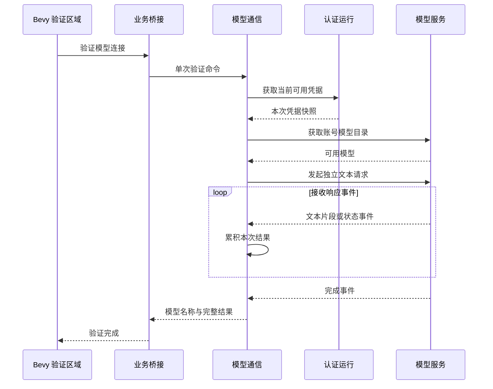

# 首次模型请求

账号授权完成后，应用需要把“已经登录”推进到“能够取得模型回复”。这里保留一个单次连接验证入口，覆盖账号凭据、模型访问和结果接收，不建立完整对话系统。

## 用户看到一个明确的验证动作

账号拥有订阅使用权限时，主内容区显示“验证模型连接”。点击后，应用取得当前账号可用的模型，发送一条简短的连接验证输入，并在完成后显示模型名称和回复正文。

验证输入由应用固定提供，例如“请简短回复，确认连接正常”。每次点击都是独立请求，前一次的输入和结果不作为下一次的上下文。界面只保留本次结果，不在数据目录中建立会话历史。

## 模型来自当前账号

验证操作先使用当前账号的访问凭据取得模型目录，保留服务端公开展示的模型项和原有顺序，取其中第一项进行这次验证。界面显示它的展示名称，实际请求使用该项的模型标识。

这样不需要预置一个可能不属于当前账号的模型名称，也不为连接验证增加模型管理界面。目录为空或读取失败时，验证区域显示原因，并保留当前账号状态。

## 请求在后台完成

模型通信属于 Agent 运行层。应用不读取 Token，也不直接构造带认证信息的 HTTP 请求。桥接只传递本次操作及其结果。

请求采用 ChatGPT 订阅授权对应的公开 Responses 路径，使用 OAuth Access Token 认证。传输层以事件流接收内容，界面在结束后一次性显示完整结果。

## 什么结果算完成

请求中的存储选项为关闭，响应采用流式传输。模型通信累积文本，并持续读取到服务端的明确终态。

| 接收结果               | 验证区域的状态               |
| ---------------------- | ---------------------------- |
| 收到完整完成事件       | 显示验证完成、模型名称和回复 |
| 服务端返回失败事件     | 显示实际失败原因             |
| 服务端返回未完成事件   | 显示请求未完成及其原因       |
| 流中断，未收到完成事件 | 显示连接中断，不发布成功结果 |

验证成功由协议终态决定，不要求模型逐字回复某个固定字符串。已经收到的部分文本不作为成功结果发布。

操作进行期间，“验证模型连接”按钮禁用，避免重复发送。授权来源失效或关闭应用可以结束本次操作；后台确认结束后才释放相关资源。

## 失败后保留能够继续使用的状态

认证相关失败交给认证运行执行有界恢复。只有在当前账号身份没有变化、请求还未进入响应输出阶段时，才使用恢复后的凭据重新发起请求。

网络中断、额度限制、模型不支持或服务暂时不可用，显示在验证区域。文件缺失、格式无效或已过期时，账号区显示对应状态。相同文件未提供可恢复的新 Token 时，请求保留实际的认证失败。
