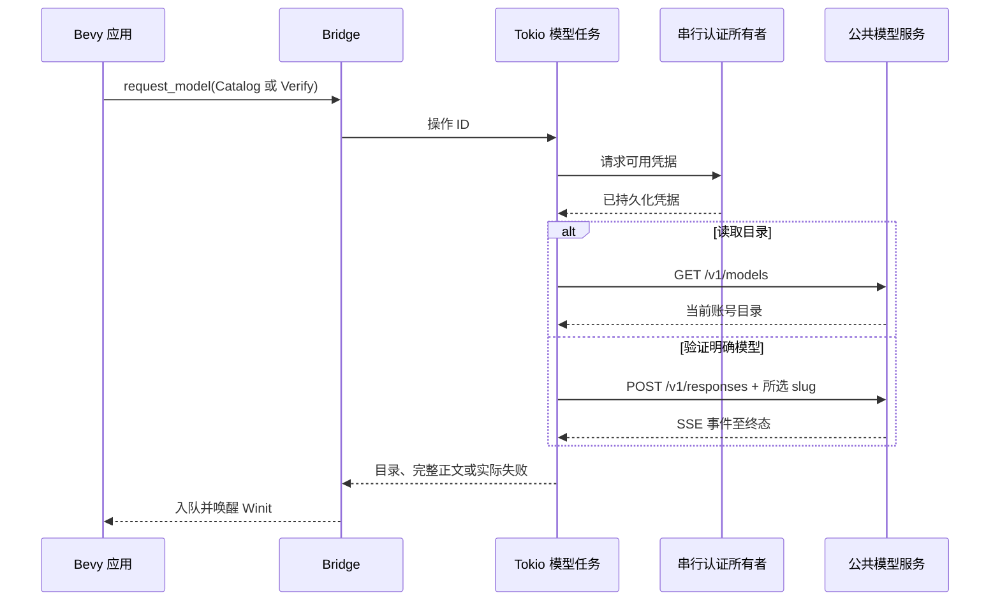

# 单次模型请求

模型通信位于 `agentelier_llm_model`，与串行认证所有者共用同一线程的 Tokio。网络任务通过 `agentelier_account::CredentialClient` 取得凭据，Account 在 Runtime 调度下串行处理请求并协调旋转和提交；模型任务不读取文件或维护第二套会话缓存。

运行侧 ModelControl 分开持有取消信号和实际回收信号；接纳操作后禁止新的恢复或浏览器登录，避免目录与推理跨账号混用。Bridge 独立记录模型操作 ID，与浏览器和退出操作区分。退出可越过互斥门控，先停止凭据接纳并取消模型任务，再等待 JoinHandle 回收，最后处理撤销和本地清理。普通关闭同样取消并回收模型任务，然后等待凭据所有者完成必要提交及 Tokio 结束。

模型任务取消只丢弃自己的网络/凭据等待 Future。已提交给认证所有者的刷新独立继续，不因等待者取消而丢失旋转结果。主窗口以真实终态结束等待；退出期间 Bridge 消费并隔离旧模型及认证结果。

模型目录保留全部可显示项目及服务顺序，用户显式选择 slug 后独立验证。每次操作取得当前可用凭据；认证恢复沿 AuthenticatedRequest 的一次恢复预算执行，通过 CredentialVersion 比较 client_id 和 subject，避免恢复到另一账号。HTTP 401 可在输出前触发恢复；输出项或文本开始后标记禁止重放。

SSE 解析器跨 HTTP 块保留当前行和事件数据，支持 LF、CRLF、CR、多行 data 及开头 BOM，空行才派发事件。只以完成对象的 output 数组为正文权威来源，按 message/content 顺序提取 output_text；增量仅用于标记输出已经开始。未完成、失败和显式错误独立传播，EOF 没有完成事件不成功。大小和时间限制见[请求边界](#请求边界)。

ModelFailure 保留分类、可取得的 HTTP 状态、结构化代码、请求标识与诊断文本。LLM Model Bridge (`agentelier_llm_model_bridge`) 将其转成自己的业务类型，应用不依赖 Agent 内部错误。日志记录操作、所选模型、耗时、状态和错误分类，不记录认证头、Token、模型正文或完整原始响应。

`chat_ui::ModelState` 保存目录、当前选择、操作及安全展示结果；BSN 构造模型 ComboBox、按钮、状态区与 WidgetryScrollArea。最终正文在 PostUpdate 的 UiSystems::Content 前更新，切换设置页不取消请求，返回时按当前投影重建。数据环境仍为启动时已占用的目录，更改下次目录不改变正在执行的请求。

Runtime (`agentelier_agent_runtime`) 负责 ModelControl、Tokio 任务启动、取消及 JoinHandle 回收，不实现 HTTP/SSE。Connection (`agentelier_bridge_connection`) 关联模型操作 ID，调用 LLM Model Bridge 转换结果并封装为 BridgeEventKind::Model。账号状态事件由 Account Bridge 独立转换；模型库依赖 Account、Prompts 和 Tools 的描述类型，不依赖 Login、Runtime 或 Bridge，也不执行工具。

## 请求边界

模型目录 JSON 响应上限为 4 MiB；SSE 单事件上限为 4 MiB，单次响应流累计上限为 16 MiB。超过上限返回实际失败，不截断为成功结果。

HTTP 连接期限为 15 秒。独立目录与连接验证请求的总期限为 120 秒；聊天生成没有总时限，使用 120 秒的流空闲期限，持续收到有效事件或心跳时可以继续等待。HTTP 429 不自动重试；401 的一次恢复仅允许发生在输出开始前。

## 显式模型准备

LLM Model 以 ModelRequest::Catalog 读取全部可显示模型，以 Verify 携带明确 slug、名称和可选 effort 执行固定输入验证。ModelResult 分别表达目录及验证回复；Runtime 共用一种可取消模型任务，LLM Model Bridge 转换自己的请求和结果类型，Connection 只分配并关联操作。chat_ui 独立持有目录与选择，login_ui 只依赖共享宿主的活动状态来禁用冲突的账号操作。

推理能力从目录的 supported_reasoning_levels 和 default_reasoning_level 解析；畸形能力数据或与支持列表不一致的默认值作为协议失败。UI 的 ReasoningSetting 区分 ServiceDefault 与 Effort，选择不进入账号状态。Bridge 逐字段转换可选 effort，LLM Model 只在显式值存在时序列化 reasoning.effort；验证回复带回实际提交设置，UI 不从服务是否成功反推使用了哪个档位。

聊天 GenerationRequest 额外携带固定的 InstructionSnapshot。生成前核对快照，并通过其统一 `messages()` 映射将基础覆盖及有序补充文本构造成 `developer` 输入消息，再追加 ProtocolHistory 和当前用户输入；基础与补充槽位不对应不同协议优先级。默认空配置保持原有请求行为。指令材料解析与保存归 Prompts，LLM Model 不读提示词文件，不在模型连接验证中自动注入准备区指令。

聊天 generate 在请求中附带会话固定的 strict function tools、自动选择及 parallel_tool_calls=true（仅允许模型提出多项调用，实际执行仍串行）；独立的目录/连接验证操作不附带工具。SSE 接收函数参数增量只发布展示，最终 response.completed 校验身份、完整输出及 reasoning 后返回完整调用。协议历史按原顺序重放 function_call，并以 call_id 关联 function_call_output：普通工具使用有界 JSON 字符串，图片结果使用 input_text/input_image 内容数组。

图片 data URL 由协议适配根据不可变载荷的实际 MIME 与编码生成，detail 固定 high。完整请求通过 32 MiB 有界 Writer 序列化，预算计入 Base64、工具声明、指令与全部历史；超限为任务协议错误，不裁剪历史。发送使用已校验的序列化字节，不把内容数组二次转成字符串。DEBUG 只保留 call_id、MIME、尺寸、摘要、字节数和结构检查，禁止完整 Base64 或请求正文。

模型目录仅在实际 input_modalities 是非空字符串数组时取得明确图片能力，包含 image 为支持，不包含为不支持；缺失或无法解释为未知。该可选信息经 Bridge 和 UI 进入会话固定设置；未知不被推断为支持或拒绝。服务真实拒绝仍沿既有 HTTP 类别与请求标识返回，不自动换模型、账号或协议。
