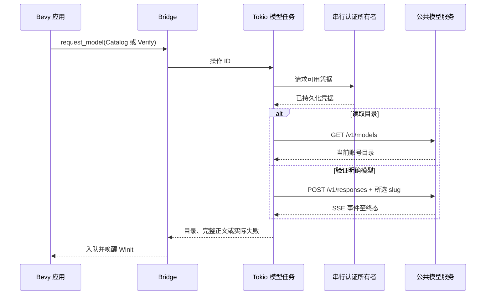

# 单次模型请求

模型通信位于 `agentelier_llm_model`，与串行认证所有者共用同一线程的 Tokio。网络任务通过 `agentelier_account::CredentialClient` 取得凭据，Account 在 Runtime 调度下串行处理请求并协调旋转和提交；模型任务不读取文件或维护第二套会话缓存。

运行侧 ModelControl 分开持有取消信号和实际回收信号；接纳操作后禁止新的恢复或浏览器登录，避免目录与推理跨账号混用。Bridge 独立记录模型操作 ID，与浏览器和退出操作区分。退出可越过互斥门控，先停止凭据接纳并取消模型任务，再等待 JoinHandle 回收，最后处理撤销和本地清理。普通关闭同样取消并回收模型任务，然后等待凭据所有者完成必要提交及 Tokio 结束。

模型任务取消只丢弃自己的网络/凭据等待 Future。已提交给认证所有者的刷新独立继续，不因等待者取消而丢失旋转结果。主窗口以真实终态结束等待；退出期间 Bridge 消费并隔离旧模型及认证结果。

模型目录保留全部可显示项目及服务顺序，用户显式选择 slug 后独立验证。每次操作取得当前可用凭据；认证恢复沿 AuthenticatedRequest 的一次恢复预算执行，通过 CredentialVersion 比较 client_id 和 subject，避免恢复到另一账号。HTTP 401 可在输出前触发恢复；输出项或文本开始后标记禁止重放。

SSE 解析器跨 HTTP 块保留当前行和事件数据，支持 LF、CRLF、CR、多行 data 及开头 BOM，空行才派发事件。只以完成对象的 output 数组为正文权威来源，按 message/content 顺序提取 output_text；增量仅用于标记输出已经开始。未完成、失败和显式错误独立传播，EOF 没有完成事件不成功。大小和时间限制见[请求边界](#请求边界)。

ModelFailure 保留分类、可取得的 HTTP 状态、结构化代码、请求标识与诊断文本。LLM Model Bridge (`agentelier_llm_model_bridge`) 将其转成自己的业务类型，应用不依赖 Agent 内部错误。日志记录操作、所选模型、耗时、状态和错误分类，不记录认证头、Token、模型正文或完整原始响应。

`chat_ui::ModelState` 保存目录、当前选择、操作及安全展示结果；BSN 构造模型 ComboBox、按钮、状态区与 WidgetryScrollArea。最终正文在 PostUpdate 的 UiSystems::Content 前更新，切换设置页不取消请求，返回时按当前投影重建。数据环境仍为启动时已占用的目录，更改下次目录不改变正在执行的请求。

Runtime (`agentelier_agent_runtime`) 负责 ModelControl、Tokio 任务启动、取消及 JoinHandle 回收，不实现 HTTP/SSE。Connection (`agentelier_bridge_connection`) 关联模型操作 ID，调用 LLM Model Bridge 转换结果并封装为 BridgeEventKind::Model。账号状态事件由 Account Bridge 独立转换；模型库依赖 Account、Prompts 和 Tools 的描述类型，不依赖 Login、Runtime 或 Bridge，也不执行工具。

## 请求边界

模型目录 JSON 响应上限为 4 MiB；SSE 单事件上限为 4 MiB，单次响应流累计上限为 16 MiB。超过上限返回实际失败，不截断为成功结果。

HTTP 连接期限为 15 秒。独立目录与连接验证请求的总期限为 120 秒；聊天生成没有总时限，使用 120 秒的流空闲期限，持续收到有效事件或心跳时可以继续等待。HTTP 429 不自动重试；401 的一次恢复仅允许发生在输出开始前。

## 显式模型准备

LLM Model 以 ModelRequest::Catalog 读取全部可显示模型，以 Verify 携带明确 slug、名称和可选 effort 执行固定输入验证。ModelResult 分别表达目录及验证回复；Runtime 共用一种可取消模型任务，LLM Model Bridge 转换自己的请求和结果类型，Connection 只分配并关联操作。chat_ui 独立持有目录与选择，login_ui 只依赖共享宿主的活动状态来禁用冲突的账号操作。

推理能力从目录的 supported_reasoning_levels 和 default_reasoning_level 解析；畸形能力数据或与支持列表不一致的默认值作为协议失败。UI 的 ReasoningSetting 区分 ServiceDefault 与 Effort，选择不进入账号状态。Bridge 逐字段转换可选 effort，LLM Model 只在显式值存在时序列化 reasoning.effort；验证回复带回实际提交设置，UI 不从服务是否成功反推使用了哪个档位。

聊天 GenerationRequest 额外携带固定的 InstructionSnapshot。生成前核对快照，并通过其统一 `messages()` 映射将基础覆盖及有序补充文本构造成 `developer` 输入消息，再追加 ProtocolHistory 和当前用户输入；基础与补充槽位不对应不同协议优先级。默认空配置保持原有请求行为。指令材料解析与保存归 Prompts，LLM Model 不读提示词文件，不在模型连接验证中自动注入准备区指令。

聊天请求携带会话冻结的 Function Tool 声明、自动选择和 `parallel_tool_calls: true`。新建 `gpt-6.2-sol` 会话把目录作为 `input` 首个 developer `additional_tools` 项，具备异步资格的叶子带 `async: true`。顶层 `tools` 字段省略。固定指令、记忆、技能、协议历史和本轮输入随原顺序排列，材料索引记录实际位置。其他模型和旧平铺会话沿用同步声明。HTTP 聊天使用 `store: false`、`stream: true` 和完整的 `input`，省略 `previous_response_id`。独立的目录与连接验证不附带工具。

SSE 函数参数增量只更新展示。模型层核对完整流项与 `response.completed.output` 的身份、名称、namespace、参数和异步模式。原生路径按无 namespace 的工具名称匹配冻结目录。返回 `async: true` 的调用需要相应声明，省略标志或返回 `false` 按同步处理。请求拒绝沿用实际服务错误。协议历史原样重放 `function_call`，并以 `call_id` 关联 `function_call_output`。普通工具使用有界 JSON 字符串，图片结果使用 `input_text` 和 `input_image` 内容数组。

历史允许完整响应和工具结果分开追加，并用原始调用身份校验结果的唯一性。准备请求时固定持久历史的位置、实际覆盖项和所含结果的 `call_id`。这些材料和已序列化的请求字节随本次请求保持固定。只有接纳本次完整合法响应才确认其中的结果已经用于成功请求。当前发送入口仍要求批次结果全部收齐。

图片 data URL 由协议适配根据不可变载荷的实际 MIME 与编码生成，detail 固定 high。完整请求通过 32 MiB 有界 Writer 序列化，预算计入 Base64、工具声明、指令与全部历史；超限为任务协议错误，不裁剪历史。发送使用已校验的序列化字节，不把内容数组二次转成字符串。DEBUG 只保留 call_id、MIME、尺寸、摘要、字节数和结构检查，禁止完整 Base64 或请求正文。

模型目录仅在实际 input_modalities 是非空字符串数组时取得明确图片能力，包含 image 为支持，不包含为不支持；缺失或无法解释为未知。该可选信息经 Bridge 和 UI 进入会话固定设置；未知不被推断为支持或拒绝。服务真实拒绝仍沿既有 HTTP 类别与请求标识返回，不自动换模型、账号或协议。

## 任务内固定执行身份

Turn Runner 首次请求前通过 CredentialClient 获取 ExecutionIdentity，捕获凭据版本的账号标识与本次认证生命周期的失效令牌。GenerationRequest 只包含模型、推理、指令、历史和工具设置，不含会话创建者。生成发送前与认证恢复后都核对任务身份；同主体正常 Token 续期可更换凭据版本，退出失效令牌或其他账号凭据不能用于旧任务。身份不实现 Debug/Reflect，也不持久化 Token。

新任务重新获取当前账号，保留原 Session UUID、固定设置与协议历史。服务拒绝旧不透明协议项或该模型权限时返回真实失败，不裁剪历史或替换模型。跨账号服务接受旧载荷的实际结果仍需授权切换账号后验证。

## 模型窗口能力与响应使用量

目录解析 context_window、max_context_window、effective_context_window_percent、auto_compact_token_limit 和实际提供的 comp_hash。优先 context_window，缺失再用 max；有效比例默认 95%，自动阈值为显式值与完整窗口 90% 的较小值。只有阈值时保留未知容量；非法、零值或矛盾字段形成真实协议错误，不按 slug 猜测窗口。每个任务用当前账号重读固定 slug 的目录，核对推理能力；缺窗口和阈值时在普通请求前失败，保留输入与历史。

完成与失败流事件保存实际 response usage，含输入、输出、总数、缓存输入、reasoning 输出及原始 usage；HTTP 失败中提供的合法用量也交给任务。缺失保持未知，畸形细项或不一致总数明确失败。服务端使用量与完整请求 32 MiB 字节限制、图片编码预算分别处理，缓存输入不从窗口计量中减去。

ProtocolHistory 按内容估算新增项，不累计 transport ID 或外层 JSON/Base64 转义成本。文字采用粗略字节启发式，图片与加密 reasoning 使用各自的近似规则；这些值始终标为估算，不宣称 tokenizer 精度或解密后的原文。规则依据 [Codex 模型能力](https://github.com/openai/codex/blob/main/codex-rs/protocol/src/openai_models.rs)与 [ContextManager](https://github.com/openai/codex/blob/main/codex-rs/core/src/context_manager/history.rs)。

## 服务端 Inline 压缩

聊天请求携带 `context_management=[{type: "compaction", compact_threshold: ...}]`。阈值取实际模型自动阈值与有效窗口的较小值，缺失自动阈值时使用有效窗口；低于服务要求的 1,000 token 或能力未知时拒绝启动。当前 API 地址、认证所有者、固定任务身份和请求设置不变，没有独立压缩请求、显式触发项或文本摘要备用路径。

SSE 允许 compaction 与助手、reasoning、function_call 混排，支持一份完整响应包含多个压缩项。每个压缩项验证非空 encrypted_content 及可选身份，并保留原始字段；最终 response.completed 的有序 output 是权威结果，流增量仍只用于展示和身份核对。压缩输出只投影阶段，不将密文显示或写入日志。生成失败、提前断流或无效项不会安装候选历史。

恢复时按原调用身份补齐唯一 output。存在 ToolReturned 时使用其已保存的载荷，缺失结果使用由登记或开始事实确定的中断说明。已开始发送且没有完整响应的请求保留未知结果，后续用户发送可以重放已保存的 output。完整响应先存档再执行工具。响应全部工具结果封闭后，Conversation 为有压缩项的响应准备检查点，Runner 等待同一存储写入者确认后安装。工作历史从最新安全 compaction 边界起保留后续原始顺序；若某压缩项前还有未封闭工具调用，则保留更早的调用前缀，避免结果成为孤项。原始响应、助手正文、工具事实与附件仍完整存档。固定指令和工具声明仍随每次请求提供，不写入工作历史重复累积。

发生压缩的响应 usage 保留为该次完整请求的用量事实，不作新窗口占用锚点。检查点清除旧锚点并估算当前活跃材料，后续无压缩响应可重新提供服务端锚点。压缩项的密文长度启发式仍只是估算，不等于解密后的 token 数。协议依据见 [Responses server-side compaction](https://developers.openai.com/api/docs/guides/compaction)。

## 项目指令请求记录

模型层 prepare 是唯一请求构造入口，输出私有冻结字节和 RequestProjection（工具契约、基础摘要、有序协议类型、载荷大小与 SHA-256）。generate 仅消费 PreparedGeneration，认证恢复使用同一字节。类型化项目项序列化为 user，基础保持 developer，完整请求保留 32 MiB 有界序列化。

generate 在进入 HTTP 发送阶段和取得响应头时分别发布 Sending 与 ResponseReceived，包括非成功 HTTP 状态。Runner 将这些事实交回运行时，Conversation 按当前 Turn 合并并生成待持久化的请求记录。认证内部重发使用同一请求身份与冻结字节，核对界面展示最近一次实际 HTTP 状态。

## Skills 调度材料

普通任务的 Skills 目录由 Runner 取得，Conversation 按当前 Turn 提供给 GenerationRequest。模型层不读取磁盘：固定 developer 指令之后、原始协议历史之前，每次请求只加入一份允许隐式调用的技能摘要。目录和原始工具结果分开保存，RequestProjection 记录其角色、input 索引、文本和摘要；有界序列化、请求准备持久确认及认证冻结字节重发沿用原有边界。Skill 目录不注册新 Tool，也不自动执行脚本或建立 MCP 连接。

显式 `$name` 的选中正文由 Skills 在任务启动时完整读取并由 Conversation 固定。GenerationRequest 携带已确定材料；模型层验证其正文摘要，然后在完整原始协议历史后按输入顺序注入独立 user 项。每个 SkillMaterial 保存来源路径、角色、input 索引、包装正文和摘要。正文不写回 ProtocolHistory，同一任务的多次准备引用相同快照，认证重发完全复用 PreparedGeneration 字节。

新会话绑定的长期记忆摘要在固定基础指令之后作为一条 developer 背景消息加入。RequestProjection 保存发布 ID、摘要 SHA-256、输入位置和实际包装正文。已有协议项的顺序与身份保持原样，认证重发继续发送原先冻结的字节。
