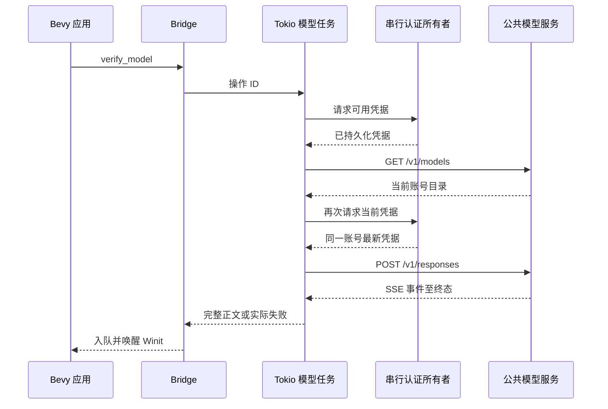

# 单次模型请求

模型通信位于 `agentelier_agent::model`，与串行认证所有者共用同一线程的 Tokio。网络任务通过 CredentialClient 取得凭据，认证循环继续接收请求并负责旋转和提交；模型任务不读取文件或维护第二套会话缓存。

运行侧 ModelControl 分开持有取消信号和实际回收信号；接纳操作后禁止新的恢复或浏览器登录，避免目录与推理跨账号混用。Bridge 独立记录模型操作 ID，与浏览器和退出操作区分。退出可越过互斥门控，先停止凭据接纳并取消模型任务，再等待 JoinHandle 回收，最后处理撤销和本地清理。普通关闭同样取消并回收模型任务，然后等待凭据所有者完成必要提交及 Tokio 结束。

模型任务取消只丢弃自己的网络/凭据等待 Future。已提交给认证所有者的刷新独立继续，不因等待者取消而丢失旋转结果。主窗口以真实终态结束等待；退出期间 Bridge 消费并隔离旧模型及认证结果。

模型目录采用当前账号服务顺序的首个公开项目。目录之后再次获取凭据，通过 CredentialVersion 的账号比较检查 client_id 和 subject；认证恢复沿 AuthenticatedRequest 的一次恢复预算执行。HTTP 401 可在输出前触发恢复；输出项或文本开始后标记禁止重放。

SSE 解析器跨 HTTP 块保留当前行和事件数据，支持 LF、CRLF、CR、多行 data 及开头 BOM，空行才派发事件。只以完成对象的 output 数组为正文权威来源，按 message/content 顺序提取 output_text；增量仅用于标记输出已经开始。未完成、失败和显式错误独立传播，EOF 没有完成事件不成功。大小和时间限制见[模型连接验证](../../features/model-request.md)。

ModelFailure 保留分类、可取得的 HTTP 状态、结构化代码、请求标识与诊断文本。Bridge 将其转成自己的业务类型，应用不依赖 Agent 内部错误。日志记录操作、所选模型、耗时、状态和错误分类，不记录认证头、Token、模型正文或完整原始响应。

`login_ui::ModelState` 仅保存当前操作及安全展示结果；BSN 构造按钮、状态区与 WidgetryScrollArea。最终正文在 PostUpdate 的 UiSystems::Content 前更新，切换设置页不取消请求，返回时按当前投影重建。数据环境仍为启动时已占用的目录，更改下次目录不改变正在执行的请求。
