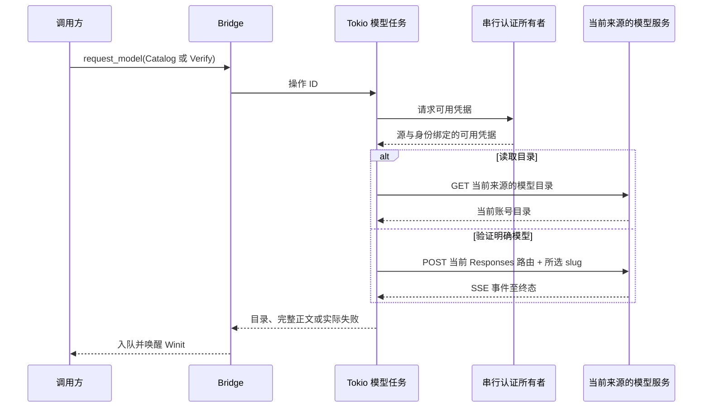

# 单次模型请求

模型通信位于 `agentelier_llm_model`，与串行认证所有者共用同一线程的 Tokio。网络任务通过 `agentelier_account::CredentialClient` 取得凭据，Account 从当前登录会话交付凭据，模型任务消费受身份约束的可用凭据。

运行侧 ModelControl 分开持有取消信号和实际回收信号。Bridge 分别关联模型及来源操作。凭据状态变化使旧身份失效，Runtime 等待旧任务和必要记录完成后发布新来源。普通关闭取消并回收模型任务及 Tokio。

模型任务取消会丢弃自己的网络和凭据等待。主窗口在运行侧确认真实终态后结束等待。

Codex OAuth 使用 `chatgpt.com/backend-api/codex/models` 和同域的 `responses`，目录请求携带 `client_version`，Codex 请求携带 `originator: agentelier` 和 `ChatGPT-Account-Id` 工作区头。Responses 和 Codex Images 使用同一 CredentialClient。Codex 目录只显示服务标记为可见、支持文本且可由普通客户端执行的模型，并保留服务顺序。Codex Responses 添加顶层 `instructions` 字段，固定指令仍按原顺序进入 `input`。

独立验证命令接收调用方提供的模型 slug。认证恢复沿 AuthenticatedRequest 的一次恢复预算执行。恢复要求取得同一主体和工作区的新 Token 版本。HTTP 401 可在输出前触发一次同源凭据恢复。Account 优先交付已有的新版本，否则启动共享续期。Codex Images 在收到成功响应之前应用同一规则。输出项或文本开始后禁止重放，请求原始字节在认证恢复期间保持固定。

SSE 解析器跨 HTTP 块保留当前行和事件数据，支持 LF、CRLF、CR、多行 data 及开头 BOM，空行才派发事件。只以完成对象的 output 数组为正文权威来源，按 message/content 顺序提取 output_text；增量仅用于标记输出已经开始。未完成、失败和显式错误独立传播，EOF 没有完成事件不成功。大小和时间限制见[请求边界](#请求边界)。

ModelFailure 保留分类、可取得的 HTTP 状态、结构化代码、请求标识与诊断文本。LLM Model Bridge (`agentelier_llm_model_bridge`) 将其转成自己的业务类型，应用不依赖 Agent 内部错误。日志记录操作、所选模型、耗时、状态和错误分类，不记录认证头、Token、模型正文或完整原始响应。

`chat_ui::ModelState` 保存当前账号的模型目录、操作 ID 和目录加载错误。账号可用后自动请求目录，结果用于创建会话和填充设置中的模型选项。请求使用本次启动时确定的数据目录。

Runtime (`agentelier_agent_runtime`) 负责 ModelControl、Tokio 任务启动、取消及 JoinHandle 回收。会话运行资源持有可复用的连接状态，Responses 传输由 LLM Model 实现。Connection (`agentelier_bridge_connection`) 关联模型操作 ID，调用 LLM Model Bridge 转换结果并封装为 BridgeEventKind::Model。账号状态事件由 Account Bridge 独立转换；模型库依赖 Account、Prompts 和 Tools 的描述类型，不依赖 Login、Runtime 或 Bridge，也不执行工具。

## 请求边界

模型目录 JSON 响应上限为 4 MiB；SSE 单事件上限为 4 MiB，单次响应流累计上限为 16 MiB。超过上限返回实际失败，不截断为成功结果。

HTTP 连接期限为 15 秒。独立目录与连接验证请求的总期限为 120 秒；聊天生成按 300 秒等待响应或检测流空闲，有效事件或心跳更新活动时间。HTTP 传输与 5xx 使用最多 4 次尝试，断流与明确的服务过载最多续接重试 5 次。认证恢复仍要求输出前的 401。

## 显式模型准备

LLM Model 以 ModelRequest::Catalog 读取全部可显示模型，以 Verify 携带明确 slug、名称和可选 effort 执行固定输入验证。ModelResult 分别表达目录及验证回复。Runtime 共用一种可取消模型任务，LLM Model Bridge 转换请求和结果类型，Connection 分配并关联操作。Chat UI 持有目录投影，login_ui 使用共享宿主活动状态禁用冲突的账号操作。

推理能力从目录的 supported_reasoning_levels 和 default_reasoning_level 解析。畸形能力数据或与支持列表不一致的默认值作为协议失败。Bridge 逐字段转换可选 effort，LLM Model 在显式值存在时序列化 reasoning.effort。验证回复带回实际提交设置。

聊天 GenerationRequest 额外携带固定的 InstructionSnapshot。生成前核对快照，并通过其统一 `messages()` 映射将基础覆盖及有序补充文本构造成 `developer` 输入消息，再追加 ProtocolHistory 和当前用户输入；基础与补充槽位不对应不同协议优先级。默认空配置保持原有请求行为。指令材料解析与保存归 Prompts，LLM Model 不读提示词文件，不在模型连接验证中自动注入准备区指令。

聊天请求携带会话冻结的 Function Tool 声明、自动选择和 `parallel_tool_calls: true`。固定指令、记忆、技能、协议历史和本轮输入随原顺序排列，材料索引记录实际位置。Codex 新建 `gpt-6-astra` 会话使用 WebSocket 的 `response.create` 和顶层 `tools`，具备异步资格的声明携带 `async: true`。其他模型和已有 Codex 平铺会话使用 HTTP 同步声明。HTTP 聊天使用 `store: false`、`stream: true` 和完整的 `input`，省略 `previous_response_id`。独立的目录与连接验证不附带工具。

SSE 和 WebSocket 共享 Responses 事件解析。函数参数增量只更新展示。模型层核对完整流项与 `response.completed.output` 的身份、名称、namespace、参数和异步模式。原生路径按无 namespace 的工具名称匹配冻结目录。返回 `async: true` 的调用需要相应声明，省略标志或返回 `false` 按同步处理。请求拒绝沿用实际服务错误。协议历史原样重放 `function_call`，并以 `call_id` 关联 `function_call_output`。普通工具使用有界 JSON 字符串，图片结果使用 `input_text` 和 `input_image` 内容数组。同步调用结果确认追加后才能构建下一次请求；未配对的异步调用保留在冻结请求中。请求在途期间到达的结果只确认保存，待响应接纳或请求停止后按保存序号追加。

新原生会话将同步的任务查询和等待随冻结工具目录发送。会话在构建请求时固定任务登记边界；模型通过后续完整请求引用列表公开的任务 ID。同批列表可以观察新任务，等待只能使用请求冻结时已有的任务。

历史允许完整响应和工具结果分开追加，并用原始调用身份校验结果的唯一性。准备请求时固定持久历史的位置、实际覆盖项和所含结果的 `call_id`。这些材料和已序列化的请求字节随本次请求保持固定。只有接纳本次完整合法响应才确认其中的结果已经用于成功请求。继续发送前需收齐同步调用的结果，开放的异步调用可以跨请求和 Turn。

图片 data URL 由协议适配根据不可变载荷的实际 MIME 与编码生成，detail 固定 high。完整请求序列化后冻结字节，保留 Base64、工具声明、指令和当前工作上下文。上下文按模型 token 窗口及压缩策略管理。工作窗口中配对的图片完整送模，压缩后按新的工作窗口发送。HTTP 使用冻结 JSON 的 zstd 传输编码，WebSocket 全量请求沿用同一冻结材料。WebSocket 续接从同一输入取新增项并保持内容数组原样。DEBUG 只保留 call_id、MIME、尺寸、摘要、字节数和结构检查，禁止完整 Base64 或请求正文。

模型目录仅在实际 input_modalities 是非空字符串数组时取得明确图片能力，包含 image 为支持，不包含为不支持；缺失或无法解释为未知。该可选信息经 Bridge 和 UI 进入会话固定设置；未知不被推断为支持或拒绝。服务真实拒绝仍沿既有 HTTP 类别与请求标识返回，不自动换模型、账号或协议。

模型目录另解析 `multi_agent_version`。构建子 Agent 模型覆盖时，LLM Model 只接纳当前目录中明确支持 V2 的模型，并要求显式档位在该模型的支持列表内。目录缺项、格式异常和覆盖拒绝各有独立结果。普通 Responses 请求继续使用显式选择的模型及其推理档位。

## Codex WebSocket 续接

Model 按当前 Codex 凭据发起 HTTPS Upgrade，沿用认证、TLS 和代理设置。每次请求仍冻结 `store: false` 的全量载荷，用于本地历史与预算核对。连接可在同一运行会话的连续 Turn 中复用。仅当冻结输入以前次已确认的完整输入和响应输出开头时，才发送 `previous_response_id` 和新增输入。当前请求重新携带该次适用的工具声明和压缩配置。工具结果以原 `call_id` 进入新增输入。

前缀变化时从全量冻结输入建立新响应链。连接关闭、来源失效或 Token 版本变化时旧响应 ID 不再参与请求。重开会话或换用新连接时可从已保存历史重放。网络断流时丢弃在途连接，用同一冻结输入重连，只有完整响应通过校验后才接纳历史和派发工具。会话选择的工具契约决定传输方式，WebSocket 会话保持该传输契约。

## 任务内固定执行身份

Turn Runner 首次请求前通过 CredentialClient 获取 ExecutionIdentity，捕获凭据版本的账号标识与本次认证生命周期的失效令牌。新建 Codex 会话时固定主体和工作区，冻结请求记录服务来源并将模型 slug 编入请求字节。生成发送、认证恢复和接纳响应时核对执行身份。同一授权主体和工作区可以使用新的 Token 版本，执行身份的失效令牌和原始凭据留在运行侧。

新任务重新获取当前账号，保留原 Session UUID、固定设置与协议历史。存档可在未连接时打开。缺少 Codex 绑定的旧会话保留 SIWC 请求和工具记录供查看。执行要求当前 Codex 主体及工作区匹配会话绑定。绑定缺失或不匹配时，界面提示新建会话。模型权限或旧协议项被服务拒绝时保留真实失败、原历史和原模型选择。

## 模型窗口能力与响应使用量

目录解析 context_window、max_context_window、effective_context_window_percent、auto_compact_token_limit 和实际提供的 comp_hash。优先 context_window，缺失再用 max；有效比例默认 95%，自动阈值为显式值与完整窗口 90% 的较小值。只有阈值时保留未知容量；非法、零值或矛盾字段形成真实协议错误，不按 slug 猜测窗口。每个任务用当前账号重读固定 slug 的目录，核对推理能力；缺窗口和阈值时在普通请求前失败，保留输入与历史。

完成与失败流事件保存实际 response usage，含输入、输出、总数、缓存输入、reasoning 输出及原始 usage；HTTP 失败中提供的合法用量也交给任务。缺失保持未知，畸形细项或不一致总数明确失败。服务端使用量与图片编码预算分别处理，缓存输入仍计入窗口用量。

ProtocolHistory 按内容估算新增项，不累计 transport ID 或外层 JSON/Base64 转义成本。文字采用粗略字节启发式，图片与加密 reasoning 使用各自的近似规则；这些值始终标为估算，不宣称 tokenizer 精度或解密后的原文。规则依据 [Codex 模型能力](https://github.com/openai/codex/blob/main/codex-rs/protocol/src/openai_models.rs)与 [ContextManager](https://github.com/openai/codex/blob/main/codex-rs/core/src/context_manager/history.rs)。

## 服务端 Inline 压缩

冻结请求记录精确的开放调用集合。集合为空时，聊天请求携带 `context_management=[{type: "compaction", compact_threshold: ...}]`。开放调用或已接受的单次无压缩继续使本次请求省略该配置，冻结后状态变化不改写请求。已经交付 session_id 的函数调用已闭合，进程是否存活不参与判断。阈值取实际模型自动阈值与有效窗口的较小值，缺失自动阈值时使用有效窗口；低于服务要求的 1,000 token 或能力未知时拒绝启动。当前 API 地址、认证所有者、固定任务身份和请求设置不变，没有独立压缩请求、显式触发项或文本摘要备用路径。

Responses 流允许 compaction 与助手、reasoning、function_call 混排，支持一份完整响应包含多个压缩项。每个压缩项验证非空 encrypted_content 及可选身份，并保留原始字段；最终 response.completed 的有序 output 是权威结果，流增量仍只用于展示和身份核对。压缩输出只投影阶段，密文仅保留在协议存档。冻结时已有未配对调用，或者输出在新调用之后才给出压缩项，都会使整个完整响应在正常接纳前失败。单次无压缩继续中收到压缩项同样失败。

恢复时按原调用身份补齐唯一 output。存在 ToolReturned 时使用其已保存的载荷，缺失结果使用由登记或开始事实确定的中断说明。已开始发送且没有完整响应的请求保留未知结果，后续用户发送可以重放已保存的 output。完整响应先存档再执行工具。Conversation 在接纳合法响应后为安全压缩准备检查点。Runner 等待单写入者确认后才安装工作窗口和派发该响应的新调用。压缩项之后的开放调用和检查点冻结后的尾部保留原始顺序。原始响应、助手正文、工具事实与附件仍完整存档。固定指令和工具声明仍随每次请求提供，不写入工作历史重复累积。

发生压缩的响应 usage 保留为该次完整请求的用量事实，不作新窗口占用锚点。检查点清除旧锚点并估算当前活跃材料，后续无压缩响应只有在用量覆盖连续历史前缀时才成为服务端锚点。压缩项的密文长度启发式仍只是估算，不等于解密后的 token 数。协议依据见 [Responses server-side compaction](https://developers.openai.com/api/docs/guides/compaction)。

## 项目指令请求记录

模型层 prepare 是唯一请求构造入口，输出私有冻结字节和 RequestProjection（工具契约、基础摘要、有序协议类型、载荷大小与 SHA-256）。generate 仅消费 PreparedGeneration，认证恢复使用同一字节。重试清理当前尝试的流式预览，已有工具结果留在历史，Stop 可以取消等待。类型化项目项序列化为 user，基础保持 developer。请求在开放调用闭合后恢复 Inline 压缩。

generate 在进入发送阶段后发布 Sending，HTTP 收到响应头后发布实际状态，WebSocket 成功发送后记录已升级的传输状态。Runner 将这些事实交回运行时，Conversation 按当前 Turn 合并并生成待持久化的请求记录。HTTP 认证重发复用原始字节。WebSocket 在重新认证并建立新连接后使用同一冻结载荷的全量输入。

## Skills 调度材料

普通任务的 Skills 目录由 Runner 取得，Conversation 按当前 Turn 提供给 GenerationRequest。模型层不读取磁盘：固定 developer 指令之后、原始协议历史之前，每次请求只加入一份允许隐式调用的技能摘要。目录和原始工具结果分开保存，RequestProjection 记录其角色、input 索引、文本和摘要；请求准备持久确认及认证恢复沿用相同的冻结字节。Skill 目录不注册新 Tool，也不自动执行脚本或建立 MCP 连接。

显式 `$name` 的选中正文由 Skills 在任务启动时完整读取并由 Conversation 固定。GenerationRequest 携带已确定材料；模型层验证其正文摘要，然后在完整原始协议历史后按输入顺序注入独立 user 项。每个 SkillMaterial 保存来源路径、角色、input 索引、包装正文和摘要。正文不写回 ProtocolHistory，同一任务的多次准备引用相同快照，认证重发完全复用 PreparedGeneration 字节。

新会话绑定的长期记忆摘要在固定基础指令之后作为一条 developer 背景消息加入。RequestProjection 保存发布 ID、摘要 SHA-256、输入位置和实际包装正文。已有协议项的顺序与身份保持原样，认证重发继续发送原先冻结的字节。

用户消息使用 Responses 内容数组。请求准备从正式会话附件加载工作历史中的用户图片，以内容数组中的图片标签与完整文本的编号相对应。冻结的请求复用已读取的字节，诊断只记录附件描述符和占位位置。
